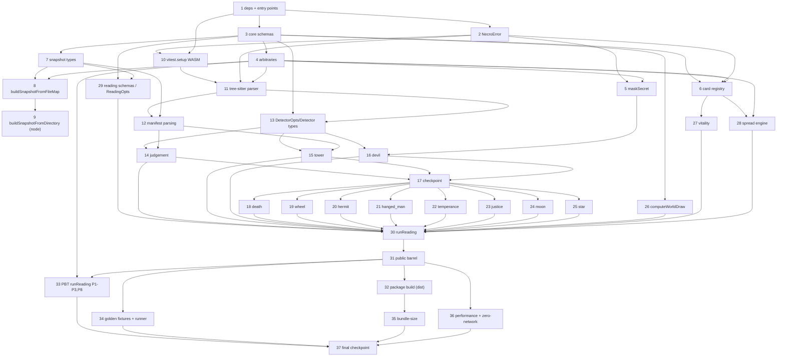

# Implementation Plan: Oracle Deck Engine (`packages/oracle`)

## Overview

This implementation plan realizes the Oracle Deck Engine design exactly, as a pure-TypeScript library in `packages/oracle`. It proceeds foundation-first and test-first, keeping the package typechecking and runnable after every few tasks, and finishes with golden fixtures and non-functional verification (bundle size, performance, zero-network).

## Implementation Plan

This plan builds the pure-TypeScript Oracle Deck Engine incrementally and test-first: foundation (deps, entry points, errors, schemas, shared property-test arbitraries, masking), then the tree-sitter parser, snapshot builders, manifest parsing, each of the eleven snapshot detectors (each its own test-first task), the world/vitality/spread pure functions, the `runReading` orchestrator, the package build, golden fixtures, and finally the non-functional verification (bundle size, performance, zero-network). The package typechecks and runs tests after every few tasks. All external data (registry freshness, OSV, repo meta) is injected as parameters — no task performs a network call and no task requires secrets in the repo (R21.2).

## Tasks

- [x] 1. Configure package dependencies and dual entry points
  - Add runtime deps to `packages/oracle/package.json`: `zod`, `web-tree-sitter`, `tree-sitter-python`, `smol-toml`; add dev dep `fast-check`; use the built-in `crypto.randomUUID` (no `uuid` dep).
  - Configure `exports` map with two entry points: `"."` → `./src/index.ts` (browser-safe main) and `"./node"` → `./src/node.ts` (Node-only).
  - Create empty placeholder `src/node.ts` that will re-export `buildSnapshotFromDirectory`; keep `src/index.ts` compiling.
  - Ensure `tsconfig.json` has `"strict": true`; confirm `pnpm --filter @necro/oracle typecheck` passes.
  - _Requirements: R2.3, R21.3, R21.4_

- [x] 2. Create NecroError and error code constants
  - [x] 2.1 Implement `src/util/errors.ts`
    - Define `NecroErrorCodeSchema` (zod enum) and `NecroError` class with `code`, `userMessage` (oracle voice), and optional `cause` per the design Data Models section.
    - Export all codes: `REGISTRY_INVALID`, `CARD_NOT_FOUND`, `PARSER_INIT_FAILED`, `FILE_TOO_LARGE`, `INVALID_QUERY_PATTERN`, `SNAPSHOT_DIR_NOT_FOUND`, `INVALID_REPO_META`, `DETECTOR_FAILED`.
    - _Requirements: R1.3, R1.5, R1.6, R3.2, R3.6, R3.8, R2.4, R11.1, R19.4_
  - [x] 2.2 Write unit tests for `NecroError`
    - Assert `code`, `userMessage`, `cause`, and `name === "NecroError"` are set; assert `message` equals `userMessage`.
    - _Requirements: R1.3_

- [x] 3. Define core primitive zod schemas
  - Implement `src/registry/schema.ts`: `CardIdSchema` (12-member enum), `SeveritySchema`, `EvidenceSchema`, `CardDefinitionSchema`, `CardDrawSchema`, `SpreadPositionSchema`, `GateIdSchema`, `VerdictSchema`, with inferred types exported.
  - _Requirements: R1.2, R2.1, R5.4, R16.1_

- [x] 4. Create shared property-test arbitraries
  - Implement `packages/oracle/test/arbitraries.ts`: `arbRepoRef`, `arbFileEntry`, `arbRepoMeta`, `arbRepoSnapshot`, `arbCardDraw`, `arbCardDrawArray`, `arbSha`, `arbPythonSource`, `arbLargeFileMap` per the design.
  - The card/draw/sha/python-source arbitraries (`arbCardDraw`, `arbCardDrawArray`, `arbSha`, `arbPythonSource`) depend only on the core primitive schemas (task 3) and are available immediately for the earliest `[PBT]` tasks (masking, registry, file-map, parser).
  - The snapshot-oriented arbitraries (`arbRepoSnapshot`, `arbRepoMeta`, `arbFileEntry`, `arbRepoRef`, `arbLargeFileMap`) reference the snapshot types defined in task 7 and may be authored incrementally once those types exist; wire them up as the snapshot types land.
  - Provides the fast-check arbitraries consumed by all downstream `[PBT]` tasks.
  - _Requirements: R21.5_

- [x] 5. Implement secret masking utility
  - [x] 5.1 Write unit tests for `maskSecret` (test-first)
    - Length ≥ 4 → first 4 chars + `"****"`; length < 4 → `"****"`; verify AWS/private-key inputs are reduced.
    - _Requirements: R20.1, R20.4_
  - [x] 5.2 Implement `src/util/mask.ts` `maskSecret(value: string): string`
    - _Requirements: R20.1, R20.4_
  - [x] 5.3 [PBT] Write property tests for masking — P8, P9
    - **Property 9: Secret masking length invariant** — len ≥ 4 ⇒ exactly 8 chars; len < 4 ⇒ `"****"`.
    - **Property 8: No raw secrets in evidence** — `maskSecret` output never matches `/AKIA[0-9A-Z]{16}/` or private-key headers (the evidence-side of P8 is re-checked in the runReading PBT).
    - **Validates: Requirements R20.1, R20.2, R20.3, R20.4** / **Properties: P8, P9**

- [x] 6. Implement the card registry
  - [x] 6.1 Write unit tests for the registry (test-first)
    - Assert exactly 12 cards with correct ids/numerals; `getCard` happy path and `CARD_NOT_FOUND` sad path; weights match R18.3 (`star`/`world` = 0); duplicate `id` or `numeral` throws `REGISTRY_INVALID` at load.
    - _Requirements: R1.1, R1.2, R1.4, R1.5, R1.6, R18.3_
  - [x] 6.2 Implement `src/registry/cards.ts`
    - Build the 12 `CardDefinition` entries, validate each with `CardDefinitionSchema` at module load, guard against duplicate `id`/`numeral`, throw `NecroError(REGISTRY_INVALID)` on failure before any export is usable.
    - Export `CARD_REGISTRY: ReadonlyMap<CardId, CardDefinition>` and `getCard(id)`.
    - Set weights: judgement 20, tower 15, devil 18, death 10, wheel 12, hermit 5, hanged_man 8, temperance 7, justice 6, moon 9, star 0, world 0; set `linkedGrimoireIds` (e.g. judgement → `["py2to3","pyproject"]`).
    - _Requirements: R1.1, R1.2, R1.3, R1.4, R1.5, R1.6, R5.6, R18.3_
  - [x] 6.3 [PBT] Write property tests for registry weights — P4, P14
    - **Property 4: Severity/orientation consistency** across generated `CardDraw` arrays.
    - **Property 14: Registry weight consistency** — star/world-only draws score 100; any weighted severity reduces below 100.
    - **Validates: Requirements R1.2, R18.3, R5.2, R5.3** / **Properties: P4, P14**

- [x] 7. Define snapshot types and schemas
  - Implement `src/snapshot/types.ts`: `RepoRefSchema`, `LangSchema`, `FileEntrySchema`, `RepoMetaSchema`, `OversizeFileItemSchema`, `RepoSnapshotSchema`, the runtime `RepoSnapshot` type (adds `contents: Map<string,string>`), and the `GitHubSnapshotBuilder` interface.
  - _Requirements: R2.1, R2.2, R2.8, R11.1_

- [x] 8. Implement `buildSnapshotFromFileMap` (browser-safe)
  - [x] 8.1 Write unit tests for the file-map builder (test-first)
    - Lang assigned by extension (`.py`/`.js`/`.ts`/`.html`/other); 1 MB oversize files land in `oversizeFiles` and are absent from `contents`; > 5000 files → first 5000 lexicographic, `truncated: true`; ≤ 5000 → `truncated: false`; `createdAt` equals the supplied `opts.createdAt` (builder never calls `Date.now()`); default neutral `meta` applied when omitted.
    - _Requirements: R2.1, R2.2, R2.5, R2.6, R2.7_
  - [x] 8.2 Implement `src/snapshot/builder-file-map.ts`
    - Accept `(ref, files, opts: { meta?, createdAt })`, build `FileEntry[]` + `contents` Map, apply size filter and file cap, set `truncated`, default `meta` to neutral values.
    - Export from `src/index.ts`.
    - _Requirements: R2.1, R2.2, R2.5, R2.6, R2.7_
  - [x] 8.3 [PBT] Write property tests for the file-map builder — P12, P13
    - **Property 12: Snapshot file cap enforced** — > 5000 keys ⇒ `truncated === true` and `files.length <= 5000`.
    - **Property 13: Oversize files skipped** — > 1 MB entries absent from `contents`, present in `oversizeFiles`.
    - **Validates: Requirements R2.6, R2.7** / **Properties: P12, P13**

- [x] 9. Implement `buildSnapshotFromDirectory` on the Node-only entry
  - [x] 9.1 Write unit tests for the directory builder (test-first)
    - Reads an existing temp directory into a snapshot; missing/inaccessible path rejects with `NecroError(SNAPSHOT_DIR_NOT_FOUND)`; honours explicit `createdAt`.
    - _Requirements: R2.3, R2.4_
  - [x] 9.2 Implement `src/snapshot/builder-directory.ts` and wire `src/node.ts`
    - Read files via Node `fs`, delegate shaping to `buildSnapshotFromFileMap`; re-export `buildSnapshotFromDirectory` from `src/node.ts` only (never from `src/index.ts`, keeping the main bundle `fs`-free).
    - _Requirements: R2.3, R2.4_

- [x] 10. Create the Vitest WASM setup file
  - Create `packages/oracle/vitest.setup.ts` calling `await initParser()` in `beforeAll`; register it via `setupFiles` in `vitest.config.ts` so all tests use the real on-disk WASM grammar (no network).
  - The setup file imports `initParser` from the parser module; it is sequenced immediately before the parser task (task 11) so that import resolves once the parser skeleton exists, and the parser implementation (task 11.2) satisfies the import. The parser test sub-task (11.1) depends on this setup file being in place.
  - _Requirements: R3.1, R21.5, R21.6_

- [x] 11. Implement the tree-sitter parser
  - [x] 11.1 Write unit tests for the parser (test-first)
    - Depends on the Vitest WASM setup file (task 10) so the on-disk grammar is initialised in `beforeAll`.
    - `parsePython` returns a `module`-root `Tree` for valid py2/py3; invalid UTF-8 → best-effort non-null tree (no throw); byte length > 1 MB → `FILE_TOO_LARGE`; `queryPython` invalid S-expr → `INVALID_QUERY_PATTERN`; `hasLegacyPythonNodes` true for `print_statement`, `exec_statement`, `except E, e`, `<>`, `10L` (`/[Ll]$/`), `0777` (`/^0[0-7]+$/`), and backtick repr (including the `ERROR`-node fallback); false for clean py3.
    - _Requirements: R3.1, R3.3, R3.4, R3.5, R3.6, R3.7, R3.8_
  - [x] 11.2 Implement `src/parser/tree-sitter.ts`
    - `initParser()` lazy singleton (idempotent; resets `initPromise` on failure → `PARSER_INIT_FAILED`); synchronous `parsePython` (throws `PARSER_INIT_FAILED` if called before init, `FILE_TOO_LARGE` over 1 MB); `queryPython` (`INVALID_QUERY_PATTERN`); `hasLegacyPythonNodes` with the 7 legacy indicators and the `ERROR`-node backtick fallback. No side effects at import time.
    - _Requirements: R3.1, R3.2, R3.3, R3.4, R3.5, R3.6, R3.7, R3.8, R21.6_
  - [x] 11.3 [PBT] Write property tests for the parser — P15
    - **Property 15: `hasLegacyPythonNodes` is false for clean Python 3** using `arbPythonSource`.
    - **Validates: Requirements R3.7** / **Properties: P15**

- [x] 12. Implement manifest parsing
  - [x] 12.1 Write unit tests for manifest parsing (test-first)
    - `requirements*.txt` → `ParsedDependency[]` (name/versionSpec/extras); `setup.py` parsed via AST only and never executed (`install_requires`, `python_requires`, `classifiers`, `name`; dynamic fields omitted); `pyproject.toml` (`[project]` + `[tool.poetry]`); `Pipfile`; `package.json`; invalid content → `{ parsed: false, parseError, dependencies: [] }`; `detectPythonVersion` priority (setup.py classifiers > pyproject requires-python > Pipfile) with `"unknown"` fallback.
    - _Requirements: R4.1, R4.2, R4.3, R4.4, R4.5, R4.6, R4.7, R4.8_
  - [x] 12.2 Implement `src/parser/manifest.ts`
    - `ParsedDependencySchema`, `ManifestSchema`, `PythonVersionSignalSchema`; `parseAllManifests(snapshot)` (uses `opts.trees`-style pre-parse via `parsePython` internally for setup.py AST, TOML via `smol-toml`, JSON for package.json); `detectPythonVersion(manifests)`.
    - _Requirements: R4.1, R4.2, R4.3, R4.4, R4.5, R4.6, R4.7, R4.8_

- [x] 13. Define the shared `DetectorOpts` and `Detector` types
  - Add `DetectorOpts` (`registryData?`, `osvData?`, `now`, `trees`, `parseErrors`) and the `Detector` function type to the detectors barrel; add `RegistryEntry`/`RegistryData` and `OsvVulnerability`/`OsvData` shapes used by Tower/Devil.
  - _Requirements: R6.6, R7.6, R19.2, R21.2_

- [x] 14. Implement `detectJudgement` (XX — Dead Runtime)
  - [x] 14.1 Write unit tests (test-first)
    - py2 syntax → drawn; py2-only manifests → severity 3 upright; straddling (`six`/`__future__`/2to3 shims) → severity 1 reversed (precedence over R5.2); evidence per construct type with first-occurrence path/line; no Python files and no Python manifests → null; vendor/.tox/node_modules/site-packages excluded.
    - _Requirements: R5.1, R5.2, R5.3, R5.4, R5.5, R5.6_
  - [x] 14.2 Implement `src/detectors/judgement.ts`
    - Read pre-parsed trees from `opts.trees` (never call `parsePython`); skip `opts.parseErrors` paths; use `hasLegacyPythonNodes` + `detectPythonVersion`; set `linkedGrimoireIds = ["py2to3","pyproject"]`.
    - _Requirements: R5.1, R5.2, R5.3, R5.4, R5.5, R5.6_

- [x] 15. Implement `detectTower` (XVI — Rotting Dependencies)
  - [x] 15.1 Write unit tests (test-first)
    - Yanked/deprecated/py2-only/≥2 majors behind → severity 2 upright; unpinned or exactly 1 major behind → severity 1 reversed; clean → null; dependency missing from injected `registryData` is skipped (no evidence, not a staleness signal); evidence carries name/versionSpec/detail.
    - _Requirements: R6.1, R6.2, R6.3, R6.4, R6.5, R6.6, R6.7_
  - [x] 15.2 Implement `src/detectors/tower.ts`
    - Pure; consume injected `opts.registryData` only (no network, R6.6/R21.2); leftmost-non-zero-segment major comparison.
    - _Requirements: R6.1, R6.2, R6.3, R6.4, R6.5, R6.6, R6.7_

- [x] 16. Implement `detectDevil` (XV — Security Sins)
  - [x] 16.1 Write unit tests (test-first)
    - Dangerous patterns (`eval`, `exec(`, `pickle.loads`, `yaml.load` w/o `Loader=`, `shell=True`, `os.system`, `verify=False`, weak-hash near secret names) in prod → severity 2 upright; test/example-only → severity 1 reversed; secret patterns (AWS key, private-key headers, high-entropy assignments) masked in evidence with no raw value retained; injected `osvData` → one `kind:"osv"` evidence each; none → null.
    - _Requirements: R7.1, R7.2, R7.3, R7.4, R7.5, R7.6, R7.7, R20.2, R20.3_
  - [x] 16.2 Implement `src/detectors/devil.ts`
    - Read pre-parsed trees from `opts.trees` (never call `parsePython`); skip `opts.parseErrors`; call `maskSecret` immediately on raw secrets and apply the safety-net re-mask to any `Evidence.detail` matching AWS/private-key patterns.
    - _Requirements: R7.1, R7.2, R7.3, R7.4, R7.5, R7.6, R7.7, R20.2, R20.3_

- [x] 17. Checkpoint — runnable core
  - Ensure all tests pass and `pnpm --filter @necro/oracle typecheck` is clean; ask the user if questions arise.

- [x] 18. Implement `detectDeath` (XIII — Dead Code)
  - [x] 18.1 Write unit tests (test-first)
    - Unreachable modules (excluding entrypoint candidates) → severity 2 upright, up to 20 lexicographic paths; ≥ 5 unused top-level symbols → severity 2, up to 20 ordered items; large commented-out valid-Python blocks (≥ 5 lines) → severity 1 reversed when no unreachable modules, else additional evidence; nothing → null.
    - _Requirements: R8.1, R8.2, R8.3, R8.4, R8.5_
  - [x] 18.2 Implement `src/detectors/death.ts`
    - Build the intra-repo import graph from `opts.trees` (skip `opts.parseErrors`); never call `parsePython`.
    - _Requirements: R8.1, R8.2, R8.3, R8.4, R8.5_

- [x] 19. Implement `detectWheel` (X — No Tests)
  - [x] 19.1 Write unit tests (test-first)
    - Zero test files → severity 2 upright; tests present but no runner config → severity 1 reversed; tests + ≥ 1 runner config → null; evidence has exact count, up to 10 lexicographic paths, detected config names; dedup of multi-pattern matches.
    - _Requirements: R9.1, R9.2, R9.3, R9.4, R9.5_
  - [x] 19.2 Implement `src/detectors/wheel.ts`
    - _Requirements: R9.1, R9.2, R9.3, R9.4, R9.5_

- [x] 20. Implement `detectHermit` (IX — Missing Documentation)
  - [x] 20.1 Write unit tests (test-first)
    - No root README → severity 2 upright; README < 200 bytes or missing keyword → severity 1 reversed with sub-condition evidence; docstring coverage < 0.25 with ≥ 4 public symbols adds a coverage evidence item; unparseable py file → parse-error evidence and excluded from coverage; clean → null.
    - _Requirements: R10.1, R10.2, R10.3, R10.4, R10.5_
  - [x] 20.2 Implement `src/detectors/hermit.ts`
    - Docstring coverage from `opts.trees` (skip `opts.parseErrors`); never call `parsePython`.
    - _Requirements: R10.1, R10.2, R10.3, R10.4, R10.5_

- [x] 21. Implement `detectHangedMan` (XII — Stagnation)
  - [x] 21.1 Write unit tests (test-first)
    - Invalid `meta` → `NecroError(INVALID_REPO_META)`; archived → severity 2 upright; > 730 days + ≥ 3 open issues → severity 2 upright (archived precedence); reversed ranges `(183,730]` or (openPRCount ≥ 3 and oldestOpenPRAgeDays ≥ 180) → severity 1 reversed; active ≤ 183 days + openPRCount < 3 → null; evidence fields present; uses `opts.now` (no `Date.now()`).
    - _Requirements: R11.1, R11.2, R11.3, R11.4, R11.5, R11.6_
  - [x] 21.2 Implement `src/detectors/hanged-man.ts`
    - _Requirements: R11.1, R11.2, R11.3, R11.4, R11.5, R11.6_

- [x] 22. Implement `detectTemperance` (XIV — No CI / Dead CI)
  - [x] 22.1 Write unit tests (test-first)
    - No CI → severity 2 upright with `kind:"no-ci-found"`; Travis-only → severity 1 reversed; any non-Travis provider → null; `.github/workflows/` depth exactly one level; evidence lists paths + provider names.
    - _Requirements: R12.1, R12.2, R12.3, R12.4, R12.5_
  - [x] 22.2 Implement `src/detectors/temperance.ts`
    - _Requirements: R12.1, R12.2, R12.3, R12.4, R12.5_

- [x] 23. Implement `detectJustice` (XI — Missing License)
  - [x] 23.1 Write unit tests (test-first)
    - `licenseKey` NOASSERTION/null → severity 2 upright (precedence); no license file + valid key → severity 2 upright; exactly 1 file + valid key → null; > 1 distinct file + valid key → severity 1 reversed; evidence reports only detected paths + observed key; never suggests a license.
    - _Requirements: R13.1, R13.2, R13.3, R13.4, R13.5, R13.6_
  - [x] 23.2 Implement `src/detectors/justice.ts`
    - _Requirements: R13.1, R13.2, R13.3, R13.4, R13.5, R13.6_

- [x] 24. Implement `detectMoon` (XVIII — Complexity and Illusion)
  - [x] 24.1 Write unit tests (test-first)
    - ≥ 2 files > 1000 lines or any nesting depth > 6 → severity 2 upright (precedence); else exactly 1 large file or > 10 confusion markers → severity 1 reversed; none → null; evidence records path + exact line count / depth / marker count; multi-marker line counted once.
    - _Requirements: R14.1, R14.2, R14.3, R14.4, R14.5, R14.6_
  - [x] 24.2 Implement `src/detectors/moon.ts`
    - Nesting depth computed from `opts.trees` (skip `opts.parseErrors`); never call `parsePython`.
    - _Requirements: R14.1, R14.2, R14.3, R14.4, R14.5, R14.6_

- [x] 25. Implement `detectStar` (XVII — Hope and Strengths)
  - [x] 25.1 Write unit tests (test-first)
    - Strength score 0–5 (license, tests, CI, README, recent push); ≥ 3 → severity 2 upright; 1–2 → severity 1 reversed; 0 → null; one evidence item per factor with name/contributed/observed value; null `pushedAt` contributes 0; uses `opts.now`.
    - _Requirements: R15.1, R15.2, R15.3, R15.4, R15.5_
  - [x] 25.2 Implement `src/detectors/star.ts`
    - _Requirements: R15.1, R15.2, R15.3, R15.4, R15.5_

- [x] 26. Implement `computeWorldDraw` (XXI — Destiny)
  - [x] 26.1 Write unit tests (test-first)
    - REVIVED → world severity 2 upright; UNDEAD → world severity 1 reversed; STILL_DEAD → null; non-null draws include vitalityDelta + passed/failed gate ids as evidence.
    - _Requirements: R16.1, R16.2, R16.3, R16.4, R16.5_
  - [x] 26.2 Implement `src/detectors/world.ts`
    - _Requirements: R16.1, R16.2, R16.3, R16.4, R16.5_

- [x] 27. Implement vitality scoring
  - [x] 27.1 Write unit tests (test-first)
    - `computeVitality` formula `Math.round(Math.max(0, 100 - Σ(weight×severity)))`; empty/all-null → 100; sum > 100 → 0; `computeVitalityDelta(before, after) === after - before`.
    - _Requirements: R18.1, R18.2, R18.3, R18.4, R18.5, R18.6_
  - [x] 27.2 Implement `src/scoring/vitality.ts`
    - _Requirements: R18.1, R18.2, R18.3, R18.4, R18.5, R18.6_
  - [x] 27.3 [PBT] Write property tests for vitality — P7, P10
    - **Property 7: Vitality monotonic** — lowering severities never lowers vitality.
    - **Property 10: Vitality bounds** — always an integer in `[0,100]`.
    - **Validates: Requirements R18.1, R18.2, R18.3, R18.4, R18.5** / **Properties: P7, P10**

- [x] 28. Implement the spread engine
  - [x] 28.1 Write unit tests (test-first)
    - Fates (3) / necropsy (5) / celtic (10) exact counts and labels; necropsy selection rules (Corpse/Wound/Shadow/Hope/Call, "no ritual can be performed"); void sentinel fill; no duplicate `CardId`; identical result for same `(draws, kind, sha)`; djb2 SHA-seeded tiebreak determinism.
    - _Requirements: R17.1, R17.2, R17.3, R17.4, R17.5, R17.6, R17.7, R17.8_
  - [x] 28.2 Implement `src/spread/assign.ts`
    - Pure `assignSpread` with djb2 hash tiebreak, void sentinel, `Set<CardId>` no-duplicate guard.
    - _Requirements: R17.1, R17.2, R17.3, R17.4, R17.5, R17.6, R17.7, R17.8_
  - [x] 28.3 [PBT] Write property tests for spreads — P5, P6, P11
    - **Property 5: No duplicate card in spread.**
    - **Property 6: Primary position holds most severe** (necropsy "The Corpse").
    - **Property 11: Spread count invariant** (3/5/10).
    - **Validates: Requirements R17.2, R17.3, R17.4, R17.7** / **Properties: P5, P6, P11**

- [x] 29. Define reading schemas and `ReadingOpts`
  - Implement the schema section of `src/reading/run.ts`: `SpreadKindSchema`, `ReadingOptsSchema` (default `"necropsy"`, optional `registryData`/`osvData`, required `now`), `ReadingSchema` (id UUID, repo, draws, spread, vitality, createdAt, engineVersion, errors).
  - _Requirements: R19.2, R19.5_

- [x] 30. Implement the `runReading` orchestrator
  - [x] 30.1 Write unit tests (test-first)
    - Happy path end-to-end; `initParser` called once then all `.py` parsed once into `trees`/`parseErrors`; `Promise.allSettled` isolates a throwing detector into `errors[]` while others complete; `createdAt === opts.now`; `engineVersion` from package.json; non-Python-only snapshot completes with Python detectors returning null (R21.8).
    - _Requirements: R19.1, R19.2, R19.3, R19.4, R19.5, R21.8_
  - [x] 30.2 Implement `src/reading/run.ts` `runReading`
    - Parse `.py` files once (feeding `DetectorOpts.trees`/`parseErrors`), run `parseAllManifests`, run the 11 detectors via `Promise.allSettled`, filter nulls, `assignSpread`, `computeVitality`, assemble `Reading` with `createdAt = opts.now` and `id = crypto.randomUUID()`; propagate `PARSER_INIT_FAILED` as a whole-reading failure.
    - _Requirements: R19.1, R19.2, R19.3, R19.4, R19.5, R21.8_

- [~] 31. Wire the public barrel (`src/index.ts`)
  - Re-export all public types, schemas, registry, parser, builders (file-map only), manifest fns, the 11 detectors, `computeWorldDraw`, `assignSpread`, vitality fns, `runReading`, `maskSecret`, `NecroError`; confirm no `fs` import reaches the main entry and `src/node.ts` re-exports only `buildSnapshotFromDirectory`.
  - _Requirements: R2.3, R21.3_

- [~] 32. Configure the package build to emit `dist/index.js` and `dist/node.js`
  - Configure `packages/oracle` so `pnpm --filter @necro/oracle build` (tsc, per the existing `build` script) emits `dist/index.js` and `dist/node.js` along with their `.d.ts` declaration files; ensure `tsconfig.json` `outDir`/`declaration` produce both entry outputs.
  - Update `package.json` `exports` so production consumers resolve the built `dist` outputs while dev continues to use `src`: set `types` and `import` conditions for both the `"."` subpath (`dist/index.js` + `dist/index.d.ts`) and the `"./node"` subpath (`dist/node.js` + `dist/node.d.ts`); document the `development`/`default` condition split so `src` remains the dev entry.
  - Confirm `pnpm --filter @necro/oracle build` produces `dist/index.js`, `dist/node.js`, and their declarations, and that the main `"."` entry stays `fs`-free.
  - _Requirements: R21.3, R21.4, R21.7_

- [~] 33. [PBT] Write the `runReading` orchestrator property tests — P1, P2, P3
  - **Property 1: Determinism** — same snapshot + opts (fixed `now`) → identical `Reading`.
  - **Property 2: Detector never throws** — all errors captured in `Reading.errors`.
  - **Property 3: Evidence paths exist** — every `Evidence.path` is a key in `snapshot.contents`.
  - Also assert the P8 evidence-side: no `Evidence.detail` matches AWS/private-key patterns.
  - **Validates: Requirements R17.8, R19.1, R19.4, R21.8, R2.1, R5.4, R20.2, R20.3** / **Properties: P1, P2, P3, P8**

- [ ] 34. Create golden fixtures and the golden test runner
  - [~] 34.1 Author fixture snapshots and expected readings
    - Create under `packages/oracle/fixtures/`: `py2-only`, `straddling`, `no-tests`, `no-license`, `archived`, `clean`, `secrets`, each with `snapshot.json` (file map + `RepoRef` + `RepoMeta` + `createdAt`) and `expected-reading.json`.
    - _Requirements: R5.2, R5.3, R7.4, R9.2, R11.2, R13.3, R15.2_
  - [~] 34.2 Implement the golden test runner
    - For each fixture, build via `buildSnapshotFromFileMap(ref, files, { meta, createdAt })`, run `runReading(snapshot, { spreadKind: "necropsy", now })`, deep-equal against `expected-reading.json` excluding only `id`; verify `secrets` fixture evidence is masked.
    - _Requirements: R19.1, R19.5, R20.2_

- [~] 35. Add bundle-size verification for the main entry
  - Depends on the package build task (task 32) so `dist/index.js` and `dist/node.js` exist to measure.
  - Add `@size-limit/preset-small-lib` dev dep and a `size-limit` config (`dist/index.js`, 50 KB gzipped) plus a `pnpm size` script; exempt `dist/node.js`; document that the tree-sitter WASM file is loaded separately and excluded.
  - _Requirements: R21.3, R21.7_

- [~] 36. Add the performance check
  - Add a test/script that builds a ≤ 500-file snapshot with pre-fetched (injected) `registryData`/`osvData` and asserts `runReading` completes within 5000 ms p50; assert zero outbound network calls occur (R21.2) and no secrets are required.
  - _Requirements: R21.1, R21.2_

- [~] 37. Final checkpoint — full verification
  - Run `pnpm --filter @necro/oracle typecheck`, `pnpm --filter @necro/oracle test`, `pnpm size`, and the performance check; ensure 100% passing with zero network/LLM/sandbox calls; ask the user if questions arise.
  - _Requirements: R21.4, R21.5_

## Notes

- All unit and property-based (`[PBT]`) test sub-tasks are MANDATORY; there are no optional test tasks. Both the test sub-tasks and the core implementation sub-tasks must be implemented.
- `[PBT]` tasks implement fast-check property tests; each names its P-number(s) and the requirement clauses it validates, per the testing steering rule.
- Shared fast-check arbitraries live in `packages/oracle/test/arbitraries.ts` (task 4) and are available to every downstream `[PBT]` task; the snapshot-oriented arbitraries are filled in once the snapshot types land (task 7).
- Every tree-sitter detector reads pre-parsed `Tree` objects from `opts.trees` and skips `opts.parseErrors` — detectors never call `parsePython` themselves (that happens once in `runReading`).
- No task performs a network, LLM, or sandbox call; all external data (registry freshness, OSV, repo meta) is injected as parameters, and no task requires secrets in the repository (R21.2).

## Task Dependency Graph



```json
{
  "waves": [
    { "id": 0, "tasks": ["1"] },
    { "id": 1, "tasks": ["2.1", "3", "10"] },
    { "id": 2, "tasks": ["2.2", "4", "11.1"] },
    { "id": 3, "tasks": ["5.1", "7", "11.2"] },
    { "id": 4, "tasks": ["5.2", "6.1", "8.1", "11.3", "13"] },
    { "id": 5, "tasks": ["5.3", "6.2", "8.2", "9.1", "12.1"] },
    { "id": 6, "tasks": ["6.3", "8.3", "9.2", "12.2"] },
    { "id": 7, "tasks": ["14.1", "15.1", "16.1", "26.1", "27.1", "28.1"] },
    { "id": 8, "tasks": ["14.2", "15.2", "16.2", "26.2", "27.2", "28.2"] },
    { "id": 9, "tasks": ["18.1", "19.1", "20.1", "21.1", "22.1", "23.1", "24.1", "25.1", "27.3", "28.3"] },
    { "id": 10, "tasks": ["18.2", "19.2", "20.2", "21.2", "22.2", "23.2", "24.2", "25.2", "29"] },
    { "id": 11, "tasks": ["30.1"] },
    { "id": 12, "tasks": ["30.2"] },
    { "id": 13, "tasks": ["31"] },
    { "id": 14, "tasks": ["32", "33", "34.1", "36"] },
    { "id": 15, "tasks": ["34.2", "35"] }
  ]
}
```
