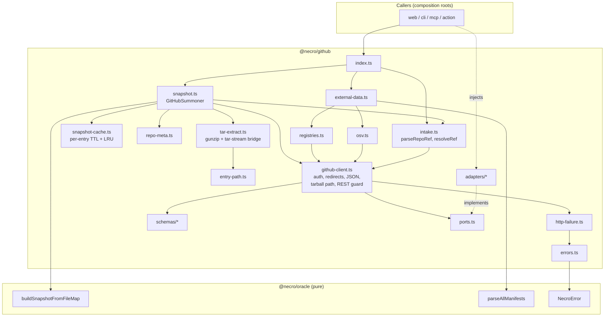

# Design Document: GitHub Summoner (`packages/github`)

## Overview

The GitHub Summoner is the `@necro/github` adapter. It turns a public GitHub repository reference (`owner/repo`, `https://github.com/owner/repo`, optionally with a ref) into the two things `runReading` from `@necro/oracle` needs:

1. a `RepoSnapshot` (via a single tarball download, in-memory extraction, and `buildSnapshotFromFileMap`), and
2. the injectable external data (`RegistryData` for the Tower, `OsvData` for the Devil) plus a list of skipped dependencies.

It implements the `GitHubSnapshotBuilder` interface that `@necro/oracle` already defines (`build(ref: RepoRef): Promise<RepoSnapshot>`) and adds the pieces that interface leaves out: a pure reference parser, a ref resolver, a metadata mapper, and the external-data fetcher.

Design stance, in priority order:

- **Repository code is data.** Nothing extracted is executed, imported, evaluated, or written to disk. The tarball lives in memory as streamed chunks and text strings.
- **Every side effect is a port.** HTTP, time, and environment arrive through `FetchPort`, `ClockPort`, and `EnvPort`. No global `fetch`, `Date.now()`, zero-argument `new Date()`, or `process.env` appears in package logic. Every test runs offline against recorded fixtures.
- **Caps are layered and independent of the tar library.** Compressed bytes (50 MB), decompressed tar-stream bytes (200 MB), and entry count (100,000) are enforced by our own stream guards. The 1 MB per-file and 5000-file caps stay in `buildSnapshotFromFileMap` and are never reimplemented.
- **Quota-frugal and token-aware.** Without a `GITHUB_TOKEN` the archive comes straight from `codeload.github.com` with no Authorization header and zero REST calls. With a token it comes from the `api.github.com` tarball endpoint plus at most one redirect to codeload. A summon makes at most 5 REST calls (4 in the normal case, the fifth reserved for a rename redirect), and the client enforces that with a hard guard.
- **Honest degradation.** The two optional REST calls (open pull requests, latest release) degrade to the neutral defaults `RepoMeta` already defines when they fail with a `5xx`, a timeout, or a connection-level network error, and the failed call is named in the public `degradedFields` list (`pulls` | `release`). Per-dependency registry/OSV failures land in `skipped`. The reading never fails because a registry or an optional metadata call was slow. A rate limit or `401` (on any call, optional ones included), a missing repo or ref, a rejected token, an outage or timeout on the repo, commit, or tarball request, or a size cap fails loudly with a typed `NecroError`.
- **Public repositories only.** A repository the API reports as `private: true` is refused before any content is downloaded.

### What this spec changes outside `packages/github`

| Package | Change | Why |
|---|---|---|
| `@necro/oracle` | Add 10 codes to `NecroErrorCodeSchema` in `packages/oracle/src/util/errors.ts` (additive, no logic change) | R7.1; see "Decision D1" |
| `@necro/config` | Add env schema with optional `GITHUB_TOKEN` | R6.1 |
| root `eslint.config.js` | Restricted-syntax block for `packages/github/src` (bans `Date.now()` and zero-argument `new Date()`, allows `new Date(ms)`) | R9.1–R9.3 enforcement |
| `docs/ARCHITECTURE.md` (new), `docs/KIRO_USAGE.md` | New adapter section, dated usage entry | Docs discipline |

Full list with exact versions is in "Required Changes to Other Packages".

---

## Architecture

### Dependency direction

```
oracle  ←  grimoires  ←  coven  ←  (web, cli, mcp-server, action)
  ↑                         ↑
  └── github (adapter) ─────┘   injected into coven/web/cli via ports
```

`@necro/github` imports from `@necro/oracle` (types, `NecroError`, `buildSnapshotFromFileMap`, `parseAllManifests`) and from third-party libraries (`zod`, `tar-stream`). `@necro/oracle` never imports `@necro/github`. The package imports `@necro/oracle` only through its `src/index.ts` entry. It does not use the Node-only `./node` entry, so it stays free of `fs`. The one Node built-in it uses is `node:stream` (`Readable.fromWeb`) inside `tar-extract.ts` to bridge web streams to `tar-stream`.

`@necro/github` does **not** import `@necro/config`. `EnvPort` is defined here, and composition roots (web, CLI, Action) wire it to the validated config. This keeps adapters independent of each other and keeps `process.env` out of package logic.

### Module layout

Kebab-case files, matching the `structure` steering (`intake.ts`, `snapshot.ts`, `osv.ts`, `registries.ts` are the four named public facades; `delivery.ts` belongs to a later spec and is not created here).

```
packages/github/
  package.json
  tsconfig.json
  vitest.config.ts
  fixtures/                        recorded API JSON; tarballs are built in-memory by test helpers
    api/<case>/{repo,commit,pulls,release}.json
    registry/{pypi,npm,osv}/<case>.json
  src/
    index.ts                       sole public entry (R10.1)
    ports.ts                       FetchPort, ClockPort, EnvPort, FetchTransportError
    constants.ts                   caps, hosts, timeouts, defaults (SCREAMING_SNAKE)
    errors.ts                      SummonerError, error factory, message catalog, redaction
    http-failure.ts                pure classifier: (failure, ctx, nowMs) → SummonerError | DegradedOutcome
                                   (DegradedOutcome only for optional pulls/release 5xx, timeout, network)
    intake.ts                      parseRepoRef (pure), resolveRef
    github-client.ts               auth + redirect policy, JSON reads, tarball path selection,
                                   REST call counter and hard budget guard (5)
    repo-meta.ts                   mapRepoMeta (pure)
    entry-path.ts                  normalizeEntryPath, isVendoredPath, isBinarySample (pure)
    tar-extract.ts                 capped streaming gunzip + tar-stream decode → ExtractedTree
    snapshot-cache.ts              SnapshotCache (per-entry TTL + LRU, ClockPort-driven), effectiveTtlMs
    snapshot.ts                    GitHubSummoner (implements GitHubSnapshotBuilder), createSummoner
    registries.ts                  PyPI + npm fetch and map → RegistryData
    osv.ts                         OSV querybatch + vuln detail fetch and map → OsvData
    external-data.ts               fetchExternalData orchestrator (dedupe, pool, skipped)
    time.ts                        parseIsoMs, isoFromMs, daysBetween (pure; no clock reads:
                                   isoFromMs formats a ClockPort instant with new Date(ms), allowed by R9.2)
    schemas/
      github.ts  pypi.ts  npm.ts  osv.ts
    adapters/                      the ONLY place allowed to touch globals (lint-exempt)
      system-fetch.ts              FetchPort over global fetch (redirect: "manual", AbortSignal.timeout)
      system-clock.ts              ClockPort over Date.now()
    testing/                       fixture-backed ports and tar builders (not exported from index)
      fixture-fetch.ts  fixed-clock.ts  make-tar-gz.ts  raw-tar.ts
```

Tests sit next to the code (`*.test.ts`, `*.pbt.test.ts`), per the `structure` steering.

### Component diagram



### Summon sequence

```mermaid
sequenceDiagram
    participant C as Caller
    participant S as GitHubSummoner
    participant K as SnapshotCache
    participant G as api.github.com
    participant X as codeload.github.com

    C->>S: summon("owner/repo#ref")
    S->>S: parseRepoRef (pure)
    S->>G: 1. GET /repos/{o}/{r}
    Note over S,G: only this first call may follow ONE 301/307/308<br/>to https://api.github.com (rename); the followed hop<br/>counts as a REST call (D2)
    G-->>S: repo payload (zod-validated, canonical owner/name)
    Note over S: private:true → REPO_PRIVATE, stop.<br/>All later requests use the canonical owner/name.
    S->>G: 2. GET /repos/{canon}/commits/{ref}
    G-->>S: sha (40 lowercase hex) or 404/422 → REF_NOT_FOUND
    S->>K: get(canonOwner/canonName@sha)
    alt hit and age < entry's effective TTL
        K-->>S: cached SummonResult
        S-->>C: result (no further network)
    else miss or expired
        par metadata
            S->>G: 3. GET /pulls?state=open&sort=created&direction=asc&per_page=1 (optional)
            S->>G: 4. GET /releases/latest (optional)
            Note over S,G: 5xx, timeout, or network error on 3 or 4 → neutral RepoMeta<br/>+ degradedFields, summon continues. 401/403/429 on 3 or 4 stay fatal.
        and tarball (variant chosen by token presence)
            alt no GITHUB_TOKEN
                S->>X: GET /{o}/{r}/tar.gz/{sha} (no Authorization, no REST call)
                X-->>S: 200 tar.gz stream (any redirect → VALIDATION_FAILED)
            else GITHUB_TOKEN present
                S->>G: GET /repos/{o}/{r}/tarball/{sha} (Authorization: Bearer)
                G-->>S: 302 Location: https://codeload.github.com/...
                S->>X: GET (no Authorization)
                X-->>S: 200 tar.gz stream (a second redirect → VALIDATION_FAILED)
            end
        end
        S->>S: capped gunzip + tar-stream decode → text file map
        S->>S: buildSnapshotFromFileMap(ref, files, {meta, createdAt})
        S->>K: set(key, result, { ttlMs: min(configured TTL, 600 000) if degradedFields non-empty, else configured TTL })
        S-->>C: result
    end
```

The tarball request is never a REST call on either variant, so it does not count toward the budget of 5 and does not touch `restCallCount`. A summon uses 4 REST calls (repo, commit, pulls, release); the fifth slot is headroom reserved for the rename redirect hop. A degraded pulls or release call was still sent, so it counts as a REST call exactly like a successful one, and it is never retried.

### Key design decisions

**D1. New error codes are added to `@necro/oracle`'s enum (not a package-local extension).**
`NecroError.code` is typed as `NecroErrorCode`, the inferred union of a closed `z.enum`. Two options satisfy R7.1:

- *Option A: extend `NecroErrorCodeSchema` in `packages/oracle/src/util/errors.ts`* with the 10 codes (`INVALID_REPO_URL`, `REPO_NOT_FOUND`, `REPO_PRIVATE`, `RATE_LIMITED`, `NETWORK_TIMEOUT`, `DOWNLOAD_TOO_LARGE`, `VALIDATION_FAILED`, `REF_NOT_FOUND`, `AUTH_INVALID`, `UPSTREAM_UNAVAILABLE`).
- *Option B: a package-local enum in `@necro/github`.*

Option B cannot work while still honouring "each raised error is an instance of `NecroError`". A subclass cannot widen `readonly code: NecroErrorCode` to a wider union (TypeScript rejects the override), and `new NecroError("INVALID_REPO_URL", …)` does not compile against the closed union. Casting around it would defeat the type that makes the enum useful. Option B would also scatter error vocabulary: web, CLI, and MCP all need one exhaustive `switch` over codes to render in-world errors.

**Choice: Option A.** The change is additive (10 string literals), has no logic, adds no import to `oracle`, and does not violate dependency direction, because `oracle` gains strings and not a reference to the adapter. The existing `errors.test.ts` iterates `NecroErrorCodeSchema.options`, so the new codes are covered automatically. The user-facing message catalog stays in `@necro/github` (`errors.ts`), because the wording belongs to the adapter that knows the failure context. This also sets the precedent the sandbox, LLM, and ledger specs will follow.

To carry machine-readable context (wait minutes, HTTP status) without changing `NecroError`'s shape, the package raises `SummonerError extends NecroError` with a read-only `details` object. Callers that only know `NecroError` keep working.

**D2. Redirects are never followed by the adapter. The client follows at most one rename redirect, on the first repo call only, and enforces a hard REST budget.**
`FetchPort` is contractually `redirect: "manual"`. The client decides whether a `Location` is acceptable and re-evaluates the header policy for the new target on every hop (R3.12, R6.3). The policy has four rules:

1. *Where.* Only the first `GET /repos/{owner}/{repo}` of an operation may be redirected. `getJson` takes `allowRepoRedirect: true` for that one call; every other REST call has it `false`, and a 3xx there is `VALIDATION_FAILED` (R2.9).
2. *What.* The client follows at most one `301`, `307`, or `308`, and only when `Location` parses to scheme `https`, hostname exactly `api.github.com`, and the default port (a same-host path such as `/repositories/{id}`). The header policy is re-applied to the new request (Bearer when a token exists, since the host is still `api.github.com`). Any other status (`302`, `303`), any other host or scheme, or a second redirect is `VALIDATION_FAILED` and no further request is sent (R2.8, R2.9).
3. *Canonical identity.* After a redirect (or none), the validated response body is the source of truth: `owner.login` and `name` (cross-checked against `full_name`) become the `RepoRef` `owner` and `name`, the cache key, every later REST path, and the tarball URL (R2.4). The user's spelling and the redirect path are never trusted.
4. *Budget.* The followed hop is a REST call and increments `restCallCount` (R2.10). A hard guard throws before a request is sent when `restCallCount` would exceed `REST_CALL_BUDGET = 5` (`VALIDATION_FAILED`, reason `rest-budget-exceeded`; an internal-invariant failure, not a user-facing condition). Normal operation uses 4 calls, so the guard is dormant unless a redirect plus a design bug pushes past the budget (R4.8).

The tarball request has its own, separate redirect rule (token path: one redirect to `https://codeload.github.com`, no auth; no-token path: none expected, any redirect refused). That rule is in "GitHub client".

**D3. Gzip uses web streams; tar decoding uses `tar-stream@3.2.2`; caps are ours.**
`tar-stream` is the single tar library: mature, pure JavaScript, zero native code, and its `extract()` stream hands us entries one at a time. The extractor consumes it through the **event form** `extract.on("entry", (header, stream, next) => ...)` with an explicit `next()`, not through the async-iterator form. The task 1 spike on `tar-stream@3.2.2` found that `for await (const entry of extract)` does not block on an unconsumed entry: its `next()` auto-drains and discards the previous entry, so sequential delivery and the "every skipped entry is drained by us" discipline would no longer be ours to guarantee. Only the event form blocks until `next()` is called after the body is consumed (`stream.resume()` to drain). The same spike confirmed that pax global (`g`) and extended (`x`) headers and GNU long names resolve into `header.name` and never surface as entries, and that destroying the extract stream and the `Readable.fromWeb` bridge cancels the upstream reader and stops pulling (a guard error placed before the bridge does the same). The pipeline is `body → compressed guard → DecompressionStream("gzip") → uncompressed guard → Readable.fromWeb → tar.extract()`. Byte-counting `TransformStream` guards sit before and after the decompressor, upstream of `tar-stream`, so a decompression bomb is stopped by our code regardless of how the tar library buffers or discards, and every byte of a skipped entry is counted toward the compressed, uncompressed, and entry-count caps. Details of the bridge, entry consumption, and cancellation are in "Tarball extraction". Version check (`pnpm view tar-stream versions --json`): the latest 3.x is `3.2.2`, so it is pinned exactly. Spike finding (task 21): destroying `extract` with an error also makes the in-flight entry stream emit `error`, so every entry handler must attach `stream.on("error", ...)` first (see "Tarball extraction").

**D4. Oversize text files are represented by one shared sentinel string.**
`buildSnapshotFromFileMap` is the only place the 1 MB cap lives (R3.8), but it measures strings it is handed. Holding up to 200 MB of text just so the builder can measure and discard it would waste memory. When an entry's declared size exceeds 1 MiB and its first 8000 bytes are text, the extractor passes a single module-level string of 1 MiB + 1 bytes under that path. The builder then records the path in `oversizeFiles` exactly as it would for the real content, and the retained file map stays small. The sentinel never reaches `snapshot.contents` because the builder drops oversize files.

**D5. Snapshot cache stores `SummonResult`, returns shallow copies.**
`runReading` assigns `snapshot.manifests = parseAllManifests(snapshot)`. Returning the cached object itself would let one reading mutate another's snapshot. The cache returns `{ ...snapshot }` (a new top-level object sharing the read-only `files`/`contents`), so the assignment is local. In-flight builds for the same key share one promise, so concurrent summons do not download twice. Failures are never cached.

*Degraded results get a short TTL (R8.11 to R8.14).* A result whose `degradedFields` is non-empty carries neutral `RepoMeta` values for the failed optional calls. Caching those for 7 days would freeze the neutral values for a commit long after the outage ended. The summoner therefore chooses the entry's TTL when it stores the result: `effectiveTtlMs = degradedFields.length > 0 ? min(configuredTtlMs, DEGRADED_TTL_MS) : configuredTtlMs`, with `DEGRADED_TTL_MS = 600_000` (10 minutes). Taking the minimum means a longer configured or default TTL never overrides the degraded TTL, while a caller-configured TTL shorter than 10 minutes still wins. The cache stays generic: it stores a per-entry TTL passed to `set` and knows nothing about `degradedFields`. Freshness uses the same strictly-less-than rule against the injected `ClockPort` (R8.13), and an expired degraded entry is simply absent, so the next summon repeats the `pulls` and `release` calls and replaces the entry under the TTL its new result earns (R8.14).

**D6. OSV is queried only for exactly-pinned dependencies.**
The Devil turns every injected `OsvVulnerability` into evidence. A version-less OSV query returns every advisory ever filed against the package, including ones fixed years before the pinned version. That would put false evidence on a card, which violates "the cards cannot lie". The fetcher therefore queries OSV only when the manifest pins an exact version (`==1.2.3` for PyPI, `1.2.3`/`=1.2.3` for npm). Other dependencies are reported in `skipped` with reason `version-not-pinned`.

**D7. Time is read once per operation.**
`ClockPort` exposes only `nowMs()`. Each `build` reads it once; `createdAt`, the PR age arithmetic, and the cache entry timestamp derive from that single reading, so they cannot disagree. ISO strings are produced by `isoFromMs(ms)` (`new Date(ms).toISOString()`), which formats an instant that came from `ClockPort` and never reads the system clock. R9.2 explicitly permits this; `Date.now()` and zero-argument `new Date()` stay forbidden (Q5, resolved).

---

## Components and Interfaces

### Ports (`ports.ts`)

```typescript
export interface FetchRequest {
  readonly url: string;                       // absolute https URL, host already allow-listed by the client
  readonly method: "GET" | "POST";
  readonly headers: Readonly<Record<string, string>>;
  readonly body?: string;                     // JSON string for POST
  readonly timeoutMs: number;                 // adapter enforces (AbortSignal.timeout)
  readonly redirect: "manual";                // adapters MUST NOT follow redirects
  readonly signal?: AbortSignal;              // caller-initiated cancel (sibling failed)
}

export interface FetchResponse {
  readonly status: number;
  readonly headers: Readonly<Record<string, string>>; // lower-cased names
  readonly body: ReadableStream<Uint8Array> | null;
}

export type FetchPort = (req: FetchRequest) => Promise<FetchResponse>;

/** Thrown by FetchPort adapters for transport-level failure; never a NecroError. */
export class FetchTransportError extends Error {
  readonly kind: "timeout" | "network";
  constructor(kind: "timeout" | "network", message: string, cause?: unknown);
}

export interface ClockPort {
  nowMs(): number;                            // epoch milliseconds
}

export interface EnvPort {
  get(key: "GITHUB_TOKEN"): string | undefined;
}

export interface SummonerDeps {
  readonly fetch: FetchPort;
  readonly clock: ClockPort;
  readonly env: EnvPort;
}
```

An adapter that returns a response must give the client a body it can cancel. The client always consumes or cancels the body, so connections are released.

### Constants (`constants.ts`)

```typescript
export const MAX_COMPRESSED_BYTES = 52_428_800;      // 50 MB   (R3.9)
export const MAX_UNCOMPRESSED_BYTES = 209_715_200;   // 200 MB  (R3.10)
export const MAX_ENTRIES = 100_000;                  //         (R3.11)
export const BINARY_SNIFF_BYTES = 8000;              // NUL within first 8000 bytes (R3.6)
export const TEXT_FILE_CEILING_BYTES = 1_048_576;    // mirrors the oracle cap; used ONLY to decide
                                                     // whether to pass the oversize sentinel (D4)
export const REST_CALL_BUDGET = 5;                   // R4.8; hard guard in GitHubClient (D2).
                                                     // Excludes the tarball download, includes a followed rename redirect
export const DEFAULT_TTL_MS = 604_800_000;           // 7 days  (R8.5)
export const DEGRADED_TTL_MS = 600_000;              // 10 minutes (R8.11); cap on the effective TTL of an
                                                     // entry whose degradedFields is non-empty
export const DEFAULT_MAX_CACHE_ENTRIES = 20;         //         (R8.7)
export const TIMEOUT_REST_MS = 15_000;
export const TIMEOUT_TARBALL_MS = 40_000;            // keeps a summon under the ~50 s serverless guard
export const TIMEOUT_EXTERNAL_MS = 10_000;           // hard ceiling for registry/OSV (R5.4)
export const EXTERNAL_CONCURRENCY = 8;
export const MAX_REGISTRY_QUERIES = 300;
export const MAX_OSV_DETAIL_FETCHES = 200;
export const OSV_BATCH_SIZE = 1000;
export const MAX_REST_JSON_BYTES = 2_097_152;        // 2 MiB
export const MAX_REGISTRY_JSON_BYTES = 10_485_760;   // 10 MiB (large PyPI/npm documents)
export const MAX_OSV_JSON_BYTES = 5_242_880;         // 5 MiB

export const GITHUB_API_HOST = "api.github.com";
export const GITHUB_AUTH_HOSTS: ReadonlySet<string> = new Set(["github.com", "api.github.com"]);
export const CODELOAD_HOST = "codeload.github.com";   // direct tarball host (no token) and the only
                                                     // permitted redirect target of the token path
export const EXTERNAL_HOSTS: ReadonlySet<string> =
  new Set(["pypi.org", "registry.npmjs.org", "api.osv.dev"]);

/** Path segments marking vendored or VCS data. Matched against any segment of the stripped path. */
export const VENDORED_SEGMENTS: ReadonlySet<string> =
  new Set(["node_modules", ".git", "vendor", "third_party", "bower_components", "site-packages"]);
```

The numeric caps are *defaults*. `ExtractionLimits` (below) is injectable so property tests can use tiny limits and finish in milliseconds, with one smoke test pinning the default literals.

### Reference parsing and resolution (`intake.ts`)

```typescript
export const ParsedRepoRefSchema: z.ZodType<ParsedRepoRef>;
export interface ParsedRepoRef {
  readonly host: "github.com";                // always normalized (R1.5)
  readonly owner: string;                     // original case preserved (R1.1/1.2)
  readonly name: string;                      // ".git" suffix removed
  readonly ref: string | null;                // branch, tag, or sha; null when absent (R1.4)
}

/** Pure. Throws SummonerError { code: "INVALID_REPO_URL" }. No network, clock, or env (R1.10). */
export function parseRepoRef(input: string): ParsedRepoRef;

export interface IntakeDeps {
  readonly client: GitHubClient;
}

/**
 * Resolve to an immutable commit (R2). Calls: repo + commit = 2 REST calls, plus the one
 * followed rename redirect if the repo call is redirected (never more than 5 per operation).
 * The returned RepoRef carries the CANONICAL owner/name from the validated repo payload (R2.4).
 */
export function resolveRef(parsed: ParsedRepoRef, deps: IntakeDeps): Promise<RepoRef>;

/** Same, but also returns the validated repo payload so build() does not fetch it again. */
export function resolveRefDetailed(
  parsed: ParsedRepoRef,
  deps: IntakeDeps,
): Promise<{ ref: RepoRef; repo: GhRepo }>;
```

`resolveRef` is the exported function from R10.3. `resolveRefDetailed` is exported only for `GitHubSummoner`'s use and is not part of `index.ts`.

**Grammar implemented by `parseRepoRef`** (steps run in this order):

1. Reject if the input is not a string, longer than 2048 characters, or empty after trimming whitespace (R1.6, R1.9).
2. Trim; strip all trailing `/` characters.
3. If the string matches `^[A-Za-z][A-Za-z0-9+.-]*://` it is a **URL form**; otherwise it is **shorthand**.
4. *URL form.* Parse with `new URL(...)`. Reject unless the protocol is `http:` or `https:`, the hostname (lower-cased) is `github.com` or `www.github.com`, there is no userinfo (`user:pass@`, which could carry a token), and the port is empty (R1.5, R1.7). Split `pathname` on `/`, dropping the empty first segment. Accept exactly `[owner, repo]` or `[owner, repo, "tree", ...refSegments]`. The ref is `refSegments` percent-decoded and re-joined with `/`, because branch names contain slashes. Any other shape (for example `/issues`) is rejected. Query string and fragment are ignored.
5. *Shorthand.* Split into a head and an optional ref at the **first** `#` or `@`: `owner/repo`, `owner/repo#ref`, `owner/repo@sha`. The ref is everything after that first delimiter. The head must be exactly two non-empty `/`-separated segments (R1.9).
6. Strip one trailing `.git` from the repository name (R1.6).
7. Validate `owner` and `name` against `^[A-Za-z0-9_.-]+$`, and reject `.` and `..` (R1.8).
8. Validate a present ref: non-empty, at most 255 characters, no whitespace or control characters, no `..` segment, no leading `-` or `/`, none of `\ ? * [ ~ ^ :` (conservative subset of git ref rules; also keeps it safe in a URL path). A ref that is 40 hex characters of any case is lower-cased.
9. Return `{ host: "github.com", owner, name, ref }`.

Every rejection raises `INVALID_REPO_URL` with a *reason code* (`foreign-host`, `bad-scheme`, `has-credentials`, `missing-owner`, `missing-name`, `bad-characters`, `bad-ref`, `empty`, `unsupported-path`). The `userMessage` states the reason code and never echoes the raw input, so a pasted `https://ghp_…@github.com/…` cannot leak.

**Ref resolution** uses the single `commits/{ref}` endpoint, which accepts a branch, tag, full SHA, or partial SHA:

- No ref: take `repo.default_branch` from call 1 and request `commits/{default_branch}`.
- Explicit ref: request `commits/{ref}` (each path segment `encodeURIComponent`-encoded, `/` preserved).
- Full 40-hex ref: after the response, assert the returned `sha` equals the requested value, which is the existence check required by R2.3.
- Partial SHA: the response `sha` is the expanded 40-character form.

`defaultBranch` is always `repo.default_branch`, regardless of which ref was requested (R2.4). Both responses pass through zod before any field is read (R2.5, R2.6).

**Canonical owner and name (R2.4, D2).** The `ParsedRepoRef` owner/name are only the spelling the user typed and the path of call 1. `resolveRefDetailed` builds `RepoRef.owner` and `RepoRef.name` from the validated repo payload (`owner.login` and `name`; `full_name` must equal `owner.login + "/" + name`, else `VALIDATION_FAILED`). This normalizes case (`Octocat/hello-world` → `octocat/Hello-World`) and renames. Call 2 (`commits/{ref}`) and every later request use the canonical pair, never the user's spelling. Call 1 is issued with `allowRepoRedirect: true`; if GitHub answers with a rename redirect to `https://api.github.com`, the client follows it once (counted as a REST call) and the canonical identity comes from the final body.

**Ref failures (R2.11, R7.7).** Once call 1 has proven the repository exists and is public, a `404` or `422` from `commits/{ref}` (and `409` for an empty repository) raises `REF_NOT_FOUND`, naming the missing ref, never `INVALID_REPO_URL` or `REPO_NOT_FOUND`. A full 40-hex ref whose response `sha` differs from the request raises `VALIDATION_FAILED`.

### GitHub client (`github-client.ts`)

```typescript
export interface GitHubClientOptions {
  readonly userAgent?: string;                // default "necro-oracle"
  readonly timeouts?: Partial<{ restMs: number; tarballMs: number }>;
}

export class GitHubClient {
  constructor(deps: SummonerDeps, opts?: GitHubClientOptions);

  /**
   * Number of REST_Calls sent to api.github.com by this client (R4.8). A REST_Call is any
   * request to api.github.com other than the tarball download, so the tarball request
   * (either path, including its api.github.com first hop when a token exists) is NOT counted.
   * A followed rename redirect IS counted. Never exceeds REST_CALL_BUDGET.
   */
  readonly restCallCount: number;

  /**
   * GET a REST path, validate against `schema`, map failures via http-failure.ts.
   * Throws VALIDATION_FAILED (reason "rest-budget-exceeded") BEFORE sending a request that
   * would be the 6th REST_Call. The request is counted when it is sent, so a call that later
   * degrades still counts toward the budget.
   *
   * Required contexts (`optional: false`): every failure is thrown as a SummonerError.
   */
  getJson<T>(
    path: string,
    schema: z.ZodType<T>,
    ctx: RequestContext & { readonly optional: false },
  ): Promise<{ data: T; headers: Readonly<Record<string, string>> }>;

  /**
   * Optional contexts (`optional: true`, endpoints "pulls" and "release" only). Never throws for
   * a degradable failure; returns an OptionalJsonResult instead (see "Optional calls" below).
   * Still throws for 401, 403, 429 (AUTH_INVALID / RATE_LIMITED / REPO_PRIVATE), a refused
   * redirect, a malformed token, or the budget guard.
   */
  getJson<T>(
    path: string,
    schema: z.ZodType<T>,
    ctx: RequestContext & { readonly optional: true },
  ): Promise<OptionalJsonResult<T>>;

  /**
   * Open the tarball. The path depends on token presence (R3.15, R3.16):
   *  - no token: GET https://codeload.github.com/{owner}/{repo}/tar.gz/{sha}
   *    directly, no Authorization, no REST_Call, no redirect expected (a redirect is refused);
   *  - token: GET https://api.github.com/repos/{owner}/{repo}/tarball/{sha} with Bearer,
   *    then at most one redirect, only to https://codeload.github.com, without Authorization.
   * owner/name are the canonical values from the RepoRef.
   */
  openTarball(ref: RepoRef, signal?: AbortSignal): Promise<{
    body: ReadableStream<Uint8Array>;
    contentLength: number | null;
  }>;
}

export interface RequestContext {
  readonly endpoint: "repo" | "commit" | "pulls" | "release";
  readonly repo: { owner: string; name: string };
  /** true once the repo endpoint has returned 200 for this operation (changes 404 meaning). */
  readonly repoProven: boolean;
  /**
   * false for the repo and commit endpoints: every failure is thrown.
   * true ONLY for the Optional_REST_Calls (`pulls`, `release`): a 5xx, a timeout, or a
   * connection-level network error is returned as a degraded outcome instead of thrown (R4.9).
   * 401, 403, and 429 are fatal in both modes.
   */
  readonly optional: boolean;
  /**
   * true ONLY for the first GET /repos/{owner}/{repo} of an operation. Permits one
   * 301/307/308 whose Location is on https://api.github.com (D2). Every other call: false,
   * and any 3xx is VALIDATION_FAILED.
   */
  readonly allowRepoRedirect: boolean;
}
```

One `GitHubClient` instance is scoped to one `summon` or `build` operation: the summoner constructs a fresh client per call, so `restCallCount` and the budget guard are per operation, not per process. (The tarball download carries its own context in `openTarball`, because it is not a JSON read and not a REST_Call.)

The client is the only module that builds headers or touches `FetchPort` for GitHub hosts. Registries and OSV use a thinner helper `externalRequest(deps, host, ...)` that applies the host allow-list and *never* sets Authorization.

**Authorization and host policy** (`headersFor(url, token)`, a pure function):

| Target host | Scheme | Authorization | Notes |
|---|---|---|---|
| `api.github.com` | https | `Bearer <token>` when a token exists | REST calls, the followed rename redirect hop, and the token path's tarball first hop |
| `github.com` | https | `Bearer <token>` when a token exists | not contacted by this design; permitted by R6.2 |
| `codeload.github.com` | https | **never** | direct tarball request (no-token path, R3.15) and the redirect hop of the token path (R3.12) |
| `pypi.org`, `registry.npmjs.org`, `api.osv.dev` | https | **never** | R6.3 |
| any other host, any `http:` URL, or any non-default port | | request refused | `VALIDATION_FAILED` (SSRF guard) |

All GitHub requests send `Accept: application/vnd.github+json` (REST) or `Accept: application/gzip, application/x-gzip, */*` (tarball), `X-GitHub-Api-Version: 2022-11-28` on `api.github.com` only, and a `User-Agent` (GitHub rejects requests without one). The token is read from `EnvPort` per request, validated with `GithubTokenSchema` (non-empty, no whitespace or control characters, so no header injection), and never stored on the client, cache, error, or log line. A malformed token raises `AUTH_INVALID` (R7.8) with a message that names the variable and not its value, before any request is sent.

**Tarball path selection (`openTarball`).** The path is chosen by token presence, read once per call:

| | No token (R3.15) | Token (R3.16) |
|---|---|---|
| First request | `GET https://codeload.github.com/{owner}/{name}/tar.gz/{sha}` | `GET https://api.github.com/repos/{owner}/{name}/tarball/{sha}` |
| Authorization | none | `Bearer <token>` |
| REST_Calls | 0 | 0 (the download is not a REST_Call, even though its first hop is on `api.github.com`) |
| Expected redirect | none; any 3xx is refused with `VALIDATION_FAILED` | exactly one `301/302/307/308` to `https://codeload.github.com` |
| Second request | n/a | `GET <Location>` with **no** Authorization |
| A further redirect | n/a | refused: `VALIDATION_FAILED` |

Rules for the token path: read `Location`, parse with `new URL`, require `https:`, hostname exactly `codeload.github.com`, and the default port; anything else raises `VALIDATION_FAILED` ("unexpected redirect target") and the request is not sent. Cancel the first response body before issuing the second request. The one-redirect limit is structural (the second response is not eligible for redirect handling), not a counter. `owner`, `name`, and `sha` in both URLs come from the canonical `RepoRef`, each segment validated against `OwnerOrNameSchema`/`Sha40Schema` before interpolation.

**Rename redirect on the first repo call.** Covered by D2: the client follows one `301/307/308` to `https://api.github.com` only on the call flagged `allowRepoRedirect`, increments `restCallCount` for the followed hop, and re-applies `headersFor` to the new URL.

**Optional calls (`optional: true`; R4.7, R4.9, R7.6, R7.9).** The `pulls` and `release` calls are the only Optional_REST_Calls. `http-failure.ts` owns the decision, so the client and the tests share one pure function:

```typescript
// src/http-failure.ts
export type DegradedField = "pulls" | "release";            // the Degraded_Fields vocabulary
export type DegradedCause = "http-5xx" | "timeout" | "network";

export interface DegradedOutcome {
  readonly status: "degraded";
  readonly field: DegradedField;                            // from ctx.endpoint
  readonly cause: DegradedCause;
  readonly httpStatus?: number;                             // 5xx only
  readonly sanitizedCause: Error;                           // redacted clone, kept for diagnostics, never thrown
}

/** Pure. Returns a SummonerError for fatal situations, a DegradedOutcome for degradable ones. */
export function classifyFailure(
  failure: { kind: "http"; status: number; headers: Readonly<Record<string, string>>; bodyHint?: string }
         | { kind: "transport"; error: FetchTransportError },
  ctx: RequestContext,
  nowMs: number,
): SummonerError | DegradedOutcome;
```

`classifyFailure` applies the error-mapping table in "Error Handling". Rate-limit detection and `401` run first and are identical for every endpoint. Only then, when `ctx.optional` is true and the failure is a `5xx` or a `FetchTransportError` (`timeout` or `network`), does it return a `DegradedOutcome`; with `ctx.optional` false the same inputs yield `UPSTREAM_UNAVAILABLE` or `NETWORK_TIMEOUT`. `ctx.optional` is never true for `repo` or `commit`, which the client asserts when it builds the context.

What `getJson` returns for an `optional: true` context:

```typescript
export type OptionalJsonResult<T> =
  | { readonly status: "ok"; readonly data: T; readonly headers: Readonly<Record<string, string>> }
  | { readonly status: "absent" }        // 404, or a 2xx that fails zod or the body cap: neutral value, NOT a Degraded_Field
  | DegradedOutcome;                     // 5xx, timeout, connection-level network error: neutral value AND a Degraded_Field
```

- `ok`: validated payload, as for required calls.
- `absent`: the existing quiet-neutral path (for example `404` on `releases/latest` meaning no releases, or a payload that fails zod, R4.7). It maps to the neutral value but does not appear in `degradedFields`, because Degraded_Fields lists only calls that failed with a `5xx`, a timeout, or a network error (R4.9).
- `degraded`: no `NecroError` is created or thrown. The response body, if any, is cancelled. There is no retry, so the budget is not spent twice.
- Anything else (`401`, `403`, `429`, a refused redirect, a malformed token, the budget guard) is thrown exactly as for a required call. A degraded outcome never masks these: if pulls degrades but release returns `429`, the summon raises `RATE_LIMITED`.

Budget: `restCallCount` is incremented when the request is sent, before the outcome is known, so a degraded call counts toward the budget of 5 like any other REST_Call (R4.8). A failure that happens before the request is sent (budget guard, malformed token) is not degradable and is thrown.

The summoner consumes the two outcomes in `buildDetailed` step 5. A `degraded` outcome is not a fatal failure, so it does not fire the shared `AbortController`; the sibling optional call and the tarball continue.

### Repo metadata mapper (`repo-meta.ts`)

```typescript
import type { DegradedField, DegradedCause } from "./http-failure.js";

/** What an optional call produced, as seen by the pure mapper. */
export type OptionalOutcome<T> =
  | { readonly status: "ok"; readonly value: T }
  | { readonly status: "absent" }                          // 404 / failed zod: neutral, not a Degraded_Field
  | { readonly status: "degraded"; readonly cause: DegradedCause };  // 5xx / timeout / network: neutral + Degraded_Field

export interface MetaInputs {
  readonly repo: GhRepo | null;               // null → neutral defaults for repo-derived fields
  readonly pulls: OptionalOutcome<{ count: number; oldestCreatedAt: string | null }>;
  readonly release: OptionalOutcome<{ publishedAt: string | null }>;
  readonly nowMs: number;
}

export interface MappedMeta {
  readonly meta: RepoMeta;                    // @necro/oracle shape, validated with RepoMetaSchema
  /** Failed optional calls in fixed order (pulls before release), no duplicates; [] when none. */
  readonly degradedFields: readonly DegradedField[];
}

/** Pure (R4.1–R4.5, R4.7, R4.9). */
export function mapRepoMeta(inputs: MetaInputs): MappedMeta;
```

Field rules:

| `RepoMeta` field | Source | Rule |
|---|---|---|
| `isArchived` | `repo.archived` | else `false` |
| `pushedAt` | `repo.pushed_at` | normalized ISO 8601 UTC via `isoFromMs(parseIsoMs(x))`, else `null` |
| `licenseKey` | `repo.license` | `null` license → `null`; `spdx_id` null or `"NOASSERTION"` → `"NOASSERTION"`; else `spdx_id` (R4.2) |
| `openPRCount` | pulls call | `pulls.status = "ok"`: open PR count; `absent` or `degraded`: `0` |
| `openIssueCount` | `repo.open_issues_count` | `max(0, open_issues_count − openPRCount)` (R4.4). With `openPRCount` `0` (pulls absent or degraded) this equals the raw `open_issues_count`, because pull requests cannot be subtracted (R4.7) |
| `oldestOpenPRAgeDays` | pulls call | `ok`: `max(0, floor((nowMs − parseIsoMs(createdAt)) / 86_400_000))` for the oldest open PR, `null` when none (R4.5); `absent` or `degraded`: `null` |
| `latestReleaseAt` | release call | `ok`: `published_at` normalized to ISO UTC; `absent` (no releases) or `degraded`: `null` |

`SummonExtras` (R4.6) carries what `RepoMeta` cannot:

```typescript
export interface SummonExtras {
  readonly stars: number;                     // integer ≥ 0
  readonly defaultBranch: string;             // non-empty
  readonly hasWorkflowsDir: boolean;          // derived from tarball entries, no extra API call
  /** Degraded_Fields (R4.6, R4.9): [] when no Optional_REST_Call degraded. */
  readonly degradedFields: readonly DegradedField[];
}
// DegradedField = "pulls" | "release" (defined in http-failure.ts, re-exported from index.ts)
```

When the `pulls` call degrades, `openPRCount` is `0`, `oldestOpenPRAgeDays` is `null`, and `openIssueCount` is GitHub's raw count (pull requests included); `"pulls"` appears in `degradedFields` so the Scribe can say so rather than present the number as exact. When the `release` call degrades, `latestReleaseAt` is `null` and `"release"` appears. A `404` on releases (no releases) or a payload that fails zod gives the same neutral values but is not listed, because it is not a degradation (R4.9). `degradedFields` is part of the public `SummonResult.extras`, next to `stars`, `defaultBranch`, and `hasWorkflowsDir`, and `mapRepoMeta` fills it (the summoner copies `MappedMeta.degradedFields` into `extras`).

### Tarball extraction (`tar-extract.ts`, `entry-path.ts`)

```typescript
export interface ExtractionLimits {
  readonly maxCompressedBytes: number;        // default MAX_COMPRESSED_BYTES
  readonly maxUncompressedBytes: number;      // default MAX_UNCOMPRESSED_BYTES
  readonly maxEntries: number;                // default MAX_ENTRIES
}
export const DEFAULT_LIMITS: ExtractionLimits;

export interface ExtractedTree {
  /** Null-prototype object: a file named "__proto__" is an ordinary key. */
  readonly files: Record<string, string>;
  readonly hasWorkflowsDir: boolean;
  readonly stats: {
    readonly entries: number;
    readonly skippedTraversal: number;
    readonly skippedLinks: number;
    readonly skippedSpecial: number;
    readonly skippedVendored: number;
    readonly skippedBinary: number;
    readonly oversize: number;
  };
}

/**
 * Streams: body → compressed guard → gunzip → uncompressed guard → Readable.fromWeb → tar-stream extract.
 * Raises SummonerError DOWNLOAD_TOO_LARGE on any cap; VALIDATION_FAILED on a corrupt archive.
 * Cancels the upstream body on every failure so the download stops (R3.9).
 */
export function extractTarball(
  body: ReadableStream<Uint8Array>,
  limits?: Partial<ExtractionLimits>,
): Promise<ExtractedTree>;
```

**Stream guards.** `capStream(maxBytes, onExceed)` is a `TransformStream<Uint8Array, Uint8Array>` that sums chunk lengths and errors the pipeline the moment the sum crosses `maxBytes`. The compressed guard sits before the decompressor, so the 50 MB limit counts bytes downloaded. The uncompressed guard sits after it and counts **decompressed tar-stream bytes** (R3.10, Q4 resolved), which include at most 1024 bytes of tar framing per entry. It cannot be fooled by a header that lies about `size`, and it does not depend on the tar library: bytes are counted before `tar-stream` sees them. As an early exit, a declared entry `size` larger than the remaining uncompressed budget fails before its body is read. A `Content-Length` above the compressed cap fails before the first byte is read, and the missing header case is covered by the guard. Because skipped entries are drained through the same pipeline (below), their bytes count toward the uncompressed cap too.

**Bridging web streams to `tar-stream`.** `tar-stream@3` is Node-streams based, so `tar-extract.ts` does the following (the only `node:` import in the package is `import { Readable } from "node:stream"`):

1. Build the guarded web pipeline: `body.pipeThrough(compressedGuard).pipeThrough(new DecompressionStream("gzip")).pipeThrough(uncompressedGuard)`.
2. `const source = Readable.fromWeb(guarded)` (Node 22; the type is cast from the global `ReadableStream` to `node:stream/web`'s `ReadableStream` at this one call site).
3. `const extract = tar.extract()` and `source.pipe(extract)`. Errors on `source` (including the guards' `DOWNLOAD_TOO_LARGE`) are forwarded with `source.on("error", e => extract.destroy(e))`, so the consumer sees one failure.
4. Consume entries with the event form `extract.on("entry", (header, stream, next) => { ... })`. `header` carries `name`, `size`, `type`; `stream` is the entry body. The iterator form `for await (const entry of extract)` is **not used**: per the spike it auto-drains the previous entry on `next()` instead of blocking (see D3).
5. The extraction settles through a single promise: it resolves on `extract` `'finish'` and rejects on the first error. Corrupt gzip or tar framing surfaces as an error from `DecompressionStream` or `extract`; it is mapped to `VALIDATION_FAILED` unless it is already one of our `SummonerError`s. The guards throw those, and the first guard error wins: once the promise is settled, later secondary errors from stream destruction are ignored.

Pseudo-code of the loop (not source code; names indicative):

```
extractTarball(body, limits):
  return new Promise((resolve, reject) =>
    settled = false
    fail(err): if settled return; settled = true
               extract.destroy(err); source.destroy(err)   // cancels the Readable.fromWeb bridge and the upstream reader
               reject(err)                                  // guard error recorded first wins over secondary destroy errors
    source.on("error", fail); extract.on("error", e => fail(mapCorrupt(e)))
    extract.on("finish", () => if !settled: settled = true; resolve(tree))
    extract.on("entry", (header, stream, next) =>
      stream.on("error", fail)                             // FIRST statement, before any read or drain (spike finding)
      count += 1; if count > limits.maxEntries: return fail(DOWNLOAD_TOO_LARGE)
      path = normalizeEntryPath(header.name)
      if path is traversal | header.type in {symlink, link} | special type | vendored:
          skip(stream, next)                               // stream.resume(); next() on 'end'
      else if directory / root: record hasWorkflowsDir; skip(stream, next)
      else:
          read first BINARY_SNIFF_BYTES; if NUL: skip(stream, next)           // binary
          else if header.size > TEXT_FILE_CEILING_BYTES: store sentinel; skip(stream, next)   // oversize
          else: read rest, decode, store text; next()                          // kept
    )
    source.pipe(extract))
```

The settle-once flag is the whole error-handling story: every failure path calls `fail`, which destroys `extract` and `source` and rejects once.

**Entry streams need their own error listener (spike finding).** When `extract` is destroyed with an error (for example a byte-count guard trip), the entry stream currently in flight also emits `error`; with no listener that is an uncaught exception (Vitest reports it as an unhandled error). Every entry handler therefore attaches `stream.on("error", ...)` immediately, before reading or draining, routing into `fail`; secondary errors after the first are ignored by the settle-once flag.

**One entry at a time, explicit `next()`.** In the event form, `tar-stream` does not emit the next `entry` event until `next()` is called, and each handler calls it only after the body is consumed, so processing is sequential by construction and memory stays bounded by one text file plus the retained file map. Each entry handler does exactly one of:

- *Keep (text file).* Read the body, decode, store, then call `next()`.
- *Skip (traversal, link, special, vendored, binary after sniff, oversize sentinel).* Drain the body with `stream.resume()`, then call `next()` once the body has ended. To sniff, the handler reads the first `BINARY_SNIFF_BYTES`, then either continues reading (text) or drains the rest (binary or oversize).

**Guards sit upstream of `tar-stream` (P11, R3.10, R3.11).** The compressed guard, the decompressor, and the uncompressed guard all run before bytes reach `tar-stream`, and the entry-count check runs in the handler before any skip or keep decision. Therefore every byte of a skipped entry is counted toward the compressed, uncompressed, and entry-count caps regardless of how `tar-stream` discards it, so a hostile archive cannot hide bulk in skipped entries. A dedicated test (task 21.1, and the P11 property in 21.4) builds an archive whose bulk sits entirely in skipped entries (traversal, symlink payload, vendored, binary, oversize) and asserts the caps fire. The early declared-size check still fails immediately when an entry's declared size exceeds the remaining uncompressed budget.

- *Cancellation and failure.* Errors and cap violations call `extract.destroy(err)` and destroy `source`, which cancels the `Readable.fromWeb` bridge and so the upstream reader and HTTP body, then reject the single settle-once promise. The first error wins: a guard error beats the secondary errors that stream destruction emits afterward. The pipeline never keeps reading after a cap error, and nothing after the failure point is consumed or retained.
- *Sentinel (D4).* For an entry whose declared size exceeds 1 MiB and whose sniffed prefix is text, the extractor drains the rest and stores the shared oversize sentinel. The content is not accumulated.

**Per-entry rules** applied in this order to each decoded entry (header + body stream):

1. Count the entry; if the count exceeds `maxEntries`, raise `DOWNLOAD_TOO_LARGE` (R3.11).
2. `normalizeEntryPath(rawName)`:
   - reject if it contains a NUL, is absolute (`/…`, `C:…`), or any segment split on `/` or `\` equals `..` → *traversal*, skip (R3.3);
   - drop empty and `.` segments;
   - drop the first segment (the `<owner>-<repo>-<sha>/` prefix, R3.13);
   - a result with no remaining segments (the root directory entry) is skipped silently.
3. Entry type (`header.type` strings from `tar-stream`: `file`, `link`, `symlink`, `directory`, `block-device`, `character-device`, `fifo`, `contiguous-file`): only `file` is a candidate. `symlink` and `link` are skipped (R3.4); devices, FIFOs, `contiguous-file`, and other types are skipped as *special*. `directory` entries contribute only to `hasWorkflowsDir`. Every skipped entry is drained with `stream.resume()` before `next()` (see above).
4. Vendored: any segment in `VENDORED_SEGMENTS` (`node_modules`, `.git`, `vendor`, `third_party`, `bower_components`, `site-packages`; list final, Q8) → skip (R3.5).
5. `hasWorkflowsDir` becomes true if the normalized path's first two segments are `.github`, `workflows` (file or directory entry, checked before the binary and size filters).
6. Read the first `BINARY_SNIFF_BYTES` of the body. A NUL byte means *binary*: drain the body and skip (R3.6).
7. If the declared size exceeds `TEXT_FILE_CEILING_BYTES`: drain the body and store the oversize sentinel (D4).
8. Otherwise read the rest, decode as UTF-8 with `TextDecoder("utf-8", { fatal: false, ignoreBOM: true })` (BOM preserved), and store. A repeated path overwrites the earlier one, as `tar -x` would.

Entries are processed strictly one at a time (the event form does not advance until the handler calls `next()` after consuming or draining the body), which keeps memory bounded by one text file plus the retained file map.

Nothing here touches the filesystem. Extracted bytes become strings and are never passed to `eval`, `import`, `Function`, or a child process.

### Snapshot cache (`snapshot-cache.ts`)

```typescript
export interface SnapshotCacheOptions {
  readonly ttlMs?: number;                    // configured TTL; default DEFAULT_TTL_MS
  readonly maxEntries?: number;               // default DEFAULT_MAX_CACHE_ENTRIES
}

export interface SnapshotCacheSetOptions {
  /**
   * Effective TTL of this entry in ms (integer >= 1). Omitted: the configured `ttlMs`.
   * A supplied value is clamped to the configured `ttlMs`, so a per-entry TTL can only
   * shorten the lifetime, never extend it past the configured TTL (R8.11).
   */
  readonly ttlMs?: number;
}

/** Pure: effective TTL for a stored result (R8.11, R8.12). */
export function effectiveTtlMs(configuredTtlMs: number, degradedFields: readonly DegradedField[]): number;
//   → degradedFields.length > 0 ? Math.min(configuredTtlMs, DEGRADED_TTL_MS) : configuredTtlMs

/** Pure: identical key for identical (owner, name, sha) (R8.4). */
export function cacheKey(ref: Pick<RepoRef, "owner" | "name" | "sha">): string;
//   → `${owner}/${name}@${sha}`

export class SnapshotCache<V> {
  constructor(clock: ClockPort, opts?: SnapshotCacheOptions);
  get(key: string): V | undefined;            // fresh hit → marks most-recently-used (R8.9)
  set(key: string, value: V, opts?: SnapshotCacheSetOptions): void;
                                              // replaces existing key; evicts LRU at capacity (R8.6, R8.8);
                                              // records the per-entry effective TTL (R8.11, R8.12)
  readonly size: number;
  readonly configuredTtlMs: number;           // opts.ttlMs ?? DEFAULT_TTL_MS; input to effectiveTtlMs
}
```

`effectiveTtlMs` lives in `snapshot-cache.ts` next to `cacheKey` (both pure) and is re-exported from `index.ts` with them.

Implementation notes:

- Backing store is a `Map<string, { value: V; createdAtMs: number; ttlMs: number }>`. JavaScript `Map` iterates in insertion order, so re-inserting on hit (`delete` then `set`) keeps the first key the least-recently-used. `ttlMs` is the entry's own effective TTL.
- `get`: entry present and `nowMs − createdAtMs < entry.ttlMs` → hit. Age `≥ entry.ttlMs` → delete and return `undefined` (R8.2, R8.3, R8.13: the boundary instant is expired, for degraded and normal entries alike).
- `set`: delete any existing entry for the key (at most one entry per key), purge expired entries (each against its own `ttlMs`), then while `size ≥ maxEntries` delete the first (LRU) key, then insert with `createdAtMs = clock.nowMs()` and `ttlMs = min(opts.ttlMs ?? configured ttlMs, configured ttlMs)`.
- The summoner, not the cache, decides which TTL a result earns by calling `effectiveTtlMs(configuredTtlMs, extras.degradedFields)`. A degraded entry that has expired is deleted by `get` or by the purge in `set`, so the next summon rebuilds and repeats the optional calls (R8.14).
- The key is exact-case. `Foo/bar@sha` and `foo/bar@sha` are distinct keys. Both resolve to the same repo, so the cost is one extra download, and equality of keys stays equivalent to equality of the three components (P8). Owner and name charsets exclude `/` and `@`, so the key is injective.
- The cache holds `SummonResult` values only. Tokens and headers are never in scope of the builder's result, so none can be stored (R8.10).

### Summoner and builder (`snapshot.ts`)

```typescript
export interface SummonerOptions {
  readonly cache?: SnapshotCacheOptions;
  readonly limits?: Partial<ExtractionLimits>;
  readonly client?: GitHubClientOptions;
}

export interface SummonResult {
  readonly snapshot: RepoSnapshot;
  readonly extras: SummonExtras;
  readonly cache: "hit" | "miss";
}

export class GitHubSummoner implements GitHubSnapshotBuilder {
  constructor(deps: SummonerDeps, opts?: SummonerOptions);

  /** @necro/oracle contract (R10.4). */
  build(ref: RepoRef): Promise<RepoSnapshot>;

  /** build() plus extras (stars, defaultBranch, hasWorkflowsDir, degradedFields). */
  buildDetailed(ref: RepoRef): Promise<SummonResult>;

  /** parse → resolve → build; the whole pipeline from a user string. */
  summon(input: string | ParsedRepoRef): Promise<SummonResult>;
}

export function createSummoner(deps: SummonerDeps, opts?: SummonerOptions): GitHubSummoner;
```

`buildDetailed(ref)`:

1. Validate `ref` with a strict schema (`sha` = 40 lowercase hex). A malformed ref raises `VALIDATION_FAILED`.
2. `cacheKey(ref)`; fresh hit → return the cached result with zero network access (R8.2).
3. If a build for the key is already in flight, await it.
4. Otherwise: read the clock once (`startMs`). Fetch the repo payload (or reuse the one `summon` passes in; a standalone `build(ref)` issues call 1 with `allowRepoRedirect: true`). If `private: true`, raise `REPO_PRIVATE` before anything is downloaded. If the payload's canonical owner/name differ from `ref` (a hand-built ref), the canonical pair is used for every later URL and for the cache key.
5. Run in parallel under one `AbortController`: `pulls` and `release` (both `getJson` with `optional: true`, each yielding an `OptionalJsonResult`), and the tarball (`openTarball`, path chosen by token presence) + extraction. A thrown failure in any branch (including `RATE_LIMITED` or `AUTH_INVALID` from pulls or release) aborts the others. A `degraded` or `absent` optional result is not a failure and aborts nothing.
6. `mapRepoMeta(...)` with the single `startMs` (the two `OptionalJsonResult`s are translated to `OptionalOutcome`s; `MappedMeta.degradedFields` becomes `extras.degradedFields`); `buildSnapshotFromFileMap(ref, tree.files, { meta, createdAt: isoFromMs(startMs) })`.
7. Store in the cache with `cache.set(key, result, { ttlMs: effectiveTtlMs(configuredTtlMs, extras.degradedFields) })` (the entry's creation time is `clock.nowMs()` at insertion): a non-empty `degradedFields` stores the entry for `min(configured TTL, 10 minutes)`, an empty one for the configured TTL (R8.11, R8.12). Return a shallow copy. Step 2's freshness check then applies each entry's own TTL, so an expired degraded entry falls through to a full rebuild that repeats `pulls` and `release` (R8.14).

`build(ref)` returns `(await buildDetailed(ref)).snapshot`.

### External data (`external-data.ts`, `registries.ts`, `osv.ts`)

```typescript
export interface ExternalDataResult {
  readonly registryData: RegistryData;        // Map<lowercased name, RegistryEntry>
  readonly osvData: OsvData;                  // OsvVulnerability[], sorted by (affectedPackage, id)
  readonly skipped: readonly SkippedDependency[];
}

export type SkipReason =
  | "timeout" | "network" | "http-error" | "rate-limited"
  | "invalid-response" | "response-too-large" | "invalid-name"
  | "version-not-pinned" | "no-published-files" | "limit-exceeded";

export interface SkippedDependency {
  readonly name: string;                      // as written in the manifest
  readonly ecosystem: "pypi" | "npm";
  readonly source: "registry" | "osv";
  readonly reason: SkipReason;
}

export interface ExternalDataDeps {
  readonly fetch: FetchPort;
  readonly clock: ClockPort;                  // not used for network time; reserved for deterministic ordering/logging
}

/**
 * Never throws for per-dependency failures (R5.5, R5.7). Accepts a snapshot (manifests are
 * parsed with parseAllManifests, ignoring snapshot.manifests) or pre-parsed manifests.
 */
export function fetchExternalData(
  input: RepoSnapshot | readonly Manifest[],
  deps: ExternalDataDeps,
  opts?: { concurrency?: number; timeoutMs?: number },
): Promise<ExternalDataResult>;
```

Pipeline:

1. **Collect and dedupe (R5.1).** Gather `ParsedDependency` values from all manifests. Ecosystem is `npm` for `package_json` manifests and `pypi` for the other four kinds. Deduplicate per ecosystem by `name.toLowerCase()`, keeping the first spelling and the first `versionSpec` that is exactly pinned. Order names alphabetically for deterministic output. More than `MAX_REGISTRY_QUERIES` names: the overflow is recorded as `limit-exceeded`.
2. **Registry queries (R5.2, R5.4–R5.9).** Run through a fixed-size promise pool (`EXTERNAL_CONCURRENCY`), PyPI first, then npm. Each request has `timeoutMs = min(opts.timeoutMs ?? 10_000, 10_000)`.
   - PyPI: `GET https://pypi.org/pypi/{pep503(name)}/json`. The URL uses the PEP 503 normalized name (`[-_.]+` → `-`, lower-cased) because the client does not follow PyPI's redirect from non-normalized names.
   - npm: `GET https://registry.npmjs.org/{encodeName(name)}` with `Accept: application/vnd.npm.install-v1+json` (abbreviated metadata). Scoped names become `@scope%2Fname`.
   - Names are checked against strict patterns first; failures are `invalid-name` and never reach a URL.
   - `404` → the dependency is **omitted** from `registryData` and is *not* skipped (R5.6: absent is a fact, not a failure).
   - Timeout/network/non-404 HTTP failure/zod failure → `skipped` with the matching reason.
   - The map key is `dep.name.toLowerCase()`, exactly what `tower.ts` looks up. Two spellings that normalize to the same PyPI package share one request and fan the entry out to each lowercased key.
   - If a lowercased name exists in both ecosystems, npm is written after PyPI, so npm wins (R5.11, last-writer-wins by fixed order).
3. **OSV (R5.3).** Build `{ package: { name, ecosystem }, version }` queries for exactly-pinned dependencies (D6), post them in chunks of `OSV_BATCH_SIZE` to `https://api.osv.dev/v1/querybatch`, collect the distinct vulnerability ids, and fetch each `GET https://api.osv.dev/v1/vulns/{id}` through the same pool (at most `MAX_OSV_DETAIL_FETCHES`; overflow becomes `limit-exceeded` for the dependencies involved). Only the detail records carry severity and affected ranges, which is why a second round is needed.
4. **Assemble (R5.10).** Return `{ registryData, osvData, skipped }`.

**Registry mapping** (all fields conform to `RegistryEntry`, R5.9):

| `RegistryEntry` | PyPI (`/pypi/{n}/json`) | npm (abbreviated) |
|---|---|---|
| `name` | `info.name` | `name` |
| `latestVersion` | `info.version` | `dist-tags.latest` |
| `yanked` | `info.yanked === true` | `false` |
| `isDeprecated` | classifier `Development Status :: 7 - Inactive` present | `versions[latest].deprecated` is a non-empty string |
| `py2Only` | has `Programming Language :: Python :: 2 :: Only`, or has a `Python :: 2…` classifier and no `Python :: 3…` classifier | `false` |
| `publishedAt` | latest `urls[].upload_time_iso_8601`, normalized to ISO UTC (no files → skip `no-published-files`) | `modified`, normalized (see Q3) |

**OSV mapping** (`OsvVulnerability`):

| Field | Source |
|---|---|
| `id` | vuln `id` |
| `severity` | `database_specific.severity` upper-cased: `CRITICAL`, `HIGH`, `LOW`; `MODERATE`/`MEDIUM` → `MEDIUM`; anything else, including absent → `UNKNOWN`. CVSS vectors are not scored here. |
| `affectedPackage` | the queried dependency name (as written) |
| `affectedVersionRange` | from the `affected[]` entry matching the package name and ecosystem: events rendered as `>=a,<b` (`introduced`/`fixed`), `>=a` (no fix), `<=b` (`last_affected`); `introduced: "0"` is rendered without the lower bound; multiple ranges joined with ` \|\| `; with no ranges, `==<queried version>` |

Advisories that list one another in `aliases` (a `GHSA-` and a `PYSEC-` entry for the same flaw) collapse to one record per (`affectedPackage`, alias group), preferring the `GHSA-` id, which carries severity.

### Public API (`index.ts`)

```typescript
export { parseRepoRef, resolveRef, ParsedRepoRefSchema, type ParsedRepoRef } from "./intake.js";
export { GitHubSummoner, createSummoner,
         type SummonerOptions, type SummonResult, type SummonExtras } from "./snapshot.js";
export { fetchExternalData,
         type ExternalDataResult, type SkippedDependency, type SkipReason } from "./external-data.js";
export { mapRepoMeta, type MetaInputs, type MappedMeta, type OptionalOutcome } from "./repo-meta.js";
export type { DegradedField, DegradedCause } from "./http-failure.js";
export { cacheKey, effectiveTtlMs, SnapshotCache } from "./snapshot-cache.js";
export { GitHubClient } from "./github-client.js";
export { SummonerError, type SummonerErrorCode } from "./errors.js";
export { DEFAULT_LIMITS, type ExtractionLimits } from "./tar-extract.js";
export type { FetchPort, FetchRequest, FetchResponse, ClockPort, EnvPort, SummonerDeps } from "./ports.js";
export { FetchTransportError } from "./ports.js";
export { createSystemFetchPort } from "./adapters/system-fetch.js";
export { systemClock } from "./adapters/system-clock.js";
```

Consumers never import a path other than the package entry (R10.1). `testing/` helpers are internal. The `adapters/` exports are conveniences for composition roots, and the logic modules never import them.

### GitHub REST call plan (R2.7, R2.10, R4.8)

| # | Request | Gives | If it fails |
|---|---|---|---|
| 1 | `GET /repos/{o}/{r}` (may follow one rename redirect, D2) | canonical owner/name, default branch, `private`, archived, `pushed_at`, stars, open-issues count, license | fatal |
| 2 | `GET /repos/{canon}/commits/{ref}` | exact 40-char SHA | fatal (`REF_NOT_FOUND` for a missing ref) |
| 3 | `GET /repos/{canon}/pulls?state=open&sort=created&direction=asc&per_page=1` | oldest open PR (first item) and, from the `Link: rel="last"` page number, the open PR count | optional: `5xx`, timeout, and connection-level network error degrade to neutral and are listed in `degradedFields` (`pulls`); `401`, `403`, `429` stay fatal; other failures (`404`, bad payload) are quietly neutral and not listed |
| 4 | `GET /repos/{canon}/releases/latest` | `published_at` | same as call 3 (optional; degraded field `release`); `404` means no releases (`null`, not listed) |
| – | tarball: no token → `GET codeload.github.com/{o}/{r}/tar.gz/{sha}`; token → `GET api.github.com/repos/{o}/{r}/tarball/{sha}` then one redirect to codeload | the archive | fatal |

The tarball row is **not** a REST_Call on either path (REST_Call glossary term), so it never touches `restCallCount`.

Budget accounting:

- `summon()`: calls 1 and 2 (resolve), then 3 and 4 (build reuses the call-1 payload) = **4 REST calls**.
- `build(ref)` alone: calls 1, 3, 4 = **3 REST calls**.
- A cache hit inside `summon()` costs only calls 1 and 2; inside `build()` it costs **zero** (the cache lookup precedes any network access).
- The budget is 5 (R4.8). The headroom of 1 is consumed only by a followed rename redirect on call 1 (R2.10), giving a worst case of **5** for `summon()` and 4 for `build(ref)`. The client's hard guard throws before a 6th request is sent (D2), so the bound is enforced in code, not only in tests.
- Without a token the whole summon touches `api.github.com` at most 4 times (5 with a rename), so against the 60/hour unauthenticated limit one cache-miss summon costs 4 units (about 15 summons per hour per IP). With a token the tarball's first hop also hits `api.github.com`, but that is authenticated quota (5,000/hour) and still not a REST_Call.

The pull-request count uses the `Link` header trick rather than the Search API (`/search/issues`), which has its own, much lower unauthenticated limit (10 requests per minute) and is not worth a call.

---

## Data Models

All payloads that cross a boundary pass through zod. `z.object` strips unknown keys by default, which is what we want for third-party payloads: only declared fields survive validation. Types are inferred with `z.infer`.

### Strict ref and token schemas

```typescript
// src/schemas/github.ts
import { z } from "zod";
import { RepoRefSchema } from "@necro/oracle";

export const Sha40Schema = z.string().regex(/^[0-9a-f]{40}$/);

/** The oracle's RepoRefSchema only requires min(1); the Summoner guarantees more (R2.4). */
export const ResolvedRepoRefSchema = RepoRefSchema.extend({ sha: Sha40Schema });

export const OwnerOrNameSchema = z
  .string()
  .min(1)
  .regex(/^[A-Za-z0-9_.-]+$/)
  .refine((s) => s !== "." && s !== "..");

/** Header-injection guard. The value is never echoed in an error. */
export const GithubTokenSchema = z.string().min(1).regex(/^[^\s\x00-\x1f\x7f]+$/);
```

### GitHub payloads

```typescript
// src/schemas/github.ts (continued)
const IsoDate = z.string().datetime({ offset: true });

/**
 * Canonical identity (R2.4): owner.login + name are the canonical spelling. A refinement on
 * the schema requires full_name === `${owner.login}/${name}`; a mismatch is VALIDATION_FAILED.
 */
export const GhRepoSchema = z.object({
  name: OwnerOrNameSchema,
  full_name: z.string().min(1),
  owner: z.object({ login: OwnerOrNameSchema }),
  default_branch: z.string().min(1),
  private: z.boolean(),
  archived: z.boolean(),
  pushed_at: IsoDate.nullish().transform((v) => v ?? null),
  stargazers_count: z.number().int().nonnegative(),
  open_issues_count: z.number().int().nonnegative(),          // includes open PRs
  license: z
    .object({ spdx_id: z.string().nullable() })
    .nullish()
    .transform((v) => v ?? null),
}).refine((r) => r.full_name === `${r.owner.login}/${r.name}`);
export type GhRepo = z.infer<typeof GhRepoSchema>;

export const GhCommitSchema = z.object({ sha: Sha40Schema });

export const GhPullsSchema = z.array(z.object({ created_at: IsoDate }));

export const GhReleaseSchema = z.object({
  published_at: IsoDate.nullish().transform((v) => v ?? null),
});

/** Best-effort hint used only by the failure mapper; failure to parse is not an error. */
export const GhErrorBodySchema = z.object({ message: z.string().optional() });
```

### PyPI, npm, OSV payloads

```typescript
// src/schemas/pypi.ts
export const PypiDocSchema = z.object({
  info: z.object({
    name: z.string().min(1),
    version: z.string().min(1),
    classifiers: z.array(z.string()).default([]),
    yanked: z.boolean().optional(),
  }),
  urls: z
    .array(z.object({ upload_time_iso_8601: z.string().datetime({ offset: true }) }))
    .default([]),
});

// src/schemas/npm.ts
export const NpmDocSchema = z.object({
  name: z.string().min(1),
  "dist-tags": z.object({ latest: z.string().min(1) }),
  versions: z.record(z.unknown()),                  // only versions[latest] is validated further
  modified: z.string().datetime({ offset: true }).optional(),
});
export const NpmVersionSchema = z.object({ deprecated: z.string().optional() });

// src/schemas/osv.ts
export const OsvBatchResponseSchema = z.object({
  results: z.array(
    z.object({
      vulns: z.array(z.object({ id: z.string().min(1) })).optional(),
      next_page_token: z.string().optional(),       // present → truncated; recorded as skipped
    }),
  ),
});

export const OsvVulnSchema = z.object({
  id: z.string().min(1),
  aliases: z.array(z.string()).optional(),
  database_specific: z.record(z.unknown()).optional(),
  affected: z
    .array(
      z.object({
        package: z.object({ name: z.string(), ecosystem: z.string() }).optional(),
        ranges: z
          .array(z.object({ type: z.string(), events: z.array(z.record(z.string())) }))
          .optional(),
        versions: z.array(z.string()).optional(),
      }),
    )
    .optional(),
});
```

`OsvBatchResponseSchema.results` must have exactly one entry per query, in query order; a length mismatch is a validation failure for the whole batch (all dependencies in it are skipped as `invalid-response`).

### Package-level types

```typescript
// src/errors.ts
export type SummonerErrorCode = Extract<NecroErrorCode,
  | "INVALID_REPO_URL" | "REPO_NOT_FOUND" | "REPO_PRIVATE" | "RATE_LIMITED"
  | "NETWORK_TIMEOUT" | "DOWNLOAD_TOO_LARGE" | "VALIDATION_FAILED"
  | "REF_NOT_FOUND" | "AUTH_INVALID" | "UPSTREAM_UNAVAILABLE">>;

export interface SummonerErrorDetails {
  readonly reason?: string;                   // machine reason, e.g. "foreign-host", "empty-repository",
                                              // "rest-budget-exceeded", "redirect-refused"
  readonly ref?: string;                      // REF_NOT_FOUND only; grammar-validated and redacted
  readonly httpStatus?: number;
  readonly retryAfterMinutes?: number;        // RATE_LIMITED only
  readonly limit?: "compressed" | "uncompressed" | "entries";
}

export class SummonerError extends NecroError {
  readonly code: SummonerErrorCode;
  readonly details: SummonerErrorDetails;
}
```

`details` contains only non-secret scalars. `cause` is the sanitized original (see Error Handling, "Redaction").

### Oracle change (D1)

```typescript
// packages/oracle/src/util/errors.ts, additive only
export const NecroErrorCodeSchema = z.enum([
  "REGISTRY_INVALID", "CARD_NOT_FOUND", "PARSER_INIT_FAILED", "FILE_TOO_LARGE",
  "INVALID_QUERY_PATTERN", "SNAPSHOT_DIR_NOT_FOUND", "INVALID_REPO_META", "DETECTOR_FAILED",
  // @necro/github (spec 02): 10 codes
  "INVALID_REPO_URL", "REPO_NOT_FOUND", "REPO_PRIVATE", "RATE_LIMITED",
  "NETWORK_TIMEOUT", "DOWNLOAD_TOO_LARGE", "VALIDATION_FAILED",
  "REF_NOT_FOUND", "AUTH_INVALID", "UPSTREAM_UNAVAILABLE",
]);
```

### Data flow summary

```
"owner/repo#ref" ──parseRepoRef──▶ ParsedRepoRef
   ──resolveRef (2 calls)──▶ RepoRef {owner,name,sha(40 hex),defaultBranch} + GhRepo
   ──tarball (no token: codeload direct; token: api + ≤1 redirect)──▶ capped gunzip ▶ capped tar-stream ▶ Record<path,string> (null-prototype)
   ──buildSnapshotFromFileMap(ref, files, {meta, createdAt})──▶ RepoSnapshot  ──▶ SnapshotCache
RepoSnapshot ──parseAllManifests──▶ ParsedDependency[] ──fetchExternalData──▶ {registryData, osvData, skipped}
RepoSnapshot + {registryData, osvData, now} ──▶ runReading (oracle)
```

---

## Correctness Properties

*A property is a characteristic or behavior that should hold true across all valid executions of a system-essentially, a formal statement about what the system should do. Properties serve as the bridge between human-readable specifications and machine-verifiable correctness guarantees.*

P1–P18 and P34 are the properties named in the requirements document and keep their numbers and meaning (P16 now also covers R7.6, and P18 is the optional-call degradation property added by the Q16 carve-out). The requirements document numbers its degraded-entry TTL property P34 (R8.2, R8.3, R8.11 to R8.14), so it follows P18 without colliding with the design's own P19–P33. Requirements P34 is realized by the extended design P31 and is owned by the same cache-model test; design P19 is the unrelated ref-resolution property below and is untouched. P19–P33 are added by this design from the prework analysis and were renumbered after P18 (they were P18–P32 before the requirements gained P18; the former REST-budget property is subsumed by requirements P13; P32 and P33 are design-only). Property reflection removed these overlaps: the per-criterion tests for R1.1–R1.6 collapse into P1, R4.1–R4.7 into P23, R8.1–R8.3 and R8.6–R8.9 into the single model-based P31, and R5.2/R5.4/R5.9 into P24. P12 and P27 both concern the Authorization header but are kept apart because P12 exercises redirect hops end to end while P27 is the pure host-policy function. P13 (budget as observed over whole scenarios) and P32 (the client's hard guard in isolation) both bound REST calls but fail for different reasons. P16 owns the ref, `401`, and repo/commit/tarball `5xx` and timeout mapping; P18 owns the optional pulls/release degradation (and the rate-limit and `401` rows on those calls); P29 owns the remaining classification rows.

PBT applies to this package because the interesting logic is pure (parser, path normalizer, metadata mapper, failure mapper, cache, dependency collection) or sits behind ports that fakes can drive deterministically. Criteria that are structural (no globals in package logic) are verified by lint and smoke tests, not properties.

### Property 1: Reference parse round-trip

*For any* valid owner and repository name (ASCII letters, digits, `-`, `_`, `.`, not `.`/`..`), any optional valid ref, any accepted host form (`github.com` or `www.github.com`, scheme `http` or `https`, any case of host), any ref delimiter form (`#ref`, `@sha`, URL `/tree/<ref>`), and any combination of leading/trailing whitespace, trailing `/`, and a trailing `.git` on the name, `parseRepoRef` returns `host = "github.com"`, the original-case owner and name without the noise, and the ref (or `null` when none was supplied).

**Validates: Requirements 1.1, 1.2, 1.3, 1.4, 1.5, 1.6, 10.2**

### Property 2: Foreign hosts are rejected

*For any* hostname other than `github.com` and `www.github.com` (compared case-insensitively), any scheme, and any otherwise well-formed path, `parseRepoRef` throws a `NecroError` with code `INVALID_REPO_URL` and returns no reference.

**Validates: Requirements 1.7, 7.2**

### Property 3: Malformed references are rejected

*For any* input that is empty, whitespace-only, lacks an owner, lacks a repository name, or contains an owner or name with a character outside `[A-Za-z0-9_.-]` (or equal to `.` or `..`), `parseRepoRef` throws a `NecroError` with code `INVALID_REPO_URL`.

**Validates: Requirements 1.8, 1.9, 7.2**

### Property 4: Parsing is idempotent

*For any* string accepted by `parseRepoRef`, parsing it twice yields deeply equal references, and re-formatting the result as `owner/repo[#ref]` and parsing again yields the same reference.

**Validates: Requirements 1.11**

### Property 5: Per-file cap is preserved, not reimplemented

*For any* generated tar archive, the snapshot built by the Summoner equals `buildSnapshotFromFileMap` applied directly to the text files the extractor kept; no retained file exceeds 1 MB, and every text file above 1 MiB (including those represented by the oversize sentinel) appears in `oversizeFiles` and not in `files`.

**Validates: Requirements 3.7, 3.8**

### Property 6: Compressed download cap

*For any* download cap `L`, either download path (direct codeload without a token, or the `api.github.com` tarball endpoint with a token), and any valid gzip stream whose compressed length exceeds `L`, extraction throws `DOWNLOAD_TOO_LARGE` with `limit = "compressed"`, yields no snapshot, and cancels the upstream body before the stream is fully read. With the default limits, the cap is exactly 52,428,800 bytes.

**Validates: Requirements 3.9, 3.15, 3.16**

### Property 7: File-count cap is preserved

*For any* file map with more than 5000 text files within the entry and size limits, the resulting snapshot retains exactly the first 5000 paths in lexicographic order and reports `truncated = true`.

**Validates: Requirements 3.7, 3.8**

### Property 8: Cache key determinism and injectivity

*For any* `(owner, name, sha)` triple built from valid characters, `cacheKey` returns the same string on every call, and two triples produce the same key if and only if all three components are equal.

**Validates: Requirements 8.1, 8.4**

### Property 9: Secrets never leak; repository content is untouched

*For any* generated `GITHUB_TOKEN` and any scripted failure (HTTP error, transport error whose message embeds the token or an `Authorization` value), no raised `NecroError` (`userMessage`, `message`, `details`, and the full `cause` chain), no returned `SummonResult`, no captured log line, and no cache entry contains the token value or an `Authorization` header value; any such text is replaced by the fixed marker `[REDACTED]`. *For any* repository file whose text happens to contain token-like or secret-like strings, the content in `snapshot.contents` and in the cache is byte-for-byte identical to the extracted content.

**Validates: Requirements 6.5, 8.10**

### Property 10: Offline determinism

*For any* fixture-backed `FetchPort`, fixed `ClockPort`, and fixed `EnvPort`, running `summon` followed by `fetchExternalData` twice produces byte-for-byte equal serialized results (snapshot, extras, `registryData`, `osvData`, `skipped`) and makes no real network request; *for any* fixture transport failure or thrown value, the failure surfaces as a `NecroError` (for GitHub calls) or a `skipped` entry (for registry/OSV calls), never as a fallback to a real network, clock, or environment source.

**Validates: Requirements 3.14, 9.4, 9.5, 9.6**

### Property 11: Uncompressed and entry-count caps

*For any* limits `(U, E)` and any archive whose decompressed tar-stream byte count (including tar framing, and including the bytes of skipped entries) exceeds `U` or whose entry count exceeds `E`, extraction throws `DOWNLOAD_TOO_LARGE` (with `limit = "uncompressed"` or `"entries"` respectively) and yields no snapshot, regardless of how small the compressed archive is. With the default limits the caps are exactly 209,715,200 bytes and 100,000 entries.

**Validates: Requirements 3.10, 3.11**

### Property 12: Authorization is never sent to codeload or to non-GitHub-API hosts

*For any* token value and any redirect `Location`: no request sent to a host other than `github.com` or `api.github.com` carries an `Authorization` header, including `codeload.github.com` reached by redirect from the token path and the PyPI, npm, and OSV hosts; a redirect to a host other than `codeload.github.com` is refused (`VALIDATION_FAILED`) and no request is sent to it; at most one redirect is followed on the tarball path.

**Validates: Requirements 3.1, 3.12, 3.16, 6.3**

### Property 13: REST call budget, including the rename redirect

*For any* scripted scenario (success, `404` on releases, pulls and/or release call degraded by a `5xx`, timeout, or network error (the degraded request still counts as a REST_Call), cache hit, cache miss, explicit or default ref, token or no token, and a first repository call that returns a followed rename redirect), the number of REST_Calls (requests to `api.github.com` other than the tarball download) during one `summon` is at most 5 and during one `build` at most 4, the tarball download request never contributes to the count on either path, `hasWorkflowsDir` is derived with no additional request, and the `RepoRef` `owner` and `name` equal the canonical values from the validated repo response (not the requested spelling).

**Validates: Requirements 2.4, 2.7, 2.8, 2.10, 4.6, 4.8**

### Property 14: Rename-redirect policy

*For any* generated redirect response, a `301`, `307`, or `308` on the first repository metadata call whose `Location` is on `https://api.github.com` is followed exactly once and re-applies the Authorization policy to the new request; any other status (such as `302`), a redirect to another host or scheme or port, a second redirect, and any redirect on a REST_Call other than the first repository call raises `VALIDATION_FAILED` and sends no further request.

**Validates: Requirements 2.8, 2.9**

### Property 15: Direct codeload path is unauthenticated and REST-free

*For any* `RepoRef` (canonical owner, name, 40-hex sha) with no `GITHUB_TOKEN` present, the tarball request targets exactly `https://codeload.github.com/{owner}/{repo}/tar.gz/{sha}`, carries no `Authorization` header, contributes zero REST_Calls, and a `3xx` response from codeload is refused with `VALIDATION_FAILED`.

**Validates: Requirements 3.15, 3.12, 6.4**

### Property 16: Error-code mapping for ref, auth, and upstream failures

*For any* generated response: a nonexistent ref (`404`/`422`, or `409` empty repository) in an existing, proven repository yields `REF_NOT_FOUND` naming the ref and never `INVALID_REPO_URL` or `REPO_NOT_FOUND`; a `401` on any REST_Call yields `AUTH_INVALID`; a GitHub `5xx` on the repository metadata call, the commit/ref resolution call, or the tarball download yields `UPSTREAM_UNAVAILABLE` and never `NETWORK_TIMEOUT`; a timeout or connection-level network error on those same three requests yields `NETWORK_TIMEOUT`; while a per-dependency registry or OSV `5xx` yields none of these and is recorded in Skipped_Dependencies. (The pulls and release calls are covered by P18.)

**Validates: Requirements 2.11, 5.5, 7.6, 7.7, 7.8, 7.9**

### Property 17: AUTH_INVALID never leaks the token

*For any* generated `GITHUB_TOKEN` value (including malformed ones) and any `401` response, the raised `AUTH_INVALID` `userMessage` and every other `NecroError` field (`message`, `details`, and the full `cause` chain) contain no substring of the token value.

**Validates: Requirements 6.5, 7.8**

### Property 18: Optional-call degradation

*For any* `5xx` response, timeout, or connection-level network error on the pull-request call, the latest-release call, or both: the summon raises no `NecroError`; `openPRCount` is `0` and `oldestOpenPRAgeDays` is `null` when the pull-request call failed; `latestReleaseAt` is `null` when the latest-release call failed; `openIssueCount` equals GitHub's raw `open_issues_count` when the pull-request call failed; `degradedFields` names exactly the failed calls (`pulls`, `release`) and is empty when neither failed; the failed calls still count toward the REST budget, which stays at most 5. *For any* `429`, rate-limited `403`, or `401` on those calls the summon still raises `RATE_LIMITED` or `AUTH_INVALID` respectively and reports no degradation; *for any* `5xx` on the repository metadata, commit/ref resolution, or tarball requests the summon still raises `UPSTREAM_UNAVAILABLE`, and a timeout or network error on them still raises `NETWORK_TIMEOUT`.

**Validates: Requirements 4.7, 4.8, 4.9, 7.6, 7.9**

### Property 19: Resolved references are fully populated and immutable

*For any* valid repo payload and commit payload (any default branch name, any requested ref form: none, branch, tag, full SHA, partial SHA), `resolveRef` returns a `RepoRef` whose `owner`, `name`, and `defaultBranch` are non-empty, whose `sha` matches `^[0-9a-f]{40}$`, and whose `defaultBranch` equals the repo payload's `default_branch` regardless of the ref requested; *for any* full 40-hex ref, resolution succeeds only if the commit payload's `sha` equals it.

**Validates: Requirements 2.1, 2.2, 2.3, 2.4, 10.3**

### Property 20: Invalid payloads are rejected without partial results

*For any* repo or commit payload that violates its zod schema (missing field, wrong type, `sha` not 40 lowercase hex, empty `default_branch`, `full_name` that disagrees with `owner.login/name`), `resolveRef` throws `VALIDATION_FAILED`, returns no `RepoRef`, and issues no further request that depends on the invalid field.

**Validates: Requirements 2.5, 2.6**

### Property 21: Archive entry paths are safe and repository-relative

*For any* generated sequence of tar entries (clean files, `..` traversal, absolute paths, backslash traversal, symlinks, hard links, devices, vendored segments at any depth, random top-level prefixes, duplicate paths), every key of the extracted file map: has the top-level `<owner>-<repo>-<sha>/` prefix removed, contains no `..` or empty segment, is not absolute, contains no segment in `VENDORED_SEGMENTS`, and originates from a regular-file entry. Every clean regular file is present with its content. `hasWorkflowsDir` is true if and only if some non-traversal, non-vendored entry lies under `.github/workflows/`. A file named `__proto__` is an ordinary key and does not change any prototype.

**Validates: Requirements 3.3, 3.4, 3.5, 3.13, 4.6**

### Property 22: Binary classification

*For any* entry content and any NUL position `p`, the entry is excluded as binary if and only if a NUL byte occurs within the first 8000 bytes; content with a NUL only at an offset of 8000 or later is treated as text.

**Validates: Requirements 3.6**

### Property 23: Metadata mapping

*For any* repo payload, pull-request result, release result (each possibly absent), and `nowMs`: the output passes `RepoMetaSchema`; `licenseKey` is `null` for no license, `"NOASSERTION"` for a null or `NOASSERTION` SPDX id, and the SPDX id otherwise; `pushedAt` and `latestReleaseAt` are ISO 8601 UTC strings ending in `Z` or `null`; `openPRCount` equals the supplied count and `openIssueCount = max(0, open_issues_count − openPRCount)`; `oldestOpenPRAgeDays` is `null` when there is no open PR and otherwise `max(0, floor((nowMs − createdAtMs) / 86,400,000))`; every field whose source is absent equals its neutral default.

**Validates: Requirements 4.1, 4.2, 4.3, 4.4, 4.5, 4.7**

### Property 24: Registry data is keyed, deduplicated, and well-formed

*For any* dependency list (mixed ecosystems, mixed name case, duplicates) and any successful fixture responses: each distinct lowercased name is requested at most once per ecosystem; every key of `registryData` equals `dep.name.toLowerCase()` for some input dependency, with no ecosystem prefix; every entry passes the `RegistryEntry` shape check; every recorded registry/OSV request has `timeoutMs ≤ 10,000`, whatever timeout option is supplied; no request carries an `Authorization` header; and a lowercased name present in both ecosystems yields exactly one entry (npm after PyPI).

**Validates: Requirements 5.1, 5.2, 5.4, 5.9, 5.11, 6.3**

### Property 25: OSV data is honest and well-formed

*For any* dependency list and fixture OSV responses: only exactly-pinned dependencies are queried; every `OsvVulnerability` passes the oracle shape check, has `affectedPackage` equal to a queried dependency name, and `severity` in the allowed set (`UNKNOWN` when the source gives none); aliases of the same flaw for the same package collapse to one record; unpinned dependencies appear in `skipped` with reason `version-not-pinned` and nowhere in `osvData`.

**Validates: Requirements 5.3, 5.9**

### Property 26: Per-dependency failures are isolated

*For any* dependency list and any assignment of outcomes per dependency (success, `404`, timeout, network error, HTTP 5xx, malformed JSON, oversize body), `fetchExternalData` resolves without throwing; `registryData` contains exactly the dependencies whose outcome was success; `404` dependencies are absent from both `registryData` and `skipped`; every timeout, network, HTTP-error, or invalid-response dependency appears in `skipped` exactly once with the matching reason; and a failure of one endpoint never removes data gathered from another.

**Validates: Requirements 5.5, 5.6, 5.7, 5.8, 7.6, 7.9**

### Property 27: Authorization header policy

*For any* URL and any token (or none): `headersFor` includes `Authorization` if and only if a token exists, the scheme is `https`, the port is the default, and the host is exactly `github.com` or `api.github.com`; hosts such as `codeload.github.com`, `pypi.org`, `registry.npmjs.org`, `api.osv.dev`, and look-alikes (`api.github.com.evil.test`, `evilgithub.com`, `api.github.com:444`) never receive it; with no token no request sent through the client carries `Authorization`.

**Validates: Requirements 6.2, 6.3, 6.4**

### Property 28: Every error is a typed, in-voice NecroError

*For any* error code in the ten introduced codes and any generated context, the factory produces an instance of `NecroError` (and `SummonerError`) with the requested `code`; `userMessage` is non-empty, ASCII, contains exactly one line break separating a mystical line of at most 16 words from a non-empty technical line; the message contains no input echo beyond declared fields (for `REF_NOT_FOUND`, the grammar-validated, redacted ref); and when an originating error is supplied, `error.cause` is present, retains its name, and carries its message with secrets redacted.

**Validates: Requirements 7.1, 7.7, 7.8, 7.10, 7.11**

### Property 29: HTTP and transport failure classification

*For any* `(status, headers, authenticated, repoProven, endpoint)`: `404` on the repo endpoint maps to `REPO_NOT_FOUND` when authenticated and `REPO_PRIVATE` when not; a repo payload with `private: true` maps to `REPO_PRIVATE`; `FetchTransportError` of either kind on the repo, commit, or tarball request maps to `NETWORK_TIMEOUT`, while on an optional pulls/release request it produces a degraded outcome and no error; `403` without rate-limit signals maps to `REPO_PRIVATE`; a `3xx` on any REST endpoint outside the permitted rename redirect maps to `VALIDATION_FAILED`; any other unexpected status maps to `VALIDATION_FAILED`; the mapping never throws a non-`NecroError`. (The ref, `401`, and `5xx` rows are P16; the optional-call degradation rows are P18.)

**Validates: Requirements 2.9, 7.3, 7.6, 9.6**

### Property 30: Rate-limit wait is computed from the clock

*For any* `x-ratelimit-reset` epoch second, `ClockPort` instant, and optional `Retry-After` (integer seconds, HTTP-date, absent, or malformed): a `403`/`429` response with `Retry-After` yields `RATE_LIMITED` whose `retryAfterMinutes = max(1, ceil(retryAfterSeconds / 60))`; without a usable `Retry-After`, a response with `x-ratelimit-remaining: 0` yields `max(1, ceil((resetMs − nowMs) / 60,000))`; with neither, the wait is 1 minute; the `userMessage` states the same number.

**Validates: Requirements 7.4, 7.5**

### Property 31: Snapshot cache behaves like a TTL + LRU model (also realizes requirements P34, degraded-entry TTL)

*For any* sequence of `get` and `set` operations on arbitrary keys with a monotonic fixed clock, any configured `ttlMs ≥ 1`, any `maxEntries ≥ 1`, and any per-entry `set` option (absent, or a `ttlMs ≥ 1` that may exceed the configured TTL), `SnapshotCache` agrees with a reference model at every step. The model stores `(key, setTime, entryTtl)` with `entryTtl = min(configured ttlMs, option ?? configured ttlMs)`: a `get` hits if and only if the key was set and `now − setTime < entryTtl` of the latest `set` for that key (an age equal to the entry's TTL is a miss); a hit makes the key most-recently-used; `set` on an existing key replaces it, including its TTL (at most one entry per key); inserting beyond capacity evicts the least-recently-used key; `size ≤ maxEntries` always. *For any* `degradedFields` list and configured TTL, `effectiveTtlMs` returns `min(configured, 600_000)` when the list is non-empty and the configured TTL when it is empty, so a degraded entry is a hit at age `effective − 1` and a miss at age `effective`. *For any* build request whose key is fresh in the cache, the `FetchPort` call count is unchanged; *for any* build whose cached entry is an expired degraded entry, the rebuild repeats the `pulls` and `release` calls and replaces the entry.

**Validates: Requirements 8.1, 8.2, 8.3, 8.6, 8.8, 8.9, 8.11, 8.12, 8.13, 8.14** (requirements P34 covers 8.2, 8.3, 8.11 to 8.14 through the degraded-entry half of this property)

### Property 32: Hard REST budget guard

*For any* sequence of REST requests issued through one `GitHubClient` (any mix of endpoints, any number of attempts, with or without a followed rename redirect), `restCallCount` never exceeds 5, the `FetchPort` never receives a 6th request to `api.github.com` that is not the tarball download, and the attempt that would be the 6th throws `VALIDATION_FAILED` (reason `rest-budget-exceeded`) before any request is sent.

**Validates: Requirements 2.7, 2.10, 4.8**

### Property 33: Tarball path is selected by token presence

*For any* `RepoRef` and any `GITHUB_TOKEN` (present or absent): with a token, the first request targets `https://api.github.com/repos/{owner}/{repo}/tarball/{sha}` with `Authorization: Bearer <token>`, exactly one redirect to `https://codeload.github.com` is followed without `Authorization`, and a second redirect is refused; with no token, the first and only request targets `codeload.github.com` directly. In both cases the extracted archive and the resulting snapshot are identical for identical archive bytes.

**Validates: Requirements 3.1, 3.12, 3.15, 3.16**

---

## Error Handling

### Error factory and message catalog (`errors.ts`)

```typescript
export function summonerError(
  code: SummonerErrorCode,
  ctx: ErrorContext,                          // typed per code (repo, minutes, limit, reason, service)
  cause?: unknown,
): SummonerError;
```

The factory is the only place a `SummonerError` is constructed. It builds the `userMessage` from a per-code template, redacts the `cause`, and fills `details`. Every `userMessage` follows the `oracle-voice` steering: a mystical line of at most 16 words, a line break, then the technical line saying what happened and what to do next. ASCII only, no emoji, no raw user input.

| Code | Mystical line | Technical line (template) |
|---|---|---|
| `INVALID_REPO_URL` | `The sigil is malformed. The oracle cannot trace it.` | `Expected owner/repo or https://github.com/owner/repo. Rejected: <reason>.` |
| `REPO_NOT_FOUND` | `No grave lies at this address.` | `GitHub shows no repository <owner>/<name> visible to this token. Check the spelling, or the repository moved or was renamed.` |
| `REPO_PRIVATE` | `A sealed crypt. The oracle reads only open graves.` | `<owner>/<name> is private or cannot be shown to be public. Only public repositories are supported.` |
| `RATE_LIMITED` | `The spirits are silent. GitHub bars the door.` | `GitHub API rate limit reached. Retry in <n> min.` (`<n>` is whole minutes, at least 1) |
| `NETWORK_TIMEOUT` | `The ether does not answer.` | `<service> did not respond in time or was unreachable. Retry shortly.` |
| `DOWNLOAD_TOO_LARGE` | `This crypt is too vast to enter.` | `The archive exceeded the <compressed 50 MB / uncompressed 200 MB / 100000 entries> limit. Try a smaller repository.` |
| `VALIDATION_FAILED` | `The spirits spoke in a tongue the oracle does not know.` | `<what> failed validation (<where>). Retry; report it if it persists.` |
| `REF_NOT_FOUND` | `The name you speak is not written in this grave.` | `Ref "<ref>" does not exist in <owner>/<name>. Check the branch, tag, or commit SHA, or omit the ref to read the default branch.` |
| `AUTH_INVALID` | `The key is refused. The gate stays shut.` | `GitHub rejected the credentials in GITHUB_TOKEN. Replace the token or unset it to read public repositories without one.` |
| `UPSTREAM_UNAVAILABLE` | `The halls of GitHub are dark tonight.` | `<service> answered with a server error (HTTP <status>). This is not your repository; retry in a few minutes.` |

Notes on the three new entries (oracle-voice rules 1, 2, 7, 8): each is a mystical line of at most 16 words, a line break, then a technical line saying what happened and what to do next; ASCII only, no emoji, no tarot-card names used as decoration. `REF_NOT_FOUND` echoes the ref because R7.7 requires naming it; the ref has already passed the `parseRepoRef` grammar (length, character set) and goes through `redactSecrets`, so a pasted token-shaped string is masked. `AUTH_INVALID` never interpolates the token or any part of it; it names only the variable `GITHUB_TOKEN`. `UPSTREAM_UNAVAILABLE` carries `<service>` (`GitHub API` or `GitHub archive`) and the numeric status as declared fields. The catalog wording is unchanged by the Q16 carve-out. The `UPSTREAM_UNAVAILABLE` and `NETWORK_TIMEOUT` messages apply only to the repository metadata, commit/ref resolution, and tarball requests; they are never produced for the optional pulls and release calls, which degrade silently (the Scribe, not an error message, tells the user about `degradedFields`).

### Redaction (`redactSecrets`)

R6.5 requires that no character of the token is observable. `GitHubClient` knows the token only for the duration of a request. On any failure it builds the `cause` as a sanitized clone: a new `Error` with the original `name`, `code`, and `status` where present, and `message`/`stack` passed through `redactSecrets(text, [token])`. `redactSecrets` replaces every occurrence of each known secret with `[REDACTED]`, then applies a pattern pass for `Bearer\s+\S+` and the GitHub token prefixes (`ghp_`, `gho_`, `ghu_`, `ghs_`, `ghr_`, `github_pat_`). The original error object is not attached, because a transport adapter may have copied request headers into it. The sanitized clone still satisfies "preserve the originating error" at the level the contract cares about (type, message, stack, status). Redaction is never applied to repository file contents.

The token is not logged anywhere. The package has no logger of its own: it returns data and throws errors, and callers decide what to log.

### HTTP and transport failure mapping (`http-failure.ts`)

The classifier is pure: `classifyFailure(failure, ctx, nowMs) → SummonerError | DegradedOutcome`, where `failure` is an HTTP status with headers and body hint, or a `FetchTransportError`. It returns a `DegradedOutcome` only for a `5xx` or transport failure when `ctx.optional` is true (the `pulls` and `release` endpoints); every other row yields a `SummonerError`. `bodyHint` is the optional `message` string that survives `GhErrorBodySchema.safeParse`; a body that does not parse is ignored, never an error.

Rate-limit detection comes first. A response is rate limited when the status is `403` or `429` and (`retry-after` is present, or `x-ratelimit-remaining` is `0`, or the hint mentions a rate limit). `429` is always rate limited.

| Situation | Code | Notes |
|---|---|---|
| `403`/`429` with usable `Retry-After` (integer seconds or HTTP-date) | `RATE_LIMITED` | secondary limit; `minutes = max(1, ceil(seconds/60))` (R7.5) |
| `403`/`429`, no usable `Retry-After`, `x-ratelimit-remaining: 0` | `RATE_LIMITED` | primary limit; `minutes = max(1, ceil((reset×1000 − nowMs)/60000))` (R7.4) |
| `403`/`429`, rate-limit signal but neither header usable | `RATE_LIMITED` | `minutes = 1` |
| `404` on **repo**, request unauthenticated | `REPO_PRIVATE` | cannot be proven absent (R7.3) |
| `404` on **repo**, request authenticated | `REPO_NOT_FOUND` | wording hedged: "visible to this token" (Q2, accepted) |
| repo payload `private: true` | `REPO_PRIVATE` | raised before any content download |
| `403` without rate-limit signals, `451` | `REPO_PRIVATE` | access blocked or withheld |
| `404`/`422` on **commit**, repo already proven | `REF_NOT_FOUND` | `details.ref` set; message names the ref (R2.11, R7.7); never `INVALID_REPO_URL` |
| `409` on **commit** (empty repository) | `REF_NOT_FOUND` | reason `empty-repository`; no commit exists, so no ref can |
| full 40-hex ref whose response `sha` differs | `VALIDATION_FAILED` | reason `sha-mismatch` |
| `404` on **tarball**, repo already proven | `REPO_NOT_FOUND` | archive vanished mid-summon (either download path) |
| `404` on **release** | not an error | no releases: `latestReleaseAt = null` |
| `404`, or a `2xx` that fails zod, on **pulls**/**release** | absent | neutral defaults; not listed in `degradedFields` (not a degradation, R4.7) |
| `401` or `429` / rate-limited `403` on **pulls**/**release** | `AUTH_INVALID` / `RATE_LIMITED` | still fatal; never degraded (R4.9, R7.4, R7.5, R7.8) |
| `301`/`307`/`308` on the **first repo call**, `Location` on `https://api.github.com`, first redirect | followed | counts as a REST_Call (R2.10); canonical identity from the final body (D2) |
| any other 3xx on a REST endpoint, redirect on a non-first call, other host/scheme, or a second redirect | `VALIDATION_FAILED` | reason `redirect-refused`; request not sent (R2.9) |
| any 3xx from the direct codeload request (no-token path), or a second redirect on the token path | `VALIDATION_FAILED` | reason `redirect-refused` |
| `401` on any GitHub request, or a malformed token (`GithubTokenSchema` fails) | `AUTH_INVALID` | message names `GITHUB_TOKEN`, never its value (R7.8, P17) |
| `5xx` on the **repo** call, the **commit** call, or the **tarball** download (either path) | `UPSTREAM_UNAVAILABLE` | `details.httpStatus` set; no retry, to protect the call budget (R7.9) |
| `5xx` on the optional **pulls** or **release** call | degrade (`DegradedOutcome`, cause `http-5xx`) | no `NecroError`; neutral `RepoMeta` values; field named in `degradedFields` (R4.7, R4.9, R7.9) |
| `FetchTransportError` (`timeout` or `network`) on the **repo** call, the **commit** call, or the **tarball** download | `NETWORK_TIMEOUT` | registry/OSV transport errors become `skipped`, never this code (R7.6) |
| `FetchTransportError` (`timeout` or `network`) on the optional **pulls** or **release** call | degrade (`DegradedOutcome`, cause `timeout` or `network`) | no `NecroError`; neutral values; field named in `degradedFields` (R4.9, R7.6) |
| `2xx` whose body fails its zod schema, or body larger than its cap | `VALIDATION_FAILED` | no field read from the unvalidated value |
| non-allow-listed host, `http:` URL, or non-default port | `VALIDATION_FAILED` | request not sent |
| REST budget guard trips (6th request) | `VALIDATION_FAILED` | reason `rest-budget-exceeded`; request not sent (D2) |
| corrupt gzip or tar stream | `VALIDATION_FAILED` | archive could not be read |
| any other unexpected status | `VALIDATION_FAILED` | |

Registry and OSV `5xx` responses are not in this table: they are per-dependency failures and become `skipped` entries with reason `http-error` (see below). No situation above maps to `INVALID_REPO_URL` except a malformed reference string rejected by `parseRepoRef`.

**Endpoint split (Q16 carve-out).** `UPSTREAM_UNAVAILABLE` and `NETWORK_TIMEOUT` are fatal only for the repository metadata, commit/ref resolution, and tarball requests (R7.6, R7.9). For the *optional* endpoints (`pulls`, `release`) a `5xx`, a timeout, or a connection-level network error degrades instead (R4.7, R4.9). The fatal conditions on optional endpoints are a rate limit (`429`, or `403` with rate-limit signals), `401`, a refused redirect, and a malformed token: a rate limit on call 3 means call 4 and the tarball will fail too, and a rejected credential will fail every later call, so failing fast is the honest result. A `404` or a payload that fails zod is quietly neutral. A degraded call is not retried and still counts as a REST_Call.

| Failure | repo, commit, tarball | optional pulls, release |
|---|---|---|
| `5xx` | `UPSTREAM_UNAVAILABLE` | degrade, listed in `degradedFields` |
| timeout | `NETWORK_TIMEOUT` | degrade, listed in `degradedFields` |
| connection-level network error | `NETWORK_TIMEOUT` | degrade, listed in `degradedFields` |
| `401` | `AUTH_INVALID` | `AUTH_INVALID` |
| `403` rate-limited, `429` | `RATE_LIMITED` | `RATE_LIMITED` |

### Registry and OSV failures

These never raise. Each becomes a `SkippedDependency` with a reason from `SkipReason`: a transport timeout is `timeout`, other transport failures are `network`, a non-2xx status other than `404` is `http-error` (`429` is `rate-limited`), a payload that fails zod or has the wrong result count is `invalid-response`, and an over-cap body is `response-too-large`. A single OSV batch failure skips every pinned dependency in that batch, and registry data already gathered is kept (R5.7).

### Cancellation and resource release

On the first fatal failure in `buildDetailed`, the shared `AbortController` fires, the in-flight tarball request is aborted, and the tar pipeline cancels its upstream reader. Every response body the client does not read is cancelled. No partial snapshot is cached and no entry is written for a failed build.

---

## Testing Strategy

### Principles

- **No network, LLM, or sandbox calls in any test.** Every test uses `testing/fixture-fetch.ts`, a `FetchPort` that answers from recorded JSON under `fixtures/` and records every request (URL, method, headers, `timeoutMs`). `vitest.setup.ts` replaces `globalThis.fetch` with a function that throws, so a stray real call fails loudly. The fixed clock and a fixture `EnvPort` complete the three ports.
- **Archives are built in memory.** `testing/make-tar-gz.ts` produces gzip tarballs from entry lists without committing binaries. Hostile entries (`..`, absolute, symlink, hard link, device, backslash) are written by a small hand-rolled ustar header writer in `testing/raw-tar.ts`, independent of `tar-stream`'s own `pack()` (which may refuse to produce them), because the extractor must be tested against what an attacker can produce. `make-tar-gz.ts` may use `tar-stream` `pack()` for well-formed archives; `tar-stream` is a runtime dependency, so no extra test dependency is needed.
- **Limits are parametric.** Cap properties (P6, P11) inject small limits (for example 1–64 KB, 3–50 entries) so 100 runs finish in milliseconds. One smoke test pins the default literals (`52_428_800`, `209_715_200`, `100_000`, `604_800_000`, `600_000`, `20`). One slow example test (tagged and skipped from the default run) streams a lazily generated 200 MB zero-filled archive at the real default to confirm the guard fires at that scale.
- **Pure first.** Parser, path normalizer, binary sniff, metadata mapper, failure mapper, header policy, cache, and dependency collection are plain functions and are tested directly.

### Property-based tests (fast-check)

- Library: `fast-check` `^3.23.1`, the version already used by the workspace.
- Each property in the Correctness Properties section is implemented as a **single** property test, minimum **100 runs** (`{ numRuns: 100 }`; the cheap pure ones use 500).
- Each test names its requirements and carries the design tag: `// Feature: 02-github-summoner, Property N: <title>`, with `describe("P3 (R1.8, R1.9): malformed references are rejected", …)`.
- Files: `*.pbt.test.ts` next to the module under test.

| Property | Module under test | Test file |
|---|---|---|
| P1, P2, P3, P4 | `intake.ts` (`parseRepoRef`) | `intake.pbt.test.ts` |
| P5, P7 | `snapshot.ts` + `tar-extract.ts` + oracle builder | `snapshot.pbt.test.ts` |
| P6, P11 | `tar-extract.ts` | `tar-extract.pbt.test.ts` |
| P8, P31, P34 (P34 is the requirements-document degraded-entry TTL property, realized by the P31 cache-model test) | `snapshot-cache.ts` (`SnapshotCache` with per-entry TTL, `effectiveTtlMs`) | `snapshot-cache.pbt.test.ts` |
| P9 | `errors.ts`, `github-client.ts`, `snapshot.ts` | `secrets.pbt.test.ts` |
| P10 | `snapshot.ts` + `external-data.ts` | `determinism.pbt.test.ts` |
| P12, P15, P27, P32, P33 | `github-client.ts` (`headersFor`, tarball path selection, redirect policy, budget guard) | `github-client.pbt.test.ts` |
| P13 | `snapshot.ts` + `github-client.ts` (whole-scenario REST count, canonical identity) | `call-budget.pbt.test.ts` |
| P14 | `github-client.ts` (rename redirect policy) | `rename-redirect.pbt.test.ts` |
| P16, P17 | `http-failure.ts`, `errors.ts`, `github-client.ts` | `error-mapping.pbt.test.ts` |
| P18 | `http-failure.ts` + `github-client.ts` (`optional: true` outcome) + `repo-meta.ts` + `snapshot.ts` (whole summon with scripted pulls/release failures) | `optional-degradation.pbt.test.ts` |
| P19, P20 | `intake.ts` (`resolveRef`) | `resolve-ref.pbt.test.ts` |
| P21, P22 | `entry-path.ts`, `tar-extract.ts` | `entry-path.pbt.test.ts`, `tar-extract.pbt.test.ts` |
| P23 | `repo-meta.ts` | `repo-meta.pbt.test.ts` |
| P24, P25, P26 | `external-data.ts`, `registries.ts`, `osv.ts` | `external-data.pbt.test.ts` |
| P28, P29, P30 | `errors.ts`, `http-failure.ts` | `http-failure.pbt.test.ts` |

P8, P31, and P34 are all in `snapshot-cache.pbt.test.ts`; P31 and P34 share one cache-model test (task 22.3), whose `describe` title names both. The tests for P6 and P11 exercise `extractTarball` through the real `Readable.fromWeb` + `tar-stream` bridge, not a stub, so backpressure and cancellation behaviour is what ships.

Generators worth naming: valid owner/name/ref strings (with noise decorators), hostile tar entry sequences, repo/commit/pulls/release payload builders with schema-violating mutators and rename-redirect responses (status, `Location` host/scheme/port, first or later call, one or two hops), token strings (valid and malformed, to check `AUTH_INVALID` non-leak), dependency lists with case and duplicate variants, per-dependency outcome assignments, and `(reset, now, retry-after)` triples. For P31 the model is a ten-line list-based LRU with timestamps and a per-entry TTL (`min(configured, option)`), with an arbitrary `degradedFields` list driving `effectiveTtlMs`. For P13, P15, P32, and P33 the fixture `FetchPort` records every request (URL, headers) and the test asserts over the recording.

### Unit and example tests

- **Parser examples:** `octocat/Hello-World`, `https://github.com/octocat/Hello-World/tree/feature/x`, `https://www.github.com/o/r.git/`, `o/r@<40 hex>`, rejected `git@github.com:o/r.git`, `https://user:pw@github.com/o/r`, `https://gitlab.com/o/r`, `https://github.com/o/r/issues`.
- **Resolution:** default branch path, explicit branch, full SHA verified, partial SHA expanded, SHA mismatch, missing ref in an existing repo (`REF_NOT_FOUND`), rename redirect on call 1 (canonical owner/name from the body, 5 REST calls total), case-variant spelling normalized to canonical.
- **Download path:** no token → one request to `codeload.github.com/{o}/{r}/tar.gz/{sha}`, no Authorization header, zero REST calls; token → `api.github.com` tarball endpoint with Bearer, one redirect to codeload without Authorization; 3xx from the direct path refused.
- **Errors:** `401` → `AUTH_INVALID` with the token absent from every field; GitHub `5xx` on the repo call, the commit call, and the tarball → `UPSTREAM_UNAVAILABLE`; timeout on those three → `NETWORK_TIMEOUT`; `5xx`, timeout, or network error on pulls or release → no throw, neutral `RepoMeta`, `degradedFields` set; `429`/`401` on pulls or release → `RATE_LIMITED`/`AUTH_INVALID`; registry `5xx` → `skipped`, no throw.
- **Metadata:** archived repo, no license, `NOASSERTION`, no releases (`404`), zero open PRs, `Link: rel="last"` count parsing, a single PR without a `Link` header, pulls degraded (`openIssueCount` equals the raw count), release degraded, both degraded (`degradedFields` is `["pulls", "release"]`).
- **Tarball:** realistic GitHub archive layout (pax global header handled internally by `tar-stream`, root directory entry, nested paths), an entry that is skipped must still be drained so the next entry is reached, `.github/workflows/ci.yml` detection, binary and vendored exclusions, a 1 MiB file kept and a 1 MiB + 1 file recorded in `oversizeFiles`.
- **External data:** PyPI normalized-name URL for `Flask_Cors`, scoped npm name encoding, Python 2-only classifier mapping, deprecated npm version, OSV batch + detail round trip, cross-ecosystem collision (R5.11), result shape (R5.10).
- **Degraded cache TTL (`degraded-cache.test.ts`):** a build with `pulls` degraded is a hit at 9 min 59.999 s and a miss at exactly 10 min, and the next summon repeats the `pulls` and `release` calls and replaces the entry; a build with empty `degradedFields` stays cached for 7 days; a configured TTL shorter than 10 minutes wins; a longer configured TTL does not override the 10-minute degraded TTL.
- **Cache:** default TTL, degraded TTL (`600_000`) and capacity constants, in-flight deduplication, failure not cached, shallow-copy return (mutating `manifests` on a returned snapshot does not change the next hit).
- **Interface conformance:** `const _: GitHubSnapshotBuilder = new GitHubSummoner(...)` compile-time check; import-surface test that every name in R10 is reachable from `src/index.ts` only.

### Integration test (offline)

A golden test builds a snapshot from a recorded repo + tarball fixture, calls `fetchExternalData` with recorded registry and OSV fixtures, then passes both into `runReading` from `@necro/oracle` and snapshot-tests the draws (Tower and Devil present). This is the end-to-end proof for R5.10 and R10.5 and the guard against the `registryData` key contract drifting from `tower.ts`.

### Static checks (smoke)

- `eslint.config.js` block for `packages/github/src/**` (excluding `adapters/**`, `testing/**`, tests): `no-restricted-globals` (`fetch`), `no-restricted-syntax` for `Date.now()`, zero-argument `new Date()` (selector `NewExpression[callee.name='Date'][arguments.length=0]`) and bare `Date()` calls, `process.env`, `eval`, `new Function`, and `no-restricted-imports` for `node:fs`, `node:child_process`, `node:vm` (`node:stream` is allowed, for the `Readable.fromWeb` bridge only). `new Date(ms)` with an argument is deliberately **not** banned, because R9.2 permits formatting a `ClockPort` instant (`new Date(ms).toISOString()` in `time.ts`); `Date.now()` and zero-argument `new Date()` remain forbidden everywhere in package logic. `adapters/system-clock.ts` is the lint-exempt place that reads `Date.now()`. This is how R1.10, R6.1, R9.1–R9.3, and R3.2 are enforced.
- A dependency-direction check (script in CI) that `packages/oracle` contains no `@necro/github` import and `packages/github` imports `@necro/oracle` only via its package entry.
- `pnpm typecheck` with `strict`, `noUncheckedIndexedAccess`, `exactOptionalPropertyTypes` inherited from `tsconfig.base.json`.

### Not covered by automated tests here

Live calls against `api.github.com`, `pypi.org`, `registry.npmjs.org`, and `api.osv.dev`. Their response shapes are pinned by recorded fixtures. A manual smoke script, kept out of `pnpm test`, may exercise the real adapters before release.

---

## Required Changes to Other Packages

### `@necro/oracle` (additive)

- `src/util/errors.ts`: add the ten codes to `NecroErrorCodeSchema` (D1): `INVALID_REPO_URL`, `REPO_NOT_FOUND`, `REPO_PRIVATE`, `RATE_LIMITED`, `NETWORK_TIMEOUT`, `DOWNLOAD_TOO_LARGE`, `VALIDATION_FAILED`, `REF_NOT_FOUND`, `AUTH_INVALID`, `UPSTREAM_UNAVAILABLE`. No other change. `errors.test.ts` already iterates `.options`.
- Optionally refresh the code list in `.kiro/specs/01-oracle-deck-engine/design.md` so the historical spec does not contradict the code.

### `@necro/config`

- Add `zod` as a dependency (same specifier as `@necro/oracle`: `^3.25.76`).
- Export an env schema with the optional token. Empty or whitespace-only values are treated as unset, and a malformed value fails with a message that lists the *key name only*, never the value:

```typescript
export const EnvSchema = z.object({
  GITHUB_TOKEN: z.preprocess(
    (v) => (typeof v === "string" && v.trim() === "" ? undefined : v),
    z.string().regex(/^[^\s\x00-\x1f\x7f]+$/).optional(),
  ),
});
export type Env = z.infer<typeof EnvSchema>;
export function loadEnv(source: Readonly<Record<string, string | undefined>>): Env;
```

- Composition roots wire it: `const env = loadEnv(process.env); const envPort: EnvPort = { get: (k) => env[k] }`. The reading of `process.env` happens only there.

### `@necro/github` (this spec)

`package.json` additions:

| Dependency | Specifier | Reason |
|---|---|---|
| `@necro/oracle` | `workspace:*` | types, `NecroError`, `buildSnapshotFromFileMap`, `parseAllManifests` |
| `zod` | `^3.25.76` | same version as `@necro/oracle`, so one copy resolves |
| `tar-stream` | `3.2.2` (exact; latest 3.x per `pnpm view tar-stream versions --json`) | streaming tar decode (and `pack()` for well-formed test archives) |
| `@types/tar-stream` (dev) | `3.1.5` (exact; latest per `pnpm view @types/tar-stream version`) | types for `tar-stream` |
| `fast-check` (dev) | `^3.23.1` | same as the workspace |
| `@types/node` (dev) | `^22.20.5` | same as `@necro/oracle`; supplies web-stream, `DecompressionStream`, and `node:stream` types |

Also: `tsconfig.json` gets `"references": [{ "path": "../oracle" }]`; add `vitest.setup.ts` (throwing `fetch` stub) and reference it from `vitest.config.ts`; add the `test`, `test:pbt` entries consistent with other packages. In Task 1, confirm that `@necro/oracle` resolves from this package under Vitest (the oracle `exports` map uses `development`/`import` conditions). If it does not, add `resolve.conditions: ["development"]` to this package's Vitest config.

**Tar library choice (D3, final).**

- **`tar-stream@3.2.2` (chosen).** Pure JavaScript, mature, USTAR plus pax extended headers, and sequential entry delivery with a per-entry stream, which maps directly onto the per-entry rules. Its runtime dependencies are `b4a`, `streamx`, `fast-fifo`, and `bare-fs` (declared by `tar-stream@3.2.2`; the package does not use any `fs` code path). Pinned exactly, with all use confined to `tar-extract.ts`. Requires `@types/tar-stream@3.1.5`. It is Node-streams based, hence the `Readable.fromWeb` bridge described under "Tarball extraction".
- **`tar` (node-tar), rejected:** oriented to extracting onto the filesystem, which this package never does.
- **`nanotar@0.3.0`, rejected:** parses a whole buffer, so it cannot stop at the cap before buffering the data.
- **Gzip:** the global `DecompressionStream("gzip")`, not `node:zlib`, so the byte-counting guards compose as web `TransformStream`s before the Node-stream bridge. The only `node:` import is `node:stream` for `Readable.fromWeb`.

The task 1 spike confirmed both facts about `tar-stream@3.2.2` against the real package: pax global and extended headers and GNU long names resolve into `header.name` and the pax global header never surfaces as an entry, and destroying the `extract` stream and the bridge cancels the upstream reader and stops pulling. The spike also found that the async-iterator form does not block on an unconsumed entry (its `next()` auto-drains), so the extractor uses the event form `extract.on("entry", (header, stream, next) => ...)` with an explicit `next()`. None of this affects the public design.

### Root and docs

- `eslint.config.js`: add the restricted-syntax block described under Static checks.
- `docs/ARCHITECTURE.md`: this file does not exist yet. Create it with a section for the GitHub adapter: dependency direction, the three ports, the call plan, the cap layers, and the host/auth policy table. It should be organized so later specs (sandbox, llm, ledger) append their own sections.
- `docs/KIRO_USAGE.md`: append a dated entry under the daily log and the Specs heading: the requirements-first workflow produced this spec; the prework step turned the acceptance criteria into 15 new properties (P19-P33) beside the 18 named in the requirements (including P18, the optional-call degradation property from the Q16 carve-out); npm registry queries (`pnpm view tar-stream versions --json`) and the `tar-stream` README were used to choose and verify the tar library. Also record the requirements revision that added rename redirects, the token-aware tarball path, and three more error codes. Per the docs discipline, this lands in the same change as the implementation.
- `docs/DECK.md` is unaffected: no card, grimoire, agent, or gate changes.
- `pnpm-lock.yaml` updates with the dependency additions.

---

## Open Questions and Risks

**Q1. Renamed or transferred repositories. RESOLVED by D2.** The client follows at most one `301`/`307`/`308` on the first `GET /repos/{owner}/{repo}` only, and only to `https://api.github.com`. The followed hop counts toward the 5-call budget (4 normal calls plus 1 headroom), and the canonical owner/name from the validated body drive everything after. All other redirects are `VALIDATION_FAILED`.

**Q2. An authenticated `404` cannot prove absence. RESOLVED (accepted).** GitHub also answers `404` for a private repository the token cannot see. R7.3 maps an authenticated `404` to `REPO_NOT_FOUND`, and the design follows it with a message worded "not visible to this token" so it stays true. A repository the token can see and that is private is caught by `private: true` and gets `REPO_PRIVATE`.

**Q3. npm `publishedAt` is an approximation. RESOLVED (accepted).** The abbreviated npm document has no per-version publish time, so `publishedAt` is its `modified` time. The Tower does not read `publishedAt`, so no card is affected today. Revisit (full packument, or a `publishedAtPrecision` field in `@necro/oracle`) before another detector consumes it.

**Q4. Uncompressed-size measure. RESOLVED (accepted).** The 200 MB cap counts decompressed tar-stream bytes (R3.10), including tar framing and the drained bytes of skipped entries. Boundary tests are expressed against stream length.

**Q5. Wording of R9.2. RESOLVED (accepted).** Formatting a `ClockPort` instant with `new Date(ms).toISOString()` is allowed. `Date.now()` and zero-argument `new Date()` are forbidden and linted; `new Date(ms)` is not banned by the lint block, and `time.ts` is the only place that uses it. `adapters/system-clock.ts` is the lint-exempt reader of `Date.now()`.

**Q6. Tarball quota and path. RESOLVED (R3.15, R3.16).** `GitHubClient.openTarball` picks the path by token presence. Without a token it fetches `https://codeload.github.com/{owner}/{repo}/tar.gz/{sha}` directly, with no Authorization header, no REST call, and no expected redirect (a redirect is `VALIDATION_FAILED`). With a token it uses the `api.github.com` tarball endpoint with Bearer and follows one redirect, only to `codeload.github.com`, without Authorization. The tarball is not a REST_Call on either path. A token is still recommended for deployments, only because it raises the rate limit of the four REST metadata calls (60/hour unauthenticated, 5,000/hour authenticated).

**Q7. Error codes. RESOLVED.** Ten codes are added to `NecroErrorCodeSchema`, including `REF_NOT_FOUND`, `AUTH_INVALID`, and `UPSTREAM_UNAVAILABLE`, so no failure is approximated with `INVALID_REPO_URL`, `VALIDATION_FAILED`, or `NETWORK_TIMEOUT`. Message catalog entries for the three new codes are in "Error Handling".

**Q8. Vendored-folder list. RESOLVED (final).** `node_modules`, `.git`, `vendor`, `third_party`, `bower_components`, `site-packages`. A repository with a first-party `vendor/` directory loses those files from readings; that is accepted.

**Q9. Tar library. RESOLVED (D3).** `tar-stream@3.2.2`, pinned exactly. No alternative library is planned. Residual note: `tar-stream@3.2.2` declares `bare-fs` among its dependencies; the package never exercises it, but it enlarges the install footprint.

**Q9a. Pax headers and GNU long names. RESOLVED by the task 1 spike.** Pax global (`g`) and extended (`x`) headers and GNU long names resolve correctly into `header.name` and never surface as entries.

**Q9b. Destroy and cancellation. RESOLVED by the task 1 spike.** Destroying the `extract` stream and the `Readable.fromWeb` bridge cancels the upstream reader and stops pulling, and a guard error placed before the bridge does the same.

**Q9c. Async-iterator blocking. RESOLVED by choosing the event form.** The spike found that `for await (const entry of extract)` does not block on an unconsumed entry (its `next()` auto-drains and discards the previous one). The extractor therefore uses `extract.on("entry", (header, stream, next) => ...)` with an explicit `next()` after the body is consumed or drained. The byte-count guards sit upstream of `tar-stream`, so skipped-entry bytes are counted either way; a dedicated test covers it.

**Q10. Memory on serverless. RESOLVED (accepted as a deployment decision).** Retained text can approach the 200 MB uncompressed cap, and JavaScript strings holding non-Latin-1 text use two bytes per character. `ExtractionLimits` is injectable so the web app can set tighter limits (for example 64 MB) without a code change.

**Q11. The cache is per process.** On Vercel most invocations meet a cold instance, so the 7-day in-memory cache (10 minutes for degraded results) helps mainly the CLI, the MCP server, and warm instances. A shared cache (Upstash Redis, 7-day TTL per the tech steering) is the obvious next step. `SnapshotCache` is a small class so a Redis-backed variant can implement the same `get`/`set(key, value, { ttlMs })` shape, including the per-entry TTL, in a later spec.

**Q12. Exact-pin-only OSV queries reduce coverage.** Many real `requirements.txt` files use ranges, and those dependencies get no OSV check (D6), reported as `version-not-pinned`. This is the price of never putting a vulnerability on a card that does not apply to the pinned version. Resolving a range to a concrete version would need a lockfile parser or a registry lookup, and belongs in a later spec.

**Q13. Large registry documents.** A PyPI JSON document for a package with thousands of releases can approach the 10 MiB response cap. Such a dependency becomes `response-too-large` and is skipped, not partially read.

**Q14. Shared ports.** `ClockPort` and `FetchPort` will be wanted by the sandbox and ledger adapters. They are defined here for now. If a second adapter needs them, promote them to a small shared package rather than importing across adapters.

**Q15. Type globals.** `DecompressionStream`, `ReadableStream`, `TransformStream`, `TextDecoder`, and `URL` come from `@types/node` under the base `lib: ["ES2022"]`. If any is missing in the installed `@types/node`, import the types from `node:stream/web` as `import type` (no runtime `node:` import).

**Q16. Should an outage of the optional pulls and release calls fail the whole summon? RESOLVED: carve-out added (R4.7, R4.9, R7.6, R7.9), with a 10-minute cache TTL for degraded results (R8.11 to R8.14).** The pull-request and latest-release calls only feed `openPRCount`, `oldestOpenPRAgeDays`, `openIssueCount` precision, and `latestReleaseAt`, so a `5xx`, a timeout, or a connection-level network error on them degrades to neutral `RepoMeta` values and is reported in `degradedFields` (`pulls` | `release`) instead of raising `UPSTREAM_UNAVAILABLE` or `NETWORK_TIMEOUT`. `401`, `403`, and `429` on those calls stay fatal (`AUTH_INVALID`, `RATE_LIMITED`). `UPSTREAM_UNAVAILABLE` and `NETWORK_TIMEOUT` remain fatal for the repository, commit, and tarball requests. Consequences: P16 now covers R7.6 and P18 covers degradation; a degraded call still counts toward the REST budget and is never retried; a summon result with a non-empty `degradedFields` is cached with a short TTL of `min(configured TTL, DEGRADED_TTL_MS)` (10 minutes by default, R8.11), while results with an empty list keep the configured TTL (default 7 days, R8.12). The next summon after the degraded entry expires repeats the optional `pulls` and `release` calls and replaces the entry (R8.14), so neutral metadata cannot persist for the full TTL. The degraded call is still never retried within one summon.

**Risk summary.** The two risks that could change user-visible behavior are Q2 (a misleading `REPO_NOT_FOUND` for inaccessible private repos) and Q6 (quota exhaustion without a token). The two that could change the implementation are Q9 and Q10. The rest are documented limitations.
