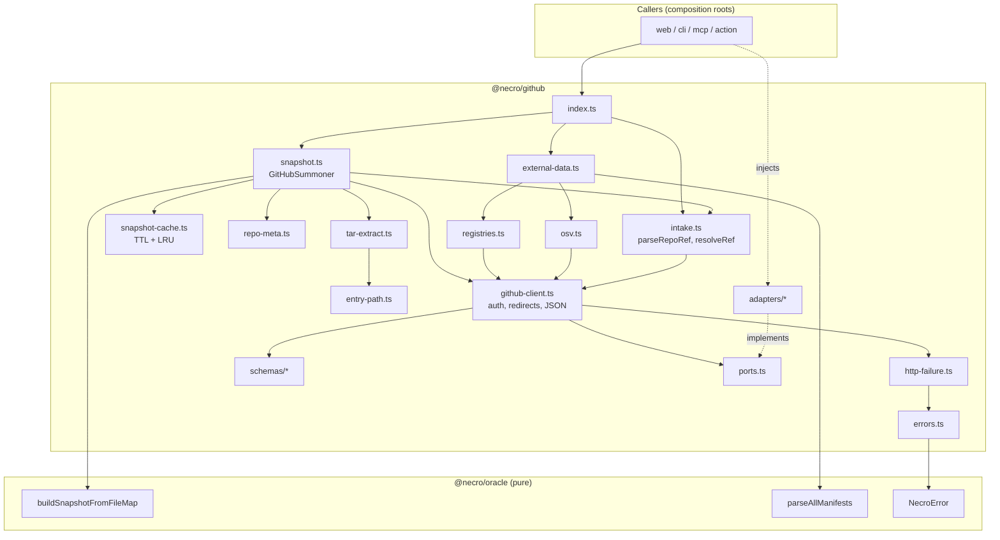
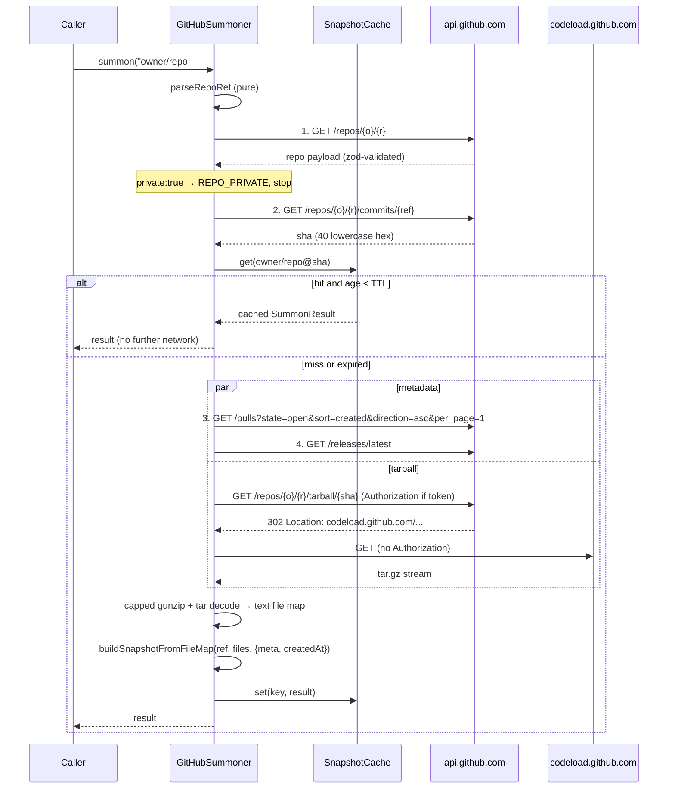

# Design Document: GitHub Summoner (`packages/github`)

## Overview

The GitHub Summoner is the `@necro/github` adapter. It turns a public GitHub repository reference (`owner/repo`, `https://github.com/owner/repo`, optionally with a ref) into the two things `runReading` from `@necro/oracle` needs:

1. a `RepoSnapshot` (via a single tarball download, in-memory extraction, and `buildSnapshotFromFileMap`), and
2. the injectable external data (`RegistryData` for the Tower, `OsvData` for the Devil) plus a list of skipped dependencies.

It implements the `GitHubSnapshotBuilder` interface that `@necro/oracle` already defines (`build(ref: RepoRef): Promise<RepoSnapshot>`) and adds the pieces that interface leaves out: a pure reference parser, a ref resolver, a metadata mapper, and the external-data fetcher.

Design stance, in priority order:

- **Repository code is data.** Nothing extracted is executed, imported, evaluated, or written to disk. The tarball lives in memory as streamed chunks and text strings.
- **Every side effect is a port.** HTTP, time, and environment arrive through `FetchPort`, `ClockPort`, and `EnvPort`. No `fetch`, `Date.now()`, `new Date()`, or `process.env` appears in package logic. Every test runs offline against recorded fixtures.
- **Caps are layered and independent of the tar library.** Compressed bytes (50 MB), decompressed stream bytes (200 MB), and entry count (100,000) are enforced by our own stream guards. The 1 MB per-file and 5000-file caps stay in `buildSnapshotFromFileMap` and are never reimplemented.
- **Honest degradation.** Optional metadata falls back to the neutral defaults `RepoMeta` already defines. Per-dependency registry/OSV failures land in `skipped`. The reading never fails because a registry was slow. A rate limit, a missing repo, or a size cap fails loudly with a typed `NecroError`.
- **Public repositories only.** A repository the API reports as `private: true` is refused before any content is downloaded.

### What this spec changes outside `packages/github`

| Package | Change | Why |
|---|---|---|
| `@necro/oracle` | Add 7 codes to `NecroErrorCodeSchema` (additive, no logic change) | R7.1; see "Decision D1" |
| `@necro/config` | Add env schema with optional `GITHUB_TOKEN` | R6.1 |
| root `eslint.config.js` | Restricted-syntax block for `packages/github/src` | R9.1–R9.3 enforcement |
| `docs/ARCHITECTURE.md` (new), `docs/KIRO_USAGE.md` | New adapter section, dated usage entry | Docs discipline |

Full list with exact versions is in "Required Changes to Other Packages".

---

## Architecture

### Dependency direction

```
oracle  ←  grimoires  ←  coven  ←  (web, cli, mcp-server, action)
  ↑                         ↑
  └── github (adapter) ─────┘   injected into coven/web/cli via ports
```

`@necro/github` imports from `@necro/oracle` (types, `NecroError`, `buildSnapshotFromFileMap`, `parseAllManifests`) and from third-party libraries (`zod`, `modern-tar`). `@necro/oracle` never imports `@necro/github`. The package imports `@necro/oracle` only through its `src/index.ts` entry. It does not use the Node-only `./node` entry, so it stays free of `fs`.

`@necro/github` does **not** import `@necro/config`. `EnvPort` is defined here, and composition roots (web, CLI, Action) wire it to the validated config. This keeps adapters independent of each other and keeps `process.env` out of package logic.

### Module layout

Kebab-case files, matching the `structure` steering (`intake.ts`, `snapshot.ts`, `osv.ts`, `registries.ts` are the four named public facades; `delivery.ts` belongs to a later spec and is not created here).

```
packages/github/
  package.json
  tsconfig.json
  vitest.config.ts
  fixtures/                        recorded API JSON; tarballs are built in-memory by test helpers
    api/<case>/{repo,commit,pulls,release}.json
    registry/{pypi,npm,osv}/<case>.json
  src/
    index.ts                       sole public entry (R10.1)
    ports.ts                       FetchPort, ClockPort, EnvPort, FetchTransportError
    constants.ts                   caps, hosts, timeouts, defaults (SCREAMING_SNAKE)
    errors.ts                      SummonerError, error factory, message catalog, redaction
    http-failure.ts                pure mapper: (status, headers, body hint, ctx) → SummonerError
    intake.ts                      parseRepoRef (pure), resolveRef
    github-client.ts               auth + redirect policy, JSON reads, REST call counter
    repo-meta.ts                   mapRepoMeta (pure)
    entry-path.ts                  normalizeEntryPath, isVendoredPath, isBinarySample (pure)
    tar-extract.ts                 capped streaming gunzip + tar decode → ExtractedTree
    snapshot-cache.ts              SnapshotCache (TTL + LRU, ClockPort-driven)
    snapshot.ts                    GitHubSummoner (implements GitHubSnapshotBuilder), createSummoner
    registries.ts                  PyPI + npm fetch and map → RegistryData
    osv.ts                         OSV querybatch + vuln detail fetch and map → OsvData
    external-data.ts               fetchExternalData orchestrator (dedupe, pool, skipped)
    time.ts                        parseIsoMs, isoFromMs, daysBetween (pure, no clock reads)
    schemas/
      github.ts  pypi.ts  npm.ts  osv.ts
    adapters/                      the ONLY place allowed to touch globals (lint-exempt)
      system-fetch.ts              FetchPort over global fetch (redirect: "manual", AbortSignal.timeout)
      system-clock.ts              ClockPort over Date.now()
    testing/                       fixture-backed ports and tar builders (not exported from index)
      fixture-fetch.ts  fixed-clock.ts  make-tar-gz.ts
```

Tests sit next to the code (`*.test.ts`, `*.pbt.test.ts`), per the `structure` steering.

### Component diagram



### Summon sequence



### Key design decisions

**D1. New error codes are added to `@necro/oracle`'s enum (not a package-local extension).**
`NecroError.code` is typed as `NecroErrorCode`, the inferred union of a closed `z.enum`. Two options satisfy R7.1:

- *Option A: extend `NecroErrorCodeSchema` in `packages/oracle/src/util/errors.ts`* with the 7 codes.
- *Option B: a package-local enum in `@necro/github`.*

Option B cannot work while still honouring "each raised error is an instance of `NecroError`". A subclass cannot widen `readonly code: NecroErrorCode` to a wider union (TypeScript rejects the override), and `new NecroError("INVALID_REPO_URL", …)` does not compile against the closed union. Casting around it would defeat the type that makes the enum useful. Option B would also scatter error vocabulary: web, CLI, and MCP all need one exhaustive `switch` over codes to render in-world errors.

**Choice: Option A.** The change is additive (7 string literals), has no logic, adds no import to `oracle`, and does not violate dependency direction, because `oracle` gains strings and not a reference to the adapter. The existing `errors.test.ts` iterates `NecroErrorCodeSchema.options`, so the new codes are covered automatically. The user-facing message catalog stays in `@necro/github` (`errors.ts`), because the wording belongs to the adapter that knows the failure context. This also sets the precedent the sandbox, LLM, and ledger specs will follow.

To carry machine-readable context (wait minutes, HTTP status) without changing `NecroError`'s shape, the package raises `SummonerError extends NecroError` with a read-only `details` object. Callers that only know `NecroError` keep working.

**D2. Redirects are never followed by the adapter; the client follows them under policy.**
`FetchPort` is contractually `redirect: "manual"`. The client decides whether a `Location` is acceptable and re-evaluates the Authorization policy for the new host on every hop (R3.12, R6.3). REST redirects (301/302/307/308 from `api.github.com`) are *not* followed: they only occur for renamed or transferred repositories, following them would multiply the call count past the budget, and they map to `REPO_NOT_FOUND` with a "moved" message. The tarball request follows exactly one redirect, and only to `https://codeload.github.com`.

**D3. Gzip and tar decoding use web streams plus `modern-tar`; caps are ours.**
`DecompressionStream("gzip")` (global in Node 22) and `modern-tar`'s `createTarDecoder()` form a pull-based pipeline. Byte-counting `TransformStream` guards sit before and after the decompressor, so a decompression bomb is stopped by our code regardless of how the tar library buffers. Choice and fallback in "Required Changes".

**D4. Oversize text files are represented by one shared sentinel string.**
`buildSnapshotFromFileMap` is the only place the 1 MB cap lives (R3.8), but it measures strings it is handed. Holding up to 200 MB of text just so the builder can measure and discard it would waste memory. When an entry's declared size exceeds 1 MiB and its first 8000 bytes are text, the extractor passes a single module-level string of 1 MiB + 1 bytes under that path. The builder then records the path in `oversizeFiles` exactly as it would for the real content, and the retained file map stays small. The sentinel never reaches `snapshot.contents` because the builder drops oversize files.

**D5. Snapshot cache stores `SummonResult`, returns shallow copies.**
`runReading` assigns `snapshot.manifests = parseAllManifests(snapshot)`. Returning the cached object itself would let one reading mutate another's snapshot. The cache returns `{ ...snapshot }` (a new top-level object sharing the read-only `files`/`contents`), so the assignment is local. In-flight builds for the same key share one promise, so concurrent summons do not download twice. Failures are never cached.

**D6. OSV is queried only for exactly-pinned dependencies.**
The Devil turns every injected `OsvVulnerability` into evidence. A version-less OSV query returns every advisory ever filed against the package, including ones fixed years before the pinned version. That would put false evidence on a card, which violates "the cards cannot lie". The fetcher therefore queries OSV only when the manifest pins an exact version (`==1.2.3` for PyPI, `1.2.3`/`=1.2.3` for npm). Other dependencies are reported in `skipped` with reason `version-not-pinned`.

**D7. Time is read once per operation.**
`ClockPort` exposes only `nowMs()`. Each `build` reads it once; `createdAt`, the PR age arithmetic, and the cache entry timestamp derive from that single reading, so they cannot disagree. ISO strings are produced by `isoFromMs(ms)` (`new Date(ms).toISOString()`), which constructs a date from a given value and never reads the system clock (see Open Question Q5 on lint wording).

---

## Components and Interfaces

### Ports (`ports.ts`)

```typescript
export interface FetchRequest {
  readonly url: string;                       // absolute https URL, host already allow-listed by the client
  readonly method: "GET" | "POST";
  readonly headers: Readonly<Record<string, string>>;
  readonly body?: string;                     // JSON string for POST
  readonly timeoutMs: number;                 // adapter enforces (AbortSignal.timeout)
  readonly redirect: "manual";                // adapters MUST NOT follow redirects
  readonly signal?: AbortSignal;              // caller-initiated cancel (sibling failed)
}

export interface FetchResponse {
  readonly status: number;
  readonly headers: Readonly<Record<string, string>>; // lower-cased names
  readonly body: ReadableStream<Uint8Array> | null;
}

export type FetchPort = (req: FetchRequest) => Promise<FetchResponse>;

/** Thrown by FetchPort adapters for transport-level failure; never a NecroError. */
export class FetchTransportError extends Error {
  readonly kind: "timeout" | "network";
  constructor(kind: "timeout" | "network", message: string, cause?: unknown);
}

export interface ClockPort {
  nowMs(): number;                            // epoch milliseconds
}

export interface EnvPort {
  get(key: "GITHUB_TOKEN"): string | undefined;
}

export interface SummonerDeps {
  readonly fetch: FetchPort;
  readonly clock: ClockPort;
  readonly env: EnvPort;
}
```

An adapter that returns a response must give the client a body it can cancel. The client always consumes or cancels the body, so connections are released.

### Constants (`constants.ts`)

```typescript
export const MAX_COMPRESSED_BYTES = 52_428_800;      // 50 MB   (R3.9)
export const MAX_UNCOMPRESSED_BYTES = 209_715_200;   // 200 MB  (R3.10)
export const MAX_ENTRIES = 100_000;                  //         (R3.11)
export const BINARY_SNIFF_BYTES = 8000;              // NUL within first 8000 bytes (R3.6)
export const TEXT_FILE_CEILING_BYTES = 1_048_576;    // mirrors the oracle cap; used ONLY to decide
                                                     // whether to pass the oversize sentinel (D4)
export const REST_CALL_BUDGET = 5;                   // R4.8
export const DEFAULT_TTL_MS = 604_800_000;           // 7 days  (R8.5)
export const DEFAULT_MAX_CACHE_ENTRIES = 20;         //         (R8.7)
export const TIMEOUT_REST_MS = 15_000;
export const TIMEOUT_TARBALL_MS = 40_000;            // keeps a summon under the ~50 s serverless guard
export const TIMEOUT_EXTERNAL_MS = 10_000;           // hard ceiling for registry/OSV (R5.4)
export const EXTERNAL_CONCURRENCY = 8;
export const MAX_REGISTRY_QUERIES = 300;
export const MAX_OSV_DETAIL_FETCHES = 200;
export const OSV_BATCH_SIZE = 1000;
export const MAX_REST_JSON_BYTES = 2_097_152;        // 2 MiB
export const MAX_REGISTRY_JSON_BYTES = 10_485_760;   // 10 MiB (large PyPI/npm documents)
export const MAX_OSV_JSON_BYTES = 5_242_880;         // 5 MiB

export const GITHUB_AUTH_HOSTS: ReadonlySet<string> = new Set(["github.com", "api.github.com"]);
export const TARBALL_REDIRECT_HOST = "codeload.github.com";
export const EXTERNAL_HOSTS: ReadonlySet<string> =
  new Set(["pypi.org", "registry.npmjs.org", "api.osv.dev"]);

/** Path segments marking vendored or VCS data. Matched against any segment of the stripped path. */
export const VENDORED_SEGMENTS: ReadonlySet<string> =
  new Set(["node_modules", ".git", "vendor", "third_party", "bower_components", "site-packages"]);
```

The numeric caps are *defaults*. `ExtractionLimits` (below) is injectable so property tests can use tiny limits and finish in milliseconds, with one smoke test pinning the default literals.

### Reference parsing and resolution (`intake.ts`)

```typescript
export const ParsedRepoRefSchema: z.ZodType<ParsedRepoRef>;
export interface ParsedRepoRef {
  readonly host: "github.com";                // always normalized (R1.5)
  readonly owner: string;                     // original case preserved (R1.1/1.2)
  readonly name: string;                      // ".git" suffix removed
  readonly ref: string | null;                // branch, tag, or sha; null when absent (R1.4)
}

/** Pure. Throws SummonerError { code: "INVALID_REPO_URL" }. No network, clock, or env (R1.10). */
export function parseRepoRef(input: string): ParsedRepoRef;

export interface IntakeDeps {
  readonly client: GitHubClient;
}

/** Resolve to an immutable commit (R2). Calls: repo + commit = 2 REST calls. */
export function resolveRef(parsed: ParsedRepoRef, deps: IntakeDeps): Promise<RepoRef>;

/** Same, but also returns the validated repo payload so build() does not fetch it again. */
export function resolveRefDetailed(
  parsed: ParsedRepoRef,
  deps: IntakeDeps,
): Promise<{ ref: RepoRef; repo: GhRepo }>;
```

`resolveRef` is the exported function from R10.3. `resolveRefDetailed` is exported only for `GitHubSummoner`'s use and is not part of `index.ts`.

**Grammar implemented by `parseRepoRef`** (steps run in this order):

1. Reject if the input is not a string, longer than 2048 characters, or empty after trimming whitespace (R1.6, R1.9).
2. Trim; strip all trailing `/` characters.
3. If the string matches `^[A-Za-z][A-Za-z0-9+.-]*://` it is a **URL form**; otherwise it is **shorthand**.
4. *URL form.* Parse with `new URL(...)`. Reject unless the protocol is `http:` or `https:`, the hostname (lower-cased) is `github.com` or `www.github.com`, there is no userinfo (`user:pass@`, which could carry a token), and the port is empty (R1.5, R1.7). Split `pathname` on `/`, dropping the empty first segment. Accept exactly `[owner, repo]` or `[owner, repo, "tree", ...refSegments]`. The ref is `refSegments` percent-decoded and re-joined with `/`, because branch names contain slashes. Any other shape (for example `/issues`) is rejected. Query string and fragment are ignored.
5. *Shorthand.* Split into a head and an optional ref at the **first** `#` or `@`: `owner/repo`, `owner/repo#ref`, `owner/repo@sha`. The ref is everything after that first delimiter. The head must be exactly two non-empty `/`-separated segments (R1.9).
6. Strip one trailing `.git` from the repository name (R1.6).
7. Validate `owner` and `name` against `^[A-Za-z0-9_.-]+$`, and reject `.` and `..` (R1.8).
8. Validate a present ref: non-empty, at most 255 characters, no whitespace or control characters, no `..` segment, no leading `-` or `/`, none of `\ ? * [ ~ ^ :` (conservative subset of git ref rules; also keeps it safe in a URL path). A ref that is 40 hex characters of any case is lower-cased.
9. Return `{ host: "github.com", owner, name, ref }`.

Every rejection raises `INVALID_REPO_URL` with a *reason code* (`foreign-host`, `bad-scheme`, `has-credentials`, `missing-owner`, `missing-name`, `bad-characters`, `bad-ref`, `empty`, `unsupported-path`). The `userMessage` states the reason code and never echoes the raw input, so a pasted `https://ghp_…@github.com/…` cannot leak.

**Ref resolution** uses the single `commits/{ref}` endpoint, which accepts a branch, tag, full SHA, or partial SHA:

- No ref: take `repo.default_branch` from call 1 and request `commits/{default_branch}`.
- Explicit ref: request `commits/{ref}` (each path segment `encodeURIComponent`-encoded, `/` preserved).
- Full 40-hex ref: after the response, assert the returned `sha` equals the requested value, which is the existence check required by R2.3.
- Partial SHA: the response `sha` is the expanded 40-character form.

`defaultBranch` is always `repo.default_branch`, regardless of which ref was requested (R2.4). Both responses pass through zod before any field is read (R2.5, R2.6).

### GitHub client (`github-client.ts`)

```typescript
export interface GitHubClientOptions {
  readonly userAgent?: string;                // default "necro-oracle"
  readonly timeouts?: Partial<{ restMs: number; tarballMs: number }>;
}

export class GitHubClient {
  constructor(deps: SummonerDeps, opts?: GitHubClientOptions);

  /** Count of requests sent to api.github.com since construction (tarball first hop included). */
  readonly restCallCount: number;

  /** GET a REST path, validate against `schema`, map failures via http-failure.ts. */
  getJson<T>(
    path: string,
    schema: z.ZodType<T>,
    ctx: RequestContext,
  ): Promise<{ data: T; headers: Readonly<Record<string, string>> }>;

  /** GET the tarball: first hop on api.github.com, at most one redirect to codeload. */
  openTarball(ref: RepoRef, signal?: AbortSignal): Promise<{
    body: ReadableStream<Uint8Array>;
    contentLength: number | null;
  }>;
}

export interface RequestContext {
  readonly endpoint: "repo" | "commit" | "pulls" | "release" | "tarball";
  readonly repo: { owner: string; name: string };
  /** true once the repo endpoint has returned 200 for this operation (changes 404 meaning). */
  readonly repoProven: boolean;
  /** true when a fatal failure should be thrown; false when the caller degrades (pulls, release). */
  readonly optional: boolean;
}
```

The client is the only module that builds headers or touches `FetchPort` for GitHub hosts. Registries and OSV use a thinner helper `externalRequest(deps, host, ...)` that applies the host allow-list and *never* sets Authorization.

**Authorization and host policy** (`headersFor(url, token)`, a pure function):

| Target host | Scheme | Authorization | Notes |
|---|---|---|---|
| `api.github.com` | https | `Bearer <token>` when a token exists | REST calls and tarball first hop |
| `github.com` | https | `Bearer <token>` when a token exists | not contacted by this design; permitted by R6.2 |
| `codeload.github.com` | https | **never** | tarball redirect hop (R3.12) |
| `pypi.org`, `registry.npmjs.org`, `api.osv.dev` | https | **never** | R6.3 |
| any other host, any `http:` URL, or any non-default port | | request refused | `VALIDATION_FAILED` (SSRF guard) |

All GitHub requests send `Accept: application/vnd.github+json`, `X-GitHub-Api-Version: 2022-11-28`, and a `User-Agent` (GitHub rejects requests without one). The token is read from `EnvPort` per request, validated with `GithubTokenSchema` (non-empty, no whitespace or control characters, so no header injection), and never stored on the client, cache, error, or log line. A malformed token raises `VALIDATION_FAILED` with a message that names the variable and not its value.

**Redirect handling for the tarball:**

1. Request `https://api.github.com/repos/{owner}/{name}/tarball/{sha}` with auth per the table.
2. On `302` (or `301/307/308`) read `Location`, parse it with `new URL`, and require `https:` and hostname exactly `codeload.github.com`. Anything else raises `VALIDATION_FAILED` ("unexpected redirect target") and the request is not sent.
3. Cancel the first response body, then request the new URL with **no** Authorization header (`headersFor` returns none for that host).
4. A second redirect from codeload is not followed: `VALIDATION_FAILED`. The one-redirect limit is therefore structural, not a counter.

### Repo metadata mapper (`repo-meta.ts`)

```typescript
export interface MetaInputs {
  readonly repo: GhRepo | null;               // null → neutral defaults for repo-derived fields
  readonly pulls: { count: number; oldestCreatedAt: string | null } | null;  // null → neutral
  readonly release: { publishedAt: string | null } | null;                   // null → neutral
  readonly nowMs: number;
}

export interface MappedMeta {
  readonly meta: RepoMeta;                    // @necro/oracle shape, validated with RepoMetaSchema
  readonly degraded: readonly DegradedField[];
}

/** Pure (R4.1–R4.5, R4.7). */
export function mapRepoMeta(inputs: MetaInputs): MappedMeta;
```

Field rules:

| `RepoMeta` field | Source | Rule |
|---|---|---|
| `isArchived` | `repo.archived` | else `false` |
| `pushedAt` | `repo.pushed_at` | normalized ISO 8601 UTC via `isoFromMs(parseIsoMs(x))`, else `null` |
| `licenseKey` | `repo.license` | `null` license → `null`; `spdx_id` null or `"NOASSERTION"` → `"NOASSERTION"`; else `spdx_id` (R4.2) |
| `openPRCount` | pulls call | open PR count, else `0` |
| `openIssueCount` | `repo.open_issues_count` | `max(0, open_issues_count − openPRCount)` (R4.4) |
| `oldestOpenPRAgeDays` | pulls call | `max(0, floor((nowMs − parseIsoMs(createdAt)) / 86_400_000))` for the oldest open PR, `null` when none (R4.5) |
| `latestReleaseAt` | release call | `published_at` normalized to ISO UTC, else `null` |

`SummonExtras` (R4.6) carries what `RepoMeta` cannot:

```typescript
export interface SummonExtras {
  readonly stars: number;                     // integer ≥ 0
  readonly defaultBranch: string;             // non-empty
  readonly hasWorkflowsDir: boolean;          // derived from tarball entries, no extra API call
  readonly degraded: readonly DegradedField[];
}
export type DegradedField = "pulls" | "release" | "repo-meta" | "pr-count-unknown";
```

When the `pulls` call degrades, `openPRCount` is `0` and `openIssueCount` is GitHub's raw count (pull requests included); `"pulls"` appears in `degraded` so the Scribe can say so rather than present the number as exact.

### Tarball extraction (`tar-extract.ts`, `entry-path.ts`)

```typescript
export interface ExtractionLimits {
  readonly maxCompressedBytes: number;        // default MAX_COMPRESSED_BYTES
  readonly maxUncompressedBytes: number;      // default MAX_UNCOMPRESSED_BYTES
  readonly maxEntries: number;                // default MAX_ENTRIES
}
export const DEFAULT_LIMITS: ExtractionLimits;

export interface ExtractedTree {
  /** Null-prototype object: a file named "__proto__" is an ordinary key. */
  readonly files: Record<string, string>;
  readonly hasWorkflowsDir: boolean;
  readonly stats: {
    readonly entries: number;
    readonly skippedTraversal: number;
    readonly skippedLinks: number;
    readonly skippedSpecial: number;
    readonly skippedVendored: number;
    readonly skippedBinary: number;
    readonly oversize: number;
  };
}

/**
 * Streams: body → compressed guard → gunzip → uncompressed guard → tar decoder.
 * Raises SummonerError DOWNLOAD_TOO_LARGE on any cap; VALIDATION_FAILED on a corrupt archive.
 * Cancels the upstream body on every failure so the download stops (R3.9).
 */
export function extractTarball(
  body: ReadableStream<Uint8Array>,
  limits?: Partial<ExtractionLimits>,
): Promise<ExtractedTree>;
```

**Stream guards.** `capStream(maxBytes, onExceed)` is a `TransformStream<Uint8Array, Uint8Array>` that sums chunk lengths and errors the pipeline the moment the sum crosses `maxBytes`. The compressed guard sits before the decompressor, so the 50 MB limit counts bytes downloaded. The uncompressed guard sits after it and counts decompressed *tar stream* bytes. That measure includes at most 1024 bytes of tar framing per entry, so it is slightly stricter than "sum of entry payloads". It also cannot be fooled by a header that lies about `size` and does not depend on the tar library (see Open Question Q4). As an early exit, a declared entry `size` larger than the remaining uncompressed budget fails before its body is read. A `Content-Length` above the compressed cap fails before the first byte is read, and the missing header case is covered by the guard.

**Per-entry rules** applied in this order to each decoded entry (header + body stream):

1. Count the entry; if the count exceeds `maxEntries`, raise `DOWNLOAD_TOO_LARGE` (R3.11).
2. `normalizeEntryPath(rawName)`:
   - reject if it contains a NUL, is absolute (`/…`, `C:…`), or any segment split on `/` or `\` equals `..` → *traversal*, skip (R3.3);
   - drop empty and `.` segments;
   - drop the first segment (the `<owner>-<repo>-<sha>/` prefix, R3.13);
   - a result with no remaining segments (the root directory entry) is skipped silently.
3. Entry type: only `file` is a candidate. `symlink` and `link` are skipped (R3.4); devices, FIFOs, and other types are skipped as *special*. `directory` entries contribute only to `hasWorkflowsDir`.
4. Vendored: any segment in `VENDORED_SEGMENTS` → skip (R3.5).
5. `hasWorkflowsDir` becomes true if the normalized path's first two segments are `.github`, `workflows` (file or directory entry, checked before the binary and size filters).
6. Read the first `BINARY_SNIFF_BYTES` of the body. A NUL byte means *binary*: cancel the body, skip (R3.6).
7. If the declared size exceeds `TEXT_FILE_CEILING_BYTES`: cancel the body and store the oversize sentinel (D4).
8. Otherwise read the rest, decode as UTF-8 with `TextDecoder("utf-8", { fatal: false, ignoreBOM: true })` (BOM preserved), and store. A repeated path overwrites the earlier one, as `tar -x` would.

Entries are processed strictly one at a time (the tar decoder requires each body to be consumed or cancelled before advancing), which keeps memory bounded by one text file plus the retained file map.

Nothing here touches the filesystem. Extracted bytes become strings and are never passed to `eval`, `import`, `Function`, or a child process.

### Snapshot cache (`snapshot-cache.ts`)

```typescript
export interface SnapshotCacheOptions {
  readonly ttlMs?: number;                    // default DEFAULT_TTL_MS
  readonly maxEntries?: number;               // default DEFAULT_MAX_CACHE_ENTRIES
}

/** Pure: identical key for identical (owner, name, sha) (R8.4). */
export function cacheKey(ref: Pick<RepoRef, "owner" | "name" | "sha">): string;
//   → `${owner}/${name}@${sha}`

export class SnapshotCache<V> {
  constructor(clock: ClockPort, opts?: SnapshotCacheOptions);
  get(key: string): V | undefined;            // fresh hit → marks most-recently-used (R8.9)
  set(key: string, value: V): void;           // replaces existing key; evicts LRU at capacity (R8.6, R8.8)
  readonly size: number;
}
```

Implementation notes:

- Backing store is a `Map<string, { value: V; createdAtMs: number }>`. JavaScript `Map` iterates in insertion order, so re-inserting on hit (`delete` then `set`) keeps the first key the least-recently-used.
- `get`: entry present and `nowMs − createdAtMs < ttlMs` → hit. Age `≥ ttlMs` → delete and return `undefined` (R8.2, R8.3: the boundary instant is expired).
- `set`: delete any existing entry for the key (at most one entry per key), purge expired entries, then while `size ≥ maxEntries` delete the first (LRU) key, then insert with `createdAtMs = clock.nowMs()`.
- The key is exact-case. `Foo/bar@sha` and `foo/bar@sha` are distinct keys. Both resolve to the same repo, so the cost is one extra download, and equality of keys stays equivalent to equality of the three components (P8). Owner and name charsets exclude `/` and `@`, so the key is injective.
- The cache holds `SummonResult` values only. Tokens and headers are never in scope of the builder's result, so none can be stored (R8.10).

### Summoner and builder (`snapshot.ts`)

```typescript
export interface SummonerOptions {
  readonly cache?: SnapshotCacheOptions;
  readonly limits?: Partial<ExtractionLimits>;
  readonly client?: GitHubClientOptions;
}

export interface SummonResult {
  readonly snapshot: RepoSnapshot;
  readonly extras: SummonExtras;
  readonly cache: "hit" | "miss";
}

export class GitHubSummoner implements GitHubSnapshotBuilder {
  constructor(deps: SummonerDeps, opts?: SummonerOptions);

  /** @necro/oracle contract (R10.4). */
  build(ref: RepoRef): Promise<RepoSnapshot>;

  /** build() plus extras (stars, defaultBranch, hasWorkflowsDir, degraded). */
  buildDetailed(ref: RepoRef): Promise<SummonResult>;

  /** parse → resolve → build; the whole pipeline from a user string. */
  summon(input: string | ParsedRepoRef): Promise<SummonResult>;
}

export function createSummoner(deps: SummonerDeps, opts?: SummonerOptions): GitHubSummoner;
```

`buildDetailed(ref)`:

1. Validate `ref` with a strict schema (`sha` = 40 lowercase hex). A malformed ref raises `VALIDATION_FAILED`.
2. `cacheKey(ref)`; fresh hit → return the cached result with zero network access (R8.2).
3. If a build for the key is already in flight, await it.
4. Otherwise: read the clock once (`startMs`). Fetch the repo payload (or reuse the one `summon` passes in). If `private: true`, raise `REPO_PRIVATE` before anything is downloaded.
5. Run in parallel under one `AbortController`: `pulls` (optional), `release` (optional), and the tarball download + extraction. A fatal failure in any branch aborts the others.
6. `mapRepoMeta(...)` with the single `startMs`; `buildSnapshotFromFileMap(ref, tree.files, { meta, createdAt: isoFromMs(startMs) })`.
7. Store in the cache (the entry's creation time is `clock.nowMs()` at insertion) and return a shallow copy.

`build(ref)` returns `(await buildDetailed(ref)).snapshot`.

### External data (`external-data.ts`, `registries.ts`, `osv.ts`)

```typescript
export interface ExternalDataResult {
  readonly registryData: RegistryData;        // Map<lowercased name, RegistryEntry>
  readonly osvData: OsvData;                  // OsvVulnerability[], sorted by (affectedPackage, id)
  readonly skipped: readonly SkippedDependency[];
}

export type SkipReason =
  | "timeout" | "network" | "http-error" | "rate-limited"
  | "invalid-response" | "response-too-large" | "invalid-name"
  | "version-not-pinned" | "no-published-files" | "limit-exceeded";

export interface SkippedDependency {
  readonly name: string;                      // as written in the manifest
  readonly ecosystem: "pypi" | "npm";
  readonly source: "registry" | "osv";
  readonly reason: SkipReason;
}

export interface ExternalDataDeps {
  readonly fetch: FetchPort;
  readonly clock: ClockPort;                  // not used for network time; reserved for deterministic ordering/logging
}

/**
 * Never throws for per-dependency failures (R5.5, R5.7). Accepts a snapshot (manifests are
 * parsed with parseAllManifests, ignoring snapshot.manifests) or pre-parsed manifests.
 */
export function fetchExternalData(
  input: RepoSnapshot | readonly Manifest[],
  deps: ExternalDataDeps,
  opts?: { concurrency?: number; timeoutMs?: number },
): Promise<ExternalDataResult>;
```

Pipeline:

1. **Collect and dedupe (R5.1).** Gather `ParsedDependency` values from all manifests. Ecosystem is `npm` for `package_json` manifests and `pypi` for the other four kinds. Deduplicate per ecosystem by `name.toLowerCase()`, keeping the first spelling and the first `versionSpec` that is exactly pinned. Order names alphabetically for deterministic output. More than `MAX_REGISTRY_QUERIES` names: the overflow is recorded as `limit-exceeded`.
2. **Registry queries (R5.2, R5.4–R5.9).** Run through a fixed-size promise pool (`EXTERNAL_CONCURRENCY`), PyPI first, then npm. Each request has `timeoutMs = min(opts.timeoutMs ?? 10_000, 10_000)`.
   - PyPI: `GET https://pypi.org/pypi/{pep503(name)}/json`. The URL uses the PEP 503 normalized name (`[-_.]+` → `-`, lower-cased) because the client does not follow PyPI's redirect from non-normalized names.
   - npm: `GET https://registry.npmjs.org/{encodeName(name)}` with `Accept: application/vnd.npm.install-v1+json` (abbreviated metadata). Scoped names become `@scope%2Fname`.
   - Names are checked against strict patterns first; failures are `invalid-name` and never reach a URL.
   - `404` → the dependency is **omitted** from `registryData` and is *not* skipped (R5.6: absent is a fact, not a failure).
   - Timeout/network/non-404 HTTP failure/zod failure → `skipped` with the matching reason.
   - The map key is `dep.name.toLowerCase()`, exactly what `tower.ts` looks up. Two spellings that normalize to the same PyPI package share one request and fan the entry out to each lowercased key.
   - If a lowercased name exists in both ecosystems, npm is written after PyPI, so npm wins (R5.11, last-writer-wins by fixed order).
3. **OSV (R5.3).** Build `{ package: { name, ecosystem }, version }` queries for exactly-pinned dependencies (D6), post them in chunks of `OSV_BATCH_SIZE` to `https://api.osv.dev/v1/querybatch`, collect the distinct vulnerability ids, and fetch each `GET https://api.osv.dev/v1/vulns/{id}` through the same pool (at most `MAX_OSV_DETAIL_FETCHES`; overflow becomes `limit-exceeded` for the dependencies involved). Only the detail records carry severity and affected ranges, which is why a second round is needed.
4. **Assemble (R5.10).** Return `{ registryData, osvData, skipped }`.

**Registry mapping** (all fields conform to `RegistryEntry`, R5.9):

| `RegistryEntry` | PyPI (`/pypi/{n}/json`) | npm (abbreviated) |
|---|---|---|
| `name` | `info.name` | `name` |
| `latestVersion` | `info.version` | `dist-tags.latest` |
| `yanked` | `info.yanked === true` | `false` |
| `isDeprecated` | classifier `Development Status :: 7 - Inactive` present | `versions[latest].deprecated` is a non-empty string |
| `py2Only` | has `Programming Language :: Python :: 2 :: Only`, or has a `Python :: 2…` classifier and no `Python :: 3…` classifier | `false` |
| `publishedAt` | latest `urls[].upload_time_iso_8601`, normalized to ISO UTC (no files → skip `no-published-files`) | `modified`, normalized (see Q3) |

**OSV mapping** (`OsvVulnerability`):

| Field | Source |
|---|---|
| `id` | vuln `id` |
| `severity` | `database_specific.severity` upper-cased: `CRITICAL`, `HIGH`, `LOW`; `MODERATE`/`MEDIUM` → `MEDIUM`; anything else, including absent → `UNKNOWN`. CVSS vectors are not scored here. |
| `affectedPackage` | the queried dependency name (as written) |
| `affectedVersionRange` | from the `affected[]` entry matching the package name and ecosystem: events rendered as `>=a,<b` (`introduced`/`fixed`), `>=a` (no fix), `<=b` (`last_affected`); `introduced: "0"` is rendered without the lower bound; multiple ranges joined with ` \|\| `; with no ranges, `==<queried version>` |

Advisories that list one another in `aliases` (a `GHSA-` and a `PYSEC-` entry for the same flaw) collapse to one record per (`affectedPackage`, alias group), preferring the `GHSA-` id, which carries severity.

### Public API (`index.ts`)

```typescript
export { parseRepoRef, resolveRef, ParsedRepoRefSchema, type ParsedRepoRef } from "./intake.js";
export { GitHubSummoner, createSummoner,
         type SummonerOptions, type SummonResult, type SummonExtras } from "./snapshot.js";
export { fetchExternalData,
         type ExternalDataResult, type SkippedDependency, type SkipReason } from "./external-data.js";
export { mapRepoMeta } from "./repo-meta.js";
export { cacheKey, SnapshotCache } from "./snapshot-cache.js";
export { GitHubClient } from "./github-client.js";
export { SummonerError, type SummonerErrorCode } from "./errors.js";
export { DEFAULT_LIMITS, type ExtractionLimits } from "./tar-extract.js";
export type { FetchPort, FetchRequest, FetchResponse, ClockPort, EnvPort, SummonerDeps } from "./ports.js";
export { FetchTransportError } from "./ports.js";
export { createSystemFetchPort } from "./adapters/system-fetch.js";
export { systemClock } from "./adapters/system-clock.js";
```

Consumers never import a path other than the package entry (R10.1). `testing/` helpers are internal. The `adapters/` exports are conveniences for composition roots, and the logic modules never import them.

### GitHub REST call plan (R2.7, R4.8)

| # | Request | Gives | If it fails |
|---|---|---|---|
| 1 | `GET /repos/{o}/{r}` | default branch, `private`, archived, `pushed_at`, stars, open-issues count, license | fatal |
| 2 | `GET /repos/{o}/{r}/commits/{ref}` | exact 40-char SHA | fatal |
| 3 | `GET /repos/{o}/{r}/pulls?state=open&sort=created&direction=asc&per_page=1` | oldest open PR (first item) and, from the `Link: rel="last"` page number, the open PR count | rate limit is fatal; other failures degrade to neutral |
| 4 | `GET /repos/{o}/{r}/releases/latest` | `published_at` | rate limit is fatal; `404` means no releases (`null`); other failures degrade |
| – | `GET /repos/{o}/{r}/tarball/{sha}` (302 → codeload) | the archive | fatal |

Budget accounting:

- `summon()`: calls 1 and 2 (resolve), then 3 and 4 (build reuses the call-1 payload) = **4 REST calls**, plus the tarball request.
- `build(ref)` alone: calls 1, 3, 4 = **3 REST calls**, plus the tarball.
- A cache hit inside `summon()` costs only calls 1 and 2; inside `build()` it costs **zero**.
- The tarball request's first hop does hit `api.github.com`, so against the real 60/hour unauthenticated limit a miss consumes 5 units. R4.8 excludes it from the 5-call count, and the budget invariant still holds with that hop included (4 + 1 = 5). `GitHubClient.restCallCount` counts it so tests can assert `≤ 5` including it.
- Hop 2 (codeload) is not a REST call.

The pull-request count uses the `Link` header trick rather than the Search API (`/search/issues`), which has its own, much lower unauthenticated limit (10 requests per minute) and is not worth a call.

---

## Data Models

All payloads that cross a boundary pass through zod. `z.object` strips unknown keys by default, which is what we want for third-party payloads: only declared fields survive validation. Types are inferred with `z.infer`.

### Strict ref and token schemas

```typescript
// src/schemas/github.ts
import { z } from "zod";
import { RepoRefSchema } from "@necro/oracle";

export const Sha40Schema = z.string().regex(/^[0-9a-f]{40}$/);

/** The oracle's RepoRefSchema only requires min(1); the Summoner guarantees more (R2.4). */
export const ResolvedRepoRefSchema = RepoRefSchema.extend({ sha: Sha40Schema });

export const OwnerOrNameSchema = z
  .string()
  .min(1)
  .regex(/^[A-Za-z0-9_.-]+$/)
  .refine((s) => s !== "." && s !== "..");

/** Header-injection guard. The value is never echoed in an error. */
export const GithubTokenSchema = z.string().min(1).regex(/^[^\s\x00-\x1f\x7f]+$/);
```

### GitHub payloads

```typescript
// src/schemas/github.ts (continued)
const IsoDate = z.string().datetime({ offset: true });

export const GhRepoSchema = z.object({
  name: z.string().min(1),
  full_name: z.string().min(1),
  default_branch: z.string().min(1),
  private: z.boolean(),
  archived: z.boolean(),
  pushed_at: IsoDate.nullish().transform((v) => v ?? null),
  stargazers_count: z.number().int().nonnegative(),
  open_issues_count: z.number().int().nonnegative(),          // includes open PRs
  license: z
    .object({ spdx_id: z.string().nullable() })
    .nullish()
    .transform((v) => v ?? null),
});
export type GhRepo = z.infer<typeof GhRepoSchema>;

export const GhCommitSchema = z.object({ sha: Sha40Schema });

export const GhPullsSchema = z.array(z.object({ created_at: IsoDate }));

export const GhReleaseSchema = z.object({
  published_at: IsoDate.nullish().transform((v) => v ?? null),
});

/** Best-effort hint used only by the failure mapper; failure to parse is not an error. */
export const GhErrorBodySchema = z.object({ message: z.string().optional() });
```

### PyPI, npm, OSV payloads

```typescript
// src/schemas/pypi.ts
export const PypiDocSchema = z.object({
  info: z.object({
    name: z.string().min(1),
    version: z.string().min(1),
    classifiers: z.array(z.string()).default([]),
    yanked: z.boolean().optional(),
  }),
  urls: z
    .array(z.object({ upload_time_iso_8601: z.string().datetime({ offset: true }) }))
    .default([]),
});

// src/schemas/npm.ts
export const NpmDocSchema = z.object({
  name: z.string().min(1),
  "dist-tags": z.object({ latest: z.string().min(1) }),
  versions: z.record(z.unknown()),                  // only versions[latest] is validated further
  modified: z.string().datetime({ offset: true }).optional(),
});
export const NpmVersionSchema = z.object({ deprecated: z.string().optional() });

// src/schemas/osv.ts
export const OsvBatchResponseSchema = z.object({
  results: z.array(
    z.object({
      vulns: z.array(z.object({ id: z.string().min(1) })).optional(),
      next_page_token: z.string().optional(),       // present → truncated; recorded as skipped
    }),
  ),
});

export const OsvVulnSchema = z.object({
  id: z.string().min(1),
  aliases: z.array(z.string()).optional(),
  database_specific: z.record(z.unknown()).optional(),
  affected: z
    .array(
      z.object({
        package: z.object({ name: z.string(), ecosystem: z.string() }).optional(),
        ranges: z
          .array(z.object({ type: z.string(), events: z.array(z.record(z.string())) }))
          .optional(),
        versions: z.array(z.string()).optional(),
      }),
    )
    .optional(),
});
```

`OsvBatchResponseSchema.results` must have exactly one entry per query, in query order; a length mismatch is a validation failure for the whole batch (all dependencies in it are skipped as `invalid-response`).

### Package-level types

```typescript
// src/errors.ts
export type SummonerErrorCode = Extract<NecroErrorCode,
  | "INVALID_REPO_URL" | "REPO_NOT_FOUND" | "REPO_PRIVATE" | "RATE_LIMITED"
  | "NETWORK_TIMEOUT" | "DOWNLOAD_TOO_LARGE" | "VALIDATION_FAILED">>;

export interface SummonerErrorDetails {
  readonly reason?: string;                   // machine reason, e.g. "foreign-host"
  readonly httpStatus?: number;
  readonly retryAfterMinutes?: number;        // RATE_LIMITED only
  readonly limit?: "compressed" | "uncompressed" | "entries";
}

export class SummonerError extends NecroError {
  readonly code: SummonerErrorCode;
  readonly details: SummonerErrorDetails;
}
```

`details` contains only non-secret scalars. `cause` is the sanitized original (see Error Handling, "Redaction").

### Oracle change (D1)

```typescript
// packages/oracle/src/util/errors.ts, additive only
export const NecroErrorCodeSchema = z.enum([
  "REGISTRY_INVALID", "CARD_NOT_FOUND", "PARSER_INIT_FAILED", "FILE_TOO_LARGE",
  "INVALID_QUERY_PATTERN", "SNAPSHOT_DIR_NOT_FOUND", "INVALID_REPO_META", "DETECTOR_FAILED",
  // @necro/github (spec 02)
  "INVALID_REPO_URL", "REPO_NOT_FOUND", "REPO_PRIVATE", "RATE_LIMITED",
  "NETWORK_TIMEOUT", "DOWNLOAD_TOO_LARGE", "VALIDATION_FAILED",
]);
```

### Data flow summary

```
"owner/repo#ref" ──parseRepoRef──▶ ParsedRepoRef
   ──resolveRef (2 calls)──▶ RepoRef {owner,name,sha(40 hex),defaultBranch} + GhRepo
   ──tarball (≤1 redirect)──▶ capped gunzip ▶ capped tar ▶ Record<path,string> (null-prototype)
   ──buildSnapshotFromFileMap(ref, files, {meta, createdAt})──▶ RepoSnapshot  ──▶ SnapshotCache
RepoSnapshot ──parseAllManifests──▶ ParsedDependency[] ──fetchExternalData──▶ {registryData, osvData, skipped}
RepoSnapshot + {registryData, osvData, now} ──▶ runReading (oracle)
```

---

## Correctness Properties

*A property is a characteristic or behavior that should hold true across all valid executions of a system-essentially, a formal statement about what the system should do. Properties serve as the bridge between human-readable specifications and machine-verifiable correctness guarantees.*

P1–P12 are the properties named in the requirements document and keep their numbers. P13–P26 are added by this design from the prework analysis. Property reflection removed these overlaps: the per-criterion tests for R1.1–R1.6 collapse into P1, R4.1–R4.7 into P18, R8.1–R8.3 and R8.6–R8.9 into the single model-based P26, and R5.2/R5.4/R5.9 into P19. P12 and P22 both concern the Authorization header but are kept apart because P12 exercises redirect hops end to end while P22 is the pure host-policy function.

PBT applies to this package because the interesting logic is pure (parser, path normalizer, metadata mapper, failure mapper, cache, dependency collection) or sits behind ports that fakes can drive deterministically. Criteria that are structural (no globals in package logic) are verified by lint and smoke tests, not properties.

### Property 1: Reference parse round-trip

*For any* valid owner and repository name (ASCII letters, digits, `-`, `_`, `.`, not `.`/`..`), any optional valid ref, any accepted host form (`github.com` or `www.github.com`, scheme `http` or `https`, any case of host), any ref delimiter form (`#ref`, `@sha`, URL `/tree/<ref>`), and any combination of leading/trailing whitespace, trailing `/`, and a trailing `.git` on the name, `parseRepoRef` returns `host = "github.com"`, the original-case owner and name without the noise, and the ref (or `null` when none was supplied).

**Validates: Requirements 1.1, 1.2, 1.3, 1.4, 1.5, 1.6, 10.2**

### Property 2: Foreign hosts are rejected

*For any* hostname other than `github.com` and `www.github.com` (compared case-insensitively), any scheme, and any otherwise well-formed path, `parseRepoRef` throws a `NecroError` with code `INVALID_REPO_URL` and returns no reference.

**Validates: Requirements 1.7, 7.2**

### Property 3: Malformed references are rejected

*For any* input that is empty, whitespace-only, lacks an owner, lacks a repository name, or contains an owner or name with a character outside `[A-Za-z0-9_.-]` (or equal to `.` or `..`), `parseRepoRef` throws a `NecroError` with code `INVALID_REPO_URL`.

**Validates: Requirements 1.8, 1.9, 7.2**

### Property 4: Parsing is idempotent

*For any* string accepted by `parseRepoRef`, parsing it twice yields deeply equal references, and re-formatting the result as `owner/repo[#ref]` and parsing again yields the same reference.

**Validates: Requirements 1.11**

### Property 5: Per-file cap is preserved, not reimplemented

*For any* generated tar archive, the snapshot built by the Summoner equals `buildSnapshotFromFileMap` applied directly to the text files the extractor kept; no retained file exceeds 1 MB, and every text file above 1 MiB (including those represented by the oversize sentinel) appears in `oversizeFiles` and not in `files`.

**Validates: Requirements 3.7, 3.8**

### Property 6: Compressed download cap

*For any* download cap `L` and any valid gzip stream whose compressed length exceeds `L`, extraction throws `DOWNLOAD_TOO_LARGE` with `limit = "compressed"`, yields no snapshot, and cancels the upstream body before the stream is fully read. With the default limits, the cap is exactly 52,428,800 bytes.

**Validates: Requirements 3.9**

### Property 7: File-count cap is preserved

*For any* file map with more than 5000 text files within the entry and size limits, the resulting snapshot retains exactly the first 5000 paths in lexicographic order and reports `truncated = true`.

**Validates: Requirements 3.7, 3.8**

### Property 8: Cache key determinism and injectivity

*For any* `(owner, name, sha)` triple built from valid characters, `cacheKey` returns the same string on every call, and two triples produce the same key if and only if all three components are equal.

**Validates: Requirements 8.1, 8.4**

### Property 9: Secrets never leak; repository content is untouched

*For any* generated `GITHUB_TOKEN` and any scripted failure (HTTP error, transport error whose message embeds the token or an `Authorization` value), no raised `NecroError` (`userMessage`, `message`, `details`, and the full `cause` chain), no returned `SummonResult`, no captured log line, and no cache entry contains the token value or an `Authorization` header value; any such text is replaced by the fixed marker `[REDACTED]`. *For any* repository file whose text happens to contain token-like or secret-like strings, the content in `snapshot.contents` and in the cache is byte-for-byte identical to the extracted content.

**Validates: Requirements 6.5, 8.10**

### Property 10: Offline determinism

*For any* fixture-backed `FetchPort`, fixed `ClockPort`, and fixed `EnvPort`, running `summon` followed by `fetchExternalData` twice produces byte-for-byte equal serialized results (snapshot, extras, `registryData`, `osvData`, `skipped`) and makes no real network request; *for any* fixture transport failure or thrown value, the failure surfaces as a `NecroError` (for GitHub calls) or a `skipped` entry (for registry/OSV calls), never as a fallback to a real network, clock, or environment source.

**Validates: Requirements 3.14, 9.4, 9.5, 9.6**

### Property 11: Uncompressed and entry-count caps

*For any* limits `(U, E)` and any archive whose decompressed tar stream exceeds `U` bytes or whose entry count exceeds `E`, extraction throws `DOWNLOAD_TOO_LARGE` (with `limit = "uncompressed"` or `"entries"` respectively) and yields no snapshot, regardless of how small the compressed archive is. With the default limits the caps are exactly 209,715,200 bytes and 100,000 entries.

**Validates: Requirements 3.10, 3.11**

### Property 12: Authorization is never sent across a redirect to another host

*For any* token value and any redirect `Location`, no request sent to a host other than `github.com` or `api.github.com` carries an `Authorization` header; a redirect to a host other than `codeload.github.com` is refused (`VALIDATION_FAILED`) and no request is sent to it; at most one redirect is followed.

**Validates: Requirements 3.1, 3.12, 6.3**

### Property 13: Resolved references are fully populated and immutable

*For any* valid repo payload and commit payload (any default branch name, any requested ref form: none, branch, tag, full SHA, partial SHA), `resolveRef` returns a `RepoRef` whose `owner`, `name`, and `defaultBranch` are non-empty, whose `sha` matches `^[0-9a-f]{40}$`, and whose `defaultBranch` equals the repo payload's `default_branch` regardless of the ref requested; *for any* full 40-hex ref, resolution succeeds only if the commit payload's `sha` equals it.

**Validates: Requirements 2.1, 2.2, 2.3, 2.4, 10.3**

### Property 14: Invalid payloads are rejected without partial results

*For any* repo or commit payload that violates its zod schema (missing field, wrong type, `sha` not 40 lowercase hex, empty `default_branch`), `resolveRef` throws `VALIDATION_FAILED`, returns no `RepoRef`, and issues no further request that depends on the invalid field.

**Validates: Requirements 2.5, 2.6**

### Property 15: REST call budget

*For any* scripted scenario (success, `404` on releases, failing pulls call, cache hit, cache miss, explicit or default ref), the number of requests sent to `api.github.com` during one `summon` is at most 5 including the tarball's first hop, and at most 4 excluding it; during one `build` it is at most 4 including the tarball hop; `hasWorkflowsDir` is derived with no additional request.

**Validates: Requirements 2.7, 4.6, 4.8**

### Property 16: Archive entry paths are safe and repository-relative

*For any* generated sequence of tar entries (clean files, `..` traversal, absolute paths, backslash traversal, symlinks, hard links, devices, vendored segments at any depth, random top-level prefixes, duplicate paths), every key of the extracted file map: has the top-level `<owner>-<repo>-<sha>/` prefix removed, contains no `..` or empty segment, is not absolute, contains no segment in `VENDORED_SEGMENTS`, and originates from a regular-file entry. Every clean regular file is present with its content. `hasWorkflowsDir` is true if and only if some non-traversal, non-vendored entry lies under `.github/workflows/`. A file named `__proto__` is an ordinary key and does not change any prototype.

**Validates: Requirements 3.3, 3.4, 3.5, 3.13, 4.6**

### Property 17: Binary classification

*For any* entry content and any NUL position `p`, the entry is excluded as binary if and only if a NUL byte occurs within the first 8000 bytes; content with a NUL only at an offset of 8000 or later is treated as text.

**Validates: Requirements 3.6**

### Property 18: Metadata mapping

*For any* repo payload, pull-request result, release result (each possibly absent), and `nowMs`: the output passes `RepoMetaSchema`; `licenseKey` is `null` for no license, `"NOASSERTION"` for a null or `NOASSERTION` SPDX id, and the SPDX id otherwise; `pushedAt` and `latestReleaseAt` are ISO 8601 UTC strings ending in `Z` or `null`; `openPRCount` equals the supplied count and `openIssueCount = max(0, open_issues_count − openPRCount)`; `oldestOpenPRAgeDays` is `null` when there is no open PR and otherwise `max(0, floor((nowMs − createdAtMs) / 86,400,000))`; every field whose source is absent equals its neutral default.

**Validates: Requirements 4.1, 4.2, 4.3, 4.4, 4.5, 4.7**

### Property 19: Registry data is keyed, deduplicated, and well-formed

*For any* dependency list (mixed ecosystems, mixed name case, duplicates) and any successful fixture responses: each distinct lowercased name is requested at most once per ecosystem; every key of `registryData` equals `dep.name.toLowerCase()` for some input dependency, with no ecosystem prefix; every entry passes the `RegistryEntry` shape check; every recorded registry/OSV request has `timeoutMs ≤ 10,000`, whatever timeout option is supplied; no request carries an `Authorization` header; and a lowercased name present in both ecosystems yields exactly one entry (npm after PyPI).

**Validates: Requirements 5.1, 5.2, 5.4, 5.9, 5.11, 6.3**

### Property 20: OSV data is honest and well-formed

*For any* dependency list and fixture OSV responses: only exactly-pinned dependencies are queried; every `OsvVulnerability` passes the oracle shape check, has `affectedPackage` equal to a queried dependency name, and `severity` in the allowed set (`UNKNOWN` when the source gives none); aliases of the same flaw for the same package collapse to one record; unpinned dependencies appear in `skipped` with reason `version-not-pinned` and nowhere in `osvData`.

**Validates: Requirements 5.3, 5.9**

### Property 21: Per-dependency failures are isolated

*For any* dependency list and any assignment of outcomes per dependency (success, `404`, timeout, network error, HTTP 5xx, malformed JSON, oversize body), `fetchExternalData` resolves without throwing; `registryData` contains exactly the dependencies whose outcome was success; `404` dependencies are absent from both `registryData` and `skipped`; every timeout, network, HTTP-error, or invalid-response dependency appears in `skipped` exactly once with the matching reason; and a failure of one endpoint never removes data gathered from another.

**Validates: Requirements 5.5, 5.6, 5.7, 5.8, 7.6**

### Property 22: Authorization header policy

*For any* URL and any token (or none): `headersFor` includes `Authorization` if and only if a token exists, the scheme is `https`, the port is the default, and the host is exactly `github.com` or `api.github.com`; hosts such as `codeload.github.com`, `pypi.org`, `registry.npmjs.org`, `api.osv.dev`, and look-alikes (`api.github.com.evil.test`, `evilgithub.com`, `api.github.com:444`) never receive it; with no token no request sent through the client carries `Authorization`.

**Validates: Requirements 6.2, 6.3, 6.4**

### Property 23: Every error is a typed, in-voice NecroError

*For any* error code in the seven introduced codes and any generated context, the factory produces an instance of `NecroError` (and `SummonerError`) with the requested `code`; `userMessage` is non-empty, ASCII, contains exactly one line break separating a mystical line of at most 16 words from a non-empty technical line; the message contains no input echo beyond declared fields; and when an originating error is supplied, `error.cause` is present, retains its name, and carries its message with secrets redacted.

**Validates: Requirements 7.1, 7.7, 7.8**

### Property 24: HTTP and transport failure classification

*For any* `(status, headers, authenticated, repoProven, endpoint)`: `404` on the repo endpoint maps to `REPO_NOT_FOUND` when authenticated and `REPO_PRIVATE` when not; a repo payload with `private: true` maps to `REPO_PRIVATE`; `404`/`422` on the commit endpoint after the repo is proven maps to `INVALID_REPO_URL`; `5xx` and `FetchTransportError` of either kind map to `NETWORK_TIMEOUT`; 403 without rate-limit signals maps to `REPO_PRIVATE`; any other unexpected status maps to `VALIDATION_FAILED`; the mapping never throws a non-`NecroError`.

**Validates: Requirements 7.3, 7.6, 9.6**

### Property 25: Rate-limit wait is computed from the clock

*For any* `x-ratelimit-reset` epoch second, `ClockPort` instant, and optional `Retry-After` (integer seconds, HTTP-date, absent, or malformed): a `403`/`429` response with `Retry-After` yields `RATE_LIMITED` whose `retryAfterMinutes = max(1, ceil(retryAfterSeconds / 60))`; without a usable `Retry-After`, a response with `x-ratelimit-remaining: 0` yields `max(1, ceil((resetMs − nowMs) / 60,000))`; with neither, the wait is 1 minute; the `userMessage` states the same number.

**Validates: Requirements 7.4, 7.5**

### Property 26: Snapshot cache behaves like a TTL + LRU model

*For any* sequence of `get` and `set` operations on arbitrary keys with a monotonic fixed clock, any `ttlMs ≥ 1` and any `maxEntries ≥ 1`, `SnapshotCache` agrees with a reference model at every step: a `get` hits if and only if the key was set and `now − setTime < ttlMs` (an age equal to the TTL is a miss); a hit makes the key most-recently-used; `set` on an existing key replaces it (at most one entry per key); inserting beyond capacity evicts the least-recently-used key; `size ≤ maxEntries` always. *For any* build request whose key is fresh in the cache, the `FetchPort` call count is unchanged.

**Validates: Requirements 8.1, 8.2, 8.3, 8.6, 8.8, 8.9**

---

## Error Handling

### Error factory and message catalog (`errors.ts`)

```typescript
export function summonerError(
  code: SummonerErrorCode,
  ctx: ErrorContext,                          // typed per code (repo, minutes, limit, reason, service)
  cause?: unknown,
): SummonerError;
```

The factory is the only place a `SummonerError` is constructed. It builds the `userMessage` from a per-code template, redacts the `cause`, and fills `details`. Every `userMessage` follows the `oracle-voice` steering: a mystical line of at most 16 words, a line break, then the technical line saying what happened and what to do next. ASCII only, no emoji, no raw user input.

| Code | Mystical line | Technical line (template) |
|---|---|---|
| `INVALID_REPO_URL` | `The sigil is malformed. The oracle cannot trace it.` | `Expected owner/repo or https://github.com/owner/repo. Rejected: <reason>.` |
| `REPO_NOT_FOUND` | `No grave lies at this address.` | `GitHub shows no repository <owner>/<name> visible to this token. Check the spelling, or the repository moved or was renamed.` |
| `REPO_PRIVATE` | `A sealed crypt. The oracle reads only open graves.` | `<owner>/<name> is private or cannot be shown to be public. Only public repositories are supported.` |
| `RATE_LIMITED` | `The spirits are silent. GitHub bars the door.` | `GitHub API rate limit reached. Retry in <n> min.` (`<n>` is whole minutes, at least 1) |
| `NETWORK_TIMEOUT` | `The ether does not answer.` | `<service> did not respond in time or was unreachable. Retry shortly.` |
| `DOWNLOAD_TOO_LARGE` | `This crypt is too vast to enter.` | `The archive exceeded the <compressed 50 MB / uncompressed 200 MB / 100000 entries> limit. Try a smaller repository.` |
| `VALIDATION_FAILED` | `The spirits spoke in a tongue the oracle does not know.` | `<what> failed validation (<where>). Retry; report it if it persists.` |

### Redaction (`redactSecrets`)

R6.5 requires that no character of the token is observable. `GitHubClient` knows the token only for the duration of a request. On any failure it builds the `cause` as a sanitized clone: a new `Error` with the original `name`, `code`, and `status` where present, and `message`/`stack` passed through `redactSecrets(text, [token])`. `redactSecrets` replaces every occurrence of each known secret with `[REDACTED]`, then applies a pattern pass for `Bearer\s+\S+` and the GitHub token prefixes (`ghp_`, `gho_`, `ghu_`, `ghs_`, `ghr_`, `github_pat_`). The original error object is not attached, because a transport adapter may have copied request headers into it. The sanitized clone still satisfies "preserve the originating error" at the level the contract cares about (type, message, stack, status). Redaction is never applied to repository file contents.

The token is not logged anywhere. The package has no logger of its own: it returns data and throws errors, and callers decide what to log.

### HTTP and transport failure mapping (`http-failure.ts`)

The mapper is pure: `(status, headers, bodyHint, ctx, nowMs) → SummonerError`. `bodyHint` is the optional `message` string that survives `GhErrorBodySchema.safeParse`; a body that does not parse is ignored, never an error.

Rate-limit detection comes first. A response is rate limited when the status is `403` or `429` and (`retry-after` is present, or `x-ratelimit-remaining` is `0`, or the hint mentions a rate limit). `429` is always rate limited.

| Situation | Code | Notes |
|---|---|---|
| `403`/`429` with usable `Retry-After` (integer seconds or HTTP-date) | `RATE_LIMITED` | secondary limit; `minutes = max(1, ceil(seconds/60))` (R7.5) |
| `403`/`429`, no usable `Retry-After`, `x-ratelimit-remaining: 0` | `RATE_LIMITED` | primary limit; `minutes = max(1, ceil((reset×1000 − nowMs)/60000))` (R7.4) |
| `403`/`429`, rate-limit signal but neither header usable | `RATE_LIMITED` | `minutes = 1` |
| `404` on **repo**, request unauthenticated | `REPO_PRIVATE` | cannot be proven absent (R7.3) |
| `404` on **repo**, request authenticated | `REPO_NOT_FOUND` | wording hedged: "visible to this token" (see Q2) |
| repo payload `private: true` | `REPO_PRIVATE` | raised before any content download |
| `403` without rate-limit signals, `451` | `REPO_PRIVATE` | access blocked or withheld |
| `404`/`422` on **commit**, repo already proven | `INVALID_REPO_URL` | reason `ref-not-found` (see Q7) |
| `409` on **commit** | `INVALID_REPO_URL` | reason `empty-repository` |
| `404` on **tarball**, repo already proven | `REPO_NOT_FOUND` | archive vanished mid-summon |
| `404` on **release** | not an error | no releases: `latestReleaseAt = null` |
| `404`, other failure, or non-rate-limit error on **pulls**/**release** | degrade | neutral defaults, recorded in `degraded` |
| `301`/`302`/`307`/`308` on a REST endpoint | `REPO_NOT_FOUND` | repository moved or renamed; not followed (D2) |
| `401` | `VALIDATION_FAILED` | token rejected; message names `GITHUB_TOKEN` and not its value (see Q7) |
| `500`/`502`/`503`/`504` | `NETWORK_TIMEOUT` | upstream unavailable; no retry, to protect the call budget |
| `FetchTransportError` (`timeout` or `network`) | `NETWORK_TIMEOUT` | registry/OSV transport errors become `skipped`, never this code |
| `2xx` whose body fails its zod schema, or body larger than its cap | `VALIDATION_FAILED` | no field read from the unvalidated value |
| unexpected redirect target, second redirect, or non-allow-listed host | `VALIDATION_FAILED` | request not sent |
| corrupt gzip or tar stream | `VALIDATION_FAILED` | archive could not be read |
| any other unexpected status | `VALIDATION_FAILED` | |

For *optional* endpoints (`pulls`, `release`), only a rate limit or a transport error is fatal. A rate limit on call 3 means call 4 and the tarball will fail too, so failing fast is the honest result. Every other failure degrades quietly to the neutral defaults.

### Registry and OSV failures

These never raise. Each becomes a `SkippedDependency` with a reason from `SkipReason`: a transport timeout is `timeout`, other transport failures are `network`, a non-2xx status other than `404` is `http-error` (`429` is `rate-limited`), a payload that fails zod or has the wrong result count is `invalid-response`, and an over-cap body is `response-too-large`. A single OSV batch failure skips every pinned dependency in that batch, and registry data already gathered is kept (R5.7).

### Cancellation and resource release

On the first fatal failure in `buildDetailed`, the shared `AbortController` fires, the in-flight tarball request is aborted, and the tar pipeline cancels its upstream reader. Every response body the client does not read is cancelled. No partial snapshot is cached and no entry is written for a failed build.

---

## Testing Strategy

### Principles

- **No network, LLM, or sandbox calls in any test.** Every test uses `testing/fixture-fetch.ts`, a `FetchPort` that answers from recorded JSON under `fixtures/` and records every request (URL, method, headers, `timeoutMs`). `vitest.setup.ts` replaces `globalThis.fetch` with a function that throws, so a stray real call fails loudly. The fixed clock and a fixture `EnvPort` complete the three ports.
- **Archives are built in memory.** `testing/make-tar-gz.ts` produces gzip tarballs from entry lists without committing binaries. Hostile entries (`..`, absolute, symlink, hard link, device, backslash) are written by a small hand-rolled ustar header writer in `testing/raw-tar.ts`, independent of `modern-tar`, because a well-behaved packer may refuse to produce them and the extractor must be tested against what an attacker can produce.
- **Limits are parametric.** Cap properties (P6, P11) inject small limits (for example 1–64 KB, 3–50 entries) so 100 runs finish in milliseconds. One smoke test pins the default literals (`52_428_800`, `209_715_200`, `100_000`, `604_800_000`, `20`). One slow example test (tagged and skipped from the default run) streams a lazily generated 200 MB zero-filled archive at the real default to confirm the guard fires at that scale.
- **Pure first.** Parser, path normalizer, binary sniff, metadata mapper, failure mapper, header policy, cache, and dependency collection are plain functions and are tested directly.

### Property-based tests (fast-check)

- Library: `fast-check` `^3.23.1`, the version already used by the workspace.
- Each property in the Correctness Properties section is implemented as a **single** property test, minimum **100 runs** (`{ numRuns: 100 }`; the cheap pure ones use 500).
- Each test names its requirements and carries the design tag: `// Feature: 02-github-summoner, Property N: <title>`, with `describe("P3 (R1.8, R1.9): malformed references are rejected", …)`.
- Files: `*.pbt.test.ts` next to the module under test.

| Property | Module under test | Test file |
|---|---|---|
| P1, P2, P3, P4 | `intake.ts` (`parseRepoRef`) | `intake.pbt.test.ts` |
| P5, P7 | `snapshot.ts` + `tar-extract.ts` + oracle builder | `snapshot.pbt.test.ts` |
| P6, P11 | `tar-extract.ts` | `tar-extract.pbt.test.ts` |
| P8, P26 | `snapshot-cache.ts` | `snapshot-cache.pbt.test.ts` |
| P9 | `errors.ts`, `github-client.ts`, `snapshot.ts` | `secrets.pbt.test.ts` |
| P10 | `snapshot.ts` + `external-data.ts` | `determinism.pbt.test.ts` |
| P12, P22 | `github-client.ts` (`headersFor`, redirect policy) | `github-client.pbt.test.ts` |
| P13, P14 | `intake.ts` (`resolveRef`) | `resolve-ref.pbt.test.ts` |
| P15 | `snapshot.ts` + `github-client.ts` | `call-budget.pbt.test.ts` |
| P16, P17 | `entry-path.ts`, `tar-extract.ts` | `entry-path.pbt.test.ts`, `tar-extract.pbt.test.ts` |
| P18 | `repo-meta.ts` | `repo-meta.pbt.test.ts` |
| P19, P20, P21 | `external-data.ts`, `registries.ts`, `osv.ts` | `external-data.pbt.test.ts` |
| P23, P24, P25 | `errors.ts`, `http-failure.ts` | `http-failure.pbt.test.ts` |

Generators worth naming: valid owner/name/ref strings (with noise decorators), hostile tar entry sequences, repo/commit/pulls/release payload builders with schema-violating mutators, dependency lists with case and duplicate variants, per-dependency outcome assignments, and `(reset, now, retry-after)` triples. For P26 the model is a ten-line list-based LRU with timestamps.

### Unit and example tests

- **Parser examples:** `octocat/Hello-World`, `https://github.com/octocat/Hello-World/tree/feature/x`, `https://www.github.com/o/r.git/`, `o/r@<40 hex>`, rejected `git@github.com:o/r.git`, `https://user:pw@github.com/o/r`, `https://gitlab.com/o/r`, `https://github.com/o/r/issues`.
- **Resolution:** default branch path, explicit branch, full SHA verified, partial SHA expanded, SHA mismatch.
- **Metadata:** archived repo, no license, `NOASSERTION`, no releases (`404`), zero open PRs, `Link: rel="last"` count parsing, a single PR without a `Link` header.
- **Tarball:** realistic GitHub archive layout (pax global header, root directory entry, nested paths), `.github/workflows/ci.yml` detection, binary and vendored exclusions, a 1 MiB file kept and a 1 MiB + 1 file recorded in `oversizeFiles`.
- **External data:** PyPI normalized-name URL for `Flask_Cors`, scoped npm name encoding, Python 2-only classifier mapping, deprecated npm version, OSV batch + detail round trip, cross-ecosystem collision (R5.11), result shape (R5.10).
- **Cache:** default TTL and capacity constants, in-flight deduplication, failure not cached, shallow-copy return (mutating `manifests` on a returned snapshot does not change the next hit).
- **Interface conformance:** `const _: GitHubSnapshotBuilder = new GitHubSummoner(...)` compile-time check; import-surface test that every name in R10 is reachable from `src/index.ts` only.

### Integration test (offline)

A golden test builds a snapshot from a recorded repo + tarball fixture, calls `fetchExternalData` with recorded registry and OSV fixtures, then passes both into `runReading` from `@necro/oracle` and snapshot-tests the draws (Tower and Devil present). This is the end-to-end proof for R5.10 and R10.5 and the guard against the `registryData` key contract drifting from `tower.ts`.

### Static checks (smoke)

- `eslint.config.js` block for `packages/github/src/**` (excluding `adapters/**`, `testing/**`, tests): `no-restricted-globals` (`fetch`), `no-restricted-syntax` for `Date.now`, zero-argument `new Date()`, `process.env`, `eval`, `new Function`, and `no-restricted-imports` for `node:fs`, `node:child_process`, `node:vm`. This is how R1.10, R6.1, R9.1–R9.3, and R3.2 are enforced.
- A dependency-direction check (script in CI) that `packages/oracle` contains no `@necro/github` import and `packages/github` imports `@necro/oracle` only via its package entry.
- `pnpm typecheck` with `strict`, `noUncheckedIndexedAccess`, `exactOptionalPropertyTypes` inherited from `tsconfig.base.json`.

### Not covered by automated tests here

Live calls against `api.github.com`, `pypi.org`, `registry.npmjs.org`, and `api.osv.dev`. Their response shapes are pinned by recorded fixtures. A manual smoke script, kept out of `pnpm test`, may exercise the real adapters before release.

---

## Required Changes to Other Packages

### `@necro/oracle` (additive)

- `src/util/errors.ts`: add the seven codes to `NecroErrorCodeSchema` (D1). No other change. `errors.test.ts` already iterates `.options`.
- Optionally refresh the code list in `.kiro/specs/01-oracle-deck-engine/design.md` so the historical spec does not contradict the code.

### `@necro/config`

- Add `zod` as a dependency (same specifier as `@necro/oracle`: `^3.25.76`).
- Export an env schema with the optional token. Empty or whitespace-only values are treated as unset, and a malformed value fails with a message that lists the *key name only*, never the value:

```typescript
export const EnvSchema = z.object({
  GITHUB_TOKEN: z.preprocess(
    (v) => (typeof v === "string" && v.trim() === "" ? undefined : v),
    z.string().regex(/^[^\s\x00-\x1f\x7f]+$/).optional(),
  ),
});
export type Env = z.infer<typeof EnvSchema>;
export function loadEnv(source: Readonly<Record<string, string | undefined>>): Env;
```

- Composition roots wire it: `const env = loadEnv(process.env); const envPort: EnvPort = { get: (k) => env[k] }`. The reading of `process.env` happens only there.

### `@necro/github` (this spec)

`package.json` additions:

| Dependency | Specifier | Reason |
|---|---|---|
| `@necro/oracle` | `workspace:*` | types, `NecroError`, `buildSnapshotFromFileMap`, `parseAllManifests` |
| `zod` | `^3.25.76` | same version as `@necro/oracle`, so one copy resolves |
| `modern-tar` | `0.8.6` (exact) | streaming tar decode |
| `fast-check` (dev) | `^3.23.1` | same as the workspace |
| `@types/node` (dev) | `^22.20.5` | same as `@necro/oracle`; supplies web-stream and `DecompressionStream` globals |

Also: `tsconfig.json` gets `"references": [{ "path": "../oracle" }]`; add `vitest.setup.ts` (throwing `fetch` stub) and reference it from `vitest.config.ts`; add the `test`, `test:pbt` entries consistent with other packages. In Task 1, confirm that `@necro/oracle` resolves from this package under Vitest (the oracle `exports` map uses `development`/`import` conditions). If it does not, add `resolve.conditions: ["development"]` to this package's Vitest config.

**Tar library choice.**

- **`modern-tar@0.8.6` (chosen).** Zero runtime dependencies, ships its own types, built on web streams, and its core `createTarDecoder()` yields entries as `{ header, body }` with a body stream that can be cancelled, which maps directly onto the per-entry rules. It is pre-1.0, so the version is pinned exactly and all use is confined to `tar-extract.ts` behind a small `TarEntrySource` interface.
- **`tar-stream@3.2.2` (fallback).** Mature, but it is Node-streams based and pulls in `b4a`, `bare-fs`, `streamx`, and `fast-fifo`, which enlarges the supply-chain surface for one function. Requires `@types/tar-stream@3.1.5`.
- **`tar` (node-tar), rejected:** oriented to extracting onto the filesystem, which this package never does.
- **`nanotar@0.3.0`, rejected:** parses a whole buffer, so it cannot stop at the cap before buffering the data.
- **Gzip:** the global `DecompressionStream("gzip")`, not `node:zlib`, so the package has no `node:` imports and the byte-counting guards compose as web `TransformStream`s.

Task 1 should spike three facts about `modern-tar` 0.8.6 before the extractor is built: the exact `header.type` strings for regular files, directories, symlinks, and hard links; that pax global and extended headers and GNU long names are resolved into `header.name` and the pax global header is not surfaced as an entry; and its behavior when a body is cancelled early. If any differ, adapt the wrapper or switch to the fallback. The public design does not change.

### Root and docs

- `eslint.config.js`: add the restricted-syntax block described under Static checks.
- `docs/ARCHITECTURE.md`: this file does not exist yet. Create it with a section for the GitHub adapter: dependency direction, the three ports, the call plan, the cap layers, and the host/auth policy table. It should be organized so later specs (sandbox, llm, ledger) append their own sections.
- `docs/KIRO_USAGE.md`: append a dated entry under the daily log and the Specs heading: the requirements-first workflow produced this spec; the prework step turned 87 acceptance criteria into 14 new properties; npm registry queries and the `modern-tar` README were used to choose and verify the tar library. Per the docs discipline, this lands in the same change as the implementation.
- `docs/DECK.md` is unaffected: no card, grimoire, agent, or gate changes.
- `pnpm-lock.yaml` updates with the dependency additions.

---

## Open Questions and Risks

**Q1. REST redirects are not followed (D2).** A renamed or transferred repository answers `301`. Following it would double calls 1 to 4 and breach the budget, so the design maps it to `REPO_NOT_FOUND` with a "moved or renamed" message. If product wants renamed repositories to work, the alternative is one followed redirect plus using the payload's `full_name` for later calls, at the cost of a 5-call worst case.

**Q2. An authenticated `404` cannot prove absence.** GitHub also answers `404` for a private repository the token cannot see. R7.3 maps an authenticated `404` to `REPO_NOT_FOUND`, and the design follows it, but the message is worded "not visible to this token" so it stays true. A repository the token *can* see and that is private is caught by `private: true` and gets `REPO_PRIVATE`.

**Q3. npm `publishedAt` is an approximation.** The abbreviated npm document has no per-version publish time, so `publishedAt` is its `modified` time. The Tower does not read `publishedAt`, so no card is affected today. The honest fix is either the full packument (often several MB) or an optional `publishedAtPrecision` field on `RegistryEntry` in `@necro/oracle`. Decide before another detector consumes this field.

**Q4. Uncompressed-size measure.** R3.10 speaks of the "cumulative uncompressed size of extracted entries". The design counts decompressed tar stream bytes, which add at most about 1 KB of framing per entry, so the cap is slightly stricter and cannot be bypassed by a lying header. Boundary tests are expressed against stream length. Confirm this reading is acceptable.

**Q5. Wording of R9.2.** The requirement forbids `new Date()`. The design uses `new Date(ms).toISOString()` in `time.ts` to format an instant that came from `ClockPort`, which does not read the clock. The lint rule bans `Date.now()` and *zero-argument* `new Date()`. If the requirement is meant literally, `isoFromMs` needs a hand-written formatter instead.

**Q6. The tarball's first hop spends API quota.** `GET /repos/{o}/{r}/tarball/{sha}` is served by `api.github.com`, so a cache miss consumes 5 of the 60 unauthenticated hourly requests (about 12 summons per hour per IP). Fetching `https://codeload.github.com/{o}/{r}/tar.gz/{sha}` directly would use no API quota for public repositories, but it conflicts with the redirect wording in R3.1 and R3.12. Recommendation: set a server-side `GITHUB_TOKEN` in every deployment (5,000/hour), and consider a follow-up requirement to try codeload directly first.

**Q7. The closed error-code set forces approximations.** Four situations have no dedicated code: an unresolvable ref and an empty repository (mapped to `INVALID_REPO_URL`), a rejected token (mapped to `VALIDATION_FAILED`), and upstream `5xx` (mapped to `NETWORK_TIMEOUT`). Messages are specific, and `details.reason` carries a machine reason, so the UI can still distinguish them. Suggest `REF_NOT_FOUND` and `AUTH_FAILED` in a later change to the oracle enum.

**Q8. Vendored-folder list.** R3.5 names `node_modules` and `.git` and says "recognized vendored directories". The design adds `vendor`, `third_party`, `bower_components`, and `site-packages`. A repository with a first-party `vendor/` directory would lose those files from readings. Confirm the list.

**Q9. `modern-tar` is pre-1.0 (0.8.6).** Pinned exactly and isolated behind one interface, with `tar-stream@3.2.2` as the fallback. The three facts to verify in Task 1 are listed above.

**Q10. Memory on serverless.** Retained text can approach the 200 MB uncompressed cap, and JavaScript strings holding non-Latin-1 text use two bytes per character. A Vercel function could run out of memory before any cap fires. `ExtractionLimits` is injectable so the web app can set tighter limits (for example 64 MB) than the defaults without a code change; whether to do so is a deployment decision.

**Q11. The cache is per process.** On Vercel most invocations meet a cold instance, so the 7-day in-memory cache helps mainly the CLI, the MCP server, and warm instances. A shared cache (Upstash Redis, 7-day TTL per the tech steering) is the obvious next step. `SnapshotCache` is a small class so a Redis-backed variant can implement the same `get`/`set` shape in a later spec.

**Q12. Exact-pin-only OSV queries reduce coverage.** Many real `requirements.txt` files use ranges, and those dependencies get no OSV check (D6), reported as `version-not-pinned`. This is the price of never putting a vulnerability on a card that does not apply to the pinned version. Resolving a range to a concrete version would need a lockfile parser or a registry lookup, and belongs in a later spec.

**Q13. Large registry documents.** A PyPI JSON document for a package with thousands of releases can approach the 10 MiB response cap. Such a dependency becomes `response-too-large` and is skipped, not partially read.

**Q14. Shared ports.** `ClockPort` and `FetchPort` will be wanted by the sandbox and ledger adapters. They are defined here for now. If a second adapter needs them, promote them to a small shared package rather than importing across adapters.

**Q15. Type globals.** `DecompressionStream`, `ReadableStream`, `TransformStream`, `TextDecoder`, and `URL` come from `@types/node` under the base `lib: ["ES2022"]`. If any is missing in the installed `@types/node`, import the types from `node:stream/web` as `import type` (no runtime `node:` import).

**Risk summary.** The two risks that could change user-visible behavior are Q2 (a misleading `REPO_NOT_FOUND` for inaccessible private repos) and Q6 (quota exhaustion without a token). The two that could change the implementation are Q9 and Q10. The rest are documented limitations.
