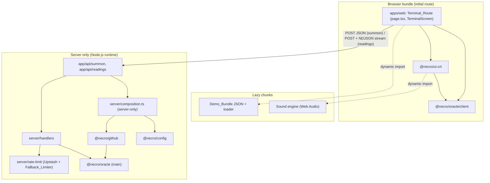
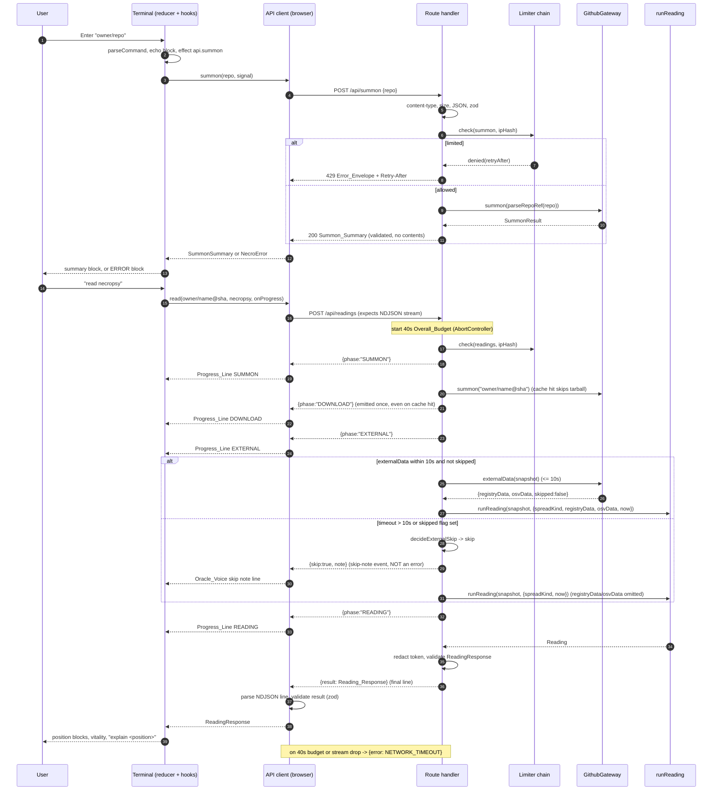

# Design Document: CRT Terminal (`packages/ui-crt` + `apps/web`)

## Overview

The CRT Terminal is the primary web surface of the Necro-Oracle. A visitor types or pastes a public GitHub repository, the server pins it to one commit, and the terminal draws the spread returned by `runReading` as evidence-backed text diagnoses. It is a DOM terminal (no canvas), keyboard-first, with CSS-only CRT effects, a typewriter reveal that never leaks to assistive technology, a bundled offline `demo`, and opt-in Web Audio sound.

A reading is not a single request/response: the Reading_Route streams a short sequence of Progress_Events as each Reading_Phase (`SUMMON`, `DOWNLOAD`, `EXTERNAL`, `READING`) begins, then sends the validated Reading_Response as the final message of the same chunked HTTP body. The route enforces an Overall_Budget of 40 seconds per reading and an External_Sub_Budget of 10 seconds on `fetchExternalData`, skipping external data gracefully (never fabricating it) when the mists hide the registries. The terminal renders each Progress_Event as one Oracle_Voice Progress_Line and only renders the spread after the final result line validates.

The design splits the work along the dependency direction in `structure.md`:

- **`@necro/ui-crt`** (new real content) holds everything that can be pure: the command parser and printer, text sanitizing and 72-column wrapping, the voice table, the reading, explain, help and error renderers, the reveal schedule, the session reducer, the sound reducer, the rate-independent preference loaders, and the React components. It imports no adapter and no server module, and from `@necro/oracle` it imports only the new Client_Safe_Entry.
- **`apps/web`** is the composition root. It owns the route page, the two API route handlers, the server-only composition module that injects `FetchPort`, `ClockPort`, `EnvPort` and `RateLimitPort`, the rate limiter, the CSP middleware, the browser adapters (fetch API client, localStorage, Web Audio loader) and the Demo_Bundle.
- **`@necro/oracle`** gains one subpath export, `@necro/oracle/client`, containing only zod schemas, types and the card registry. A small behaviour-preserving refactor (moving the Reading schemas out of the orchestrator file) makes that possible.
- **`@necro/config`** gains `NECRO_DAILY_REQUEST_CEILING` and two optional deployment keys.

### Research findings that shaped the design

All findings below come from reading the repository, not from assumptions.

| Finding | Source | Design consequence |
|---|---|---|
| The main entry `@necro/oracle` exports the tree-sitter parser, all detectors and `runReading`. `reading/run.ts` defines `ReadingSchema` and `runReading` in one file, and `run.ts` imports the parser. | `packages/oracle/src/index.ts`, `reading/run.ts` | The browser cannot import `ReadingSchema` from the main entry. Add `reading/schema.ts`, re-export it from `run.ts`, and build `src/client.ts` on schemas only (D1). |
| `@necro/oracle` already has a `./node` subpath and an exports map with a `development` condition that points at `src`, plus a `size-limit` config for the main entry. | `packages/oracle/package.json`, `.size-limit.cjs` | Add `./client` in the same shape. Add a second `size-limit` entry. |
| `parseRepoRef(input: string): ParsedRepoRef` is pure and throws `SummonerError` (`INVALID_REPO_URL`). `GitHubSummoner.summon(input: string \| ParsedRepoRef): Promise<SummonResult>` does 2 REST calls (repo, commit) before it consults its cache, then a tarball download only on a miss. | `packages/github/src/intake.ts`, `snapshot.ts` | The Reading_Route re-summons the pinned SHA. A warm instance skips the tarball (R12.10), not the 2 REST calls. The summoner must be a process-wide singleton. |
| `SummonResult = { snapshot, extras: { stars, defaultBranch, hasWorkflowsDir, degradedFields }, cache }`. `DegradedField = "pulls" \| "release"`. | `snapshot.ts`, `http-failure.ts` | Maps one-to-one onto the Summon_Summary. |
| `fetchExternalData(input: RepoSnapshot \| readonly Manifest[], deps: { fetch, clock }, opts?)` returns `{ registryData, osvData, skipped }` and never throws for per-dependency failures. | `external-data.ts` | The Reading_Route passes `registryData` and `osvData` straight to `runReading`. |
| `runReading(snapshot, opts: ReadingOpts): Promise<Reading>`; `ReadingOpts = { spreadKind, registryData?, osvData?, now }`. `Reading` has `id` (random UUID), `repo`, `draws`, `spread`, `vitality`, `createdAt`, `engineVersion`, `errors`. | `reading/run.ts` | `id` differs on every run, which affects the Demo_Bundle equality test (D6, Q3). `engineVersion` and `errors` are part of the wire schema. |
| `@necro/github` `EnvPort` is `{ get(key: "GITHUB_TOKEN"): string \| undefined }`. `@necro/config` has only `GITHUB_TOKEN`, and `loadEnv` throws a plain `Error`. | `ports.ts`, `packages/config/src/index.ts` | A wider route-level env port and a typed `EnvValidationError` are needed (D8, Q5). |
| `NecroError.userMessage` from the summoner is `"<mystical>\n<technical>"`. `NecroErrorCodeSchema` has 18 codes. `RATE_LIMITED` text from `summonerError` says "GitHub API rate limit", which is wrong for our own limiter. | `errors.ts` (both packages) | The error renderer splits on the first newline. The route layer builds its own `RATE_LIMITED` message. |
| `@necro/github` does not export its `testing/` helpers (`fixture-fetch`, `make-tar-gz`). | `packages/github/src/index.ts` | Handler tests inject at a `GithubGateway` seam, not at `FetchPort` (D9, Q6). |
| The oracle's `grammarWasmUrl()` calls `createRequire(import.meta.url).resolve("tree-sitter-python/tree-sitter-python.wasm")`. | `parser/tree-sitter.ts` | Bundling the oracle into the Next server build breaks that resolution. Externalize it and trace the WASM (D11, Q8). |
| `apps/web` has no `@necro/*` dependencies, no `zod`, no `transpilePackages`, and the placeholder page. `ui-crt`, `github` and `config` export raw `./src/index.ts`. `@necro/ui-crt` is an empty stub with `jsx: react-jsx`. | `apps/web/package.json`, `next.config.ts`, `packages/ui-crt` | Declare workspace dependencies and `transpilePackages`. |
| `SeveritySchema` is `0..3`; the Tower detector emits severity 2, the Star detector severity 1 or 2. | `registry/schema.ts`, detectors | R7.2 now says "an integer from 0 to 3 rendered exactly as received". The renderer prints the number exactly as received; `SEVERITY 0` is valid (Q1 resolved). |
| Next App Router route handlers can return a `Response` whose body is a `ReadableStream`; `fetch` on the client exposes `response.body` as a `ReadableStream` with a `getReader()`. No SSE or WebSocket primitive is required for one-direction, chunked progress. | Next 15.5 route handler contract, WHATWG fetch | Stream progress as NDJSON over the existing `POST /api/readings` body; no separate SSE endpoint (out of scope per requirements). |
| `fetchExternalData(input, deps, opts?)` returns `{ registryData, osvData, skipped }` and never throws for per-dependency failures, but it has no built-in wall-clock ceiling of its own at the route level. | `external-data.ts` | The Reading_Route must impose the External_Sub_Budget (10 s) itself and read `skipped`; a pure `decideExternalSkip` decides the skip (D13, P29). |
| `runReading(snapshot, { spreadKind, registryData?, osvData?, now })` already treats `registryData` and `osvData` as optional; omitting them lets registry/OSV-dependent cards be absent or lower-confidence rather than failing. | `reading/run.ts`, `reading/schema.ts` | On external skip the route calls `runReading` with both omitted and fabricates nothing (R6.22). |

### Design decisions

| Id | Decision | Rationale |
|---|---|---|
| D1 | Client_Safe_Entry is the subpath **`@necro/oracle/client`** (`src/client.ts`). It exports schemas, types, `CARD_REGISTRY`, `getCard` and `NecroError` only. | Browser needs the Reading shape and card names. Nothing else. A single, named subpath is the permitted exception in R16.4. |
| D2 | The wire schemas (`SummonSummarySchema`, `ReadingResponseSchema`, request and envelope schemas) live in **`apps/web/src/protocol/schemas.ts`**. `@necro/ui-crt` defines the matching TypeScript interfaces in `src/protocol.ts`, and the web schemas are checked against them with a compile-time conformance assertion. | `structure.md` forbids subpath imports of `ui-crt`, so server routes would have to import the whole React barrel. Keeping the zod schemas in `apps/web` avoids that, and `ui-crt` stays a pure rendering library. |
| D3 | The terminal logic is an Elm-style pure reducer: `step(state, action) => { state, effects }`. React only dispatches actions and runs effects. | Single in-flight request, history bounds, log cap, demo isolation and sound independence become properties of one pure function. |
| D4 | Output is modelled as `OutputBlock { lines: OutputLine[] }` where a line is a list of `Segment { text, href? }`. Only `buildEvidenceLink` can create an `href`. | Links stay inside the 72-column wrapping and can be tested as data. Every other repository-derived string is a text segment. |
| D5 | Rate limiting uses Upstash as primary and a per-instance fixed-window `FallbackLimiter` as backup. The choice is per request with a 30-second open-circuit window, measured only with `ClockPort`. | R13.6 requires availability; the circuit avoids adding the primary's timeout to every request during an outage. |
| D6 | The Demo_Bundle is generated by `scripts/demo-bundle/generate.ts` from `fixtures/graveyard/*` with the real `runReading`, a fixed `now`, and a deterministic `id` (post-processed). It ships as one JSON chunk loaded with a dynamic `import()`. | R18.12 and R18.13. The random `Reading.id` is the one non-deterministic field. |
| D7 | The sound engine is its own lazily loaded chunk behind a pure `soundReducer`. Nothing is created before `preference === "on"` and a gesture. | R19.2, R19.13, R19.17. |
| D8 | `@necro/config` adds `NECRO_DAILY_REQUEST_CEILING` (default 1000), `NECRO_CLIENT_IP_HEADER` (default `x-real-ip`), optional `UPSTASH_REDIS_REST_URL` and `UPSTASH_REDIS_REST_TOKEN`, and an `EnvValidationError`. The web composition exposes them through a `RouteEnvPort`, a supertype-compatible superset of the summoner's `EnvPort`. | R13.3, R13.4, R13.9. |
| D9 | `RouteDeps` carries `clock`, `env`, `fetch`, `limiter` and a `GithubGateway` (`summon`, `externalData`). Production wires the real `GitHubSummoner` and `fetchExternalData` over the injected `FetchPort`. | R12.12 and R16.11 with the real summoner untouched. |
| D10 | CSP is set by middleware with a per-request nonce and `'strict-dynamic'`. The terminal page is rendered dynamically. | Next App Router emits inline bootstrap scripts, so "no inline script" requires a nonce. |
| D11 | In production the server build treats `@necro/oracle`, `web-tree-sitter` and `tree-sitter-python` as external packages and traces the WASM files into the `/api/readings` function. | Keeps the grammar resolvable and the server bundle small. |
| D12 | The terminal holds no output in storage. `localStorage` holds exactly two keys, `necro.motion` and `necro.sound`. | R1.6, R10.10, R19.12. |
| D13 | The Reading_Route streams progress as **NDJSON** (one JSON object per line, `Content-Type: application/x-ndjson`, `Cache-Control: no-store`) over the existing `POST /api/readings` body, not as SSE. Each line is a Progress_Event or a skip-note event; the final line is `{ result }` (a Reading_Response) or `{ error }` (an Error_Envelope). Only the `result` line is a validated Reading_Response, checked server-side before sending and again client-side before rendering. | A standalone SSE endpoint is out of scope (requirements "Out of Scope"); NDJSON over the one POST that already carries the request is the simplest transport, needs no reconnection/event-id machinery, and matches R6.14 ("a streamed, chunked response body ... before the final Reading_Response is sent as the last message of the same response"). |
| D14 | Phase reporting is a **pure monotonic state machine**: `advancePhase(current, event) => next \| error`. The route owns a `PhaseReporter` that calls `advancePhase` and emits each Reading_Phase at most once, in the fixed order `SUMMON`, `DOWNLOAD`, `EXTERNAL`, `READING`, never backwards. `DOWNLOAD` is emitted once even on a cache hit (where it is instantaneous). | R6.14-R6.16; the pure function is what P28 tests, with no clock, network or stream in the test. |
| D15 | The Overall_Budget is a 40 s deadline from request receipt via an `AbortController` whose `signal` is passed to the gateway and races the pipeline; the External_Sub_Budget is a 10 s race around `fetchExternalData`. A pure `decideExternalSkip({ elapsedMs, skipped })` returns `{ skip, note }`; on skip the route calls `runReading` with `registryData` and `osvData` both omitted and emits a skip-note event. `maxDuration = 50` stays as the serverless backstop. All timers in tests are driven by `ClockPort`. | R6.11, R6.19-R6.22, R12.9; keeps the oracle's ritual budget strictly tighter than the serverless limit and the external phase strictly tighter than the overall budget. The pure decision function is what P29 tests. |

### Open questions and requirement conflicts

These are places where a requirement conflicted with the code as it exists, or was ambiguous. Each carries a status: **RESOLVED** (the requirement now settles it), **ACCEPTED** (the user has adopted the proposed resolution for this design), or an open proposal awaiting confirmation during the tasks phase.

- **Q1 (RESOLVED): severity range.** R7.2 now reads "its severity as an integer from 0 to 3 rendered exactly as received from the CardDraw", matching `SeveritySchema` (`0..3`). The renderer prints the number exactly as received, so `SEVERITY 0` is a valid line for a latent card. No wording anywhere in this design implies `1..3`.
- **Q2: `REF_NOT_FOUND` status.** R12.4 lists `REF_NOT_FOUND` under 400 and then under 404. Resolution: **404**.
- **Q3 (ACCEPTED): `Reading.id` is random.** R18.13 says a bundled Reading "equals the Reading produced by a fresh `runReading`", but `id` is `crypto.randomUUID()` on each run. Adopted resolution: the generator replaces `id` with a deterministic UUID derived from `(demoName, spread)`, and the equality test compares everything except `id`, which it checks for UUID shape and determinism. R18.12 ("no Demo Reading is hand-written") still holds because only `id` is rewritten by script.
- **Q4 (ACCEPTED): oracle change outside this spec.** `ReadingSchema` is co-located with the orchestrator in `reading/run.ts`, which pulls the parser. Splitting it into `reading/schema.ts` is a pure, behaviour-preserving move with unchanged public exports, but it edits spec 01's package. Adopted resolution: do it as part of the **first implementation task** (the Q8 spike + schema split, see Q8) and run the oracle's existing suite to prove behaviour is preserved.
- **Q5 (ACCEPTED): env typing.** R13.4 asks for "a typed error that does not print the value", but `loadEnv` throws a plain `Error`, and `NecroErrorCodeSchema` has no config code. Adopted resolution: add `EnvValidationError extends Error` with `keys: readonly string[]` inside `@necro/config`, without touching the oracle error enum.
- **Q6: no exported test helpers in `@necro/github`.** R16.11 asks for a fixture-backed `FetchPort`. The package's recorded-fixture fetch and tar builder are internal. Resolution: unit tests stub the `GithubGateway`; one integration test drives the real summoner with a tiny hand-written `FetchPort` that returns 404 and 429 only. If fuller fixtures are wanted, exporting `src/testing` from `@necro/github` is a spec 02 change.
- **Q7: fields beyond the glossary.** `Reading` also carries `engineVersion` and `errors` (detector failures). R7.12 forbids altering draws, but a silent detector failure would hide a card. Resolution: the wire schema keeps both fields; when `errors` is non-empty the renderer adds one closing block that states the failed detector count. It adds no card.
- **Q8 (ACCEPTED, FIRST IMPLEMENTATION TASK): Next and the oracle package.** This is the very first implementation task: a spike plus the behaviour-preserving oracle schema split. It has two parts.
  - (a) **Schema split.** Move `ReadingSchema`, `SpreadKindSchema` and `ReadingOptsSchema` (with their inferred types) out of `packages/oracle/src/reading/run.ts` into a new `packages/oracle/src/reading/schema.ts`; `run.ts` imports from `./schema.js` and re-exports the same names, so `src/index.ts` and every existing test keep their exports unchanged. Success criterion: the oracle's existing suite (`pnpm --filter @necro/oracle test`) is green with no test edits, and `@necro/oracle/client` can import `ReadingSchema` from `reading/schema.ts` without pulling the parser (proven by `client.guard.test.ts`).
  - (b) **Next/Vercel spike.** Verify two deployment risks before building on them: (1) whether Next's webpack dev server activates the `development` export condition, which would resolve `@necro/oracle` to raw TypeScript in dev; (2) whether Vercel's file tracing picks up the tree-sitter grammar WASM for the `/api/readings` function. Success criteria: a minimal `/api/readings` handler that imports `runReading` builds and runs on a Vercel preview with the grammar WASM resolvable at runtime (no `createRequire(...).resolve` failure); the dev server either activates the `development` condition (keep the dev branch in `next.config.ts`) or does not (drop the dev branch and transpile instead); the resolved behaviour of both is recorded in "Next configuration".
- **Q9: CSP wording.** R14.9 says scripts only from the application origin. With `'strict-dynamic'`, modern browsers ignore the origin allowlist and trust nonce-loaded scripts. The header still lists `'self'` for old browsers. Resolution: accept.
- **Q10: status mapping oddities.** R12.4 maps a summoner `VALIDATION_FAILED` (a GitHub payload that failed validation) to 400, which blames the client. It also maps `UPSTREAM_UNAVAILABLE` to 502 but R12.5 maps unknown throwables to code `UPSTREAM_UNAVAILABLE` with status 500. Resolution: implement exactly as written; P13 pins both.
- **Q11 (SUPERSEDED): time budget.** Superseded by the streaming design below ("Streamed progress and time budgets") and decisions D13-D15. R6 now fixes the Overall_Budget (40 s) and External_Sub_Budget (10 s) explicitly; this design implements them with an `AbortController` deadline and a bounded external race, maps a budget overrun or a dropped stream to `NETWORK_TIMEOUT`, and keeps `maxDuration = 50` as the serverless backstop. The p50 is still tracked in the perf check (R12.9).
- **Q12: `aria-busy` and live announcements.** Setting `aria-busy="true"` on a live region can defer announcements. Resolution: append the in-progress block first and set `aria-busy` one tick later; clear it in the same commit that appends the result.
- **Q13: steering names `Spread*` and `SigilRitual`.** This spec builds a single `Spread` component (fates and necropsy as ordered position blocks), `Card`, `EvidenceScroll`, `Screen` and `Terminal`. `SigilRitual` and Celtic layouts belong to later specs.
- **Q14: extra config keys.** `NECRO_CLIENT_IP_HEADER` and the two Upstash keys are not named in the requirements. R13.9 says the header is "configured for the deployment" and R13.1 needs a store, so some key must exist. Resolution: add them, all optional with safe defaults.
- **Q15: celtic on the server.** The parser accepts `read celtic` only to answer "not yet available". The Reading_Route schema accepts `fates` and `necropsy` only and rejects `celtic` with `VALIDATION_FAILED`.

## Architecture

### Dependency direction and import rules



Rules, all enforced by lint or tests (see Testing Strategy):

- `@necro/ui-crt` and the client side of `apps/web` import `@necro/oracle` only as `@necro/oracle/client`. They never import `@necro/github`, `@necro/config` or `node:*`.
- `@necro/github`, `@necro/config` and `@necro/oracle` (main entry) are imported only from `apps/web/src/server/**` and from the route files under `app/api/**`.
- `apps/web/src/server/composition.ts` starts with `import "server-only"`. It is the only file that reads `process.env`, builds adapters (Upstash, `createSystemFetchPort`, `systemClock`) or constructs `GitHubSummoner`.
- Every cross-package import uses the package's `src/index.ts`, plus the single permitted `@necro/oracle/client` subpath. `@necro/oracle/node` is used only by the Demo_Bundle generator script and its test, never by `apps/web` runtime code.

### File and package layout

```
packages/oracle/
  src/client.ts                      NEW  Client_Safe_Entry
  src/client.guard.test.ts           NEW  import-closure guard
  src/reading/schema.ts              NEW  ReadingSchema, ReadingOptsSchema, SpreadKindSchema (moved from run.ts)
  src/reading/run.ts                 EDIT imports and re-exports ./schema.js; orchestrator unchanged
  package.json                       EDIT exports["./client"]
  .size-limit.cjs                    EDIT second entry for dist/client.js
packages/config/
  src/index.ts                       EDIT new keys, EnvValidationError
  test/env.pbt.test.ts               NEW  P22
packages/ui-crt/
  package.json                       EDIT deps: react (peer), @necro/oracle (workspace), fast-check (dev)
  src/index.ts                       EDIT public barrel
  src/protocol.ts                    SummonSummary, ReadingResponse, ApiPort interfaces (types only)
  src/ports.ts                       StoragePort, MediaPort, VisibilityPort, FramePort, DemoPort, SoundLoaderPort
  src/tokens.ts                      design tokens as TS constants
  src/crt.css                        design tokens as CSS custom properties, layers, layout
  src/command/{types,parse,print}.ts
  src/text/{sanitize,wrap}.ts
  src/voice/{voice-table,phrases}.ts
  src/render/{blocks,reading,explain,summary,help,errors,evidence-link,demo-label}.ts
  src/motion/{reveal,motion-mode}.ts
  src/prefs/prefs.ts
  src/session/{state,history,log,reducer}.ts
  src/sound/{sound-reducer,engine-types,load-engine,engine}.ts   (engine.ts is the lazy chunk)
  src/demo/catalog.ts
  src/components/{Screen,Terminal,OutputLog,OutputBlockView,Card,Spread,EvidenceScroll,CommandLine,ButtonRow}.tsx
  src/hooks/{use-terminal,use-reveal,use-motion,use-sound}.ts
  src/testing/{arbitraries,mock-reading,fake-ports}.ts
apps/web/
  next.config.ts                     EDIT transpile, externals, tracing, static headers
  src/middleware.ts                  NEW  CSP nonce
  src/app/{layout,page}.tsx          EDIT
  src/app/api/summon/route.ts        NEW
  src/app/api/readings/route.ts      NEW
  src/components/TerminalScreen.tsx  NEW  client component: builds browser ports, renders <Terminal/>
  src/terminal/{api-client,browser-ports}.ts
  src/protocol/schemas.ts            NEW  zod wire schemas (conformance-checked against ui-crt types)
  src/protocol/stream.ts             NEW  NDJSON stream line schemas (phase, skip-note, result, error)
  src/terminal/ndjson.ts             NEW  createNdjsonParser (incremental line splitter, pure)
  src/server/{composition,deps,handlers/{summon,readings,guard,phase,external-skip},error-map,redact,client-ip,
              pinned-ref,limiter/{port,upstash,fallback,chain},log}.ts
  src/demo/{bundle.generated.json,load-bundle.ts,build-demo.ts,demo-bundle.test.ts}
  e2e/*.e2e.ts, playwright.config.ts
fixtures/graveyard/{lich-py2,mixed-ruins,green-garden}/
  repo/…  demo.json  registry.json  osv.json
scripts/demo-bundle/generate.ts      regenerates apps/web/src/demo/bundle.generated.json
scripts/check-web-budget.mjs         gzip budget and forbidden-marker scan on the built route
```

New `apps/web` dependencies (pin exact versions at install time, per the safety rules): `@necro/oracle`, `@necro/github`, `@necro/config`, `@necro/ui-crt` as `workspace:*`; `zod`; `@upstash/ratelimit`; `@upstash/redis`; `server-only`; `web-tree-sitter` and `tree-sitter-python` (so they resolve from the web package at runtime); dev: `@playwright/test`, `@axe-core/playwright`, `fast-check`. Root dev: `tsx` for the generator script. `@necro/ui-crt` gets `react` and `react-dom` as peer dependencies.

### Summon and read sequence



### Terminal state machine

The request lifecycle is a small state machine. The reveal queue, motion mode and sound state are independent regions that the same reducer updates.

```mermaid
stateDiagram-v2
  [*] --> Booting
  Booting --> Idle: Boot (boot block appended, focus input)
  Idle --> Idle: local command (help, clear, motion, sound, demo list, explain, unknown, empty, over-length)
  Idle --> Summoning: summon (live)
  Idle --> Reading: read (live, no held reading for this sha and spread)
  Idle --> LoadingDemo: demo name (bundle not loaded)
  Idle --> Idle: demo name (bundle loaded), read or explain on demo session
  Summoning --> Idle: ApiSummonOk (summary stored, readings dropped)
  Summoning --> Idle: ApiFailed (ERROR block)
  Summoning --> Idle: Abort (Ctrl+C or 55 s timeout)
  Reading --> Reading: Progress (phase or skip-note -> one Progress_Line, aria-busy stays true)
  Reading --> Idle: ApiReadOk (final result validated, response stored)
  Reading --> Idle: ApiFailed (ERROR block; stream drop or 40s budget -> NETWORK_TIMEOUT)
  Reading --> Idle: Abort
  LoadingDemo --> Idle: DemoLoaded (validated) or DemoLoadFailed (ERROR block)
  Summoning --> Summoning: summon/read/demo name rejected ("ritual underway")
  Reading --> Reading: summon/read/demo name rejected ("ritual underway")
  LoadingDemo --> LoadingDemo: summon/read/demo name rejected
```

Region rules: a `RevealTick` action advances `reveal` only while `motionMode === "full"`; a `Submit` while a reveal runs first completes it (R10.5); `Escape` completes the running reveal and drops the queue (R3.5); `MediaChanged` recomputes `motionMode` when the preference is `auto`. The `Reading --> Reading: Progress` self-transition appends one Progress_Line per streamed Progress_Event (phase or skip-note) without leaving the `Reading` state or clearing `inflight`; `aria-busy` stays true until `ApiReadOk` or `ApiFailed`.

### Security considerations

- **Repository content is data.** It reaches the browser only as validated strings inside a `Reading`. The server never returns file contents (the Summon_Summary has a file count, the Reading_Response has no snapshot). All repository-derived strings go through `sanitizeText`, become text nodes, and are never parsed as HTML. The only `href` is built by `buildEvidenceLink` from a validated `RepoRef` and `Evidence`, with `rel="noopener noreferrer"` and `target="_blank"`.
- **No dangerous sinks.** ESLint `no-restricted-syntax` bans `dangerouslySetInnerHTML`, `eval`, `new Function`, `postMessage`, and `import()` of non-literal specifiers in `packages/ui-crt/src` and `apps/web/src` (client files). A grep test backs the lint rule.
- **Token handling.** `GITHUB_TOKEN` is read once in `composition.ts` through `loadEnv`. The route layer replaces every occurrence of the token value in every string of a response with `[REDACTED]` (`redactDeep`). Logs record only `{ route, status, code, durationMs }`.
- **Sandbox and execution.** No repository code runs anywhere in this spec. Parsing happens in the oracle (tree-sitter, TOML) on the server.
- **Abuse.** Per-IP and global limits run before any GitHub request. The limiter key is a SHA-256 prefix of the client IP, never the raw IP, to honour the privacy rule. Body size is capped at 2 KB. SSRF is closed by `parseRepoRef` (host allowlist) and by the summoner's own header policy.
- **Residual risk (accepted).** A third-party site can make a visitor's browser POST to the routes. The rate limits and `Cache-Control: no-store` bound the cost; no CORS headers are sent, so the response is unreadable cross-origin.
- **CSP (R14.9).** Middleware sets, per request:

```
default-src 'self';
script-src 'self' 'nonce-<n>' 'strict-dynamic';       (+ 'unsafe-eval' only when NODE_ENV === "development")
style-src 'self' 'nonce-<n>';
img-src 'self' data:;  font-src 'self';  connect-src 'self';
object-src 'none';  base-uri 'none';  form-action 'self';  frame-ancestors 'none'
```

  The nonce is a base64 of 16 random bytes from Web Crypto. It is forwarded on the request as `x-nonce` and in the header, and Next applies it to its own scripts. The root layout calls `await headers()` so the page is dynamic. All CRT effects are class-based, so no inline `style` attribute is required. Static headers from `next.config.ts` add `X-Content-Type-Options: nosniff`, `Referrer-Policy: no-referrer`.

## Components and Interfaces

### `@necro/oracle`: Client_Safe_Entry

`package.json` exports map (same shape as `./node`):

```json
"./client": {
  "types": "./dist/client.d.ts",
  "development": "./src/client.ts",
  "import": "./dist/client.js",
  "default": "./dist/client.js"
}
```

`src/client.ts` is the only new entry file. It exports, by name:

```typescript
// schemas and inferred types only
export { CardIdSchema, SeveritySchema, EvidenceSchema, CardDefinitionSchema, CardDrawSchema,
         SpreadPositionSchema, type CardId, type Severity, type Evidence, type CardDefinition,
         type CardDraw, type SpreadPosition } from "./registry/schema.js";
export { CARD_REGISTRY, getCard } from "./registry/cards.js";     // numerals and names for headings
export { RepoRefSchema, type RepoRef } from "./snapshot/types.js";
export { SpreadKindSchema, ReadingSchema, type SpreadKind, type Reading } from "./reading/schema.js";
export { NecroError, NecroErrorCodeSchema, type NecroErrorCode } from "./util/errors.js";
```

`reading/schema.ts` receives `SpreadKindSchema`, `ReadingOptsSchema`, `ReadingSchema` and their types, verbatim from `run.ts`. `run.ts` then does `import { … } from "./schema.js"` and `export { SpreadKindSchema, ReadingOptsSchema, ReadingSchema, type SpreadKind, type ReadingOpts, type Reading } from "./schema.js"`, so `src/index.ts` and all existing tests keep working unchanged.

**What can be reached from `client.ts`.** Only these files: `registry/schema.ts`, `registry/cards.ts` (imports `schema.ts` and `util/errors.ts`), `snapshot/types.ts`, `reading/schema.ts`, `util/errors.ts`, plus `zod`. `registry/cards.ts`, `snapshot/types.ts` and `util/errors.ts` were read and import only zod and each other. No parser, no `web-tree-sitter`, no detector, no `smol-toml`, no `node:*`.

**Guarantee.** `packages/oracle/src/client.guard.test.ts` (Vitest, runs in `pnpm test`) walks the static import graph starting at `src/client.ts` with TypeScript's `ts.preProcessFile`, following relative specifiers (resolving `.js` to `.ts`). It fails if:

1. any reachable file is outside the allowlist `{ registry/schema, registry/cards, snapshot/types, reading/schema, util/errors }`;
2. any reachable file has a bare import other than `zod`;
3. any reachable file imports `node:*`, `web-tree-sitter`, `tree-sitter-python`, `smol-toml`, or contains a dynamic `import(`.

A second guard (`dist` level) runs after `pnpm --filter @necro/oracle build`: it reads `dist/client.js` and its relative closure and applies the same rules. Finally the web budget script (below) scans the built browser chunks for markers that survive minification.

**Size.** A second `size-limit` entry measures `dist/client.js` with zod included (not ignored), limit `25 KB` gzipped. The number is a starting estimate to be tuned when the first measurement exists.

### `@necro/config`

```typescript
export class EnvValidationError extends Error {
  readonly keys: readonly string[];            // key names only, never values
  constructor(keys: readonly string[]);
}

export const EnvSchema = z.object({
  GITHUB_TOKEN: /* unchanged */,
  NECRO_DAILY_REQUEST_CEILING: z.preprocess(
    blankToUndefined,                           // "" or whitespace -> undefined
    z.string().regex(/^[1-9][0-9]*$/).refine((s) => Number.isSafeInteger(Number(s)))
      .default("1000").transform(Number),
  ),                                            // output: positive safe integer, default 1000
  NECRO_CLIENT_IP_HEADER: z.preprocess(blankToUndefined,
    z.string().regex(/^[a-z0-9-]{1,64}$/).default("x-real-ip")),
  UPSTASH_REDIS_REST_URL: z.preprocess(blankToUndefined, z.string().url().optional()),
  UPSTASH_REDIS_REST_TOKEN: z.preprocess(blankToUndefined, z.string().min(1).optional()),
});
export function loadEnv(source: Readonly<Record<string, string | undefined>>): Env;  // throws EnvValidationError
```

`EnvValidationError` keeps the existing message format, so the existing `env.test.ts` (`toThrow()`) still passes. `0`, `-3`, `1.5`, `1e3`, `" 7"` after trimming blank only, and `abc` are all rejected; the message names `NECRO_DAILY_REQUEST_CEILING` and withholds the value.

### `@necro/ui-crt`: protocol types

`src/protocol.ts` holds plain interfaces (no zod), written for `exactOptionalPropertyTypes`:

```typescript
import type { Reading, RepoRef } from "@necro/oracle/client";

export type PlayableSpread = "fates" | "necropsy";

export interface SummonSummary {
  readonly ref: RepoRef;                         // owner, name, 40-hex sha, defaultBranch
  readonly stars: number;
  readonly hasWorkflowsDir: boolean;
  readonly degradedFields: readonly ("pulls" | "release")[];
  readonly cache: "hit" | "miss";
  readonly fileCount: number;
  readonly truncated: boolean;
  readonly demo?: true | undefined;
}
export interface ReadingResponse { readonly summary: SummonSummary; readonly reading: Reading }

export type ReadingPhase = "SUMMON" | "DOWNLOAD" | "EXTERNAL" | "READING";
// One decoded NDJSON line of the Reading_Route stream, in the client's view.
export type ProgressEvent =
  | { readonly kind: "phase"; readonly phase: ReadingPhase }
  | { readonly kind: "skip-note"; readonly note: string };
export type ReadProgress = (event: ProgressEvent) => void;

export interface ApiPort {
  summon(repo: string, signal: AbortSignal): Promise<SummonSummary>;                  // rejects with NecroError
  // read consumes the NDJSON stream: it calls onProgress for every phase/skip-note
  // line as it arrives, then resolves with the validated final result line.
  read(pinned: string, spread: PlayableSpread, signal: AbortSignal, onProgress: ReadProgress): Promise<ReadingResponse>;
}
export interface DemoBundle { readonly [name: string]: { readonly fates: ReadingResponse; readonly necropsy: ReadingResponse } }
export interface DemoPort { load(): Promise<DemoBundle> }                              // validated, memoised, rejects with NecroError
```

### `@necro/ui-crt`: pure core modules

All signatures below are exported from `src/index.ts` unless marked internal. `ReadonlyArray` is written as `readonly T[]`.

**Commands** (`command/types.ts`, `parse.ts`, `print.ts`)

```typescript
export type ExplainTarget =
  | { readonly kind: "position"; readonly position: number }     // integer >= 1
  | { readonly kind: "card"; readonly card: CardId };
export type SpreadArg = "fates" | "necropsy" | "celtic";
export type Command =
  | { readonly kind: "help" } | { readonly kind: "clear" }
  | { readonly kind: "summon"; readonly repo: string }
  | { readonly kind: "read"; readonly spread: SpreadArg }
  | { readonly kind: "explain"; readonly target: ExplainTarget }
  | { readonly kind: "motion"; readonly arg?: MotionPreference }
  | { readonly kind: "demo"; readonly name?: string }
  | { readonly kind: "sound"; readonly arg?: SoundPreference }
  | { readonly kind: "unknown"; readonly raw: string };

export const MAX_ENTRY_LENGTH = 200;
export function parseCommand(input: string): Command | null;      // total; null for empty or whitespace only
export function printCommand(cmd: Exclude<Command, { kind: "unknown" }>): string;
export function looksLikeRepoRef(token: string): boolean;         // internal helper for bare-token summon
```

Parsing rules, in order: split on Unicode whitespace after `trim()`; zero tokens gives `null`. The first token is lowercased and matched against the eight names. Arguments for `read`, `motion`, `demo`, `sound` and `explain` are matched in lowercase and stored lowercased; the repo argument of `summon` is the raw second token, unchanged. A `summon` with extra tokens, a `read` with an unknown spread, an `explain` target that is neither a positive integer nor a `CardId`, a `demo` argument outside `^[a-z0-9-]{1,32}$`, and any other mismatch yield `unknown`. A single token that is not a command name and satisfies `looksLikeRepoRef` yields `summon`. `looksLikeRepoRef` is a light regex (`github.com` or `www.github.com` URL with an owner and a repo segment, or `owner/repo` over `[A-Za-z0-9_.-]` with an optional `#ref` or `@sha`). Full validity is the server's job through `parseRepoRef`. The parser never throws and never reads the clock, environment, network or DOM. `printCommand` emits the lowercase name and single spaces, with the stored lowercase arguments.

**Text** (`text/sanitize.ts`, `text/wrap.ts`)

```typescript
export function sanitizeText(input: string): string;
export const LINE_WIDTH = 72;
export function wrapText(text: string, width?: number): string[];                 // splits on "\n", never returns []
export interface Segment { readonly text: string; readonly href?: string }
export function wrapSegments(segments: readonly Segment[], width?: number): Segment[][];
```

`sanitizeText` removes, in this order: ANSI sequences (CSI `ESC [ … final`, OSC `ESC ] … BEL|ST`, and two-character `ESC x` forms); then every remaining C0 control except `\n`, DEL, and C1 (`U+0080`–`U+009F`) in one character-class filter; then bidirectional overrides, embeddings and isolates (`U+202A`–`U+202E`, `U+2066`–`U+2069`) plus the marks `U+200E`, `U+200F`, `U+061C`. Because the last filter removes every `ESC`, no ANSI sequence can survive or re-form, which makes the function idempotent.

`wrapText` splits on `\n`, then greedily packs whitespace-separated tokens into lines of at most `width` code points. A token longer than `width` is cut at `width` (by code point, so surrogate pairs stay whole). Whitespace at a break is dropped; internal runs inside a line are kept. Width is measured in code points, not display cells (East Asian wide characters can look wider; accepted for L0). `wrapSegments` applies the same algorithm to the concatenated text and slices the original segments by offset, so a link that crosses a break becomes two segments that share the same `href`.

**Voice and phrases** (`voice/voice-table.ts`, `voice/phrases.ts`)

```typescript
export type Orientation = "upright" | "reversed";
export const VOICE_TABLE: Readonly<Record<CardId, Readonly<Record<Orientation, string>>>>;  // exhaustive: compile-time totality
export const BOOT_PHRASE = "NECRO-ORACLE v1.0 · NECROMANTIC SYSTEMS 1986 · TYPE HELP";
export const PRE_READING_PHRASE = "Shuffle. Cut. The repository speaks.";
export const DEMO_LABEL = "[DEMO] fixture replay, not a live repository";
export function vitalityVoice(vitality: number): string;       // three bands, each <= 16 words

// Progress_Line copy, one entry per Reading_Phase: a mystical line (<= 16 words)
// followed by a technical line naming the phase (R6.15). Exhaustive over ReadingPhase.
export const PHASE_VOICE: Readonly<Record<ReadingPhase, { readonly mystical: string; readonly technical: string }>>;
export const EXTERNAL_SKIP_NOTE =
  "The mists hid the registries and the vulnerabilities.\nThe reading proceeds without registry or advisory data.";   // R6.21
```

`VOICE_TABLE` is copied from the `oracle-voice` steering "Card voice lines" (12 cards × 2). Because the type is `Record<CardId, …>`, adding a card to `CardIdSchema` breaks the build until a line is added.

**Rendering** (`render/*.ts`). Renderers return drafts; the reducer assigns ids.

```typescript
export type BlockKind = "boot" | "echo" | "oracle" | "error" | "status";
export interface OutputLine { readonly segments: readonly Segment[] }
export interface OutputBlock { readonly id: number; readonly kind: BlockKind; readonly demo: boolean; readonly lines: readonly OutputLine[] }
export type BlockDraft = Omit<OutputBlock, "id">;
export function lineText(line: OutputLine): string;
export function blockText(block: BlockDraft | OutputBlock): string;              // lines joined by "\n"

export interface RenderContext { readonly live: boolean; readonly ref: RepoRef | null }   // live: Evidence_Link allowed
export function renderReading(resp: ReadingResponse): BlockDraft[];             // one per position, then closing block(s)
export function renderCardBlock(position: SpreadPosition, ctx: RenderContext): BlockDraft;
export function renderExplain(resp: ReadingResponse, target: ExplainTarget): BlockDraft[];
export function renderSummary(summary: SummonSummary): BlockDraft;
export function renderHelp(): BlockDraft;
export function renderError(err: { code: NecroErrorCode; userMessage: string }): BlockDraft;
export function renderEcho(raw: string): BlockDraft;
export function renderProgress(phase: ReadingPhase): BlockDraft;        // kind "status": PHASE_VOICE mystical + technical line (R6.15)
export function renderSkipNote(note: string): BlockDraft;              // kind "status": the EXTERNAL skip note (R6.21)
export function withDemoLabel(blocks: readonly BlockDraft[]): BlockDraft[];     // prepends DEMO_LABEL line, sets demo: true
export function buildEvidenceLink(ref: Pick<RepoRef, "owner" | "name" | "sha">, evidence: Pick<Evidence, "path" | "line">): string | null;
```

Layout of one position block (all text through `sanitizeText`, wrapped to 72 columns):

```
1  PAST                                   <- position number and label from the Reading
XVI THE TOWER  UPRIGHT  SEVERITY 2         <- numeral + uppercase name (CARD_REGISTRY), orientation, severity number
The foundations crack and burn.            <- VOICE_TABLE[card][orientation] (mystical line)
9 of 14 dependencies are 2+ major …        <- CardDraw.summary (technical line)
  requirements.txt:14  MySQL-python …      <- up to 3 Evidence lines "path:line  detail"
  … and 4 more evidence items.             <- only when more than 3
```

A void position prints the header, `VOID`, and `SpreadPosition.description`. After the position blocks, a closing block shows `VITALITY 42/100 [########------------]` on its own line (20-cell ASCII gauge, `#` filled and `-` empty), a `vitalityVoice` line first, and the final line `Type explain <position> for the evidence behind a card.` When `reading.errors` is non-empty (Q7) one more block states the count and the codes of failed detectors. `renderReading` is a pure function of its input, so equal inputs give equal lines (R7.11).

`buildEvidenceLink` returns `https://github.com/{owner}/{name}/blob/{sha}/{encodedPath}#L{line}`: the path is split on `/`, each segment passed through `encodeURIComponent`, and re-joined; `#L{line}` is added only when `line` is a defined integer; it returns `null` when `path` is absent. `renderCardBlock` calls it only when `ctx.live` is true. For a demo response the path is printed as `fixture:{path}` text with no link (R18.11). `renderExplain` prints, per Evidence item, `kind`, `source`, `path`, `line` and `detail` on labelled lines.

`renderError` splits `userMessage` at the first `\n`: the first part is the mystical line, the rest are the technical lines. If there is no newline, a generic mystical line per code is used and the whole message is the technical part. The block's first line is `ERROR <CODE>`. Every one of the 18 codes has a table entry, so the renderer is total. `stack`, `cause` and exception text are not inputs, so they cannot appear (R11.9).

**Motion and preferences** (`motion/*.ts`, `prefs/prefs.ts`)

```typescript
export type MotionPreference = "auto" | "on" | "off";
export type MotionMode = "full" | "reduced";
export type SoundPreference = "on" | "off";
export const MOTION_STORAGE_KEY = "necro.motion";
export const SOUND_STORAGE_KEY = "necro.sound";
export function resolveMotionMode(pref: MotionPreference, prefersReduced: boolean): MotionMode;
export function parseMotionPreference(raw: string | null | undefined): MotionPreference;   // else "auto"
export function parseSoundPreference(raw: string | null | undefined): SoundPreference;     // else "off"

export const REVEAL_BASE_CPS = 60;
export const REVEAL_MAX_MS = 3000;
export function revealRate(length: number): number;                       // max(60, ceil(length / 3)) chars per second
export function revealedChars(length: number, mode: MotionMode, elapsedMs: number): number;
export function revealDurationMs(length: number, mode: MotionMode): number;
```

`revealedChars` is `length` in `reduced` mode, otherwise `min(length, floor(max(0, elapsedMs) * revealRate(length) / 1000))`; `NaN` elapsed counts as 0. At 3000 ms the count is `3 * revealRate ≥ length`. The only place that reads time is the `use-reveal` hook through `FramePort`.

**History and log** (`session/history.ts`, `session/log.ts`)

```typescript
export const HISTORY_MAX = 50;
export interface History { readonly entries: readonly string[]; readonly cursor: number | null; readonly draft: string }
export function historyPush(h: History, entry: string): History;                    // drops oldest beyond 50; resets cursor
export function historyPrev(h: History, current: string): { history: History; text: string };
export function historyNext(h: History, current: string): { history: History; text: string };

export const LOG_MAX_LINES = 500;
export function appendBlocks(log: readonly OutputBlock[], blocks: readonly OutputBlock[]): OutputBlock[];
```

`historyPrev` from a fresh line saves the draft and selects the newest entry, then stops at index 0 (no wrap). `historyNext` stops past the newest entry by restoring the draft. `appendBlocks` drops whole oldest blocks until the total line count is at most 500. If one block alone exceeds 500 lines, its oldest lines are cut, so the retained lines are always a suffix of the full line sequence.

**Errors raised by the terminal itself** (`render/errors.ts`) build `NecroError` values with two-line Oracle_Voice messages:

```typescript
export function networkError(): NecroError;        // NETWORK_TIMEOUT: connection failure or 55 s client timeout
export function upstreamError(): NecroError;       // UPSTREAM_UNAVAILABLE: status >= 500 without a valid envelope
export function invalidResponseError(): NecroError;// VALIDATION_FAILED: response failed the zod schema
export function demoUnavailableError(): NecroError;// NETWORK_TIMEOUT: demo chunk could not load, "reload while online"
```

**Sound reducer** (`sound/sound-reducer.ts`)

```typescript
export interface SoundState { readonly preference: SoundPreference; readonly gesture: boolean; readonly visible: boolean }
export type SoundEvent =
  | { readonly type: "load"; readonly preference: SoundPreference; readonly visible: boolean }
  | { readonly type: "sound_on" } | { readonly type: "sound_off" }
  | { readonly type: "gesture" } | { readonly type: "hidden" } | { readonly type: "visible" };
export function soundReducer(state: SoundState, event: SoundEvent): SoundState;
export function soundActivity(state: SoundState): { readonly hum: boolean; readonly click: boolean };
```

`load` sets `gesture: false` regardless of the stored preference. `soundActivity` returns `hum` and `click` both equal to `preference === "on" && gesture && visible`. `sound_off` sets `preference: "off"`. There is no event that sets `gesture` except `gesture`; the UI layer dispatches `gesture` first on any keydown or pointerdown inside the terminal, so `sound on` typed with Enter or the SOUND button sees `gesture: true` (R3.12, R19.3).

### Session reducer and effects

```typescript
export interface InflightRequest { readonly id: number; readonly kind: "summon" | "read" | "demo-load" }
export interface SessionState {
  readonly log: readonly OutputBlock[];
  readonly nextBlockId: number;
  readonly nextRequestId: number;
  readonly history: History;
  readonly summary: SummonSummary | null;
  readonly readings: Readonly<Partial<Record<PlayableSpread, ReadingResponse>>>;   // for summary.ref.sha only
  readonly lastSpread: PlayableSpread | null;                                      // which reading `explain` uses
  readonly demoBundle: DemoBundle | null;
  readonly inflight: InflightRequest | null;
  readonly pendingDemo: string | null;                                             // name waiting for the bundle
  readonly motionPreference: MotionPreference;
  readonly prefersReduced: boolean;
  readonly motionMode: MotionMode;                                                 // derived, kept for the view
  readonly sound: SoundState;
  readonly reveal: { readonly queue: readonly number[]; readonly startedAtMs: number | null };
}

export type Action =
  | { type: "boot"; motionPreference: MotionPreference; soundPreference: SoundPreference;
      prefersReduced: boolean; visible: boolean }
  | { type: "submit"; raw: string; source: "enter" | "button" }
  | { type: "history"; direction: "prev" | "next"; current: string }
  | { type: "api.summoned"; requestId: number; summary: SummonSummary }
  | { type: "api.progress"; requestId: number; event: ProgressEvent }   // one Reading_Phase or skip-note line
  | { type: "api.read"; requestId: number; response: ReadingResponse }
  | { type: "api.failed"; requestId: number; error: { code: NecroErrorCode; userMessage: string } }
  | { type: "demo.loaded"; requestId: number; bundle: DemoBundle }
  | { type: "demo.failed"; requestId: number }
  | { type: "abort" }                                          // Ctrl+C
  | { type: "skip-reveal" }                                    // Escape
  | { type: "reveal.tick"; nowMs: number }
  | { type: "media"; prefersReduced: boolean }
  | { type: "sound"; event: SoundEvent };

export type Effect =
  | { type: "api.summon"; requestId: number; repo: string }
  | { type: "api.read"; requestId: number; pinned: string; spread: PlayableSpread }
  | { type: "api.abort" }
  | { type: "demo.load"; requestId: number }
  | { type: "prefs.save"; key: "motion" | "sound"; value: string }
  | { type: "sound.start" } | { type: "sound.release" }
  | { type: "sound.apply"; hum: boolean; click: boolean }
  | { type: "focus"; target: "input" };

export function initialState(): SessionState;
export function step(state: SessionState, action: Action): { state: SessionState; effects: readonly Effect[] };
```

Behaviour rules the reducer implements, each tied to a requirement:

- `submit`: first completes a running reveal (R10.5). Entries over `MAX_ENTRY_LENGTH` are echoed (truncated) and answered with the limit message, never pushed to history, and no request effect is produced (R2.13). Otherwise the entry is echoed, pushed to history if non-empty (R3.1), and parsed. `null` produces a fresh prompt only (R2.10).
- While `inflight !== null`, a `summon`, `read` or `demo <name>` command is answered with the "ritual underway, Ctrl+C interrupts it" block and produces no effect (R3.11).
- `summon` allocates `requestId = nextRequestId`, sets `inflight`, appends the in-progress block, and emits `api.summon`. A stale `api.*` or `demo.*` action whose `requestId` differs from `inflight.id` is ignored, which also handles late answers after an abort.
- `api.summoned` stores the summary, clears `readings`, `lastSpread`, replaces any demo state (R18.14), clears `inflight`, and appends the summary block (R5.4–R5.8).
- `read` with no summary, with `celtic`, or with a held reading for the same `sha` and spread behaves as R6.2, R6.3 and R6.12. On a demo session it renders from `demoBundle` and emits no effect (R6.13). Otherwise it appends `PRE_READING_PHRASE` and emits `api.read` with `formatPinnedRef(summary.ref)`. The `api.read` effect runner opens the NDJSON stream and dispatches one `api.progress` action per Progress_Event as it arrives, then `api.read` on the final result or `api.failed` on a dropped stream / 40 s budget / malformed line.
- `api.progress` with `requestId === inflight.id` appends exactly one status block (`renderProgress(phase)` for a `phase` event, `renderSkipNote(note)` for a `skip-note` event), keeps `inflight` set, and keeps `aria-busy` true (R6.15, R15.13). Each Reading_Phase produces at most one status block because the server emits each phase at most once (D14, P28), so the Live_Region is never spammed. A stale `api.progress` (different `requestId`) is ignored.
- `demo` without a name lists the catalog (R18.2). With a catalog name and no bundle it sets `pendingDemo`, `inflight.kind = "demo-load"`, and emits `demo.load`; with the bundle loaded it installs the demo summary and readings synchronously (R18.3, R16.8). An unknown name gives the message that lists the catalog (R18.4).
- `clear` replaces the log with one "screen cleared" block and keeps `summary`, `readings` and `lastSpread` (R15.10).
- `motion` and `sound` commands change only their own region (P27). `motion on|off|auto` emits `prefs.save`; `sound on` emits `sound.start`, `prefs.save`; `sound off` emits `sound.release`, `prefs.save`.
- `withDemoLabel` is applied to every non-echo block produced while `summary?.demo === true` by `demo`, `read` and `explain` (R18.5). No demo path ever emits `api.*` (R18.6, R18.7).
- Every new block is appended with `appendBlocks` (500-line cap) and pushed on `reveal.queue` unless `motionMode === "reduced"`.

A `focus` effect is emitted after every command that was typed or came from the SUMMON button; button-initiated commands other than SUMMON emit none (R15.4, R15.5).

### Ports used by the Terminal

```typescript
export interface StoragePort { get(key: string): string | null; set(key: string, value: string): void }   // never throws
export interface MediaPort { prefersReducedMotion(): boolean; subscribe(cb: (matches: boolean) => void): () => void }
export interface VisibilityPort { visible(): boolean; subscribe(cb: (visible: boolean) => void): () => void }
export interface FramePort { now(): number; request(cb: (nowMs: number) => void): number; cancel(handle: number): void }
export interface SoundEngine {
  start(): Promise<void>;                                         // creates the AudioContext, resumes it
  apply(activity: { hum: boolean; click: boolean }): void;
  click(): void;
  release(): void;                                                // stop the hum, close the context
}
export type SoundLoaderPort = () => Promise<SoundEngine>;

export interface TerminalPorts {
  readonly api: ApiPort; readonly demo: DemoPort; readonly storage: StoragePort; readonly media: MediaPort;
  readonly visibility: VisibilityPort; readonly frames: FramePort; readonly sound: SoundLoaderPort;
}
```

`prefs.save` goes through a wrapper that accepts only the two allowed keys, so the Output_Log, a Repo_Reference_String or a Reading_Response can never reach storage (R1.6; test T-storage).

### Sound engine (lazy chunk)

`sound/load-engine.ts` is `export const loadEngine: SoundLoaderPort = async () => (await import("./engine")).createEngine()`. The `import("./engine")` target is a literal, so the bundler emits a separate chunk fetched only on `sound on` (R19.3, R19.17).

`engine.ts` uses only `AudioContext`, `OscillatorNode`, `BiquadFilterNode`, `AudioBufferSourceNode` and `GainNode`; no `<audio>` element and no file (R19.9).

```typescript
export const MASTER_GAIN = 0.15;                 // <= MAX_MASTER_GAIN
export const MAX_MASTER_GAIN = 0.2;
export function createEngine(ctor?: typeof AudioContext): SoundEngine;   // ctor injectable for tests
```

- **Graph.** `master (gain 0.15) → destination`. Hum: two sine oscillators at 50 Hz and 100 Hz through a low-pass at 200 Hz into a `humGain` (0.5) → master. Click: a 12 ms mono `AudioBuffer` of noise with exponential decay, generated in code, through a band-pass at 2 kHz into a `clickGain` → master.
- **start.** Creates the context in the same call chain as the user gesture, calls `resume()`, and rejects if the constructor is missing, the state stays `suspended`/`closed`, or any node creation throws.
- **apply.** `hum: false` ramps `humGain` to 0 with `setTargetAtTime(0, now, 0.03)` and stops the oscillators after 100 ms (well inside the 200 ms limit, R19.4). `hum: true` (re)starts the oscillators. Click activity gates `click()`.
- **release.** Applies `hum: false`, then `ctx.close()` after 150 ms and drops all references.
- **Failure.** Any rejection from `loadEngine()` or `start()` makes `use-sound` dispatch `sound_off`, emit `prefs.save off`, and append the block "The old speakers are silent. Sound is unavailable here." The terminal continues normally (R19.14).
- **Visibility and gesture.** `use-sound` listens to `VisibilityPort` and dispatches `hidden`/`visible`; a capture-phase `keydown`/`pointerdown` listener on the terminal root dispatches `gesture` once. After each reducer step it computes `soundActivity` and calls `engine.apply`. A `keydown` in the Command_Line that is a printable key calls `engine.click()` only when `soundActivity(state).click` is true (R19.6).
- **Independence.** Nothing in `sound/*` reads `motionMode`, and nothing in `motion/*` reads `sound` (R19.11). Sound never writes to the Live_Region (R19.15).

### React components and DOM structure

All files with hooks or event handlers start with `"use client"`.

```html
<html lang="en">                                  <!-- layout.tsx; <title>Necro-Oracle terminal</title> -->
<body>
  <main class="crt" data-motion="full|reduced" aria-label="Necro-Oracle CRT terminal">
    <h1 class="crt-sr-only">Necro-Oracle terminal</h1>
    <div class="crt-screen">
      <div role="log" aria-live="polite" aria-relevant="additions" aria-busy="false"
           aria-label="Oracle output" tabindex="0" class="crt-log">
        <section class="crt-block" data-kind="oracle" data-reveal="running|done">
          <div class="crt-live crt-sr-only?">          <!-- full text; visually hidden only while its reveal runs -->
            <p class="crt-line">…text node… <a href="…" rel="noopener noreferrer" target="_blank">path:line</a></p>
          </div>
          <div class="crt-reveal" aria-hidden="true"><pre>…revealed prefix…</pre></div>   <!-- only in full motion -->
        </section>
      </div>
      <form class="crt-input" onSubmit>
        <label for="crt-cmd" class="crt-sr-only">Command</label>
        <span aria-hidden="true" class="crt-prompt">NECRO&gt;</span>
        <input id="crt-cmd" type="text" autocomplete="off" autocapitalize="off" spellcheck="false" enterkeyhint="send" />
      </form>
      <div role="group" aria-label="Command shortcuts" class="crt-buttons">
        <button type="button">HELP</button> … SUMMON, READ, DEMO, CLEAR, MOTION, <button aria-pressed="false">SOUND</button>
      </div>
      <div class="crt-layer crt-scanlines" aria-hidden="true"></div>
      <div class="crt-layer crt-flicker" aria-hidden="true"></div>
    </div>
    <noscript><p>NECRO-ORACLE v1.0 · NECROMANTIC SYSTEMS 1986 · TYPE HELP</p><p>The terminal requires JavaScript.</p></noscript>
  </main>
```

Design notes:

- **Announce once, in full (R10.4, R15.1).** Each block is rendered into the Live_Region with its complete text as ordinary DOM text at the moment it is added. While a reveal runs, that copy carries `crt-sr-only` (clipped, still in the accessibility tree) and a second, `aria-hidden` copy shows the typed prefix. When the reveal completes, the class is removed and the presentation copy is unmounted. Changing a class is not an "addition", so the screen reader hears the block once. In `reduced` mode there is no presentation copy and no hidden class.
- **No JS (R1.5).** The Terminal_Route server-renders the shell with an empty log plus the `<noscript>` statement. The boot block is appended on mount, and `Boot` is the first action. A reduced-motion visitor sees it without reveal (R10.11).
- **Focus (R15.4, R15.5).** The input is focused by `Boot`. After Enter, the `focus` effect refocuses it. A button handler does not refocus, except SUMMON, which fills `summon ` and focuses the input. The log has `tabindex="0"` so it can be scrolled by keyboard; Tab order is log, input, buttons (R3.7).
- **Keys (R3).** `onKeyDown` on the input: `Enter` (via form submit), `ArrowUp`/`ArrowDown` dispatch `history`, `Ctrl+L` calls `preventDefault` and submits `clear`, `Escape` dispatches `skip-reveal`, `Ctrl+C` dispatches `abort` only when `inflight !== null` (otherwise the browser's copy works). Tab is never intercepted.
- **Busy and progress (R15.3, R15.13, Q12).** `aria-busy` mirrors `inflight !== null`, applied in an effect one tick after the in-progress block commits, and stays true across every streamed Progress_Line, cleared only in the commit that appends the final result (or error). Each Progress_Line is appended to the Live_Region as one concise status Output_Block; because the server emits each Reading_Phase at most once (D14), the Live_Region carries at most one status per phase and is never spammed.
- **Scroll (R17.4, R17.5).** `.crt-log` is the only scroll container (`overflow-y: auto; height` fills the viewport). A layout effect scrolls to the end after a block is added, except in reduced mode when the user has scrolled up (tracked by a scroll listener comparing `scrollTop + clientHeight` with `scrollHeight`).
- **Narrow screens (R15.8).** Lines use `white-space: pre-wrap; overflow-wrap: anywhere`, the input row and button row use `flex-wrap`. No fixed widths.
- **Components.** `Screen` imports `crt.css` and renders the layers. `Terminal` wires `use-terminal`. `OutputLog`/`OutputBlockView` render blocks. `Card` renders one position block (also used for explain); `Spread` renders the ordered position blocks of a fates or necropsy response; `EvidenceScroll` renders the explain evidence list. They all consume `OutputBlock` data, so no component parses repository text.

### CRT design tokens and motion CSS

`src/tokens.ts` exports the values; `src/crt.css` declares the same values as custom properties on `.crt`. A test parses `crt.css` and asserts the two agree and that every contrast, flicker and scanline constraint holds.

| Token | Value | Constraint |
|---|---|---|
| `--crt-fg` | `#33ff66` | R9.1 |
| `--crt-bg` | `#001a00` | R9.1 |
| `--crt-fg-dim` | `#29cc52` | ≥ 4.5:1 on bg, also under scanlines |
| `--crt-error` | `#ff7a7a` | ≥ 4.5:1 on bg; errors also carry the `ERROR` marker |
| `--crt-focus` | `#d9ffe3` | ≥ 3:1 against bg and fg; 2 px outline |
| `--crt-glow-radius` / `--crt-glow-alpha` | `4px` / `0.55` | `text-shadow` only |
| `--crt-scanline-period` / `--crt-scanline-alpha` | `3px` / `0.18` | `repeating-linear-gradient`, no image |
| `--crt-flicker-cycles-per-s` / `--crt-flicker-depth` | `1` / `0.04` | 2 luminance changes per second (≤ 3), 4 % (≤ 5 %) |
| `--crt-afterglow-ms` | `600` | disabled in reduced |

Layers are `position: absolute; inset: 0; pointer-events: none` and `aria-hidden`. The flicker layer is a black overlay whose opacity animates between 0 and `--crt-flicker-depth`. Animations apply only under `.crt[data-motion="full"]`. `.crt[data-motion="reduced"] *` sets `animation: none; transition: none`, which removes the cursor blink, afterglow and flicker. The values are candidates; the tokens test computes the real WCAG ratios (including the scanline composite) and the numbers are adjusted if any fails. No image file is loaded by any layer (R9.8).

`data-motion` is set from `state.motionMode`. For `auto`, `MediaPort.subscribe` feeds `media` actions, so a system change updates the mode without reload (R10.6). Idle CPU in reduced mode: no `requestAnimationFrame` loop exists unless `reveal.queue` is non-empty and `motionMode === "full"` (R16.9).

### Streamed progress and time budgets (Reading_Route)

This section defines the Reading_Route streaming contract and the two time budgets. Names are glossary-consistent: **Reading_Phase** (`SUMMON` | `DOWNLOAD` | `EXTERNAL` | `READING`), **Progress_Event** (one streamed line), **Progress_Line** (one Oracle_Voice Output_Block the terminal shows for a Progress_Event), **Overall_Budget** (40 s from request receipt), **External_Sub_Budget** (10 s on the EXTERNAL phase).

**Transport (D13).** The Reading_Route returns a single chunked streamed response body in **NDJSON**: one JSON object per line, lines separated by `\n`. Response headers: `Content-Type: application/x-ndjson`, `Cache-Control: no-store`, `X-Content-Type-Options: nosniff`. The HTTP status is `200` as soon as streaming begins (the route cannot change status after the first byte), so a mid-stream failure is carried as a final `{ error }` line, not an HTTP status. Each non-final line is a Progress_Event or a skip-note event; the **final** line is either `{ result: Reading_Response }` or `{ error: Error_Envelope }`. Only the `result` line is a Reading_Response, validated against `ReadingResponseSchema` server-side before it is written and again client-side before the spread renders.

Why NDJSON over SSE: a standalone SSE endpoint is out of scope (requirements "Out of Scope"). NDJSON rides the existing `POST /api/readings` that already carries the request body, needs no `text/event-stream` framing, no reconnection, and no event-id replay, and it satisfies R6.14 exactly ("a streamed, chunked response body ... before the final Reading_Response is sent as the last message of the same response").

**Wire schema** (`apps/web/src/protocol/stream.ts`, zod):

```typescript
export const ReadingPhaseSchema = z.enum(["SUMMON", "DOWNLOAD", "EXTERNAL", "READING"]);
export const PhaseLineSchema = z.object({ phase: ReadingPhaseSchema }).strict();
export const SkipNoteLineSchema = z.object({ skip: z.literal(true), note: z.string().min(1).max(2000) }).strict();
export const ResultLineSchema = z.object({ result: ReadingResponseSchema }).strict();
export const ErrorLineSchema = z.object({ error: ErrorEnvelopeSchema.shape.error }).strict();
export const StreamLineSchema = z.union([PhaseLineSchema, SkipNoteLineSchema, ResultLineSchema, ErrorLineSchema]);
export type StreamLine = z.infer<typeof StreamLineSchema>;
```

A Progress_Event is a `PhaseLineSchema` or `SkipNoteLineSchema` line; the terminal decodes it to the `ProgressEvent` union of `protocol.ts`. `ResultLineSchema` wraps the already-validated `ReadingResponseSchema`; `ErrorLineSchema` reuses the `ErrorEnvelope` `error` object.

**Phase reporting is pure and monotonic (D14).** `apps/web/src/server/handlers/phase.ts`:

```typescript
export const PHASE_ORDER = ["SUMMON", "DOWNLOAD", "EXTERNAL", "READING"] as const;
export type PhaseState = { readonly reported: readonly ReadingPhase[] };   // prefix of PHASE_ORDER
export function initialPhaseState(): PhaseState;                            // { reported: [] }
// Pure: returns the next state and whether a Progress_Event must be emitted now.
// Rejects (throws a typed internal error) if a phase is requested out of order or twice.
export function advancePhase(state: PhaseState, phase: ReadingPhase): { state: PhaseState; emit: boolean };
export interface PhaseReporter {
  report(phase: ReadingPhase): void;     // calls advancePhase, writes one PhaseLine the first time only
  skipNote(note: string): void;          // writes one SkipNoteLine
}
export function createPhaseReporter(write: (line: StreamLine) => void): PhaseReporter;
```

`advancePhase` makes the sequence monotonic: a phase may be reported only if it is the next unreported phase in `PHASE_ORDER` (or already reported, in which case `emit` is false). It never goes backwards and never emits a phase twice. This pure function is what **P28** tests, with no stream, clock or network.

**Server pipeline** (`server/handlers/readings.ts`). A phase-reporting wrapper wraps the existing pipeline. With `reporter = createPhaseReporter(write)` bound to the stream writer, the order is:

1. `reporter.report("SUMMON")` **before** `github.summon(...)` (pinning the commit).
2. `reporter.report("DOWNLOAD")` for the summon/tarball body phase. Emitted exactly once even when `result.cache === "hit"` makes the tarball instantaneous (monotonic, R6.16); the event still fires once.
3. `reporter.report("EXTERNAL")` **before** `github.externalData(...)`.
4. Run `externalData` under the External_Sub_Budget (below). On skip, `reporter.skipNote(note)`.
5. `reporter.report("READING")` **before** `runReading(...)`.
6. Validate the Reading_Response, then `write({ result })` as the final line.

**Overall_Budget (D15).** On request receipt the handler creates `const ac = new AbortController()` and a `ClockPort`-driven 40 s timer (in tests a fake clock fires it; in production `AbortSignal.timeout(40_000)` is combined via `AbortSignal.any`). `ac.signal` is threaded into `github.summon`, `github.externalData` and the external race. If the deadline fires before the `result` line is written, the handler aborts the pipeline and writes a final `{ error }` line built from a `NecroError` of code `NETWORK_TIMEOUT` (the 504-equivalent code in the envelope; the HTTP status is already `200` because streaming has begun). `maxDuration = 50` remains the serverless backstop above the 40 s budget.

**External_Sub_Budget (D15).** `externalData` is wrapped in a 10 s bound: `Promise.race` of the `github.externalData(...)` promise against a `ClockPort`-driven timer that resolves to a timeout marker (equivalently `AbortSignal.timeout(10_000)` in production, but the test path is `ClockPort`-only so the timeout is deterministic). The decision is a pure function:

```typescript
export const EXTERNAL_SUB_BUDGET_MS = 10_000;
export function decideExternalSkip(input: { readonly elapsedMs: number; readonly skipped: boolean }):
  { readonly skip: boolean; readonly note: string };
// skip === (elapsedMs > EXTERNAL_SUB_BUDGET_MS) || skipped === true
// note (when skip): the Oracle_Voice skip line (R6.21)
```

When `decideExternalSkip` returns `skip: true` (the external call exceeded 10 s, or `fetchExternalData` returned `skipped: true`), the route calls `runReading` with `registryData` and `osvData` **both omitted** (never fabricated, R6.22), and `reporter.skipNote(note)` emits the skip-note line. When it returns `skip: false`, the route passes the real `registryData` and `osvData` to `runReading`. `decideExternalSkip` is what **P29** tests. The skip is a note, not an error: the reading proceeds and still ends in a `result` line.

### `apps/web`: routes, handlers and composition

**Route files** (`app/api/summon/route.ts`, `app/api/readings/route.ts`):

```typescript
export const runtime = "nodejs";
export const dynamic = "force-dynamic";
export const maxDuration = 50;                                  // R6.11 serverless backstop above the 40 s Overall_Budget
// summon/route.ts: returns a JSON Response
export const POST = (req: Request) => handleSummon(req, getRouteDeps());
// readings/route.ts: returns a streamed NDJSON Response (D13); handleReading builds a
// ReadableStream, writes Progress_Event / skip-note lines, then a final { result } or { error } line
export const POST = (req: Request) => handleReading(req, getRouteDeps());
export const GET = methodNotAllowed;  // also PUT, PATCH, DELETE, OPTIONS, HEAD: 405 + Allow: POST + Error_Envelope + no-store
```

**Deps and composition** (`server/deps.ts`, `server/composition.ts`):

```typescript
export interface RouteEnvPort extends EnvPort {                    // EnvPort from @necro/github
  get(key: "GITHUB_TOKEN"): string | undefined;
  get(key: "NECRO_DAILY_REQUEST_CEILING"): number;
  get(key: "NECRO_CLIENT_IP_HEADER"): string;
}
export interface GithubGateway {
  summon(input: ParsedRepoRef): Promise<SummonResult>;
  externalData(snapshot: RepoSnapshot): Promise<ExternalDataResult>;
}
export interface RouteDeps {
  readonly clock: ClockPort;
  readonly env: RouteEnvPort;
  readonly fetch: FetchPort;
  readonly limiter: RateLimitChain;
  readonly github: GithubGateway;
  readonly runReading: (snapshot: RepoSnapshot, opts: ReadingOpts) => Promise<Reading>;
}
export function createRouteDeps(overrides?: Partial<RouteDeps>): RouteDeps;     // pure assembly, used by tests
// composition.ts ("server-only"):
export function getRouteDeps(): RouteDeps;    // memoised: loadEnv(process.env), systemClock, createSystemFetchPort(),
                                              // one GitHubSummoner, Upstash limiter if both UPSTASH_* keys exist
```

`composition.ts` is the single module that touches `process.env`, constructs the one `GitHubSummoner` (so its `SnapshotCache` and in-flight de-duplication survive across requests on a warm instance, R12.10), and builds `github: { summon: (i) => summoner.summon(i), externalData: (s) => fetchExternalData(s, { fetch, clock }) }`.

**Handler pipeline** (`server/handlers/guard.ts`, `summon.ts`, `readings.ts`). Both handlers share this order:

1. `clientIp(req, env)` reads the configured header (default `x-real-ip`), validates it as an IPv4/IPv6 literal, and returns `"anonymous"` when it is absent or invalid (R13.9). The id is `sha256(ip).slice(0, 32)` hex.
2. `limiter.check({ route, ipId, dailyCeiling })` runs **before any GitHub request** (R13.1). On denial: `429`, `Retry-After`, `RATE_LIMITED` envelope.
3. `readJsonBody(req)`: `Content-Type` media type must be `application/json` (parameters like `charset` allowed), else `400 VALIDATION_FAILED`. A `Content-Length` over 2048, or a stream that exceeds 2048 bytes while being read, gives `413 VALIDATION_FAILED`. Invalid JSON gives `400`.
4. Zod parse of the body (strict objects) gives `400 VALIDATION_FAILED` on failure.
5. Summon: `parseRepoRef(body.repo)` then `github.summon(parsed)`, then `toSummonSummary(result)`; the Summon_Route is a plain JSON response. Readings: `parseRepoRef(body.ref)`, verify `parsed.ref` matches `^[0-9a-f]{40}$`, then run the **streamed pipeline** of "Streamed progress and time budgets" above: `SUMMON` → `github.summon(parsed)` → `DOWNLOAD` → `EXTERNAL` → `github.externalData(result.snapshot)` under the External_Sub_Budget → (skip decision) → `READING` → `runReading(result.snapshot, { spreadKind, registryData?, osvData?, now })` with `now = new Date(clock.nowMs()).toISOString()`, then `toReadingResponse`. The whole pipeline runs under the 40 s Overall_Budget `AbortController`.
6. `redactDeep(value, token)` replaces the token in every string leaf (R14.7). For the Reading_Route, `ReadingResponseSchema.parse` validates the outgoing Reading_Response before it is written as the final `{ result }` line (R6.7); for the Summon_Route, `SummonSummarySchema.parse` validates the JSON body. A failure here is an internal error, handled as a non-`NecroError` (step 7).
7. Any throw goes to `mapError(err, token)`. On the Summon_Route it becomes the HTTP status and Error_Envelope body. On the Reading_Route, if nothing has been streamed yet it may still set the HTTP status; once streaming has begun it is written as a final `{ error }` line (same `code` and `userMessage`), because the status is already committed.

Every Summon_Route response carries `Cache-Control: no-store` and `X-Content-Type-Options: nosniff` (R12.8); success is `200` with `Content-Type: application/json`. Every Reading_Route response carries the same two headers; success streams `200` with `Content-Type: application/x-ndjson` (see D13).

**Error mapper** (`server/error-map.ts`):

```typescript
export interface MappedError { readonly status: number; readonly body: ErrorEnvelope; readonly headers: Readonly<Record<string, string>> }
export function statusFor(code: NecroErrorCode): number;
export function mapError(err: unknown, token?: string): MappedError;
export function rateLimitedError(retryAfterSeconds: number): NecroError;      // our own Oracle_Voice text
```

| Code | Status |
|---|---|
| `INVALID_REPO_URL`, `VALIDATION_FAILED` | 400 |
| `REPO_PRIVATE` | 403 |
| `REPO_NOT_FOUND`, `REF_NOT_FOUND` | 404 (Q2) |
| `DOWNLOAD_TOO_LARGE` | 413 |
| `RATE_LIMITED` | 429 (+ `Retry-After` when known) |
| `AUTH_INVALID`, `UPSTREAM_UNAVAILABLE` | 502 |
| `NETWORK_TIMEOUT` | 504 |
| every other code | 500 |
| non-`NecroError` throwable | 500, code `UPSTREAM_UNAVAILABLE`, fixed Oracle_Voice message with no exception text |

The envelope carries only `code` and `userMessage` (after `redactString`); `cause` is never read. For a summoner `RATE_LIMITED`, `Retry-After` is `details.retryAfterMinutes * 60` when the error exposes it.

**Rate limiter** (`server/limiter/*`).

```typescript
export type RouteName = "summon" | "readings";
export const LIMITS = { summon: 20, readings: 10 } as const;               // per ip per hour
export interface RateLimitRequest { readonly route: RouteName; readonly ipId: string; readonly dailyCeiling: number }
export type RateLimitDecision =
  | { readonly allowed: true }
  | { readonly allowed: false; readonly scope: "ip" | "global"; readonly retryAfterSeconds: number };   // integer >= 1
export interface RateLimitPort { check(req: RateLimitRequest): Promise<RateLimitDecision> }   // rejects when unavailable
export class RateLimitUnavailableError extends Error {}

export class FallbackLimiter implements RateLimitPort {
  constructor(clock: ClockPort, opts?: { maxKeys?: number });              // default maxKeys 10_000
  check(req: RateLimitRequest): Promise<RateLimitDecision>;                // never rejects
}
export interface RateLimitChain { check(req: RateLimitRequest): Promise<RateLimitDecision> }       // never rejects
export function createRateLimitChain(opts: { primary: RateLimitPort | null; fallback: RateLimitPort;
  clock: ClockPort; openMs?: number /* default 30_000 */ }): RateLimitChain;
export function createUpstashLimiter(opts: { redis: Redis; clock: ClockPort; dailyCeiling: number; timeoutMs?: number }): RateLimitPort;
```

- **Primary (Upstash).** Three `@upstash/ratelimit` instances: `slidingWindow(20, "1 h")` for summon, `slidingWindow(10, "1 h")` for readings (key `necro:rl:<route>:<ipId>`), and `fixedWindow(dailyCeiling, "1 d")` for the shared global counter (key `necro:rl:day`). The adapter checks the per-IP limit first and the global limit second, and wraps each call in a `timeoutMs` (default 1500) race. A timeout or any exception becomes `RateLimitUnavailableError`. It does **not** use Upstash's `timeout` option, because that fails open. `retryAfterSeconds = max(1, ceil((reset - clock.nowMs()) / 1000))`, with `reset` from the Upstash result and the current time from `ClockPort`.
- **Fallback.** `FallbackLimiter` keeps `Map<key, { windowStart, count }>` with fixed windows aligned to the clock (`floor(now / windowMs) * windowMs`; hour 3 600 000 ms, day 86 400 000 ms). A request increments the per-IP counter first; if it is within the limit, the global daily counter is incremented. A counter whose window ended is reset on access. The pure core is `evaluateFixedWindow(counters, key, limit, windowMs, nowMs)`. When the map exceeds `maxKeys`, expired entries are pruned first, then the oldest windows are evicted. `retryAfterSeconds = max(1, ceil((windowEnd - now) / 1000))`. Time comes only from `ClockPort` (R13.8, R13.10).
- **Which one answers.** `createRateLimitChain` tries `primary` per request. On `RateLimitUnavailableError` (or any throw) it answers that request with `fallback` and opens a circuit for `openMs` (30 s, measured with `ClockPort`). While the circuit is open, requests go straight to `fallback`. After it expires, the next request probes the primary again. If `primary` is `null` (no Upstash keys, local dev) the chain always uses `fallback`. A failure is never converted into `UPSTREAM_UNAVAILABLE` (R13.6). Mixed windows (sliding on the primary, fixed on the fallback) and per-instance counters mean the fallback can admit more than the global limit across instances, which R13.8 accepts.
- **Rejection.** On `allowed: false` the handler builds `rateLimitedError(retryAfterSeconds)`: minutes `= max(1, ceil(retryAfterSeconds / 60))`, message `"The oracle must rest.\nToo many readings from this address. Retry in {n} min."` The header is `Retry-After: {retryAfterSeconds}` (R13.5, R13.7).
- **Daily ceiling.** Read once per handler call from `deps.env.get("NECRO_DAILY_REQUEST_CEILING")`; Summon and Reading requests share the one counter. The `demo` command never reaches the server, so it cannot count (R18.7).

**Redaction** (`server/redact.ts`): `redactString(s, token)` and `redactDeep(value, token)` replace every occurrence of a non-empty token with `[REDACTED]`; they return their input unchanged when the token is undefined. The Summon_Summary is built field by field (never by spreading `SummonResult`), so snapshot contents cannot leak.

**Pinned reference** (`server/pinned-ref.ts`; the same one-line function is in `ui-crt`): `formatPinnedRef({ owner, name, sha }) => \`${owner}/${name}@${sha}\``. `parseRepoRef` already lowercases a 40-hex ref. GitHub does not allow repository names ending in `.git`, so the round trip holds for real repositories.

**Next configuration** (`next.config.ts`), as a function of the phase:

```typescript
const base = {
  transpilePackages: ["@necro/ui-crt", "@necro/config", "@necro/github"],   // these export raw src/index.ts
  outputFileTracingRoot: path.join(__dirname, "../../"),
  outputFileTracingIncludes: { "/api/readings": [/* tree-sitter-python and web-tree-sitter .wasm files, via .pnpm globs */] },
  async headers() { return [{ source: "/:path*", headers: [/* nosniff, referrer-policy */] }]; },
};
// production: serverExternalPackages: ["@necro/oracle", "web-tree-sitter", "tree-sitter-python"]
// development: add "@necro/oracle" to transpilePackages instead (a package may not be in both lists)
```

Production runs the server half of the oracle from its built `dist` (CI already builds the oracle before typecheck), so `createRequire(import.meta.url).resolve("tree-sitter-python/…wasm")` resolves from the oracle's own `node_modules`. The browser half (`@necro/oracle/client`) resolves to `dist/client.js`. If the spike (Q8) shows that Next does not activate the `development` condition, the development branch is dropped. The glob for the WASM files is confirmed in the spike with a Vercel preview build.

**Middleware** (`src/middleware.ts`): `matcher` excludes `/_next/static`, `/_next/image`, `/favicon.ico` and `/api`. It generates the nonce, builds the CSP string, sets it on the request headers (`x-nonce`, `content-security-policy`) and on the response.

### Browser adapters (`apps/web/src/terminal`)

```typescript
export function createApiPort(fetchImpl: typeof fetch): ApiPort;
export function createBrowserPorts(): TerminalPorts;
// incremental NDJSON line splitter, pure and testable
export function createNdjsonParser(): {
  push(chunk: string): StreamLine[];   // returns zero or more complete, zod-validated lines; buffers a partial tail
  flush(): StreamLine[];               // returns a final line if the last chunk had no trailing newline
};
```

`createApiPort.summon` posts JSON with `AbortSignal.any([signal, AbortSignal.timeout(55_000)])` and maps outcomes as below.

`createApiPort.read` is a **streaming reader**. It POSTs the reading request, then reads `response.body` through a `TextDecoder` and `createNdjsonParser`: for each complete line it validates against `StreamLineSchema`, and

- a `PhaseLine` or `SkipNoteLine` is decoded to a `ProgressEvent` and handed to `onProgress` **incrementally, as it arrives** (the reducer appends one Progress_Line per event);
- the final `ResultLine` is validated by `ReadingResponseSchema` (already its inner shape) and resolves the promise (R6.18);
- an `ErrorLine` rejects with `NecroError(code, userMessage)`;
- a malformed line (not valid NDJSON or not `StreamLineSchema`) rejects with `invalidResponseError()` (`VALIDATION_FAILED`);
- if the stream ends (or the connection drops) before a `ResultLine` or `ErrorLine` arrives, or the 55 s client timeout fires, it rejects with `networkError()` (`NETWORK_TIMEOUT`, R6.17, R11.4, R11.6).

A user abort (Ctrl+C) cancels the reader and rethrows `AbortError`, which the reducer ignores. The reader keeps the single-inflight and stale-requestId rules of the reducer unchanged: only the action's `requestId === inflight.id` is honoured.

The Summon_Route outcome table (the Reading_Route uses the streaming rules above):

| Outcome | Result |
|---|---|
| `fetch` rejects with `TypeError`, or the timeout signal fires | `NETWORK_TIMEOUT` (`networkError()`) (R11.4, R11.6) |
| user abort (`signal.aborted` by Ctrl+C) | rethrown as `AbortError`; the reducer already ignores it |
| `ok` and body passes `SummonSummarySchema` | the value (R5.4) |
| `ok` but body fails the schema, or is not JSON | `VALIDATION_FAILED` (`invalidResponseError()`) |
| `!ok` and body passes `ErrorEnvelopeSchema` | `NecroError(code, userMessage)` (R5.10, R11.7) |
| status ≥ 500 and no valid envelope | `UPSTREAM_UNAVAILABLE` (`upstreamError()`) (R11.5) |
| status < 500 and no valid envelope | `VALIDATION_FAILED` |

`createBrowserPorts` builds `storage` over `window.localStorage` with try/catch, `media` over `matchMedia("(prefers-reduced-motion: reduce)")`, `visibility` over `document.visibilityState`, `frames` over `requestAnimationFrame` and `performance.now`, `sound` over `loadEngine`, and `demo` over `loadDemoBundle`.

### Demo catalog, fixtures, generator and loader

**Catalog** (`ui-crt/src/demo/catalog.ts`):

```typescript
export const DEMO_NAME_PATTERN = /^[a-z0-9-]{1,32}$/;
export const DEMO_CATALOG: readonly { readonly name: string; readonly description: string }[] = [
  { name: "lich-py2",     description: "A legacy Python 2 repository, long dead." },
  { name: "mixed-ruins",  description: "Half-ruined: some stones still stand." },
  { name: "green-garden", description: "A healthier repository, tended and alive." },
];
```

**Fixtures.** Each `fixtures/graveyard/<name>/` is a purpose-built, self-contained directory:

```
repo/…                  Python source, manifests, a workflows dir where relevant (this is the snapshot)
demo.json               { sha (40 hex), defaultBranch, stars, hasWorkflowsDir, meta: RepoMeta }
registry.json           RegistryEntry[]   (fixture dependency freshness)
osv.json                OsvVulnerability[] (fixture advisories)
```

`green-garden` is authored so its vitality is strictly higher than the other two (R18.1); the test asserts it. The fixtures contain no real secrets; any token-shaped strings used to exercise masking are obviously fake.

**Generator** (`apps/web/src/demo/build-demo.ts`, called by `scripts/demo-bundle/generate.ts` and by the test):

```typescript
export const DEMO_NOW = "2026-01-15T12:00:00.000Z";
export async function buildDemoBundle(fixturesRoot: string): Promise<DemoBundle>;
export function demoId(name: string, spread: PlayableSpread): string;     // UUID-shaped, sha256-derived
```

For each catalog entry and each of `fates` and `necropsy`: read `demo.json`; `buildSnapshotFromDirectory(repoDir, { createdAt: DEMO_NOW, meta })` from `@necro/oracle/node`, then replace `snapshot.ref` with `{ owner: "graveyard", name, sha, defaultBranch }` (the directory builder synthesizes a neutral ref; the spread seed uses `ref.sha`, so the override must happen before `runReading`); run the real `runReading` from `@necro/oracle` with `registry.json` as a `Map` keyed by package name, `osv.json`, `spreadKind`, and `now: DEMO_NOW`; override `reading.id` with `demoId` (Q3); build `summary = { ref, stars, hasWorkflowsDir, degradedFields: [], cache: "miss", fileCount: snapshot.files.length, truncated: snapshot.truncated, demo: true }`. The script writes stable (sorted-key, 2-space) JSON to `apps/web/src/demo/bundle.generated.json`. Run: `pnpm demo:bundle` (root script `tsx scripts/demo-bundle/generate.ts`; requires `pnpm --filter @necro/oracle build`).

**Loader** (`apps/web/src/demo/load-bundle.ts`):

```typescript
export function loadDemoBundle(): Promise<DemoBundle>;    // memoised promise; clears the memo on failure so retry works
```

It does `const raw = (await import("./bundle.generated.json")).default`, validates every entry with `DemoBundleSchema` (a record over the catalog names, each with `fates` and `necropsy` as `ReadingResponseSchema` and `summary.demo === true`), and rejects with `invalidResponseError()` (R18.9) or `demoUnavailableError()` when the chunk fails to load (R18.10). The literal-path dynamic import makes the JSON its own chunk (R18.8, R16.12). `TerminalScreen` calls `requestIdleCallback(() => void ports.demo.load().catch(() => {}))` after boot, with a `setTimeout(…, 2000)` fallback for Safari. A failed prefetch is silent and retried on the first `demo <name>`.

### Wire schemas (`apps/web/src/protocol/schemas.ts`)

```typescript
export const SummonRequestSchema = z.object({ repo: z.string().min(1).max(200) }).strict();
export const ReadingRequestSchema = z.object({
  ref: z.string().max(200).regex(/^[A-Za-z0-9_.-]+\/[A-Za-z0-9_.-]+@[0-9a-f]{40}$/),
  spread: z.enum(["fates", "necropsy"]),
}).strict();
export const SummonSummarySchema = z.object({
  ref: RepoRefSchema.extend({ sha: z.string().regex(/^[0-9a-f]{40}$/) }),
  stars: z.number().int().nonnegative(),
  hasWorkflowsDir: z.boolean(),
  degradedFields: z.array(z.enum(["pulls", "release"])),
  cache: z.enum(["hit", "miss"]),
  fileCount: z.number().int().nonnegative(),
  truncated: z.boolean(),
  demo: z.literal(true).optional(),
}).strict();
export const ReadingResponseSchema = z.object({ summary: SummonSummarySchema, reading: ReadingSchema }).strict();
export const ErrorEnvelopeSchema = z.object({
  error: z.object({ code: NecroErrorCodeSchema, userMessage: z.string().min(1).max(2000) }).strict(),
}).strict();
// compile-time conformance with the ui-crt interfaces
const _summary: z.ZodType<SummonSummary, z.ZodTypeDef, unknown> = SummonSummarySchema;
const _response: z.ZodType<ReadingResponse, z.ZodTypeDef, unknown> = ReadingResponseSchema;
```

### Bundle budget measurement

`scripts/check-web-budget.mjs` runs after `pnpm --filter @necro/web build`:

1. Read `.next/app-build-manifest.json` and `.next/build-manifest.json`. The initial-route JS set is the union of `pages["/page"]`, `pages["/layout"]`, `rootMainFiles` and `polyfillFiles`, keeping only `.js` files. Dynamic chunks (demo bundle, sound engine) are not in these lists, so they are excluded as R16.12 requires.
2. Sum `zlib.gzipSync(file).length` over that set. Fail when the total exceeds `250_000` bytes (decimal KB, the stricter reading of "250 KB"). Print the per-file table.
3. Scan every `.next/static/**/*.js` file for markers that survive minification and must never reach the browser: `api.github.com`, `codeload.github.com`, `GITHUB_TOKEN`, `tree-sitter-python.wasm`, `tar-stream`. The primary guard remains the oracle import-closure test; this scan catches leaks through any other path.
4. Check that the demo bundle and sound engine each exist as a separate chunk.

Contingency if the total is over budget: load the Reading validators and `CARD_REGISTRY` lazily on the first API response (a dynamic import behind the `ApiPort`), since neither is needed before then. The manifest key names above exist in the Next 15.5 build in this repo (`app-build-manifest.json` and `build-manifest.json` are present under `.next`); the script prints a clear error if a key is missing.

### Documentation updates

- `docs/ARCHITECTURE.md`: append a section `## @necro/ui-crt and the web terminal` with the module map, the `@necro/oracle/client` rule, the API contracts (request, response, status table, headers), the rate-limit and fallback behaviour, the CSP, the Demo_Bundle workflow and the bundle budget. Append only; existing sections stay unchanged.
- `docs/KIRO_USAGE.md`: append a dated `### <date> - Spec 03-crt-terminal` entry listing the Kiro features that helped (spec workflow, steering `oracle-voice` for the voice table, PBT for the parser and reducers, any hooks used).
- `docs/DECK.md`: no change; no card, grimoire, agent or gate changes.

## Data Models

### Wire contracts

| Type | Where defined | Notes |
|---|---|---|
| `SummonRequest` `{ repo: string }` | `protocol/schemas.ts` | ≤ 200 chars, strict |
| `ReadingRequest` `{ ref: "owner/name@<40 hex>", spread: "fates" \| "necropsy" }` | same | strict |
| `SummonSummary` | `ui-crt/protocol.ts` (type), `protocol/schemas.ts` (schema) | no contents, `demo?: true` |
| `ReadingResponse` `{ summary, reading }` | same | `reading` is the oracle `Reading` including `engineVersion` and `errors` |
| `ErrorEnvelope` `{ error: { code, userMessage } }` | `protocol/schemas.ts` | no `cause` |
| `StreamLine` = `{ phase }` \| `{ skip, note }` \| `{ result: ReadingResponse }` \| `{ error }` | `protocol/stream.ts` | one NDJSON line of the Reading_Route stream (D13); only `{ result }` is a validated Reading_Response |

Response headers on every route response: `Cache-Control: no-store`, `X-Content-Type-Options: nosniff`; `Retry-After` (integer seconds) on `429`; `Allow: POST` on `405`. The Summon_Route success body is `application/json`; the Reading_Route success body is a streamed `application/x-ndjson` of `StreamLine`s.

### Session and view models

`SessionState`, `Action`, `Effect`, `OutputBlock`, `OutputLine`, `Segment` and `History` are defined above under "Session reducer and effects" and "Rendering". Two invariants hold in every reachable state:

- `readings` only holds responses whose `summary.ref.sha === summary.ref.sha` of the current `summary`; a new `summary` empties `readings`.
- `demo` is true on a block exactly when it was produced while `summary?.demo === true` by a `demo`, `read` or `explain` command.

### Persisted data

| Key | Values | Writer |
|---|---|---|
| `localStorage["necro.motion"]` | `auto` \| `on` \| `off` | `prefs.save` effect only |
| `localStorage["necro.sound"]` | `on` \| `off` | `prefs.save` effect only |

Server side: no database. The rate limiter stores counters in Upstash with TTL equal to the window (1 h or 1 d) under hashed IP ids; the fallback keeps counters in process memory. The `GitHubSummoner` keeps its own in-memory `SnapshotCache` (spec 02).

### Demo bundle

```
bundle.generated.json = {
  "lich-py2":     { "fates": ReadingResponse, "necropsy": ReadingResponse },
  "mixed-ruins":  { "fates": …, "necropsy": … },
  "green-garden": { "fates": …, "necropsy": … }
}
```

Each response has `summary.demo === true`, `summary.ref.owner === "graveyard"`, a fixed 40-hex `sha`, and `reading.createdAt === DEMO_NOW`.

## Correctness Properties

*A property is a characteristic or behavior that should hold true across all valid executions of a system-essentially, a formal statement about what the system should do. Properties serve as the bridge between human-readable specifications and machine-verifiable correctness guarantees.*

These properties are the 29 named in the requirements document (P1-P29). The prework confirmed that each validates a distinct, non-implied behaviour over pure logic (parser, printer, sanitizer, wrapper, voice table, renderers, reveal schedule, reducers, error mappers, config schema, rate limiters, the phase-sequence state machine, the external-skip decision) or over the Demo_Bundle driven by fixture-backed ports offline. Criteria that are structural, visual (CSS, CSP header), latency, infrastructure, or one-shot UI interactions are verified by example, integration, snapshot, lint, or smoke tests in the Testing Strategy, not by properties, because no meaningful "for all inputs" statement holds for them. Property reflection merged per-criterion duplicates into the single properties noted below and kept P16/P21 and P26/P27 apart because each pair fails for different reasons; P28 and P29 stay separate because one governs phase ordering and the other the external-skip decision, which share no logic.

### Property 1: Command round-trip

*For all* valid non-`unknown` Commands, including `demo`, `demo <Demo_Name>`, `sound`, `sound on`, `sound off`, and every `read`, `motion`, `explain`, `summon`, `help` and `clear` form, parsing the Command_Printer output returns a Command equal to the original Command.

**Validates: Requirements 2.7, 2.8, 2.14, 2.15**

### Property 2: Parser totality

*For all* strings, including empty, whitespace-only, very long, and arbitrary Unicode strings, the Command_Parser returns a Command or `null` and never throws, performing no network, clock, environment, or DOM access.

**Validates: Requirements 2.12, 2.16**

### Property 3: Whitespace insensitivity

*For all* valid Commands and all amounts of leading, trailing, and repeated internal whitespace added between tokens, parsing the resulting string yields the same Command as parsing the canonical form.

**Validates: Requirements 2.9**

### Property 4: Line width and character preservation

*For all* strings, including those containing words longer than 72 columns, every wrapped Output_Line is at most 72 columns wide and the concatenation of the wrapped lines with whitespace removed equals the input with whitespace removed, preserving all non-whitespace characters in order.

**Validates: Requirements 17.1, 17.3**

### Property 5: Sanitized_Text

*For all* strings, the sanitized output contains no C0 or C1 control character other than line feed, no ANSI escape sequence, and no Unicode bidirectional override or isolate character, and sanitizing an already-sanitized string returns the same string (idempotence).

**Validates: Requirements 14.2, 14.3**

### Property 6: Voice_Table totality

*For all* values of `CardIdSchema` and both orientations, the Voice_Table contains exactly one non-empty mystical line of at most 16 words, and a rendered card heading uses the uppercase card name from `CARD_REGISTRY`.

**Validates: Requirements 7.3, 7.4**

### Property 7: Reading renderer fidelity

*For all* valid Readings, the rendered Output_Blocks contain exactly one position block per spread position in position order; every drawn card's `CardId`, orientation and severity appear in the output; no card that is not in the Reading appears; and rendering the same Reading_Response twice produces identical Output_Lines.

**Validates: Requirements 7.1, 7.2, 7.11, 7.12**

### Property 8: Evidence is always shown

*For all* valid Readings and all drawn cards that carry at least one Evidence item, the card's Output_Block shows at least one Evidence line, and the `explain` Output_Block for that card shows every Evidence item of the card.

**Validates: Requirements 7.5, 8.1**

### Property 9: Reveal schedule

*For all* text lengths, Motion_Modes and elapsed times, the number of revealed characters is monotonically non-decreasing in elapsed time, never exceeds the text length, reaches the full length within 3 seconds in `full` mode, and equals the full length at elapsed time zero in `reduced` mode.

**Validates: Requirements 10.1, 10.2, 10.3, 10.12**

### Property 10: Motion_Mode resolution

*For all* Motion_Preference values and `prefers-reduced-motion` media query results, the resolved Motion_Mode is `reduced` exactly when the preference is `off`, or the preference is `auto` and the media query matches, and `full` otherwise.

**Validates: Requirements 10.6, 10.7**

### Property 11: Stored preference validation

*For all* stored string values, the loaded Motion_Preference equals the stored value when it is one of `auto`, `on`, or `off` and `auto` otherwise, and the loaded Sound_Preference equals the stored value when it is one of `on` or `off` and `off` otherwise.

**Validates: Requirements 10.10, 19.1, 19.12**

### Property 12: Error rendering

*For all* `NecroErrorCode` values and all `userMessage` strings of the Oracle_Voice shape, the rendered error Output_Block begins with the `ERROR` marker, has a non-empty mystical line and a non-empty technical line, is at most 72 columns wide per line, and contains no stack-trace text and no `cause` text.

**Validates: Requirements 11.1, 11.3, 11.9**

### Property 13: Error status mapping

*For all* `NecroErrorCode` values, the API error mapper returns the HTTP status listed in Requirement 12 criterion 4 and an Error_Envelope whose `code` and `userMessage` equal the NecroError's with no `cause` field; *for all* non-NecroError throwables, it returns status 500, code `UPSTREAM_UNAVAILABLE`, and a `userMessage` that contains none of the throwable's message text.

**Validates: Requirements 12.4, 12.5**

### Property 14: Token never leaks

*For all* `GITHUB_TOKEN` values and all Readings, Summon_Summaries and error paths, no response body, response header, or rendered Output_Line contains the token value.

**Validates: Requirements 12.6, 14.7**

### Property 15: History bounds

*For all* sequences of submitted entries and Up Arrow and Down Arrow presses, the command history length is at most 50, the history index stays within the history bounds without wrapping, and the oldest entry is discarded first when a 51st entry is added.

**Validates: Requirements 3.2, 3.3**

### Property 16: Rate limit arithmetic

*For all* request sequences against a fixture-backed RateLimitPort and ClockPort, the 11th Reading_Route request from one client IP within one hour returns `RATE_LIMITED` with a `Retry-After` of at least 1 second and a `userMessage` wait of at least one whole minute, and no GitHub request is made for a limited request.

**Validates: Requirements 13.2, 13.5**

### Property 17: Evidence_Link construction

*For all* valid `RepoRef` and `Evidence` values with a path, the Evidence_Link target begins with `https://github.com/{owner}/{name}/blob/{sha}/`, contains no unencoded character outside the URL path-safe set, and decodes back to the original path segments.

**Validates: Requirements 14.4, 14.5**

### Property 18: Pinned_Reference round-trip

*For all* valid `RepoRef` values, formatting a Pinned_Reference and parsing it with `parseRepoRef` from `@necro/github` yields the same owner, name and `sha`.

**Validates: Requirements 5.3, 6.1, 6.4**

### Property 19: Single in-flight request

*For all* interleavings of `summon` and `read` submissions while a request is in flight, the Terminal reducer produces at most one outstanding request effect at a time and rejects the surplus with the "ritual underway" message.

**Validates: Requirements 3.11**

### Property 20: Output_Log cap

*For all* sequences of appended Output_Blocks, the Output_Log holds at most 500 Output_Lines and the retained lines are the most recent ones in order.

**Validates: Requirements 17.6**

### Property 21: Limiter fallback enforcement

*For all* request sequences, client IPs and ClockPort times against a RateLimitPort that always fails, the Fallback_Limiter allows exactly the requests the same limits would allow (at most 10 Reading_Route and 20 Summon_Route requests per IP per hour, and at most the Daily_Request_Ceiling per day), returns `RATE_LIMITED` for the rest, never returns `UPSTREAM_UNAVAILABLE` solely because the primary failed, and makes no GitHub request for a limited request.

**Validates: Requirements 13.2, 13.3, 13.5, 13.6, 13.7, 13.8**

### Property 22: Daily ceiling config

*For all* candidate values of `NECRO_DAILY_REQUEST_CEILING`, the env schema accepts exactly the positive integers, applies the default of 1000 when the key is absent or blank, and rejects every other value with a typed error that does not print the value.

**Validates: Requirements 13.4**

### Property 23: Demo bundle validity and equality

*For all* Demos in the Demo_Catalog and each of the `fates` and `necropsy` spreads, the bundled Reading_Response is valid against the Reading_Response zod schema and equals the Reading produced by a fresh `runReading` on the corresponding Demo_Fixture with the fixed ClockPort and fixture RegistryData and OsvData, comparing every field except the minted `id` (which is checked for UUID shape and deterministic derivation).

**Validates: Requirements 18.9, 18.12, 18.13**

### Property 24: Demo labelling and isolation

*For all* sequences of `demo`, `read` and `explain` Commands on a demo Session, every produced Output_Block starts with the Demo_Label, no network request effect is issued, no rate-limit counter changes, and no Evidence_Link is rendered.

**Validates: Requirements 18.5, 18.6, 18.7, 18.11**

### Property 25: Demo Command resolution

*For all* strings matching the Demo_Name form, `demo <name>` loads a Demo exactly when the name is in the Demo_Catalog, and otherwise yields an Oracle_Voice message listing every catalog name.

**Validates: Requirements 18.2, 18.3, 18.4**

### Property 26: Sound_Reducer

*For all* event sequences starting from any loaded Sound_Preference, the Click and Hum are inactive until a `gesture` event has occurred after `load` (so no sound occurs at load even when the stored preference is `on`); the Hum is active exactly when the preference is `on`, a gesture has occurred and the document is visible; the Click is active under the same condition; and after `sound_off` both are inactive regardless of later `gesture`, `visible` or `hidden` events.

**Validates: Requirements 19.1, 19.2, 19.7, 19.8, 19.13, 19.16**

### Property 27: Sound independence

*For all* interleavings of `motion` and `sound` Commands, the resulting Motion_Mode depends only on the `motion` Commands and the media query, and the resulting Sound_State depends only on the `sound` Commands, gesture and visibility events.

**Validates: Requirements 19.11, 19.15**

### Property 28: Progress phases are a monotonic sequence

*For all* sequences of phase-report requests fed to the pure `advancePhase` state machine, the sequence of Reading_Phases actually emitted is a prefix of `SUMMON`, `DOWNLOAD`, `EXTERNAL`, `READING` in that fixed order, each phase is emitted at most once, phases only advance (never repeat and never go backwards), and each emitted phase yields exactly one Progress_Line. The phase-advance transition is a pure function of the current `PhaseState` and the requested phase.

**Validates: Requirements 6.14, 6.15, 6.16**

### Property 29: External-skip decision and note

*For all* values of elapsed EXTERNAL time and the `fetchExternalData` `skipped` indicator, `decideExternalSkip({ elapsedMs, skipped })` returns `skip` exactly when `elapsedMs` exceeds the External_Sub_Budget of 10 seconds or `skipped` is true; and whenever it returns `skip`, a non-empty Oracle_Voice skip note is produced and `runReading` is called with `registryData` and `osvData` both omitted (never fabricated).

**Validates: Requirements 6.20, 6.21, 6.22**

## Error Handling

### Error taxonomy

| Origin | Representation | Shown as |
|---|---|---|
| `parseRepoRef`, summoner, external data | `SummonerError`/`NecroError` thrown in the handler | Error_Envelope, status from `statusFor` |
| Our rate limiter | `rateLimitedError(retryAfterSeconds)` | `429`, `Retry-After`, `RATE_LIMITED` envelope |
| Unknown server throwable | caught in `mapError` | `500`, `UPSTREAM_UNAVAILABLE`, fixed message |
| Connection failure / client timeout | `networkError()` in the browser | `ERROR NETWORK_TIMEOUT` block |
| Reading stream drops before the `result`/`error` line | `networkError()` in the browser | `ERROR NETWORK_TIMEOUT` block (R6.17) |
| Overall_Budget (40 s) elapses server-side | final `{ error: NETWORK_TIMEOUT }` stream line → `NecroError` in the browser | `ERROR NETWORK_TIMEOUT` block with a visible Oracle_Voice "the ritual ran out of time" line (R6.19) |
| External_Sub_Budget (10 s) elapses or `fetchExternalData` reports `skipped` | **not an error**: `decideExternalSkip` → skip-note stream line | visible Oracle_Voice skip note; the reading still ends in a `result` line (R6.20, R6.21) |
| `>= 500` without a valid envelope | `upstreamError()` | `ERROR UPSTREAM_UNAVAILABLE` block |
| Response fails schema in browser | `invalidResponseError()` | `ERROR VALIDATION_FAILED` block |
| Demo chunk fails to load | `demoUnavailableError()` | `ERROR NETWORK_TIMEOUT` block, "reload while online" |
| Bad command | `unknown` Command | Oracle_Voice "I do not know …; type help" |
| Over-length entry | reducer branch | Oracle_Voice "200-character limit" |

### Route handler error table

| Condition | Code | Status | Extra |
|---|---|---|---|
| Method other than POST | — | 405 | `Allow: POST`, envelope `VALIDATION_FAILED` |
| Not `application/json` | `VALIDATION_FAILED` | 400 | |
| Body over 2 KB | `VALIDATION_FAILED` | 413 | |
| Invalid JSON or zod failure | `VALIDATION_FAILED` | 400 | |
| `parseRepoRef` rejects | `INVALID_REPO_URL` | 400 | |
| `read` ref not 40-hex | `VALIDATION_FAILED` | 400 | |
| Private repo | `REPO_PRIVATE` | 403 | |
| Repo / ref not found | `REPO_NOT_FOUND` / `REF_NOT_FOUND` | 404 | |
| Download too large | `DOWNLOAD_TOO_LARGE` | 413 | |
| Rate limited | `RATE_LIMITED` | 429 | `Retry-After` |
| Auth / upstream error | `AUTH_INVALID` / `UPSTREAM_UNAVAILABLE` | 502 | |
| Network timeout to GitHub (pre-stream) | `NETWORK_TIMEOUT` | 504 | |
| Reading Overall_Budget (40 s) elapses mid-stream | `NETWORK_TIMEOUT` | 200 (stream already open) | final `{ error }` NDJSON line, not an HTTP status |
| Outgoing body fails own schema | `UPSTREAM_UNAVAILABLE` | 500 | treated as non-NecroError |
| Any other throw | `UPSTREAM_UNAVAILABLE` | 500 | no exception text (final `{ error }` line if mid-stream) |

Rules: `cause` is never serialized (R12.7); `userMessage` always runs through `redactString` (R12.6, R14.7); the renderer never receives `stack` or `cause`, so P12 holds structurally; every code in `NecroErrorCodeSchema` has a `statusFor` entry and a `renderError` mystical fallback, so both mappers are total. The external skip is never mapped as an error: it is a `skip-note` stream line and the reading proceeds (R6.20-R6.22).

## Testing Strategy

### Principles

- **Offline and deterministic.** Every unit, property and handler test runs with no network, LLM or sandbox. The browser `fetch`, `GitHubSummoner` and `fetchExternalData` are replaced by the injected `ApiPort`, `GithubGateway` and fake ports from `ui-crt/src/testing` and `apps/web` test helpers. A fake `ClockPort` drives all time; a `MockReading` builder and small fixture snapshots stand in for real readings (R16.11).
- **Pure first.** The parser, printer, sanitizer, wrapper, voice table, renderers, reveal schedule, history, log, session reducer, sound reducer, preference loaders, error mapper, redactor, evidence-link builder and fallback limiter are plain functions tested directly.
- **PBT where a universal statement holds.** PBT applies here because the core logic is pure or sits behind ports that fakes drive deterministically. It does **not** apply to the CSS/visual layer, the CSP header, bundle size, cross-package boundaries, or latency; those use example, snapshot, lint, build-script and e2e tests instead.
- **Long-running commands.** Vitest runs with `--run` (single pass); Next dev and Playwright UI are started by the maintainer, never by a test.

### Property-based tests (fast-check)

- Library: `fast-check` `^3.23.1`, already in the workspace.
- Each property is one property test, minimum 100 runs (`{ numRuns: 100 }`; cheap pure ones use 500).
- Each test's `describe` names the property id and its requirements, e.g. `describe("P1 (R2.7, R2.8, R2.14, R2.15): command round-trip", …)`, and carries the tag comment `// Feature: 03-crt-terminal, Property 1: Command round-trip`.
- Files are `*.pbt.test.ts` next to the module under test.

| Property | Module(s) under test | Test file |
|---|---|---|
| P1 | `command/parse.ts`, `command/print.ts` | `packages/ui-crt/src/command/round-trip.pbt.test.ts` |
| P2 | `command/parse.ts` | `packages/ui-crt/src/command/totality.pbt.test.ts` |
| P3 | `command/parse.ts` | `packages/ui-crt/src/command/whitespace.pbt.test.ts` |
| P4 | `text/wrap.ts` | `packages/ui-crt/src/text/wrap.pbt.test.ts` |
| P5 | `text/sanitize.ts` | `packages/ui-crt/src/text/sanitize.pbt.test.ts` |
| P6 | `voice/voice-table.ts`, `render/reading.ts` | `packages/ui-crt/src/voice/voice-table.pbt.test.ts` |
| P7 | `render/reading.ts` | `packages/ui-crt/src/render/reading.pbt.test.ts` |
| P8 | `render/reading.ts`, `render/explain.ts` | `packages/ui-crt/src/render/evidence.pbt.test.ts` |
| P9 | `motion/reveal.ts` | `packages/ui-crt/src/motion/reveal.pbt.test.ts` |
| P10 | `motion/motion-mode.ts` | `packages/ui-crt/src/motion/motion-mode.pbt.test.ts` |
| P11 | `prefs/prefs.ts` | `packages/ui-crt/src/prefs/prefs.pbt.test.ts` |
| P12 | `render/errors.ts` | `packages/ui-crt/src/render/errors.pbt.test.ts` |
| P13 | `apps/web/src/server/error-map.ts` | `apps/web/src/server/error-map.pbt.test.ts` |
| P14 | `apps/web/src/server/redact.ts`, handlers | `apps/web/src/server/redact.pbt.test.ts` |
| P15 | `session/history.ts` | `packages/ui-crt/src/session/history.pbt.test.ts` |
| P16 | `apps/web/src/server/limiter/*`, `handlers` | `apps/web/src/server/limiter/arithmetic.pbt.test.ts` |
| P17 | `render/evidence-link.ts` | `packages/ui-crt/src/render/evidence-link.pbt.test.ts` |
| P18 | `server/pinned-ref.ts` + `parseRepoRef` | `apps/web/src/server/pinned-ref.pbt.test.ts` |
| P19 | `session/reducer.ts` | `packages/ui-crt/src/session/inflight.pbt.test.ts` |
| P20 | `session/log.ts` | `packages/ui-crt/src/session/log.pbt.test.ts` |
| P21 | `apps/web/src/server/limiter/fallback.ts` | `apps/web/src/server/limiter/fallback.pbt.test.ts` |
| P22 | `@necro/config` `EnvSchema` | `packages/config/test/env.pbt.test.ts` |
| P23 | `apps/web/src/demo/build-demo.ts`, `bundle.generated.json` | `apps/web/src/demo/demo-bundle.pbt.test.ts` |
| P24 | `session/reducer.ts` + renderers | `packages/ui-crt/src/session/demo-isolation.pbt.test.ts` |
| P25 | `session/reducer.ts`, `demo/catalog.ts` | `packages/ui-crt/src/session/demo-resolution.pbt.test.ts` |
| P26 | `sound/sound-reducer.ts` | `packages/ui-crt/src/sound/sound-reducer.pbt.test.ts` |
| P27 | `session/reducer.ts` | `packages/ui-crt/src/session/independence.pbt.test.ts` |
| P28 | `apps/web/src/server/handlers/phase.ts` | `apps/web/src/server/handlers/phase.pbt.test.ts` |
| P29 | `apps/web/src/server/handlers/external-skip.ts` | `apps/web/src/server/handlers/external-skip.pbt.test.ts` |

Generators (`ui-crt/src/testing/arbitraries.ts`): a `Command` arbitrary (feeds P1/P3), arbitrary Unicode strings including control, ANSI and bidi characters (P2, P5, wrap P4), a `MockReading`/`SpreadPosition`/`Evidence` builder (P7, P8, P17), `RepoRef` from the segment grammar (P17, P18), request sequences and clock timelines (P16, P21), config value strings (P22), sound and motion event sequences (P26, P27), and action sequences for the reducer (P15, P19, P20, P24, P25). Server-side generators (`apps/web` test helpers): arbitrary phase-report request sequences including out-of-order and repeated phases (P28), and arbitrary `{ elapsedMs, skipped }` pairs spanning both sides of the 10 s External_Sub_Budget (P29).

### Example, integration, snapshot, lint and smoke tests

- **Parser examples**: each name/arg form (R2.1, R2.3-R2.6), bare-token summon, empty → null, unknown message, over-length rejection.
- **Renderer examples**: `renderSummary` (degraded, cache hit, truncated, star/file counts, R5.4-R5.8), `renderHelp` content and no-network (R4.1-R4.4), `renderExplain` targets and errors (R8.2-R8.6), vitality gauge shape (R7.7), void position, `reading.errors` closing block (Q7), live-vs-demo link gate (R7.6).
- **Session reducer examples**: boot, submit/echo/history-push, clear keeps summary (R15.10), `read` with no summary / `celtic` / held spread (R6.2, R6.3, R6.12), summon replaces demo (R18.14), abort, skip-reveal, local-command latency assertion (R16.8), button equivalents (R3.8-R3.12), `api.progress` appends exactly one status block per phase and keeps `aria-busy`/`inflight` set until the final `api.read` (R6.15, R15.13), a stale `api.progress` (wrong `requestId`) is ignored (P19 interplay).
- **API-client examples**: the Summon_Route outcome table (R5.4, R5.10, R11.4-R11.7), including a user-abort case.
- **NDJSON parser examples** (`createNdjsonParser`): a single chunk split across several reads reassembles into whole lines (partial-chunk / line-boundary handling); multiple complete lines in one chunk yield multiple `StreamLine`s in order; a chunk with no trailing newline buffers until `flush`; a malformed line (not JSON, or valid JSON failing `StreamLineSchema`) is reported as an error so the reader can reject with `invalidResponseError()`.
- **Client streaming-reader examples** (`createApiPort.read` over a fake `Response` with a scripted `ReadableStream`): each Progress_Event is dispatched to `onProgress` incrementally as its line arrives (asserted by order and timing against the fake stream); the final `result` line validates with `ReadingResponseSchema` and resolves (R6.18); an `error` line rejects with the mapped `NecroError`; a stream that ends with no `result`/`error` line rejects with `networkError()` → `NETWORK_TIMEOUT` (R6.17, R11.6); a user abort rethrows `AbortError`; a malformed line rejects with `invalidResponseError()` → `VALIDATION_FAILED` (R6.9).
- **Handler examples** (fake `RouteDeps`): method 405 (R12.2), content-type and 2 KB cap (R12.3), zod 400 (R12.1), `no-store` header on both routes (R12.8), `Content-Type: application/x-ndjson` on the Reading_Route stream (R6.14, D13), limiter-before-GitHub ordering via a gateway spy (R13.1), cache-hit path returns `cache: "hit"` and the gateway performs no tarball (R12.10, integration with the real summoner over a tiny `FetchPort`), token redaction end to end (R14.7).
- **Phase-reporting wrapper examples** (`createPhaseReporter` + a captured `write` over a fake `ClockPort`-driven pipeline): a happy-path reading emits exactly `SUMMON`, `DOWNLOAD`, `EXTERNAL`, `READING` in order then a `result` line (R6.14, R6.16); a cache-hit reading still emits `DOWNLOAD` exactly once (R6.16); `advancePhase` throws on an out-of-order or repeated phase request and emits nothing a second time.
- **Overall_Budget examples** (fake `ClockPort`): when the 40 s deadline fires before `runReading` resolves, the pipeline aborts and the stream's final line is `{ error: NETWORK_TIMEOUT }` with no `result` line (R6.19); when the pipeline finishes before 40 s, no error line is written.
- **External_Sub_Budget examples** (fake `ClockPort`, stubbed `github.externalData`): an `externalData` that takes longer than 10 s triggers `decideExternalSkip → skip`, a `skip-note` line is written, and `runReading` is called with `registryData`/`osvData` omitted (R6.20, R6.22); an `externalData` that returns `skipped: true` within 10 s triggers the same skip; an `externalData` that returns real data within 10 s passes both through and writes no skip-note.
- **Config example**: existing `env.test.ts` still green; new examples for `NECRO_CLIENT_IP_HEADER` default and Upstash-key presence.
- **Demo examples**: catalog shape and `green-garden` strictly highest vitality (R18.1), loader failure → `demoUnavailableError` (R18.10), schema failure → `invalidResponseError` (R18.9), idle prefetch is best-effort.
- **Sound engine examples** (injected `AudioContext` constructor): `start`/`apply`/`release` graph, master gain ≤ 0.2 (R19.10), hum stops within 200 ms (R19.4), missing/failing Web Audio → `sound_off` and in-world message (R19.14).
- **Tokens/CSS test**: parse `crt.css`, assert tokens equal `tokens.ts`, compute WCAG contrast for fg/dim/error/focus over bg with the scanline composite (R15.6, R15.7), assert flicker ≤ 3 changes/s and ≤ 5 % (R9.4), scanline and glow are CSS-only, no `url(` (R9.8).
- **Client-safe guard tests**: `packages/oracle/src/client.guard.test.ts` (source and `dist` import-closure, R16.5); the web budget script's forbidden-marker scan (R16.2).
- **Lint/boundary tests**: ESLint rules forbid `@necro/github`/`node:*`/`@necro/oracle` (non-`/client`) imports in `ui-crt` and client files, and `dangerouslySetInnerHTML`/`eval`/`new Function`/`postMessage` in client code (R14.1, R14.8, R16.3, R16.4, R16.7); a grep test backs each rule.
- **Build/budget**: `scripts/check-web-budget.mjs` gzip budget ≤ 250 KB and chunk-separation checks (R16.1, R16.12), wired as a CI step after the web build.
- **Playwright e2e** (`apps/web/e2e`): boot shows the phrase and focuses the input (R1.1, R1.2, R15.4); JS-disabled page shows the phrase and the "requires JavaScript" note (R1.5); a mocked-route demo flow renders a labelled spread and `explain` opens evidence; keyboard history, `Ctrl+L`, `Escape`, `Ctrl+C` abort; reduced-motion shows the first block without reveal (R10.11); 200 % zoom and 320 px width have no horizontal scroll of the input/button row (R15.8).
- **axe checks**: `@axe-core/playwright` on the booted terminal and on a rendered spread, asserting roles, the `role="log"` live region, label association, focus-visible and no colour-only state (R15.1, R15.2, R15.9).

### Coverage map

Every property P1-P29 maps to exactly one `*.pbt.test.ts` above. Every acceptance criterion is covered by a property, an example, an integration/smoke test, a lint/grep rule, the tokens/CSS test, the build-budget script, or an e2e/axe check, as classified in the prework. The streamed-reading criteria map as: R6.14 and R6.16 → P28 plus the phase-reporting wrapper examples and the NDJSON `Content-Type` handler example; R6.15 and R15.13 → the `api.progress` session-reducer examples and the `renderProgress`/`renderSkipNote` renderer examples; R6.17 → the client streaming-reader stream-drop example; R6.18 → the client streaming-reader final-validation example; R6.19 → the Overall_Budget examples; R6.20-R6.22 → P29 plus the External_Sub_Budget examples. Criteria that are declarations about structure or latency (R12.9, R12.11, R16.2-R16.7, R16.9, R16.10, R16.13) are verified by integration, smoke, lint or build-time checks rather than properties. Every test listed in this Testing Strategy is mandatory; none is optional.
