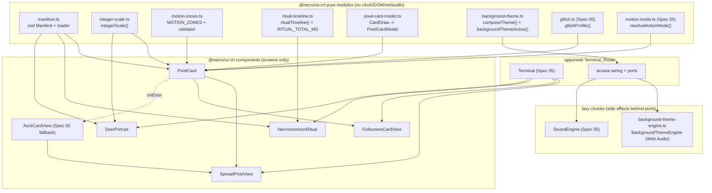
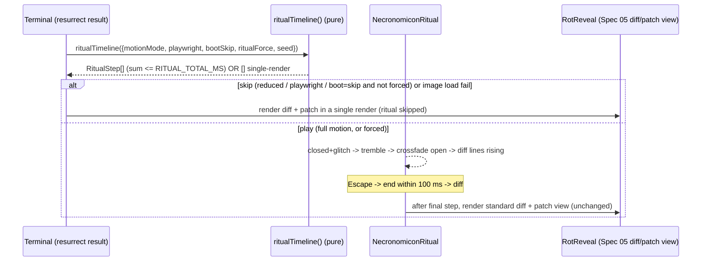
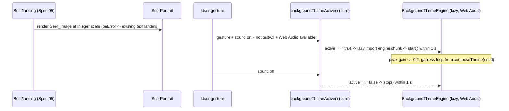

# Design Document

## Overview

Arcana_Visions is an **additive presentation layer** over the existing Visual_Necromancy feature (Spec 05). It renders the 15 pixel-art WebP arcana that already live in `apps/web/public/arcana/` — the 12 major-arcana diagnosis cards, the Seer landing portrait, and the two Necronomicon frames — as pixel-perfect, integer-scaled DOM sprites, with CSS-only motion zones, an original DOS-flavoured background theme, and a Necronomicon resurrection ritual.

The design's governing rule is **do no harm to Spec 05**. The boot sequence, ASCII cards, severity glitch, rot-and-rebirth, and CRT styling all keep working byte-for-byte. The `AsciiCard` stays the compact and no-image fallback view: every pixel surface degrades to the exact ASCII content Spec 05 already renders when an image is missing, when JavaScript is off, or when a decode fails. Arcana_Visions never regenerates, edits, downloads, or replaces any image, and never touches `.env*`, `.gitignore`, or the committed `.kiro` tree.

Two design seams make this layering safe and testable:

1. **The cards cannot lie, and the pixel skin changes nothing about the diagnosis.** All drawn data (card id, orientation, position, severity, diagnosis caption) comes from the existing pure `oracle` core and the Spec 05 session selectors (`visualCards`, `currentVisualReading`). Arcana_Visions adds *presentation* only; it introduces no detector, no spread, no scoring.
2. **Every side effect stays behind a port, every decision stays in a pure function.** The new pure modules — `integerScale`, the Motion_Zone_Table + validator, the ritual timeline, the background-theme score + gate, the manifest schema — read no clock, DOM, network, or audio. The only new side effects (image decode, `OscillatorNode` wiring) live behind the lazy sound-engine chunk and the browser's own `` element.

### Reuse of Spec 05 contracts (grounding facts)

Arcana_Visions reuses these existing `@necro/ui-crt` exports verbatim rather than inventing competing ones:

| Concern | Existing export reused | How Arcana_Visions uses it |
| --- | --- | --- |
| Severity glitch | `glitchProfile(severity): GlitchParams`, `GLITCH_MAX_DURATION_MS = 300` (`motion/glitch.ts`) | `PixelCard` derives the same `GlitchParams` and applies the identical `data-glitch-intensity` / `data-motion` contract the Spec 05 CSS keys off (`.crt[data-motion="full"] .crt-glitch[data-glitch-intensity="N"]`). |
| Motion mode | `resolveMotionMode(pref, prefersReduced): MotionMode`, type `MotionMode` (`motion/motion-mode.ts`); `useMotion(media)` hook | Reduced_Motion ⟺ `MotionMode === "reduced"`, resolved exactly as today from `prefers-reduced-motion` (via `MediaPort`) OR `motion off`. The command stays `motion <auto\|on\|off>` (`parse.ts` `MOTION_ARGS`). The legacy `quiet` name is **not** used. |
| Motion tokens | `CRT_GLITCH_MAX_MS = 300`, `CRT_SHAKE_MS`, `CRT_BLOOM_MS = 300` (`tokens.ts`) | New bounded tokens (`RITUAL_TOTAL_MS`, motion-zone periods) are added in the same `tokens.ts` module and honour the Flash_Limit of ≤ 2 luminance changes/sec. |
| Sound | `SoundLoaderPort`, `SoundEngine` (`start`/`cue`/`ambient`); pure `soundReducer`, `soundActivity`, `soundCueAllowed(state)`; `SoundPreference`/`SoundState` | The Background_Theme is a lazily-loaded extension of this subsystem. A new pure gate `backgroundThemeActive(state)` mirrors `soundCueAllowed`; the engine makes no policy decision. |
| Fallback card | `AsciiCardView`, `asciiCard`, `loadCardArt` | The ASCII_Card is the single, shared fallback for every pixel surface. |
| Bundle budget | `scripts/check-web-budget.mjs` contract pinned by `apps/web/src/budget.test.ts` (`BUDGET_BYTES = 250_000`, `findSeparateChunks`) | The background-theme chunk and the Necronomicon-ritual view join the demo/sound/resurrection chunks as a distinct dynamic chunk, kept out of `collectInitialRouteJs`. |

### Where the new code lives (structure rules)

Following `/packages/ui-crt/` "components are screens only" and the pure-core convention, and the dependency direction `oracle ← grimoires ← coven ← (web, cli, mcp-server, action)`:

```
packages/ui-crt/src/
  arcana/
    manifest.ts              # zod Manifest schema + pure loader (ids, logical sizes, bands)
    integer-scale.ts         # pure integerScale(available, logical): number
    motion-zones.ts          # MotionZone type, MOTION_ZONES table, validateMotionZone, luminanceChangesPerSecond
    ritual-timeline.ts       # pure ritualTimeline(opts): RitualStep[], RITUAL_TOTAL_MS
    pixel-card-model.ts       # pure CardDraw -> PixelCardModel mapping (alt text, caption, bands text)
  sound/
    background-theme.ts      # pure ThemeScore model, composeTheme(seed), backgroundThemeActive(state) gate
    background-theme-engine.ts  # lazy chunk: OscillatorNode wiring behind BackgroundThemeEngine port
  components/
    PixelCard.tsx            # one pixel diagnosis card (screen-only)
    SpreadPixelView.tsx      # horizontal 3-card pixel spread (fates); wraps/falls back to AsciiCardView
    FullscreenCardView.tsx   # modal single-card inspector with focus trap
    NecronomiconRitual.tsx   # resurrect ritual playback (closed -> glitch -> tremble -> open -> rising diff)
    SeerPortrait.tsx         # landing Seer image
  arcana/
    arcana.css               # pixel-rendering, bands text, motion-zone keyframes, ritual keyframes (mirrors tokens)

apps/web/src/
  components/                # wiring of the above into the Terminal_Route
  e2e/                       # arcana.e2e.ts + screenshots.e2e.ts updates
docs/ASSETS.md               # provenance disclosure
```

`oracle` and grimoire fixers import none of this. All browser access (image decode, Web Audio) is injected or behind a lazy chunk, consistent with the Spec 05 port discipline.

## Architecture

### Component map



### Palette note

Arcana_Visions renders two distinct palettes side by side, intentionally:

- **Asset palette** (the pixel art inside the WebP): the strict 4-shade `#001a00`, `#0b4f1a`, `#2fa84a`, `#8cff9e`. The card image, motion-zone overlays, Seer, and Necronomicon images render only these four shades, applied with no colour-altering CSS filter.
- **CRT phosphor chrome** (surrounding terminal): the Spec 05 `tokens.ts` phosphor palette (`CRT_FG` `#33ff66`, `CRT_BG` `#001a00`, `CRT_FG_DIM`, `CRT_FOCUS`, etc.). The DOM text drawn into the Text_Bands and the Diagnosis_Caption use the phosphor tokens so they match the terminal chrome and satisfy the existing contrast checks.

`#001a00` is shared by both palettes, which keeps the card edges seamless against the terminal background.

### Data flow 1 — reading → spread render → fullscreen

```mermaid
sequenceDiagram
  participant Core as oracle core + session selectors
  participant Model as pixel-card-model.ts (pure)
  participant Spread as SpreadPixelView
  participant Card as PixelCard
  participant FS as FullscreenCardView

  Core->>Model: visualCards(state) -> VisualCard[]
  Model->>Spread: PixelCardModel[] (id, orientation, position, severity, caption, alt)
  Spread->>Card: render 3 cards in spread order (integerScale per slot)
  Card-->>Card: img image-rendering:pixelated + data-glitch-intensity + bands text
  Note over Card: onError -> AsciiCardView(card) in same slot
  Card->>FS: click / Enter / `explain <pos|card>` -> open within 500 ms
  FS-->>FS: focus trap; Arrow prev/next (wrap); Esc close + restore focus
```

### Data flow 2 — resurrect → ritual → diff



### Data flow 3 — boot → seer, and sound-on gesture → background theme



## Components and Interfaces

### Pure module: integer scale (`arcana/integer-scale.ts`)

```ts
export interface Size { readonly w: number; readonly h: number; }

/**
 * The largest whole-number factor by which `logical` fits inside `available`
 * on both axes, clamped to >= 1. Never returns a fractional factor; when the
 * region is smaller than the logical size on either axis the result is 1
 * (the card then scrolls/clips per R1.4). NaN/<=0 inputs clamp to 1.
 */
export function integerScale(available: Size, logical: Size): number;
// impl: const s = Math.floor(Math.min(available.w / logical.w, available.h / logical.h));
//       return Number.isFinite(s) && s >= 1 ? s : 1;
```

### Pure module: manifest loader (`arcana/manifest.ts`)

```ts
import { z } from "zod";
import { CardIdSchema } from "@necro/oracle/client";

/** Only the fields Arcana_Visions trusts: ids, logical sizes, bands. png/preview/workspace paths ignored. */
export const ManifestBandsSchema = z.object({
  header_rows: z.tuple([z.number().int(), z.number().int()]),
  footer_rows: z.tuple([z.number().int(), z.number().int()]),
}).nullable();

export const ManifestImageSchema = z.object({
  id: z.string(),
  logical: z.tuple([z.number().int().positive(), z.number().int().positive()]),
  bands: ManifestBandsSchema,
}).passthrough(); // tolerate png/preview/box/workspace fields; never read them

export const ManifestSchema = z.object({
  images: z.array(ManifestImageSchema).min(1),
}).passthrough();

export type ManifestImage = z.infer<typeof ManifestImageSchema>;

/** The resolved, trusted view the app consumes. Cards are the 12 CardIds; extras are the seer/necronomicon ids. */
export interface ArcanaAsset {
  readonly id: string;
  readonly logical: Size;
  readonly bands: { readonly header: readonly [number, number]; readonly footer: readonly [number, number] } | null;
}

/** Parse raw JSON (already imported as data) into trusted assets. Throws a typed NecroError on invalid shape. */
export function loadManifest(raw: unknown): ReadonlyMap<string, ArcanaAsset>;

/** The 12 diagnosis card ids, in deck order, that must be present as 120x160 assets. */
export const DIAGNOSIS_CARD_IDS: readonly z.infer<typeof CardIdSchema>[];
```

The manifest JSON is imported as static data at build time (no network). `loadManifest` validates with zod at the boundary and discards everything except ids, logical sizes, and bands.

### Pure module: Motion_Zone_Table (`arcana/motion-zones.ts`)

```ts
import type { CardId } from "@necro/oracle/client";

export type MotionEffect = "flicker" | "shimmer" | "pulse" | "rays" | "glow";

export interface Rect { readonly x: number; readonly y: number; readonly w: number; readonly h: number; }

export interface MotionZone {
  readonly card: CardId;
  readonly rect: Rect;              // logical pixels, within the card and outside Text_Bands
  readonly effect: MotionEffect;
  readonly periodMs: number;        // full animation cycle length
  readonly steps: number;           // CSS steps() count across one period
}

/** The authored table (R4.3): tower flicker, star shimmer, moon pulse, hermit flicker, judgement rays, seer glow. */
export const MOTION_ZONES: readonly MotionZone[];

export interface Bands { readonly header: readonly [number, number]; readonly footer: readonly [number, number]; }

export type MotionZoneIssue =
  | { readonly kind: "out-of-bounds"; readonly zone: MotionZone }
  | { readonly kind: "overlaps-band"; readonly zone: MotionZone; readonly band: "header" | "footer" }
  | { readonly kind: "flash-limit"; readonly zone: MotionZone; readonly changesPerSecond: number };

/**
 * Luminance changes per second for a zone's animation. One steps() cycle moves
 * through `steps` discrete frames per `periodMs`; a conservative upper bound on
 * visible luminance changes is `steps / (periodMs / 1000)`. The Flash_Limit is 2.
 */
export function luminanceChangesPerSecond(z: MotionZone): number;
// impl: z.steps / (z.periodMs / 1000)

/** Pure validator used by the property test and the runtime guard (R4.8, R4.9, R13.2, R13.3). */
export function validateMotionZone(z: MotionZone, logical: Size, bands: Bands): MotionZoneIssue[];
// checks: rect fully within [0,logical.w]x[0,logical.h];
//         rect does not overlap header rows [h0,h1] or footer rows [f0,f1];
//         luminanceChangesPerSecond(z) <= 2
```

Runtime guard: `PixelCard` calls `validateMotionZone` for each zone of the rendered card. A zone with any issue is **omitted** (rendered static), and a dev-time `console.warn` names the invalid zone. No user-visible terminal message is emitted (R4.9). In production builds the warn is a no-op path; the zone simply renders static.

### Pure module: ritual timeline (`arcana/ritual-timeline.ts`)

```ts
export type RitualPhase = "closed-glitch" | "tremble" | "crossfade" | "rising-diff";

export interface RitualStep { readonly phase: RitualPhase; readonly startMs: number; readonly durationMs: number; }

export interface RitualOpts {
  readonly motionMode: MotionMode;   // "reduced" => single render
  readonly playwright: boolean;      // detected test run
  readonly bootSkip: boolean;        // ?boot=skip
  readonly ritualForce: boolean;     // ?ritual=force
  readonly seed: number;             // DEMO_SEED in demo; deterministic per ritual otherwise
  readonly imagesReady: boolean;     // false => skip (R6.10)
}

/** <= 3000 ms total; RITUAL_TOTAL_MS token in tokens.ts caps the sum. */
export const RITUAL_TOTAL_MS: number; // <= 3000

/**
 * Returns the ordered steps whose durations sum to <= RITUAL_TOTAL_MS, OR an
 * empty array meaning "single render, no ritual". Empty when motionMode is
 * "reduced", or when (playwright || bootSkip) and !ritualForce, or when
 * !imagesReady. Otherwise the four phases play. Deterministic in `seed`
 * (same seed => identical steps). Pure: no clock, no DOM.
 */
export function ritualTimeline(opts: RitualOpts): RitualStep[];
```

`NecronomiconRitual` is driven by this timeline through the Spec 05 `FramePort` (same pattern as `useRot`/`use-reveal`), never a wall-clock `setTimeout`. Escape dispatches an immediate skip that advances straight to the diff within 100 ms. The e2e drives it deterministically with `page.clock` plus `?ritual=force`.

### Pure module: pixel-card model (`arcana/pixel-card-model.ts`)

```ts
import type { CardId } from "@necro/oracle/client";
import type { Orientation } from "@necro/ui-crt"; // existing voice-table Orientation

export interface PixelCardModel {
  readonly card: CardId;
  readonly orientation: Orientation;    // "upright" | "reversed"
  readonly positionLabel: string;       // e.g. "III · THE SHADOW" (from spread position)
  readonly numeral: string;             // Roman numeral for the arcana
  readonly title: string;               // card display name, uppercase
  readonly severity: 0 | 1 | 2 | 3;
  readonly caption: string;             // one-line Diagnosis_Caption (<= 72 cols, oracle voice)
  readonly altText: string;             // "<Name>, <upright|reversed> — <meaning, <= 120 chars>"
}

/** Build the model from a Spec 05 VisualCard. Pure; reuses VOICE_TABLE for the one-line meaning. */
export function pixelCardModel(card: VisualCard): PixelCardModel;

/** Alt text per R10.1: name + orientation word + one-line meaning capped at 120 chars. */
export function cardAltText(card: CardId, orientation: Orientation): string;
```

### Component: `PixelCard` (screen only)

```ts
export interface PixelCardProps {
  readonly model: PixelCardModel;
  readonly asset: ArcanaAsset;          // from loadManifest
  readonly scale: number;               // from integerScale for this slot
  readonly motionMode: MotionMode;
  readonly src: string;                 // /arcana/<id>.webp
  readonly onActivate?: () => void;     // open fullscreen (click / Enter)
  readonly asciiFallback: AsciiCard;    // Spec 05 fallback for onError / no-image
}
export function PixelCard(props: PixelCardProps): React.JSX.Element;
```

DOM contract:

- A single `` with `style={{ imageRendering: "pixelated", width: logical.w * scale, height: logical.h * scale }}` and **no** blurring/smoothing filter (R1.1, R1.5). The integer scale is passed as a CSS custom property `--arcana-scale` for the stylesheet.
- `data-motion={motionMode}` and, in full motion with `severity > 0`, `data-glitch-intensity={glitchProfile(severity).intensity}` plus the same glitch custom properties `AsciiCardView` sets — reusing the exact Spec 05 CSS selector so a severity-0 card is steady and the glitch is a one-shot (`animation-iteration-count: 1`, ≤ 300 ms) leaving a clean resting state (R5.1–R5.6).
- Three text regions as phosphor DOM text: header band `[0,19]` holds `numeral + title`; footer band `[147,160]` holds `POSITION · ORIENTATION`; the `caption` renders directly **below** the image, outside the bands (R1.6, R1.7). At scale 1 the band text clips with `text-overflow: ellipsis` and never overflows its band (R1.8).
- `alt={model.altText}` on the image for screen readers (R10.1).
- Reversed cards rotate the **image** 180° via `data-orientation="reversed"`; the band/caption text is counter-kept upright (R2.9) — same technique Spec 05 uses for ASCII cards.
- `onError` on the `` swaps the image element for `<AsciiCardView card={asciiFallback} ... />` in place, with no broken-image indicator (R1.9, R3.3).
- Motion zones: for each `MOTION_ZONES` entry matching `model.card`, if `validateMotionZone` returns no issues and `motionMode === "full"`, render an absolutely-positioned overlay `<span>` (scaled by `--arcana-scale`) whose CSS animation uses `steps()` and stays within the rect (R4.1–R4.8). An invalid zone is skipped + `console.warn` (R4.9). In reduced motion all zones render static (R4.7).

### Component: `SpreadPixelView`

```ts
export interface SpreadPixelViewProps {
  readonly cards: readonly VisualCard[];   // spread order, authoritative
  readonly manifest: ReadonlyMap<string, ArcanaAsset>;
  readonly available: Size;                // measured viewport region
  readonly motionMode: MotionMode;
}
export function SpreadPixelView(props: SpreadPixelViewProps): React.JSX.Element;
```

Renders a left-to-right `.crt-spread-pixel` row of `PixelCard`s in the reading's spread order, one slot per drawn card, none reordered/duplicated/omitted (R3.1, R3.5). Each slot computes its own `integerScale(available/slots, logical)` (R3.2). When JavaScript is disabled, the server-rendered markup is the `AsciiCardView` content for each position (progressive enhancement), so a no-JS reader still sees the ASCII spread in order (R3.4).

### Component: `FullscreenCardView`

```ts
export interface FullscreenCardViewProps {
  readonly cards: readonly VisualCard[];   // spread order
  readonly index: number;                  // currently shown card
  readonly manifest: ReadonlyMap<string, ArcanaAsset>;
  readonly motionMode: MotionMode;
  readonly onIndexChange: (next: number) => void;
  readonly onClose: () => void;            // restores focus to opener
}
export function FullscreenCardView(props: FullscreenCardViewProps): React.JSX.Element;
```

Behaviour:

- A `role="dialog" aria-modal="true"` container that, on open, moves focus inside and traps Tab/Shift+Tab within its controls (R2.7, R10.6). On close it returns focus to the element that opened it — the terminal already uses a `focus` effect pattern (`use-terminal.ts` `queueMicrotask(() => inputRef.current?.focus())`); the view captures `document.activeElement` on open and restores it on close via the same deferred-focus technique.
- Opens within 500 ms on mouse click, Enter on a focused card, or the `explain <position|card>` command for a card present in the reading (R2.1–R2.3). An `explain` reference absent from the reading leaves the view unchanged and returns an oracle-voice error naming the valid positions/cards (R2.4) — rendered through the existing `renderExplain`/`renderError` path.
- Arrow Right/Down → next, Left/Up → previous, wrapping both ends (R2.5); with exactly one card any navigation is a no-op (R2.6). Escape closes and restores focus (R2.8).
- Shows the single `PixelCard` large (its own `integerScale` against the fullscreen region); reversed = image rotated 180° with upright text (R2.9); the Diagnosis_Caption shows below the image (R1.7).

### Component: `NecronomiconRitual`

```ts
export interface NecronomiconRitualProps {
  readonly steps: readonly RitualStep[];   // from ritualTimeline(); [] => render children immediately
  readonly frames: FramePort;              // Spec 05 FramePort (no setTimeout)
  readonly motionMode: MotionMode;
  readonly closedSrc: string;              // /arcana/necronomicon-closed.webp
  readonly openSrc: string;                // /arcana/necronomicon-open.webp
  readonly diffLines: readonly string[];   // the resurrected diff lines that rise
  readonly onImageError: () => void;       // marks imagesReady=false -> skip to diff (R6.10)
  readonly onComplete: () => void;         // hand off to the standard diff/patch view
  readonly children: React.ReactNode;      // the standard RotReveal diff/patch view
}
export function NecronomiconRitual(props: NecronomiconRitualProps): React.JSX.Element;
```

Plays closed+glitch → tremble → crossfade to open → diff lines rising line by line, then renders `children` (the unchanged Spec 05 diff/patch view) (R6.1, R6.9). With `steps === []` it renders `children` immediately (R6.4, R6.5). Escape calls `onComplete` within 100 ms (R6.3). An image decode failure calls `onImageError` and skips to `children` (R6.10). The diff/patch content is never altered by the ritual (R6.9).

### Component: `SeerPortrait`

```ts
export interface SeerPortraitProps {
  readonly asset: ArcanaAsset;    // seer 256x144
  readonly available: Size;
  readonly src: string;           // /arcana/seer.webp
  readonly fallback: React.ReactNode; // existing text landing content
}
export function SeerPortrait(props: SeerPortraitProps): React.JSX.Element;
```

Renders the Seer at `integerScale(available, {w:256,h:144})` with `image-rendering: pixelated`, preserving the native 16:9 aspect (no distortion/crop) (R7.1–R7.3). `onError` renders `fallback` with no broken-image indicator (R7.4).

### Pure module + lazy engine: Background_Theme (`sound/background-theme.ts`, `sound/background-theme-engine.ts`)

```ts
// background-theme.ts (pure, testable without audio)
export interface ThemeVoice {
  readonly wave: "square" | "triangle";
  readonly notes: readonly number[];   // MIDI note numbers; an arpeggio pattern
  readonly gain: number;               // <= 0.2 peak when summed across voices
}
export interface ThemeScore {
  readonly bpm: number;
  readonly loopBars: number;
  readonly voices: readonly ThemeVoice[];
}

/** Seeded, deterministic, original composition. Same seed => same score. No audio. */
export function composeTheme(seed: number): ThemeScore;

/** Peak summed gain of a score; the property test asserts this is <= 0.2 (R8.1). */
export function peakGain(score: ThemeScore): number;

/**
 * The pure gate mirroring soundCueAllowed: the theme may play only when sound is
 * on, a user gesture has occurred, the document is visible, and we are not in a
 * test/CI run. The engine makes NO policy decision.
 */
export function backgroundThemeActive(state: SoundState, env: { readonly isTest: boolean }): boolean;
```

```ts
// background-theme-engine.ts (lazy chunk; OscillatorNode wiring behind a port)
export interface BackgroundThemeEngine {
  start(score: ThemeScore): Promise<void>; // builds oscillators, gapless loop, peak gain <= 0.2
  stop(): void;                            // stops within 1 s
}
export type BackgroundThemeLoaderPort = () => Promise<BackgroundThemeEngine>;
// production loader: string-literal dynamic import permitted by boundary.guard.test.ts
```

The Terminal_Route wiring subscribes to `backgroundThemeActive`. On a transition to `true` it lazily imports the engine chunk and calls `start(composeTheme(seed))` within 1 s; on a transition to `false` (sound off / Web Audio unavailable) it calls `stop()` within 1 s (R8.4–R8.9). If `AudioContext` is unavailable, the loader resolves to a no-op engine and the route stays usable (R8.8). The synthesis chunk is excluded from the first render (R8.9, R11.2).

## Data Models

### Manifest (trusted view)

`ArcanaAsset { id, logical: {w,h}, bands: {header:[n,n], footer:[n,n]} | null }`, keyed by id in a `ReadonlyMap`. The 12 diagnosis cards and `necronomicon-closed` carry non-null bands only where the manifest declares them; the 120×160 cards use header `[0,19]` / footer `[147,160]`. The seer and `necronomicon-open` are `256×144` with `bands: null`; `necronomicon-closed` is `108×144`.

### Motion_Zone

`MotionZone { card: CardId; rect: {x,y,w,h}; effect; periodMs; steps }`; the table `MOTION_ZONES` is a `readonly MotionZone[]`. The invariant (R4.8) is: for the zone's card asset, `rect` lies fully within `[0,w]×[0,h]` and fully outside both band row ranges, and `luminanceChangesPerSecond(zone) <= 2`.

### RitualStep / timeline

`RitualStep { phase; startMs; durationMs }`; `ritualTimeline` returns an ordered array with `startMs` monotonically increasing and `sum(durationMs) <= RITUAL_TOTAL_MS <= 3000`, or `[]` for single-render.

### ThemeScore

`ThemeScore { bpm; loopBars; voices: ThemeVoice[] }` where each `ThemeVoice { wave; notes: number[]; gain }`. `peakGain(score) <= 0.2`. The loop is gapless: the score's bar count divides evenly into the scheduled loop so the last note's release meets the first note's attack with no silent gap.

### PixelCardModel ← CardDraw mapping

A Spec 05 `VisualCard` (which carries the `oracle` `CardDraw` fields: `card`, `orientation`, `severity`, plus the spread `position`) maps to `PixelCardModel` by: `numeral`/`title` from the card registry display data, `caption` = the one-line diagnosis summary (oracle voice, ≤ 72 cols), `altText` = `"<Name>, <upright|reversed> — <one-line meaning ≤ 120 chars>"`. The severity flows unchanged into `glitchProfile(severity)` for the glitch contract.

### Help-consistency resolution note (Requirement 9)

**Finding.** `read` *does* accept `celtic`: `packages/ui-crt/src/command/parse.ts` lists `SPREAD_ARGS = ["fates","necropsy","celtic"]`, and `packages/oracle/src/spread/assign.ts` fully implements `assignCeltic` (the 10 Celtic Cross positions with void sentinels) with passing tests. So the `celtic` spread is accepted and produces a valid reading end to end.

**Gap.** `packages/ui-crt/src/render/help.ts` `COMMAND_LINES` advertises only `read <fates|necropsy>`, omitting `celtic`. This violates R9.4 (the help's listed spreads must equal the accepted set).

**Resolution (and reason).** Because celtic is supported end to end, the correct resolution per R9.2 is to **document** celtic in help, not remove it (R9.3 does not apply). Update the `read` help line to `read <fates|necropsy|celtic>`. `renderHelp` stays a pure function returning a byte-stable block, so the test simply asserts the new line is present and that the set of spreads named in help equals `SPREAD_ARGS`. No change to `parse.ts` or the oracle spread engine. This note is the record R9.1 requires.

## Requirements Traceability

| Requirement | Satisfied by |
| --- | --- |
| R1 Pixel-perfect rendering | `integer-scale.ts`, `PixelCard` (pixelated img, bands text, caption, scale-1 clipping, onError→ASCII), `arcana.css` |
| R2 Full-screen card view | `FullscreenCardView` (open paths, focus trap/restore, arrow wrap, single-card no-op, Esc, reversed rotation), `explain` path via `renderExplain`/`renderError` |
| R3 Spread view | `SpreadPixelView` (3 slots in order, integer scale, ASCII fallback, no-JS ASCII, order preserved) |
| R4 Motion zones | `motion-zones.ts` (`MOTION_ZONES`, `validateMotionZone`, `luminanceChangesPerSecond`), `PixelCard` runtime guard (omit+`console.warn`), `arcana.css` steps() keyframes |
| R5 Severity glitch | `PixelCard` reusing `glitchProfile` + `data-glitch-intensity`/`data-motion` Spec 05 CSS; one-shot ≤ 300 ms; steady at severity 0; reduced-motion steady |
| R6 Necronomicon ritual | `ritual-timeline.ts`, `NecronomiconRitual` (phases, ≤ 3 s, Esc ≤ 100 ms, reduced/playwright/boot-skip single render, force flag, demo determinism, image-fail skip, unchanged diff) |
| R7 Seer landing | `SeerPortrait` (integer scale, pixelated, 16:9 preserved, onError→text landing) |
| R8 Background theme | `background-theme.ts` (`composeTheme`, `peakGain`, `backgroundThemeActive`), `background-theme-engine.ts` lazy chunk, Terminal_Route wiring |
| R9 Help/celtic consistency | Help-consistency resolution note; `help.ts` `read` line updated to include `celtic`; `renderHelp` stays byte-stable |
| R10 Accessibility | `PixelCard` alt text + DOM text; `FullscreenCardView` focus trap/restore + visible focus ring (`CRT_FOCUS`); keyboard reachability across all views; axe scan |
| R11 Performance | eager = 3 visible spread cards, rest `loading="lazy"`; motion-zone + theme chunks lazy; `scripts/check-web-budget.mjs` budget gate (`budget.test.ts`) |
| R12 Asset/audio disclosure | `docs/ASSETS.md` |
| R13 Verification coverage | Testing Strategy: PBT (integer scale, zone bounds, flash limit), ritual ≤ 3 s test, theme-gating test, Playwright e2e + axe, `screenshots.e2e.ts` updates |

## Correctness Properties

*A property is a characteristic or behavior that should hold true across all valid executions of a system — essentially, a formal statement about what the system should do. Properties serve as the bridge between human-readable specifications and machine-verifiable correctness guarantees.*

The pure modules of Arcana_Visions (`integerScale`, `validateMotionZone`/`luminanceChangesPerSecond`, `ritualTimeline`, `composeTheme`/`peakGain`/`backgroundThemeActive`, `pixelCardModel`/`cardAltText`, and the pure parts of the card/spread renderers) are the surfaces these properties pin. They read no clock, DOM, network, or audio, so each property is testable with `fast-check` and Mock inputs only.

### Property 1: Integer scale is a whole number ≥ 1

*For any* available region size and any logical size (including degenerate, tiny, huge, or non-square regions), `integerScale(available, logical)` returns an integer that is `>= 1` and never a fractional value; a region smaller than the logical size on either axis yields exactly `1`.

**Validates: Requirements 1.3, 1.4, 13.1**

### Property 2: Rendered dimensions equal logical × scale on both axes (aspect preserved)

*For any* logical size `{w,h}` (a 120×160 card, the 256×144 Seer, or any manifest logical size) and any available region, the rendered sprite's width equals `w × s` and its height equals `h × s` for the single scale `s = integerScale(available, logical)`. Because one integer factor is applied to both axes, the rendered width:height ratio equals the native `w:h` with no distortion or cropping.

**Validates: Requirements 1.2, 3.2, 7.1, 7.3**

### Property 3: Spread slot order equals the reading's spread order

*For any* reading, the sequence of card ids `SpreadPixelView` renders equals the reading's spread order exactly — no position reordered, duplicated, or omitted — and a fates reading renders exactly 3 slots.

**Validates: Requirements 3.1, 3.5**

### Property 4: Every Motion_Zone lies within its card and outside the Text_Bands

*For all* zones in `MOTION_ZONES`, `validateMotionZone(zone, cardLogical, cardBands)` reports no `out-of-bounds` and no `overlaps-band` issue: the rectangle lies fully within `[0,w]×[0,h]` and fully outside both the header rows and the footer rows of that card.

**Validates: Requirements 4.8, 13.2**

### Property 5: Every Motion_Zone animation stays within the Flash_Limit

*For all* zones in `MOTION_ZONES`, `luminanceChangesPerSecond(zone)` is `<= 2`, so no animated zone can exceed 2 luminance changes per second.

**Validates: Requirements 4.5, 13.3**

### Property 6: Ritual gating is empty exactly when the ritual must be skipped

*For any* `RitualOpts`, `ritualTimeline(opts)` returns `[]` (single render) if and only if `motionMode === "reduced"`, or `imagesReady === false`, or `(playwright || bootSkip) && !ritualForce`; otherwise it returns a non-empty timeline.

**Validates: Requirements 6.4, 6.5, 6.6, 6.10**

### Property 7: A playing ritual is ordered and completes within 3 seconds

*For any* `RitualOpts` that produce a non-empty timeline, `ritualTimeline(opts)` returns the four phases in the fixed order `closed-glitch → tremble → crossfade → rising-diff` with strictly non-decreasing `startMs`, and the sum of all step durations is `<= RITUAL_TOTAL_MS <= 3000` ms.

**Validates: Requirements 6.1, 6.2, 13.4**

### Property 8: The ritual timeline is deterministic in its seed

*For any* seed, two calls to `ritualTimeline` with otherwise-equal options and that seed return identical step arrays.

**Validates: Requirements 6.8**

### Property 9: A pixel card renders its required text in the bands and the caption below the image

*For any* `PixelCardModel`, a rendered `PixelCard` contains the Roman numeral and title as DOM text within the header band, the position and orientation as DOM text within the footer band, and the Diagnosis_Caption as DOM text directly below the image and outside the bands.

**Validates: Requirements 1.6, 1.7**

### Property 10: A reversed card rotates the image while its text stays upright

*For any* `PixelCardModel` whose orientation is reversed, a rendered `PixelCard` marks the image for 180° rotation while leaving the numeral, title, position, orientation, and caption text unrotated and readable.

**Validates: Requirements 2.9**

### Property 11: The glitch contract follows `glitchProfile`, steady at severity 0

*For any* CardDraw severity `0..3`: in full motion a severity `1..3` card sets `data-glitch-intensity` equal to `glitchProfile(severity).intensity`, and a severity-0 card carries no `data-glitch-intensity` attribute and no glitch class (a steady resting state).

**Validates: Requirements 5.1, 5.2**

### Property 12: Alt text contains the name, orientation word, and a meaning ≤ 120 chars

*For any* card id and orientation, `cardAltText(card, orientation)` contains the card's name and the orientation word (`upright` or `reversed`) and is at most 120 characters long.

**Validates: Requirements 10.1**

### Property 13: The Background_Theme plays only when every gate condition holds

*For any* `SoundState` and environment, `backgroundThemeActive(state, env)` is `true` if and only if the preference is on, a user gesture has occurred, the document is visible, and `env.isTest` is false.

**Validates: Requirements 8.4, 8.5, 8.6, 8.10, 13.5**

### Property 14: The composed theme never exceeds the peak gain ceiling

*For any* seed, `peakGain(composeTheme(seed))` is `<= 0.2`, and every voice in the score uses only a `square` or `triangle` waveform.

**Validates: Requirements 8.1**

### Property 15: The composed theme loops gaplessly

*For any* seed, the loop schedule derived from `composeTheme(seed)` is continuous at the loop boundary — the end of the final bar meets the start of the first with no silent gap — so the loop has no audible restart artifact.

**Validates: Requirements 8.2**

### Property 16: The help spread list equals the accepted spread set

*For any* run, the set of `read` spreads named in `renderHelp()` output equals exactly the set of spreads `parseCommand` accepts for the `read` command (`fates`, `necropsy`, `celtic`).

**Validates: Requirements 9.2, 9.4**

## Error Handling

All errors use the project's typed `NecroError` (`code`, `userMessage` in oracle voice, `cause`); user-facing copy follows `.kiro/steering/oracle-voice` (two layers: a short mystical line, then the plain technical fact; ≤ 72 columns; no emoji).

- **Invalid manifest shape** — `loadManifest` throws a typed `NecroError` at the boundary (zod parse failure). This is a build/startup fault, not a user action; it surfaces in the dev console and the build, never as a terminal reading error.
- **Image decode failure (card / Seer / Necronomicon)** — handled by the `` `onError` path, not an exception. A card falls back to its `AsciiCardView` content in place; the Seer falls back to the existing text landing; the ritual skips to the standard diff/patch view. No broken-image indicator and no terminal error message are shown (R1.9, R3.3, R7.4, R6.10).
- **`explain` reference absent from the reading** — the existing `renderExplain`/`renderError` path returns an oracle-voice error block that states the reference was not found and names the valid positions or cards; the Fullscreen_Card_View is left unchanged (R2.4). Example copy: `The mists hide this card. Valid positions: 1-3; cards: THE TOWER, THE STAR, THE MOON.`
- **Invalid Motion_Zone (authoring error)** — not user-facing. `validateMotionZone` returns issues; the runtime guard omits that zone's animation, renders the region static, and emits a single dev-time `console.warn` naming the zone and the issue. No terminal/user message is produced (R4.9). In production this path simply yields a static region.
- **Web Audio unavailable / theme engine load failure** — the loader resolves to a no-op `BackgroundThemeEngine`; the Terminal_Route stays fully usable and silent (R8.8). No error is surfaced to the user.
- **Over-budget bundle** — `scripts/check-web-budget.mjs` fails the build with an error reporting the measured gzipped size and the exceeded 250 KB budget (R11.4). This is a CI/build error, not a runtime path.

Totality: the pure modules never throw for valid-typed inputs. `integerScale`, `ritualTimeline`, `luminanceChangesPerSecond`, `peakGain`, and `backgroundThemeActive` are total functions; degenerate numeric inputs (NaN, ≤ 0) clamp to the documented safe result rather than throwing.

## Testing Strategy

Testing follows the project standard: every requirement maps to at least one test, property tests reference requirement IDs in their `describe` title, no network/LLM/sandbox in unit or property tests, and `fast-check` for properties with explicit `numRuns` and a printed seed on failure. A `fast-check` counterexample becomes a permanent regression example next to the property.

### Property-based tests (fast-check)

PBT is appropriate here because the core logic is pure functions with input-varying behaviour over large input spaces (viewport sizes, severities, readings, seeds, option combinations). Each property above is implemented by a **single** property-based test configured to a minimum of **200** runs (the repo default; the integer-scale, motion-zone, and ritual-timeline properties — the most invariant-dense — run 1000). Each test is tagged with a comment:

`Feature: arcana-visions, Property {number}: {property_text}`

Arbitraries live in `packages/ui-crt/test/arbitraries.ts` and reuse existing ones where possible (`arbCardDrawArray` and friends from oracle tests): `arbViewport` (sizes including 0, tiny, huge, non-square), `arbLogicalSize`, `arbReading` (1..10 cards in spread order), `arbRitualOpts` (all gate combinations), `arbSoundState`, `arbSeed`.

Property → test file mapping:

- P1, P2 → `arcana/integer-scale.pbt.test.ts`
- P3, P9, P10, P11 → `components/pixel-spread.pbt.test.ts` (render via Testing Library + jsdom; P3 also has an example asserting exactly 3 fates slots)
- P4, P5 → `arcana/motion-zones.pbt.test.ts`
- P6, P7, P8 → `arcana/ritual-timeline.pbt.test.ts`
- P12 → `arcana/pixel-card-model.pbt.test.ts`
- P13, P14, P15 → `sound/background-theme.pbt.test.ts`
- P16 → `render/help-consistency.pbt.test.ts` (asserts the set named in `renderHelp` equals the `read` set `parseCommand` accepts)

### Unit / example tests

Focused example and edge-case tests cover the non-property criteria: `image-rendering: pixelated` and the no-filter contract (R1.1, R1.5, R7.2); scale-1 ellipsis clipping style contract (R1.8); `onError` → ASCII fallback for a card and the Seer (R1.9, R3.3, R7.4); no-JS SSR ASCII order (R3.4); the Motion_Zone_Table shape and six-card coverage (R4.1, R4.3); steps() CSS and rect-clipping overflow (R4.2, R4.6); the invalid-zone runtime guard with a `console.warn` spy and no terminal message (R4.9); the glitch one-shot style contract (iteration-count 1, ≤ 300 ms, clean resting state) (R5.3, R5.4, R5.6) and reduced-motion steadiness (R5.5); the ritual diff-unchanged and Escape-skip behaviours (R6.3, R6.7, R6.9); the help line naming celtic (R9.2); the over-budget script branch reporting measured size + budget (R11.4); and `docs/ASSETS.md` presence and content (R12.1–R12.3). The help-consistency resolution note (R9.1) is recorded in this design; R9.3 is documented as not applicable because celtic is accepted end to end.

### Playwright end-to-end (`apps/web/e2e/arcana.e2e.ts`)

Drives the offline demo path (Mock LLM, seeded by `DEMO_SEED`) and asserts: full-screen card open and close by keyboard with focus restored (R2.1, R2.2, R2.5, R2.7, R2.8, R10.3, R10.5, R10.6); static images under Reduced_Motion (no zone/glitch animation) (R4.7, R5.5); the Resurrection_Ritual rendered **before** the diff on `resurrect` with `?ritual=force` and `page.clock` to make the ≤ 3 s timeline deterministic (R6.1, R6.6, R13.6); lazy-loading (3 visible spread cards eager, others `loading="lazy"`) (R11.1); and an automated **axe** scan reporting zero violations on the Spread_View, Fullscreen_Card_View, landing with the Seer, and the Resurrection_Ritual states (R10.4, R13.6).

### Screenshot capture (`apps/web/e2e/screenshots.e2e.ts` update)

Extend the existing capture-only, `CAPTURE_SCREENSHOTS`-gated spec with four new deterministic frames: the Spread_View with Pixel_Cards, a Fullscreen_Card_View, the Resurrection_Ritual open-book frame (clock frozen on the crossfade step, `?ritual=force`), and the landing with the Seer_Image (R13.7). This adds no production code and alters no Spec 05 behaviour.

### Bundle budget (`scripts/check-web-budget.mjs`)

The initial-route gzip budget stays at `BUDGET_BYTES = 250_000` (R11.3). `findSeparateChunks` is extended to locate the new **background-theme** chunk alongside the existing demo, sound, and resurrection chunks; `collectInitialRouteJs` must continue to exclude the motion-zone table and background-theme synthesis so they never enter the terminal initial route (R11.2). The offline `budget.test.ts` suite exercises these pure helpers against synthetic manifests, with no real build.
