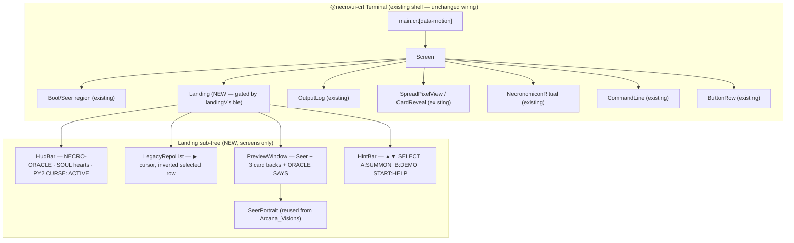
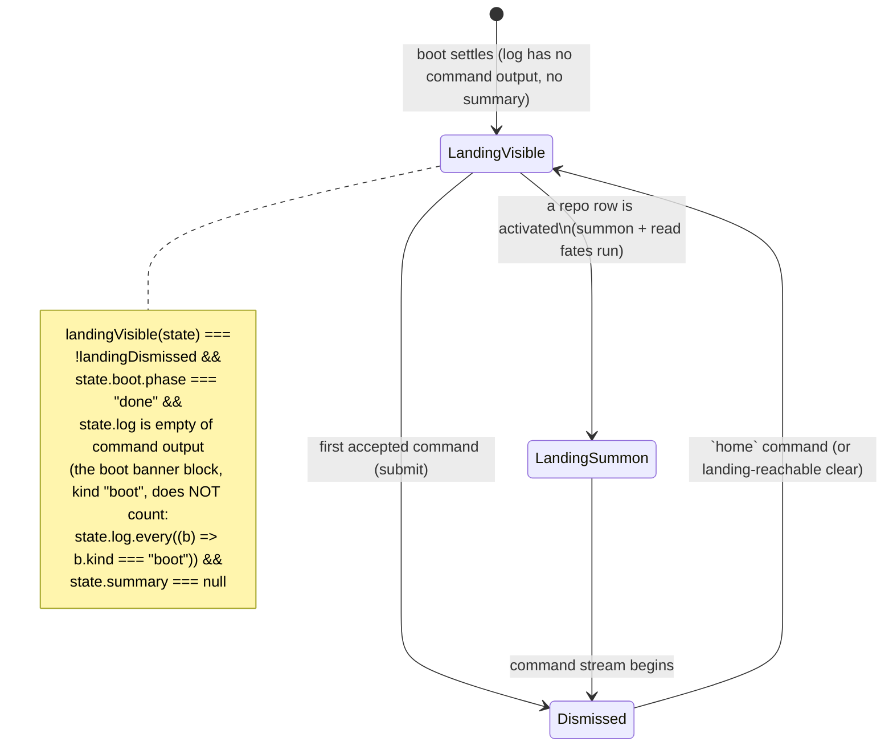
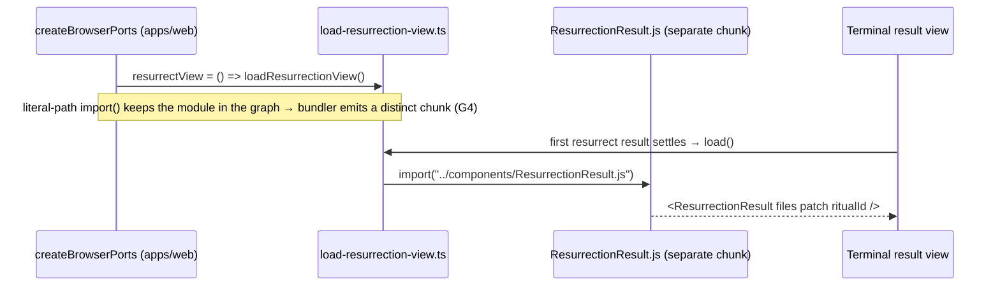

jj# Design Document

## Overview

Oracle_Landing_Polish is a single **additive layer** over the existing CRT
terminal (Spec 03 / "03-crt-terminal"), the Arcana_Visions pixel art (Spec 06),
and the Resurrection_Engine flow. It delivers two cohesive parts as one spec:

- **Part A — Landing_State.** A Game Boy DMG-styled menu that fills the empty
  idle terminal: a HUD bar, a keyboard- and mouse-selectable `LEGACY REPOS`
  list, a `PREVIEW` window (the pixel Seer, three face-down card backs, a
  per-repo `ORACLE SAYS` line), and a DMG hint bar with real key bindings. It is
  shown until the first command and is reachable again via a `home` command.
- **Part B — Bugs_And_Polish.** Four grounded fixes: the Seer not showing on the
  idle screen, the web-budget check failing because the resurrection view never
  becomes its own chunk, a palette/scaling/alignment audit across every surface,
  and in-world DMG-styled error / empty states that keep clear DOM text for
  screen readers.

The governing rule is **do no harm to prior specs**. Every Spec 03 behaviour
(boot, command line, button row, live-region log, `?boot=skip`), every
Arcana_Visions behaviour (pixel spread, fullscreen card, Necronomicon ritual,
`?ritual=force`, Seer during boot, background theme), and the whole
Resurrection_Engine flow keep working byte-for-byte. The landing is a new region
inside the existing `<Terminal>` shell that renders only in a new idle state; it
never replaces the command line, the button row, or the log. All existing tests
stay green; nothing regresses.

### Grounding facts (read from the current code)

These are the load-bearing facts the design is built on, each verified against
the committed source:

| # | Fact | Source |
| --- | --- | --- |
| G1 | The Seer renders **only** while `seerAsset !== undefined && state.boot.phase === "playing"`. Once boot settles to `"done"` — and immediately on a `?boot=skip` load — the Seer is unmounted. | `packages/ui-crt/src/components/Terminal.tsx` (the `.crt-seer-region[data-boot-seer="playing"]` branch) |
| G2 | The reducer starts `boot.phase: "done"` under `bootSignal` / reduced motion / replay. So on the common idle screen the Seer is absent. | `packages/ui-crt/src/session/reducer.ts` `stepBoot`; `session/state.ts` `BootState` |
| G3 | The resurrection result is rendered in `Terminal.tsx` through `RotOverlay` + log blocks — **not** through `ResurrectionResult.tsx`. `apps/web/src/terminal/load-resurrection-view.ts` is imported by **no runtime module** (only referenced in `budget.test.ts` comments), so the bundler tree-shakes it and never emits a `ResurrectionResult` chunk. | `Terminal.tsx` ritual branch; `grep` of `loadResurrectionView` shows only `budget.test.ts` |
| G4 | `scripts/check-web-budget.mjs` fails loudly when the resurrection chunk is absent: `findSeparateChunks` / `findSeparateChunksByContent` look for a chunk containing `ResurrectionResult` or the markers `renderFileResults` / `renderResurrectVitality` / `Residual_List`, and `runBudgetGate` sets `failed = true` when `resurrection === null`. | `scripts/check-web-budget.mjs` |
| G5 | The 4-shade palette in play uses the Spec 03 `tokens.ts` phosphor values plus the two rule-bound accents (`#ffb000`, `#ff3355`). The Arcana_Visions asset palette is the strict 4 shades `#001a00 / #0b4f1a / #2fa84a / #8cff9e`. The DMG landing is authored in **this** 4-shade asset palette. | `packages/ui-crt/src/tokens.ts`; `.kiro/specs/arcana-visions/design.md` §"Palette note" |
| G6 | `parseCommand` accepts `help`, `clear`, `summon`, `read`, `explain`, `resurrect`, `motion`, `demo`, `sound`, and a bare repo token. There is **no** `home` command yet. `clear` resets the log but does not model "landing visible". | `packages/ui-crt/src/command/parse.ts` |
| G7 | `SeerPortrait` already renders a pixelated `` scaled by `integerScale(available, {w:256,h:144})` with an `onError` text fallback. It is sound; the bug is purely **where it is mounted** (G1), not the component. | `packages/ui-crt/src/components/SeerPortrait.tsx` |
| G8 | The browser ports factory already uses the literal-path dynamic-import seam for the patch download (`import("./patch-download.js")`), the sound engine (`loadEngine`), the demo bundle (`loadDemoBundle`), and the background theme (`loadBackgroundTheme`). The resurrection view is the one heavy view **missing** such a live seam. | `apps/web/src/terminal/browser-ports.ts`; `load-resurrection-view.ts` |
| G9 | `state` carries `summary` (the summoned repo), `log`, `boot`, `motionMode`, `sound`, `lastRitual`. There is no "has the user issued a command yet" flag today. | `packages/ui-crt/src/session/state.ts` |

### Where the new code lives (structure rules)

Following the `oracle ← grimoires ← coven ← (web, cli, …)` direction, the
`@necro/ui-crt` "components are screens only" rule, and the pure-core
convention, the new code is:

```
packages/ui-crt/src/
  landing/
    repos.ts              # pure LEGACY_REPOS table + zod schema + oracle-says lookup
    selection.ts          # pure selection model: move(), activate(), SelectionState
    key-binding.ts        # pure landingKeyAction(event) -> LandingAction
    landing-model.ts      # pure landingVisible(state), HUD model, preview model
  components/
    Landing.tsx           # screen-only DMG landing region (HUD, list, preview, hint bar)
    LegacyRepoList.tsx     # screen-only selectable list with the ▶ cursor + inverted row
    PreviewWindow.tsx     # screen-only Seer + 3 card backs + ORACLE SAYS
    HudBar.tsx            # screen-only top HUD (label, SOUL hearts, PY2 CURSE)
    HintBar.tsx           # screen-only DMG hint bar
  landing/landing.css     # DMG panel chrome, inverted-row, card-back sigil, motion zones
  session/
    state.ts              # + landingDismissed flag (additive)
    reducer.ts            # + landing transitions on first command and `home`
  command/
    parse.ts              # + `home` command (additive)

apps/web/src/
  terminal/
    browser-ports.ts      # wire the resurrection-view lazy loader into a live port
    resurrect-view-port.ts # the port that pulls loadResurrectionView into the graph
  components/
    TerminalScreen.tsx    # thread the resurrection-view port down (no behaviour change)
  e2e/landing.e2e.ts      # new e2e
  e2e/screenshots.e2e.ts  # + landing-idle / landing-summon frames
docs/ARCHITECTURE.md, docs/DECK.md  # updated per docs discipline
```

`oracle` and grimoire fixers import none of this. `@necro/ui-crt` imports no
adapters; the only new side-effecting seam (the resurrection-view dynamic
import) lives in `apps/web`.

## Architecture

### Component tree and mount point

The landing mounts **inside** the existing `<Terminal>` `Screen`, above the
`OutputLog`, as a sibling of the boot/seer region. It is gated by a single pure
predicate `landingVisible(state)` so it never coexists with a reading spread,
the ritual, or a populated log.



The `CommandLine` and `ButtonRow` stay mounted and operable whenever the landing
is visible (the command chips and the `NECRO>` input keep working, per Part A).
The landing is a presentational overlay region, not a modal: it does not trap
focus away from the input.

### Landing state machine

A single additive boolean, `landingDismissed`, plus the existing `summary`,
drives three landing states. No new timers; transitions are reducer-pure.



- **LandingVisible** (idle): the DMG menu is on screen (mockup
  `necro-landing-concept3.png`). The HUD, list, preview and hint bar render;
  `ORACLE SAYS` shows the line for the currently selected repo.
- **LandingSummon**: a concrete repo row was chosen; the preview reflects the
  chosen repo while the summon runs (mockup `necro-landing-concept3-summon.png`).
  This is a transient view of LandingVisible with a `selected` repo pinned; the
  moment the first command's output lands, the landing dismisses.
- **Dismissed**: any accepted command has run. `landingDismissed` is `true`; the
  log/spread/ritual own the screen. `home` sets `landingDismissed = false` and
  clears the log + summary (a superset of `clear`), returning to LandingVisible —
  a clean round-trip.

### Part B — SeerPortrait visibility fix (root cause + remedy)

**Root cause (G1, G2).** `Terminal.tsx` mounts the Seer only in the branch
`seerAsset !== undefined && state.boot.phase === "playing"`. The idle screen is
`boot.phase === "done"`, so the Seer is unmounted there. On `?boot=skip` (dev,
Playwright, replay) the boot starts `done`, so the Seer never appears at all.
The `SeerPortrait` component itself is correct (G7) — the defect is the mount
condition.

**Remedy.** Render the Seer in the landing's `PreviewWindow` whenever the
landing is visible, independent of boot phase. Concretely:

- The existing boot-region Seer branch is **kept unchanged** (so the boot visual
  does not regress).
- `PreviewWindow` additionally renders `<SeerPortrait>` whenever
  `landingVisible(state)` and `manifest.has("seer")`, with the same
  `integerScale` measurement pattern and the same text fallback. The Seer is now
  visible on the idle screen, which is where the mockups show it.
- A test asserts the Seer is present in the DOM on the idle landing (post-boot,
  `?boot=skip`), which fails today and passes after the fix.

### Part B — resurrection chunk split (root cause + remedy)

**Root cause (G3, G4).** The resurrection diff/vitality/patch view is rendered
inline by `Terminal.tsx` via `RotOverlay` and log blocks; the dedicated
`ResurrectionResult` component is reached only through
`load-resurrection-view.ts`, which **no runtime module imports**. Dead code is
tree-shaken, so the bundler emits no `ResurrectionResult` chunk, and
`check-web-budget` (which requires that chunk to exist and be separate) fails.

**Remedy (wire the lazy loader — do not loosen the budget).** Make the lazy
seam live, exactly like the demo / sound / background-theme / patch-download
seams (G8), so `import("../components/ResurrectionResult.js")` produces a real,
distinct, non-initial chunk:

1. Add a `ResurrectViewPort` to the browser ports (`apps/web`), built as
   `() => loadResurrectionView()`, mirroring `createPatchDownloadPort`. This
   makes `load-resurrection-view.ts` reachable from the module graph, so the
   bundler keeps it and emits the `ResurrectionResult` chunk.
2. Use the port where the resurrection result settles, so the live code path
   actually mounts `ResurrectionResult` (removing the dead-code smell): when a
   `resurrect` resolves and the result view is shown, the component is lazily
   loaded and rendered. The authoritative diff/vitality text stays in the log
   (Spec behaviour preserved); `ResurrectionResult` renders the same
   `renderFileResults` blocks + the patch-download control it already contains,
   so no new eager weight enters the initial route.
3. The chunk is verified by `check-web-budget` (already expects it) and by
   `budget.test.ts` (already pins `findSeparateChunks().resurrection`). No budget
   number changes; `BUDGET_BYTES` stays `250_000`.



> Alternative considered and rejected: deleting `load-resurrection-view.ts` and
> `ResurrectionResult.tsx`. That would also make the budget script "pass" only
> by **removing** the chunk it asserts must exist — but `budget.test.ts`
> positively asserts a resurrection chunk is located (`expect(resurrection).not.toBeNull()`),
> so deletion breaks that test. Wiring the loader is the remedy that keeps every
> existing test green (hard rule: nothing regresses).

### Part B — visual consistency audit (enumerated findings)

Audited across every surface (landing, summon, reading spread, fullscreen card,
Necronomicon ritual, resurrection view, help, errors). Each finding below is
concrete and becomes a requirement in the next phase. "Palette" means the strict
4 shades `#001a00 / #0b4f1a / #2fa84a / #8cff9e` for the DMG/pixel surfaces (G5);
the surrounding Spec 03 phosphor chrome keeps its audited `tokens.ts` values.

| ID | Surface | Finding | Fix |
| --- | --- | --- | --- |
| V1 | Landing (all panels) | New DMG panels must use ONLY the 4-shade palette; no new hex may leak in. | Author `landing.css` from CSS custom properties bound to the 4 shades; a PBT scans computed styles for off-palette values. |
| V2 | Landing list | Selected row "inverted" must swap fg/bg within the 4 shades (not a new colour) and stay ≥ 4.5:1. | Inverted row = `#8cff9e` text on `#0b4f1a` (or `#001a00` on `#2fa84a`), both ≥ 4.5:1; asserted in a contrast test. |
| V3 | Landing / preview images | Card backs and Seer must be integer-scaled and `image-rendering: pixelated`, no smoothing, matching Arcana_Visions. | Reuse `integerScale` + the pixelated rule; no CSS `filter` on image surfaces. |
| V4 | Card backs | Sigil motif must be a pixel eye/moon — explicitly NO pentagram (product + tarot-ux rule). | Card-back art is an eye/moon sigil; a test asserts the back asset id is the eye/moon motif, never a pentagram token. |
| V5 | Panels (HUD, list, preview, hint) | Panels must align on an integer pixel grid; no sub-pixel offsets that blur borders. | All panel boxes sized in `--px` multiples; a layout test asserts integer box metrics. |
| V6 | Text bands / ORACLE SAYS / hint bar | Text must not truncate or overflow its panel; long repo labels and oracle lines clip with ellipsis, ≤ their column budget. | Fixed column budgets; `text-overflow: ellipsis`; oracle lines ≤ 72 cols (oracle-voice rule 8). |
| V7 | Fonts | One bitmap pixel font across the DMG surfaces; no proportional/smoothed font sneaking in. | Single pixel font-family token for landing; font asserted in a style test. |
| V8 | Flicker | Candle flicker + cursor blink are the ONLY animations and only inside motion zones; nothing flickers outside a zone. | Motion zones only; `data-motion="reduced"` and `prefers-reduced-motion` disable both; PBT asserts no animation when motion off. |
| V9 | Spacing | Consistent gutter/padding across panels (same `--gap` token); no ad-hoc margins. | Single spacing scale in `landing.css`; a snapshot test pins the panel metrics. |
| V10 | Cross-surface | The resurrection view (now its own chunk) must render in the same phosphor palette as the rest; no drift when lazily mounted. | `ResurrectionResult` reuses `OutputBlockView` (already does); a screenshot frame covers it. |

### Part B — in-world error / empty states

Error and empty states are DMG-styled in-world copy (oracle voice: a short
mystical line, then the plain technical fact, ≤ 72 cols, ASCII, no emoji) while
the DOM keeps clear screen-reader text in the existing `role="log"` live region.
The copy is authored by loading the `oracle-voice` steering file during
implementation. Minimum coverage:

| State | Trigger | Oracle-voice copy (shape) | DOM a11y |
| --- | --- | --- | --- |
| Bad / nonexistent repo | summon of a repo that 404s / invalid ref | `No such crypt answers the call.` → `GitHub returned 404 for owner/repo; check the name and ref.` | plain error text in live region, `code` label |
| Rate limit | limiter / GitHub API 429 | `The mists hide this.` → `GitHub API rate-limited; retry in N min.` | same |
| Network failure | fetch/stream error | `The connection to the other side is severed.` → `Network error reaching the oracle; check your connection and retry.` | same |
| Repo without Python | summon of a non-Python repo | `This corpse has no Python soul to raise.` → `No .py files found in owner/repo@sha; nothing to resurrect.` | same |
| Empty LEGACY REPOS edge | (defensive) list rendered with 0 entries | `The graveyard is empty tonight.` | list `aria-label` + empty message text |

All copy routes through the existing typed-`NecroError` → `mapError` →
oracle-voice path; the landing/error surfaces only restyle, they never change
the DOM text the screen reader reads.

## Components and Interfaces

### Pure module: LEGACY REPOS table (`landing/repos.ts`)

```ts
import { z } from "zod";

/** One selectable legacy-repo entry shown in the landing list. */
export const LegacyRepoSchema = z.object({
  /** The `owner/repo` summoned when this row is activated. */
  ref: z.string().min(1),
  /** The display label (e.g. "tomaes/pytarl"). */
  label: z.string().min(1),
  /** The DMG tag (e.g. "DUNGEON"). */
  tag: z.string().min(1),
  /** The file-count caption (e.g. "4 FILES"). */
  files: z.string().min(1),
  /** The per-repo ORACLE SAYS line (oracle voice, <= 72 cols). */
  oracleSays: z.string().min(1).max(72),
}).strict();
export type LegacyRepo = z.infer<typeof LegacyRepoSchema>;

/**
 * The authored repo rows plus the final "enter any repo" affordance. The
 * concrete rows summon + `read fates`; the ENTER row focuses the NECRO> input.
 */
export const LEGACY_REPOS: readonly LegacyRepo[]; // the three concrete repos
export const ENTER_ANY_LABEL = "> ENTER ANY REPO...";

/** The full selectable list: concrete repos followed by the ENTER row. */
export type LandingRow =
  | { readonly kind: "repo"; readonly repo: LegacyRepo }
  | { readonly kind: "enter"; readonly label: string };
export const LANDING_ROWS: readonly LandingRow[];
```

The three concrete rows (grounded in the user's spec):

| ref | tag | files | ORACLE SAYS (oracle voice) |
| --- | --- | --- | --- |
| `tomaes/pytarl` | DUNGEON | 4 FILES | `A small dungeon of dead code waits below.` |
| `ArmstrongJ/robotadventure` | NOIR MYSTERY | 21 FILES | `A noir mystery, its detective long since gone.` |
| `neubig/test-repo` | PY2 SPECIMEN | 240 FILES | `A vast specimen, 240 corpses of Python 2.` |

### Pure module: selection model (`landing/selection.ts`)

```ts
export interface SelectionState {
  /** 0-based index into LANDING_ROWS; always in range. */
  readonly index: number;
}

/** Move the cursor up/down, clamped to the list bounds (no wrap by default). */
export function move(state: SelectionState, dir: "up" | "down", rowCount: number): SelectionState;

/** The row currently under the ▶ cursor. */
export function selectedRow(state: SelectionState, rows: readonly LandingRow[]): LandingRow;

/**
 * What activating the current row means:
 *  - a concrete repo -> run `summon <ref>` then `read fates`
 *  - the ENTER row    -> focus the NECRO> input
 */
export type ActivateResult =
  | { readonly kind: "summon-read"; readonly ref: string }
  | { readonly kind: "focus-input" };
export function activate(row: LandingRow): ActivateResult;
```

### Pure module: key-binding handler (`landing/key-binding.ts`)

The DMG hint bar bindings map to real keys. The handler is pure: it takes a
minimal key descriptor and returns an action, reading no DOM.

```ts
export interface KeyDescriptor {
  readonly key: string;           // KeyboardEvent.key
  readonly altKey: boolean;
  readonly ctrlKey: boolean;
  readonly metaKey: boolean;
}

export type LandingAction =
  | { readonly kind: "move"; readonly dir: "up" | "down" }
  | { readonly kind: "activate" }   // Enter or A
  | { readonly kind: "demo" }       // B or D
  | { readonly kind: "help" }       // H or START (mapped to Enter-on-START visually; key = "h")
  | { readonly kind: "none" };      // not a landing binding -> fall through to the input

/**
 * Map a key to a landing action. Returns `none` for any key carrying a
 * modifier (so browser shortcuts and the input's own editing keys are never
 * stolen), and for any key not in the binding set. Case-insensitive on letters.
 */
export function landingKeyAction(ev: KeyDescriptor): LandingAction;
```

Binding table (▲▼ SELECT, A:SUMMON, B:DEMO, START:HELP):

| Key(s) | Action |
| --- | --- |
| `ArrowUp` | `move up` |
| `ArrowDown` | `move down` |
| `Enter`, `a` / `A` | `activate` |
| `b` / `B`, `d` / `D` | `demo` |
| `h` / `H` | `help` |
| any key with Alt/Ctrl/Meta, or anything else | `none` (falls through to the input) |

### Pure module: landing visibility + HUD/preview model (`landing/landing-model.ts`)

```ts
import type { SessionState } from "../session/state.js";

/** The one predicate that gates the whole Landing region. */
export function landingVisible(state: SessionState): boolean;
// impl: !state.landingDismissed && state.boot.phase === "done"
//       && state.log.every((b) => b.kind === "boot") && state.summary === null

/** The HUD model: fixed label, SOUL hearts (full), PY2 curse active. */
export interface HudModel {
  readonly label: "NECRO-ORACLE";
  readonly soulHearts: number;        // count of filled hearts shown
  readonly py2Curse: "ACTIVE";
}
export function hudModel(state: SessionState): HudModel;

/** The preview model for the currently selected row. */
export interface PreviewModel {
  readonly showSeer: boolean;          // manifest has "seer"
  readonly cardBacks: 3;               // three face-down backs (eye/moon sigil)
  readonly oracleSays: string;         // selected repo's line, or the ENTER prompt line
}
export function previewModel(
  state: SessionState,
  selected: LandingRow,
  manifest: ReadonlyMap<string, ArcanaAsset>,
): PreviewModel;
```

### Component: `Landing` (screen only)

```ts
export interface LandingProps {
  readonly state: SessionState;
  readonly manifest: ReadonlyMap<string, ArcanaAsset>;
  readonly motionMode: MotionMode;
  /** Run a command exactly as a typed submit would (reuses Terminal.submit). */
  readonly submit: (raw: string, source: "button") => void;
  /** Prefill `summon ` / focus the NECRO> input (reuses Terminal.prefillSummon). */
  readonly focusInput: () => void;
}
export function Landing(props: LandingProps): React.JSX.Element | null;
```

`Landing` returns `null` when `!landingVisible(state)`. It owns a local
`SelectionState`, attaches a `keydown` handler that calls `landingKeyAction`,
and dispatches: `move` → local state; `activate` → `activate(selectedRow)` →
either `submit("summon <ref>", "button")` then `submit("read fates", "button")`
or `focusInput()`; `demo` → `submit("demo", "button")`; `help` →
`submit("help", "button")`. Mouse click on a row selects + activates it. The
selected row is rendered inverted; the ▶ cursor marks it. The command line and
button row remain mounted and usable throughout.

### Component: `LegacyRepoList` (screen only)

```ts
export interface LegacyRepoListProps {
  readonly rows: readonly LandingRow[];
  readonly selectedIndex: number;
  readonly onSelect: (index: number) => void;    // mouse hover/click selection
  readonly onActivate: (index: number) => void;  // click / Enter
}
```

Renders a `role="listbox"` with `role="option"` rows; the selected option has
`aria-selected="true"` and the inverted class; the ▶ cursor is decorative
(`aria-hidden`) so the screen reader hears the label, tag, and file count as
plain text. Full keyboard operability flows from the parent's key handler plus
native option semantics.

### Component: `PreviewWindow` (screen only)

```ts
export interface PreviewWindowProps {
  readonly model: PreviewModel;
  readonly seerAsset: ArcanaAsset | undefined;
  readonly available: Size;
  readonly motionMode: MotionMode;
}
```

Renders the pixel `SeerPortrait` (reused), three face-down card backs (eye/moon
sigil, NO pentagram — V4), and the `ORACLE SAYS` line (phosphor DOM text, ≤ 72
cols). The Seer renders here **whenever the landing is visible** — the Part B
bug fix. Card backs are integer-scaled, `image-rendering: pixelated`, no filter.

### Component: `HudBar` + `HintBar` (screens only)

`HudBar` renders `NECRO-ORACLE`, the SOUL hearts row, and `PY2 CURSE: ACTIVE` —
all plain DOM text so the screen reader reads them; the heart glyphs carry an
accessible label ("SOUL: full"). `HintBar` renders
`▲▼ SELECT  A:SUMMON  B:DEMO  START:HELP` as text; the arrows/letters are
decorative and the real bindings live in `landingKeyAction`.

### apps/web: resurrection-view port (`terminal/resurrect-view-port.ts`)

```ts
import { loadResurrectionView } from "./load-resurrection-view.js";
import type { ResurrectionResultComponent } from "./load-resurrection-view.js";

/** A port that lazily yields the resurrection result-view component chunk. */
export type ResurrectViewPort = () => Promise<ResurrectionResultComponent>;

/** The live port — a literal-path dynamic import that keeps the chunk separate. */
export function createResurrectViewPort(): ResurrectViewPort {
  return () => loadResurrectionView();
}
```

`createBrowserPorts` adds `resurrectView: createResurrectViewPort()` to the
`TerminalPorts` bundle (additive; the `TerminalPorts` type gains an optional
`resurrectView?: ResurrectViewPort`). This single reference makes
`load-resurrection-view.ts` live, so the bundler emits the `ResurrectionResult`
chunk and `check-web-budget` passes without any budget change.

## Data Models

### SessionState additions (additive, backward-compatible)

```ts
export interface SessionState {
  // ... all existing fields unchanged ...
  /**
   * Whether the Landing_State has been dismissed by the first accepted command.
   * Seeded `false`; set `true` on the first `submit` that produces output; set
   * back to `false` by the `home` command. Pure; no clock/DOM.
   */
  readonly landingDismissed: boolean;
}
```

`initialState()` adds `landingDismissed: false`. The reducer sets it `true` in
the `submit` path (once a command is accepted) and `false` in the new `home`
transition; `clear` is unchanged (it empties the log but does not force the
landing back — only `home` does the full round-trip, so existing `clear` tests
stay green).

### `home` command (additive)

`parseCommand` gains `case "home": return args.length === 0 ? { kind: "home" } : unknown(trimmed);`
and `Command` gains `{ kind: "home" }`. The reducer's `home` transition clears
the log, clears `summary`/`readings`/`lastRitual`, and sets
`landingDismissed = false`, returning to LandingVisible. Every other command
name and its parsing stays byte-identical (G6), so no existing parser test
changes.

### LandingRow / SelectionState / LandingAction

As defined above. `LANDING_ROWS` is `LEGACY_REPOS.map(repo => ({kind:"repo",repo}))`
followed by `{kind:"enter",label:ENTER_ANY_LABEL}`. `SelectionState.index` is
always `0 <= index < LANDING_ROWS.length`.

### Palette model (enforcement data)

```ts
/** The strict 4-shade DMG/asset palette (Arcana_Visions asset palette, G5). */
export const DMG_PALETTE = ["#001a00", "#0b4f1a", "#2fa84a", "#8cff9e"] as const;
export type DmgShade = (typeof DMG_PALETTE)[number];
```

`landing.css` binds every DMG colour to a custom property whose value is one of
`DMG_PALETTE`; a PBT (below) asserts no rendered DMG surface uses a colour
outside this set.

## Low-Level Detail

### Key-binding handler algorithm (`landingKeyAction`)

```pascal
ALGORITHM landingKeyAction(ev)
INPUT: ev with { key, altKey, ctrlKey, metaKey }
OUTPUT: LandingAction

BEGIN
  // Never steal a modified key: browser shortcuts and input editing win.
  IF ev.altKey OR ev.ctrlKey OR ev.metaKey THEN
    RETURN { kind: "none" }
  END IF

  k <- lowercase(ev.key)

  CASE k OF
    "arrowup"   : RETURN { kind: "move", dir: "up" }
    "arrowdown" : RETURN { kind: "move", dir: "down" }
    "enter"     : RETURN { kind: "activate" }
    "a"         : RETURN { kind: "activate" }
    "b"         : RETURN { kind: "demo" }
    "d"         : RETURN { kind: "demo" }
    "h"         : RETURN { kind: "help" }
    OTHERWISE   : RETURN { kind: "none" }   // fall through to NECRO> input
  END CASE
END
```

**Preconditions:** `ev` is a well-formed key descriptor (`key` non-null).
**Postconditions:** returns exactly one `LandingAction`; any modified key or
unmapped key yields `none` (so typing into the input is never hijacked — e.g.
typing `a` while the input is focused still edits text because the Landing
handler only acts when the landing has keyboard focus, and even then letters are
only intercepted when the list, not the input, is the active element).
**Loop invariants:** N/A (no loops).

### Selection move algorithm (`move`)

```pascal
ALGORITHM move(state, dir, rowCount)
INPUT: state.index in [0, rowCount), dir in {up, down}, rowCount >= 1
OUTPUT: next SelectionState with index clamped to [0, rowCount)

BEGIN
  delta <- (dir = "up") ? -1 : +1
  next  <- state.index + delta
  // Clamp (no wrap): top stays at 0, bottom stays at rowCount-1.
  IF next < 0 THEN next <- 0 END IF
  IF next > rowCount - 1 THEN next <- rowCount - 1 END IF
  RETURN { index: next }
END
```

**Preconditions:** `0 <= state.index < rowCount`, `rowCount >= 1`.
**Postconditions:** `0 <= result.index < rowCount`; a single step changes the
index by at most 1; already at an edge in that direction is a no-op.
**Loop invariants:** N/A.

### Landing-visible predicate (`landingVisible`)

```pascal
ALGORITHM landingVisible(state)
INPUT: state : SessionState
OUTPUT: boolean

BEGIN
  RETURN (NOT state.landingDismissed)
     AND (state.boot.phase = "done")
     AND (state.log contains only boot-banner blocks (no command output))
     AND (state.summary = NULL)
END
```

**Preconditions:** `state` is a valid `SessionState`.
**Postconditions:** total boolean; `true` only in the idle LandingVisible state;
becomes `false` the instant a command produces log output, a repo is summoned,
or the landing is dismissed. **Loop invariants:** N/A.

### SeerPortrait visibility fix (exact change)

- **Keep** the existing boot-region branch in `Terminal.tsx` unchanged.
- **Add**, inside `PreviewWindow`, a `<SeerPortrait>` render guarded by
  `model.showSeer` (`manifest.has("seer")`), using a measured `available` region
  (same `ResizeObserver` pattern as the boot Seer, `DEFAULT_SEER_REGION` fallback)
  and `fallback={<the text landing content>}`.
- Because `Landing` renders only when `landingVisible(state)`, the preview Seer
  shows exactly on the idle screen (post-boot, including `?boot=skip`), which is
  the regression G1 described.

### Chunk-splitting / lazy-loader wiring (exact change)

```ts
// apps/web/src/terminal/browser-ports.ts (additive)
import { createResurrectViewPort } from "./resurrect-view-port.js";

export function createBrowserPorts(): TerminalPorts {
  return {
    // ... all existing ports unchanged ...
    resurrectView: createResurrectViewPort(), // NEW: keeps load-resurrection-view live
  };
}
```

```ts
// @necro/ui-crt ports.ts (additive, optional so no-port hosts still type-check)
export interface TerminalPorts {
  // ... existing ...
  readonly resurrectView?: () => Promise<
    (props: ResurrectResultViewProps) => React.JSX.Element
  >;
}
```

The resurrection result view is mounted through this port when a `resurrect`
settles and the result view is shown. `import("../components/ResurrectionResult.js")`
is a string literal, so webpack emits a distinct chunk; the content markers
`renderFileResults` / `renderResurrectVitality` / `Residual_List` live only in
that chunk, so `findSeparateChunksByContent` identifies it (G4). The initial
route gains nothing (the import is behind the port, fetched on first use), so the
gzip budget is unchanged.

### Palette / scaling / motion enforcement points

- **Palette (V1, V2):** `landing.css` uses only `var(--dmg-0..3)` bound to
  `DMG_PALETTE`. Enforcement: PBT `landing-palette.pbt.test.ts` renders each
  landing surface in jsdom and asserts every `color` / `background-color` /
  `border-color` computed value is in `DMG_PALETTE` (or `transparent`).
- **Scaling (V3, V5):** all image surfaces carry `image-rendering: pixelated`
  and are sized `logical × integerScale(...)`; no CSS `filter`. Panel boxes are
  `--px` multiples. Enforcement: `seer-portrait` + new `card-back` style tests,
  and a landing layout test asserting integer box metrics.
- **Motion (V8):** candle flicker + cursor blink are the ONLY landing animations
  and live in motion zones gated by `.crt[data-motion="full"]`; both are off
  under `data-motion="reduced"` / `prefers-reduced-motion`. Enforcement: PBT
  `landing-motion.pbt.test.ts` asserts that with `motionMode !== "full"` the
  landing emits no animated element, and a Playwright reduced-motion check.
- **Contrast (V2, V6):** inverted-row and text colours asserted ≥ 4.5:1 via the
  same sRGB ratio computation `crt-tokens.test.ts` uses.

## Correctness Properties

*A property is a characteristic or behavior that should hold true across all
valid executions of a system — a formal, machine-verifiable statement about what
the system does.* All pure landing modules read no clock, DOM, network, or
audio, so every property is testable with `fast-check` and Mock inputs only.

### Property 1: Selection index stays in range under any key sequence

*For any* starting `SelectionState` in range and *any* finite sequence of
`move` operations, the resulting index is always `0 <= index < rowCount`; it
never wraps past an edge and a single move changes it by at most 1.

**Validates: Requirements 4.6**

### Property 2: The ▶ cursor and the inverted row always mark the same single row

*For any* `SelectionState`, exactly one row is rendered as selected (inverted,
`aria-selected="true"`, ▶ cursor), and it is `selectedRow(state, rows)` — never
zero rows and never two.

**Validates: Requirements 4.5**

### Property 3: `activate` maps each row to exactly one effect

*For any* `LandingRow`, `activate(row)` returns `summon-read` with that repo's
`ref` for a concrete repo, and `focus-input` for the ENTER row — total, with no
other outcome.

**Validates: Requirements 5.3**

### Property 4: Key bindings never steal modified or unmapped keys

*For any* `KeyDescriptor`, `landingKeyAction` returns `none` whenever Alt, Ctrl,
or Meta is set, and for any key outside the binding set; the mapped keys return
exactly their listed action, case-insensitively.

**Validates: Requirements 7.2, 7.3, 7.4, 7.5, 7.6, 7.7**

### Property 5: Landing-dismiss / `home` round-trip is identity on visibility

*For any* idle state where `landingVisible(state)` is `true`, dismissing (first
command) then issuing `home` returns to a state where `landingVisible` is `true`
again; and `home` from any dismissed state yields `landingVisible === true`.

**Validates: Requirements 1.2, 1.3, 2.3**

### Property 6: `landingVisible` is false whenever any command output or summary exists

*For any* `SessionState`, `landingVisible(state)` implies the log is empty, no
repo is summoned, the boot is done, and the landing is not dismissed; conversely
a non-empty log OR a non-null summary OR `landingDismissed` forces it `false`.

**Validates: Requirements 1.1, 1.4**

### Property 7: Motion-off disables every landing animation

*For any* `motionMode !== "full"` (reduced, or `prefers-reduced-motion`), the
rendered landing contains no animated element — no candle flicker, no cursor
blink — and in full motion both appear only inside motion zones.

**Validates: Requirements 16.1, 16.2**

### Property 8: DMG palette purity

*For any* landing surface (HUD, list incl. the inverted row, preview, hint bar),
every computed `color` / `background-color` / `border-color` is a member of
`DMG_PALETTE` (or `transparent`); no off-palette colour ever renders.

**Validates: Requirements 10.1, 10.2**

### Property 9: Integer scaling and no smoothing on every landing image

*For any* available region and *any* landing image (Seer, each card back), the
rendered width/height equal `logical × integerScale(...)` on both axes and the
element carries `image-rendering: pixelated` with no colour/blur `filter`.

**Validates: Requirements 11.1, 11.2**

### Property 10: The ENTER row focuses the input and never summons

*For any* activation of the ENTER row, the effect is `focus-input` and no
`summon`/`read` command is dispatched; for any concrete-repo activation,
`summon <ref>` is dispatched followed by `read fates`, in that order.

**Validates: Requirements 5.1, 5.2**

### Property 11: `home` is a superset of `clear` plus landing restore

*For any* state, applying `home` yields an empty log, null summary/readings/
lastRitual, and `landingDismissed === false`; applying `clear` empties the log
but leaves `landingDismissed` untouched (so existing `clear` behaviour is
unchanged).

**Validates: Requirements 1.6, 2.1, 2.3**

### Property 12: Oracle-voice error/empty copy stays within the column and ASCII budget

*For any* landing error/empty state copy string, the mystical line is ≤ 16
words, each line is ≤ 72 columns, the text is ASCII-only with no emoji, and the
DOM live-region text equals the visible text (screen-reader parity).

**Validates: Requirements 19.6**

## Error Handling

All failures use the project's typed `NecroError` (`code`, oracle-voice
`userMessage`, `cause`) and route through the existing `mapError`. The landing
adds no new error path of its own; it restyles the existing error/empty states:

- **Summon errors (bad repo / rate limit / network / no-Python)** surface
  through the existing summon pipeline as an `Error_Line`; the landing dismisses
  (a command ran) and the log shows the oracle-voice two-layer message. The DMG
  styling is CSS only; the DOM text is the authoritative live-region copy a
  screen reader reads.
- **Manifest without `seer`** — `PreviewWindow` renders the text fallback in
  place of the Seer, no broken-image indicator (reuses `SeerPortrait` onError /
  `showSeer === false`).
- **Missing card-back asset** — the card back degrades to a plain phosphor box
  (no broken image), same discipline as Arcana_Visions.
- **No `FramePort` / motion off** — the candle flicker and cursor blink simply
  do not animate; the landing is fully usable static.

Totality: `landingVisible`, `move`, `activate`, `landingKeyAction`,
`previewModel`, and `hudModel` are total — degenerate inputs clamp or fall
through rather than throwing.

## Testing Strategy

Every requirement maps to at least one test; property tests name their
requirement IDs in the `describe` title; `fast-check` properties run with
explicit `numRuns` (200 default; 1000 for the selection/key-binding invariants)
and print the seed on failure, with any counterexample promoted to a permanent
regression example. No network/LLM/sandbox in unit or property tests.

### Property-based tests (fast-check)

| Property | Test file |
| --- | --- |
| P1, P2 | `landing/selection.pbt.test.ts` (1000 runs) |
| P3, P10 | `landing/activate.pbt.test.ts` |
| P4 | `landing/key-binding.pbt.test.ts` (1000 runs) |
| P5, P6, P11 | `session/landing-reducer.pbt.test.ts` |
| P7 | `components/landing-motion.pbt.test.ts` (jsdom render) |
| P8 | `components/landing-palette.pbt.test.ts` (jsdom computed styles) |
| P9 | `components/landing-image.pbt.test.ts` |
| P12 | `landing/oracle-copy.pbt.test.ts` |

Arbitraries live in `packages/ui-crt/test/arbitraries.ts`, reusing existing ones
and adding `arbSelectionState`, `arbKeyDescriptor`, `arbLandingRow`, and
`arbSessionStateIdle` / `arbSessionStateDismissed`.

### Unit / example tests

- **SeerPortrait visibility (Part B bug 1):** a jsdom test rendering `Landing`
  in the idle state (`?boot=skip`, boot done) asserts `.crt-seer-portrait` is in
  the DOM — RED before the fix, GREEN after. A second test asserts the boot-time
  Seer still renders (no regression).
- **Resurrection chunk (Part B bug 2):** `budget.test.ts` already pins
  `findSeparateChunks().resurrection !== null`; a new unit test asserts
  `createBrowserPorts().resurrectView` is a function and that calling it returns
  a promise (keeping the loader live). The real chunk emission is verified by
  `check-web-budget` against the built `.next`.
- **Visual audit (V1–V10):** targeted style/contrast tests for the inverted row
  (≥ 4.5:1), the single pixel font, integer panel metrics, ellipsis clipping,
  and the eye/moon card-back (never a pentagram).
- **Error/empty copy:** example tests for the four required states + the empty
  list, asserting oracle-voice shape and live-region text.

### Playwright end-to-end (`apps/web/e2e/landing.e2e.ts`)

Drives the idle landing (no `?boot=skip` for the live boot path, and a
`?boot=skip` path for the straight-to-idle landing): asserts the HUD, list,
preview (with the Seer visible), and hint bar render; arrow keys move the
selection and the inverted row follows; `A`/Enter on a concrete repo runs
`summon` then `read fates` and the landing dismisses; `home` returns to the
landing; `B` runs demo; `H` runs help; the NECRO> input and command chips still
work; an axe scan reports zero violations on the landing and on an error state;
and under reduced motion no landing animation runs. The existing `?ritual=force`
behaviour is preserved and re-exercised in the resurrect flow.

### Screenshot capture (`apps/web/e2e/screenshots.e2e.ts` update)

Add two deterministic frames — `landing-idle` (mockup `necro-landing-concept3`)
and `landing-summon` (mockup `necro-landing-concept3-summon`, a concrete repo
selected mid-summon) — alongside the existing capture-only, `CAPTURE_SCREENSHOTS`
-gated frames. This adds no production code and alters no prior behaviour.

### Bundle budget

`BUDGET_BYTES` stays `250_000` (no loosening). The resurrection chunk becomes
real via the new port; `check-web-budget` then finds all four lazy chunks
(demo, sound, resurrection, background-theme) as distinct, non-initial chunks,
and the initial-route gzip set is unchanged by the landing (pure modules + CSS,
no new eager heavy imports).

## Requirements Traceability (preview)

| Area | Satisfied by |
| --- | --- |
| Part A landing menu | `Landing`, `HudBar`, `LegacyRepoList`, `PreviewWindow`, `HintBar`, `landing-model.ts`, state machine |
| Part A key bindings | `key-binding.ts`, `selection.ts`; P1–P4, P10 |
| Part A visible → first command → home | `landingDismissed`, `home` command, reducer; P5, P6, P11 |
| Part B SeerPortrait fix | `PreviewWindow` Seer render + mount-condition root cause; visibility test |
| Part B chunk split | `resurrect-view-port.ts` + `browser-ports.ts` wiring; `check-web-budget`, `budget.test.ts` |
| Part B visual audit | V1–V10 fixes + `landing.css`; P8, P9 and style/contrast tests |
| Part B error/empty states | oracle-voice copy table; P12 and example tests |
| Hard rules (palette/scaling/motion/a11y/budget/no-regress) | P7–P9, P12, axe e2e, unchanged `BUDGET_BYTES`, all prior tests green |
