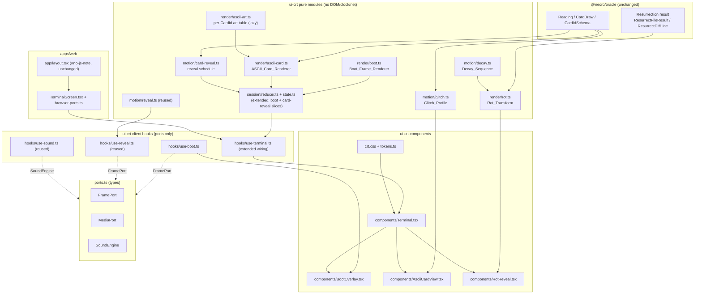

# Design Document

## Overview

Visual Necromancy is a presentation layer bolted onto the existing CRT terminal
(`@necro/ui-crt`, spec 03-crt-terminal) and resurrection engine. It adds a retro
boot sequence, framed ASCII tarot cards with a bespoke illustration per card, a
one-by-one card reveal, severity-driven glitch effects, a code rot-and-rebirth
animation, phosphor polish, and optional sound cues — all without altering a
single decision the oracle makes. The `Reading` and the resurrection result are
rendered exactly as `@necro/oracle` and the resurrection engine produce them.

The design obeys the package's hard split, which is the spine of everything
below:

- **Pure renderers** (`src/render/*.ts`) map data to the `OutputBlock` /
  `OutputLine` / `Segment` model. They touch no DOM, clock, network, or storage.
  Visual Necromancy adds `boot.ts`, `ascii-card.ts`, `ascii-art.ts`, and
  `rot.ts` here.
- **Pure motion math** (`src/motion/*.ts`) — `resolveMotionMode`, `reveal.ts`.
  Visual Necromancy adds `glitch.ts`, `card-reveal.ts`, and `decay.ts`.
- **Port-driven client hooks** (`src/hooks/*.ts`, `"use client"`) are the only
  side-effecting layer. They schedule frames through `FramePort`, read motion
  through `MediaPort`, and drive sound through the lazy `SoundEngine`. Visual
  Necromancy adds `use-boot.ts` and extends `useTerminal` wiring.
- **The pure session reducer** (`step`, `SessionState`) is extended with a boot
  slice and a card-reveal slice; new `Action`s drive them; the existing reveal
  machinery is reused unchanged for the typewriter.
- **One stylesheet** (`src/crt.css`) mirrors `src/tokens.ts`. Visual Necromancy
  adds glitch / flip / rot keyframes and new tokens — no new palette values
  beyond those the tarot-ux rule already allows.

Everything crosses package boundaries only through `src/index.ts`. New pure
modules are barrelled; hooks stay client-only. `ui-crt` imports no adapters, so
the pure modules remain testable with fast-check and the fake ports.

The guiding invariant: **the Visual_Layer is additive and reversible.** In
reduced motion, under the Playwright test signal, or if any animation cannot
run, the terminal renders exactly the final state spec 03-crt-terminal already
produces. The drama is a layer over that state, never a replacement for it.

## Architecture

### Where the new modules live



### Control flow for the three animations

```mermaid
sequenceDiagram
  participant App as apps/web page
  participant UT as useTerminal
  participant R as reducer (pure)
  participant UB as useBoot (FramePort)
  participant UR as useReveal (FramePort)
  participant V as view + CSS

  App->>UT: boot action (motion, sound, prefersReduced, bootSignal)
  UT->>R: step(boot)
  alt motionMode=full AND not bootSignal AND boot not seen
    R-->>UT: bootPhase="playing"
    UB->>UT: frame ticks -> boot.tick actions
    UT->>R: boot.tick (advance step index)
    note over R: Boot_Frame_Renderer(stepIndex) -> Boot_Frame
    R-->>V: overlay frames; boot phrase already first Output_Block
  else reduced OR test signal OR already seen OR engine failed
    R-->>UT: bootPhase="done" (no frames requested)
    R-->>V: ready prompt + boot phrase immediately
  end

  App->>UT: read resolves -> api.read
  UT->>R: step(api.read)
  note over R: renderReading -> blocks; cardReveal schedule seeds reveal queue
  alt motionMode=full
    UR->>UT: frame ticks -> reveal.tick
    UT->>R: reveal.tick (advance revealed chars per position in order)
    R-->>V: Card_Back -> flip -> ASCII_Card -> typewriter diagnosis
  else reduced
    R-->>V: all cards face-up, full text, one render
  end
```

### Design decisions

- **D1 — Additive overlays, not a rewrite.** The boot plays as an overlay on top
  of the already-mounted terminal; the ASCII card and rot animations wrap the
  existing `renderReading` / `renderResurrectVitality` output. The final DOM text
  is byte-for-byte what spec 03 produces, so every existing test stays valid and
  the Live_Region receives exactly the same text.
- **D2 — Purity preserved.** All new maths (boot frames, ASCII frames, glitch
  params, rot, schedules) are pure functions seeded by explicit arguments. The
  only side effects are the `FramePort` schedulers in `use-boot` and the reused
  `use-reveal`, plus CSS. This keeps the whole feature fast-check-testable.
- **D3 — Motion gate is the single switch.** Every animation checks
  `state.motionMode === "full"`. In `reduced` the hooks request no frames (as
  `useReveal` already does, R16.9) and the renderers emit the final state. The
  `motion` command flips `motionMode` through the existing reducer, so switching
  live updates every effect (R12.4).
- **D4 — One test signal, named `bootSignal`.** `apps/web` reads a `?boot=skip`
  query flag (and the Playwright runner sets it) into a `bootSignal: boolean` on
  the `boot` action. When true, the reducer starts `bootPhase: "done"` and the
  boot phrase is the first Output_Block immediately — `boot.e2e.ts` stays green
  with no added delay. Demo mode **without** `?boot=skip` still plays the full
  boot deterministically (R12.5).

## Components and Interfaces

### 1. Boot sequence

**`src/render/boot.ts` — Boot_Frame_Renderer (pure).**

```ts
/** The fixed number of animated boot steps (indices 0..BOOT_STEP_COUNT-1). */
export const BOOT_STEP_COUNT: number;

/** The ready-prompt frame is the final step; any index >= it returns it. */
export interface BootFrame {
  readonly lines: readonly OutputLine[]; // <= 72 cols each, selectable text
}

/** Map a step index to a Boot_Frame. No clock/network/DOM/unseeded randomness. */
export function bootFrame(stepIndex: number): BootFrame;

/** The decorative ASCII logo lines + its accessible text equivalent. */
export const BOOT_LOGO_TEXT_EQUIVALENT = "NECROMANTIC SYSTEMS 1986";
```

The frames progress through: a memory-check readout (`MEMORY 0640K … OK`, dry
Oracle_Voice, one line per step), the `NECROMANTIC SYSTEMS 1986` ASCII logo, and
a phosphor warm-up indication, ending at a ready frame. All lines ≤ 72 columns
(matches `wrapText`'s `LINE_WIDTH`). Any index ≥ the last step returns the ready
frame (R2.4), so the hook can never index out of range.

**Timing.** The boot runs in ≤ 3.5 s (R1.1). `use-boot` advances the step index
on `FramePort` ticks using a fixed per-step duration `BOOT_STEP_MS` computed so
`BOOT_STEP_COUNT * BOOT_STEP_MS ≤ 3500`. The schedule is a pure function of
elapsed time:

```ts
// src/motion/boot-schedule.ts (pure)
export const BOOT_TOTAL_MS = 3400;
export function bootStepAt(elapsedMs: number): number; // 0..BOOT_STEP_COUNT-1, clamped
```

**`src/hooks/use-boot.ts` (client).** Mirrors `use-reveal`: it requests frames
through `FramePort` **only while** `motionMode === "full"` && `bootPhase ===
"playing"`. Each tick dispatches `{ type: "boot.tick", nowMs }`; the reducer
advances the displayed step and, when `bootStepAt(elapsed)` reaches the last
step, transitions `bootPhase` to `"done"`. No frame is requested in reduced
motion, after the test signal, or once boot is done (R1.5, R1.6, R16.9).

**Skip.** Any non-modifier key or control activation while playing dispatches
`{ type: "boot.skip" }`, which sets `bootPhase: "done"` and focuses the
Command_Line (R1.3). The root key listener filters out lone Shift/Control/Alt/
Meta. A persistent visible hint — `Press any key to skip the awakening.` — is
rendered in the overlay while playing (R1.4).

**Coexistence with the no-JS note and `boot.e2e.ts` (R1.2, R1.9, R10.4, R10.7,
R12.5).** This is the delicate part and is spelled out exactly:

- The boot phrase `BOOT_PHRASE` is **always** appended as the first
  Output_Block in the log by the reducer's `boot` action, independent of
  `bootPhase`. The boot animation is a visual **overlay** (`BootOverlay`) drawn
  over the already-mounted `main.crt`; it does not gate, delay, or replace the
  log. So the boot phrase text is present for Playwright `toContainText` from the
  first commit.
- `Terminal.tsx` keeps setting `document.documentElement.dataset.js = "ready"`
  in its mount effect **unconditionally and immediately**, exactly as today. The
  boot overlay never touches, moves, re-parents, or hides `#no-js-note`, and
  never defers the `data-js` write. The CSS rule
  `html[data-js="ready"] .crt-no-js { display:none }` hides the note the moment
  the client mounts, regardless of boot state (R10.4).
- Under `bootSignal` (reduced motion, `?boot=skip`, or the Playwright env
  signal), `bootPhase` starts `"done"`, so no overlay renders and no frames are
  scheduled — the existing `boot.e2e.ts` "boot" and "no JavaScript (R1.5)" specs
  see the identical ready state with no delay (R1.9, R12.5, R10.7).
- The ASCII logo region is `aria-hidden="true"` with a sibling
  `crt-sr-only` span carrying `BOOT_LOGO_TEXT_EQUIVALENT` (R1.8, R10.2).

**`src/components/BootOverlay.tsx` (client, presentational).** Renders the
current `BootFrame` as selectable DOM text (never canvas, R1.7) positioned over
the screen, plus the skip hint and the aria-hidden-logo / sr-only-equivalent
pair. It renders nothing when `bootPhase !== "playing"`.

### 2. ASCII tarot cards

**`src/render/ascii-card.ts` — ASCII_Card_Renderer (pure).**

```ts
/** Fixed outer frame size shared by every card in both orientations. */
export const CARD_COLS = 24; // outer columns incl. border
export const CARD_ROWS = 13; // outer rows incl. border

export interface AsciiCard {
  readonly cardId: CardId;
  readonly orientation: Orientation; // 'upright' | 'reversed'
  /** The framed glyph rows: exactly CARD_ROWS rows, each exactly CARD_COLS. */
  readonly rows: readonly string[];
  /** Accessible text equivalent, e.g. "XVI THE TOWER, upright". */
  readonly accessibleText: string;
}

/** Throws NecroError('CARD_UNKNOWN') for any id not in the Deck_Card_Set. */
export function asciiCard(cardId: CardId, orientation: Orientation): AsciiCard;
```

The frame is a box-drawing border (`┌ ─ ┐ │ └ ┘`) enclosing, top to bottom: the
roman numeral row, the uppercase card name row(s), a 12-card-specific
illustration block, and a thin divider. Every card — upright and reversed —
produces exactly `CARD_ROWS × CARD_COLS` glyphs (R3.3, R3.12). Names, numerals,
and verdict words are uppercase; no emoji (R3.5). `getCard(cardId)` from
`@necro/oracle/client` supplies the numeral and name; an unknown id makes
`getCard` / the schema guard fail, which the renderer re-raises as a typed
`NecroError` with `code: "CARD_UNKNOWN"` and an Oracle_Voice `userMessage`
(R3.10).

The renderer itself always emits the frame in normal reading order. **Reversed
orientation is a CSS 180° rotation applied to the frame by `AsciiCardView`,
while a counter-rotated text overlay keeps the numeral, name, and subtitle
upright** (R3.4) — exactly the existing tarot-ux "reversed rotates 180°, subtitle
stays upright" rule. The renderer stays pure ASCII; the visual flip is
presentation. To keep the reversed render *recognisably distinct* at the data
level too (R3.12), the renderer marks the card's orientation in
`accessibleText` and in a `data-orientation` attribute the view reads, and the
illustration table may provide an orientation-specific variant.

**`src/render/ascii-art.ts` — per-CardId illustration table (pure, lazy).**

```ts
export interface CardArt {
  readonly upright: readonly string[];   // illustration rows, fixed inner size
  readonly reversed?: readonly string[]; // optional distinct reversed variant
}
export const GENERIC_ART: CardArt;                 // fallback (R3.11)
export const CARD_ART: Readonly<Record<CardId, CardArt>>;
```

Bespoke motifs for the 12 registered CardIds (R3.11), each sized to the frame's
inner illustration block:

| CardId | Motif |
| --- | --- |
| `tower` | lightning-struck tower, cracked crown |
| `death` | skull and scythe |
| `devil` | horned mask and chains |
| `hermit` | raised lantern |
| `wheel` | spoked wheel |
| `judgement` | trumpet and rising figure |
| `hanged_man` | inverted suspended figure |
| `temperance` | two pouring vessels |
| `justice` | balance scales |
| `moon` | pale moon over a path |
| `star` | single eight-pointed star |
| `world` | closed laurel circle |

Any CardId lacking a bespoke entry uses `GENERIC_ART` (R3.11). The table is
imported through a dynamic `import("./ascii-art.js")` behind a small loader so it
ships in its own chunk and is not in the first terminal render (R11.4); the
renderer accepts the loaded table as an argument, keeping `ascii-card.ts` pure
and synchronous.

**`src/components/AsciiCardView.tsx` (client, presentational).** Renders an
`AsciiCard`'s `rows` inside a `<pre aria-hidden="true">` (decorative glyphs) with
a sibling `<span class="crt-sr-only">{card.accessibleText}</span>` carrying card
name + numeral + orientation (R3.7, R10.2). Applies `data-orientation` so CSS can
rotate reversed cards 180° and counter-rotate the upright text overlay. Selectable
DOM text, never canvas (R3.6).

### 3. One-by-one card reveal

**`src/motion/card-reveal.ts` — reveal schedule (pure).**

```ts
export interface CardRevealStep {
  readonly positionIndex: number; // spread order
  readonly flipStartMs: number;   // when this card's flip begins
  readonly flipDoneMs: number;    // when the flip finishes; typewriter starts
}
/** Per-position offsets: cards flip in order, each flip + diagnosis before next. */
export function cardRevealSchedule(
  positions: readonly { diagnosisLength: number }[],
): readonly CardRevealStep[];
```

The schedule flips card *n* only after card *n−1*'s flip plus its full
typewriter reveal (computed from `revealDurationMs(diagnosisLength, "full")`)
complete (R4.1). This is the existing reveal model extended: the session reducer
already tracks a reveal `queue` and `startedAtMs`; the card-reveal slice records
which positions are flipped and which is currently typing. `useReveal` continues
to drive the typewriter via `revealedChars`; a card's diagnosis block only enters
the typewriter after its flip offset (R4.2).

The `Card_Back` is one shared frame (R4.3): `asciiCardBack()` in
`ascii-card.ts`, the same `CARD_COLS × CARD_ROWS` box filled with a repeating
sigil glyph. Before reveal, every spread position renders the identical
Card_Back (R4.1, R4.3).

- **Reduced motion (R4.4):** the reducer seeds no reveal queue for cards; the
  view renders every `AsciiCard` face-up with the full diagnosis text in one
  render — no Card_Back, no flip, no typewriter.
- **Escape (R4.5):** the existing `skip-reveal` action is extended to also mark
  every card flipped and every diagnosis fully revealed, reaching the final
  state with no further animation.
- **Order and fidelity (R4.6, R12.2):** positions render in the Reading's order
  with the Reading's labels; the view never reorders, adds, or omits a position.
  `renderReading` already emits one block per position in order; the reveal slice
  only controls *when* each becomes visible.
- **Live_Region (R4.7):** each card's diagnosis block is appended to the
  `role="log"` region exactly once, when its reveal begins — reusing the existing
  append-once log semantics, so AT announces each card a single time.
- **Empty spread (R4.8):** zero positions ⇒ no Card_Back, no ASCII_Card, no
  error (the reveal schedule returns `[]`).

### 4. Severity-driven glitch

**`src/motion/glitch.ts` — Glitch_Profile (pure).**

```ts
export interface GlitchParams {
  readonly intensity: 0 | 1 | 2 | 3; // == severity (R5.2)
  readonly offsetPx: number;         // chromatic offset magnitude
  readonly tearCount: number;        // scanline tears
  readonly corruptChars: number;     // transient corrupted glyph count
  readonly durationMs: number;       // <= 300 (R5.9)
}
/** Deterministic, finite, bounded, monotonic non-decreasing in severity. */
export function glitchProfile(severity: number): GlitchParams;
```

`glitchProfile` clamps severity to `0..3` and maps it to fixed, bounded values
(e.g. `offsetPx = severity * 2`, `tearCount = severity`, `corruptChars =
severity * 3`, `durationMs = min(300, severity * 90)`). Severity 0 yields
all-zero params (R5.3). Each field is non-decreasing in severity (R5.4). It
reads no clock/network/DOM and no unseeded randomness (R5.5, R5.6).

**Rendering (CSS + transform).** `AsciiCardView` reads `GlitchParams` and, in
`full` motion only, applies a short CSS animation:

- chromatic offset: two duplicated, absolutely-positioned glyph layers nudged
  `±offsetPx` with `text-shadow` in the dim/foreground phosphor,
- scanline tear: `tearCount` clip-path slices animated briefly,
- transient corruption: for `corruptChars` positions, a **seeded** char pick
  (Demo_Seed in demo; otherwise a per-reveal seed) swaps glyphs for a few frames
  then restores — purely visual, never altering the underlying selectable text.

**Flash_Limit math (R5.11, R7.6, R10.3).** Each glitch animation runs once per
reveal for `durationMs ≤ 300`. A flash is a luminance change; the glitch
keyframes are capped at **2 luminance changes within the ≤ 300 ms window**, i.e.
at most 2 flashes in any rolling 1 s window — below the 3-flash ceiling. The CSS
uses `animation-iteration-count: 1` (no looping), so no window can accumulate
more. This bound is asserted in the e2e via animation inspection and documented
in `crt.css`.

- **Amber tint (R5.7, R5.8, R7.2):** only `tower` and `devil` get the
  `#ffb000` tint, via a `data-burning` attribute the view sets from the CardId;
  all other cards never use amber.
- **Tower shake (R5.9):** `tower` at severity ≥ 2 in `full` motion adds a
  ≤ 300 ms shake class.
- **Reduced motion (R5.10):** no glitch at all; cards render in final steady
  state.
- **Severity never glitch-only (R5.12):** severity is always shown as the
  integer in the card header (`SEVERITY n`, already rendered by
  `cardHeaderText`) and in the diagnosis text; the glitch is purely additive.

### 5. Resurrection rot-and-rebirth

**`src/render/rot.ts` — Rot_Transform (pure).**

```ts
/** Replace existing char positions with decay glyphs. Length + lines preserved. */
export function rot(source: string, decay: number, seed: number): string;
```

- `decay` is clamped to `[0,1]` before use (R6.12).
- `decay === 0` returns `source` unchanged (R6.4).
- Corruption replaces glyphs **only at existing positions**; newlines are never
  replaced, so line count and total string length are preserved for every decay,
  including `1` (R6.5).
- The corrupted-character count is non-decreasing in `decay` (R6.6): the set of
  corrupted positions for a lower decay is a subset of the set for a higher
  decay, chosen by a seeded deterministic permutation of non-newline positions.
- Deterministic given `(source, decay, seed)` (R6.7, R6.8); the only randomness
  is the seeded permutation passed as the `seed` argument.

**`src/motion/decay.ts` — Decay_Sequence (pure).**

```ts
/** Non-decreasing amounts, first 0, last 1 (e.g. [0, .25, .5, .75, 1]). */
export function decaySequence(frameCount: number): readonly number[];
```

**`src/components/RotReveal.tsx` + rot playback.** A client hook (reusing
`FramePort` through the same pattern as `use-reveal`) steps the Decay_Sequence in
`full` motion: it renders `rot(preRitualCode, decaySequence[i], seed)` per frame
(rot up to decay 1), then reveals the revived code, and **only then** renders the
unchanged diff (`renderFileResult` / `ResurrectDiffLine`) and the Vitality_Delta
(`renderResurrectVitality`) — the diff content and vitality delta are never
altered (R6.2, R6.3). The Decay_Sequence drives frame content only; which lines
the diff adds/removes/keeps is untouched (R6.3).

- **Reduced motion (R6.9):** one synchronous render of revived code + diff +
  vitality delta, zero rot/rebirth frames.
- **Flash_Limit (R6.11):** the rot frame cadence is capped so luminance changes
  stay ≤ 2 per second (frame interval ≥ 500 ms between visible luminance shifts,
  or cross-fades that do not count as flashes); documented in `crt.css` and
  asserted in e2e.
- **Selectable text + Live_Region (R6.10):** revived code, diff, and vitality
  delta are selectable DOM text and appended to the existing `role="log"`
  region, preserving its semantics.

### 6. Determinism in Demo mode

**`Demo_Seed`.** A fixed constant exported from `src/demo/catalog.ts` (where the
Demo_Catalog already lives):

```ts
export const DEMO_SEED = 0x6e6563; // "nec"
```

In Demo mode, the glitch corruption seed and the rot seed are `DEMO_SEED`
(R9.1), so glitch params and rot outputs are reproducible across two renders of
the same Demo reading (R9.2). Boot frames, card-reveal order, and
resurrection-frame content derive solely from the Reading, the resurrection
result, and `DEMO_SEED` (R9.3). No new network access is introduced; demo stays
network-free (R9.4). The reducer reads `state.demoBundle !== null` (and the
reading's `summary.demo`) to decide whether to use `DEMO_SEED`. Under the
`bootSignal` test flag the boot is fast-forwarded, but the glitch/rot seeding
remains `DEMO_SEED`, so a demo run without the signal plays the full,
deterministic boot and animations (R12.5).

### 7. Sound cues

No new dependency: cues reuse the existing lazy `SoundEngine` / `useSound` /
`soundReducer`. New one-shot cue triggers (boot completion, card reveal, glitch,
resurrection rebirth) dispatch an existing `{ type: "sound", event }` action only
when `soundActivity(state.sound)` resolves sound to on (R8.1). The cues honour
every existing Sound_State rule: off by default (R8.4), never before the user
gesture, never autoplay (R8.3), silent while sound is off (R8.2). Sound and
motion are independent — cues may fire in reduced motion if sound is on (R8.5).
The engine stays in its own lazy chunk; cue playback is a short `engine.click()`
style call, adding no bytes to the first render.

### 8. Accessibility, no-JS, and the DOM shell

- The `OutputLog` container keeps `role="log"`, `aria-live="polite"`,
  `aria-relevant="additions"` unchanged (R10.1).
- Every decorative ASCII region (boot logo, card illustration, Card_Back, rot
  frames) is `aria-hidden="true"` with a sibling `crt-sr-only` text equivalent,
  so AT announces card name + numeral + orientation + diagnosis, never glyphs
  (R10.2, R1.8, R3.7).
- The `#no-js-note` contract is preserved exactly: `apps/web/src/app/layout.tsx`
  is **not** modified; `Terminal.tsx` keeps the immediate unconditional
  `data-js="ready"` write. Documented above under Boot coexistence (R10.4).
- Flash_Limit ≤ 3 flashes/s holds for every effect by the per-effect caps stated
  above; no flicker exceeds the existing `CRT_FLICKER_CYCLES_PER_S` budget
  (R10.3, R7.6).
- Keyboard-first contract preserved: the only new interactive affordance is the
  "any key skips boot" listener, which is keyboard-operable; no new focus trap
  (R10.6).

## Data Models

New pure types, all barrelled through `src/index.ts`:

```ts
// render/boot.ts
interface BootFrame { readonly lines: readonly OutputLine[] }

// render/ascii-card.ts
interface AsciiCard {
  readonly cardId: CardId;
  readonly orientation: Orientation;      // from voice-table
  readonly rows: readonly string[];       // CARD_ROWS × CARD_COLS
  readonly accessibleText: string;
}

// render/ascii-art.ts
interface CardArt { readonly upright: readonly string[]; readonly reversed?: readonly string[] }

// motion/glitch.ts
interface GlitchParams {
  readonly intensity: 0 | 1 | 2 | 3;
  readonly offsetPx: number;
  readonly tearCount: number;
  readonly corruptChars: number;
  readonly durationMs: number;
}

// motion/card-reveal.ts
interface CardRevealStep {
  readonly positionIndex: number;
  readonly flipStartMs: number;
  readonly flipDoneMs: number;
}
```

**SessionState extensions (pure).** Two additive slices, with no change to
`StoragePort`'s two-key restriction (boot-seen is session memory, not persisted):

```ts
interface BootState {
  readonly phase: "playing" | "done";
  readonly startedAtMs: number | null;
  readonly stepIndex: number;
  readonly seen: boolean;       // once-per-page-session (R1.5), never persisted
}

interface CardRevealState {
  readonly schedule: readonly CardRevealStep[];
  readonly flippedCount: number; // positions whose flip has completed
}
```

Added to `SessionState` as `readonly boot: BootState` and `readonly cardReveal:
CardRevealState`; `initialState()` seeds `boot: { phase:"playing",
startedAtMs:null, stepIndex:0, seen:false }` (the `boot` action downgrades to
`done` when `bootSignal` or reduced), and `cardReveal: { schedule:[],
flippedCount:0 }`.

**New Actions / Effects.** `boot.tick {nowMs}`, `boot.skip`, and a new field
`bootSignal: boolean` on the existing `boot` action. The rot playback reuses the
same `FramePort` tick pattern as reveal; no new Effect type is needed (sound
cues reuse the existing `sound` action; frame scheduling is a hook concern, not
an Effect).

**Error model.** `asciiCard` throws a typed `NecroError` with
`code: "CARD_UNKNOWN"` for an unregistered CardId (R3.10), following the
project's `NecroError { code, userMessage, cause }` convention with an
Oracle_Voice `userMessage` (`The deck holds no such card. (Unknown card id.)`).

## Correctness Properties

*A property is a characteristic or behavior that should hold true across all
valid executions of a system — essentially, a formal statement about what the
system should do. Properties serve as the bridge between human-readable
specifications and machine-verifiable correctness guarantees.*

The prework classified each testable criterion. The glitch, rot, ASCII-card, and
boot renderers are pure functions over large input spaces (severities, card ids,
orientations, source strings, decay values, seeds) with clear invariants —
precisely where property-based testing with fast-check pays off. UI wiring,
palette, aria wiring, bundle size, and Flash_Limit timing are verified by
component/e2e/snapshot tests instead (see Testing Strategy).

### Property 1: Boot frame determinism

*For any* boot step index, calling `bootFrame` twice with that index returns an
equal Boot_Frame, and every line is at most 72 columns.

**Validates: Requirements 2.2, 2.3**

### Property 2: Boot index total and saturating

*For any* integer step index (including negative and beyond the last step),
`bootFrame` returns a Boot_Frame without throwing, and any index at or beyond
the last step returns the ready frame.

**Validates: Requirements 2.4**

### Property 3: ASCII card determinism

*For any* registered CardId and orientation, calling `asciiCard` twice returns an
equal AsciiCard.

**Validates: Requirements 3.9**

### Property 4: ASCII card frame-size invariance

*For any* registered CardId in either orientation, the rendered AsciiCard has
exactly `CARD_ROWS` rows and every row is exactly `CARD_COLS` columns wide, so
all 12 cards share one outer frame size.

**Validates: Requirements 3.3, 3.12**

### Property 5: ASCII card set is complete and closed

*For any* member of the Deck_Card_Set, `asciiCard` produces a card, and *for any*
identifier that is not a member of the Deck_Card_Set, `asciiCard` throws a typed
`NecroError` rather than rendering a partial or blank card.

**Validates: Requirements 3.2, 3.10**

### Property 6: Glitch profile determinism and severity mapping

*For any* severity in 0..3, `glitchProfile` returns equal, finite, bounded
params across two calls, with `intensity === severity`.

**Validates: Requirements 5.2, 5.6**

### Property 7: Glitch monotonicity and severity-0 emptiness

*For any* pair of severities where one is greater than the other, every
`glitchProfile` parameter of the higher severity is greater than or equal to the
lower; and *for* severity 0 every parameter is zero (no offset, no tear, no
corruption).

**Validates: Requirements 5.3, 5.4**

### Property 8: Rot preserves length and line count

*For any* source string, any decay in [0,1], and any seed, `rot` returns a string
with the same total length and the same number of lines as the source, corrupting
only existing non-newline positions.

**Validates: Requirements 6.5**

### Property 9: Rot determinism and decay-0 identity

*For any* source, decay, and seed, two `rot` calls return equal strings; and *for*
decay 0, `rot` returns the source unchanged.

**Validates: Requirements 6.4, 6.8**

### Property 10: Rot corruption count is monotonic in decay

*For any* source, any seed, and any pair of decays where one is greater, the
number of corrupted characters at the higher decay is greater than or equal to
the number at the lower decay.

**Validates: Requirements 6.6**

### Property 11: Rot clamps out-of-range decay

*For any* source, any seed, and any decay below 0 or above 1, `rot` behaves as it
does for the nearest value in [0,1] (decay ≤ 0 equals the identity of decay 0;
decay ≥ 1 equals the result at decay 1).

**Validates: Requirements 6.12**

### Property 12: Demo reproducibility given Demo_Seed

*For any* Demo reading and resurrection result, deriving glitch params and rot
outputs with `DEMO_SEED` twice produces the same sequence of glitch parameters
and the same rot outputs.

**Validates: Requirements 9.2**

### Property 13: Reveal schedule preserves spread order and shape

*For any* list of spread positions, `cardRevealSchedule` returns one step per
position in input order (`positionIndex` strictly increasing by 1 from 0), with
non-decreasing flip offsets, and returns `[]` for an empty spread.

**Validates: Requirements 4.1, 4.6, 4.8**

## Error Handling

- **Unknown CardId** — `asciiCard` throws `NecroError('CARD_UNKNOWN')` (R3.10);
  the reading path only ever passes registered CardIds from `CardIdSchema`, so
  this is a defensive guard surfaced in Oracle_Voice, never reached in normal
  flow.
- **Boot cannot animate** — if `FramePort` is unavailable or the overlay cannot
  mount, `bootPhase` is forced to `"done"`: the ready prompt and boot phrase are
  already the first Output_Block and focus moves to the Command_Line, so the
  terminal always reaches the ready state (R1.9).
- **Reduced motion / test signal** — treated as a normal path, not an error:
  renderers emit the final state and hooks request no frames (R1.6, R4.4, R5.10,
  R6.9).
- **Sound engine failure** — unchanged from spec 03: `useSound`'s
  `onEngineFailure` forces sound off and shows the in-world notice once; new cues
  simply never fire. No cue path throws.
- **Out-of-range inputs** — `rot` clamps decay (R6.12); `glitchProfile` clamps
  severity; `bootFrame` saturates on out-of-range indices (R2.4) — none throw.

## Testing Strategy

**Dual approach.** Pure modules get fast-check property tests (universal
invariants) plus a few example unit tests (specific frames, specific motifs).
Wiring, palette, aria, bundle, and timing get component / e2e / snapshot tests.

**Property tests (`*.pbt.test.ts`, min 100 iterations, named with requirement
IDs), one per correctness property above.** Library: `fast-check`, already in the
stack. Each test tags its property, e.g.:

```ts
// Feature: visual-necromancy, Property 8: rot preserves length and line count
describe("P8 (R6.5): rot preserves length and line count", () => { /* fc.assert */ });
```

- `render/boot.pbt.test.ts` — Properties 1, 2.
- `render/ascii-card.pbt.test.ts` — Properties 3, 4, 5 (generator draws from
  `CardIdSchema` members and from arbitrary non-member strings).
- `motion/glitch.pbt.test.ts` — Properties 6, 7.
- `render/rot.pbt.test.ts` — Properties 8, 9, 10, 11 (always include the
  round-trip/identity case for decay 0 and the clamp cases).
- `demo/visual-demo.pbt.test.ts` — Property 12 (seeded reproducibility).
- `motion/card-reveal.pbt.test.ts` — Property 13.

**Example unit tests (`*.test.ts`).** Specific boot frame contents and the
72-column bound on the real logo; each of the 12 bespoke motifs renders a
non-generic illustration and reversed differs from upright; `asciiCard` throws
with the right code; `glitchProfile(0)` is all zeros and `glitchProfile(3)` has
`durationMs ≤ 300`; `decaySequence` first 0 / last 1 / non-decreasing.

**Component tests (fake ports, manual clock).** Mount `Terminal` (or focused
`BootOverlay` / `AsciiCardView` / `RotReveal`) with `FakeFramePort`,
`FakeMediaPort`, and the fake sound loader:

- Boot plays only in `full` motion and requests no frames in `reduced` or under
  `bootSignal`; the boot phrase is the first Output_Block in all cases; any
  non-modifier key dispatches `boot.skip`; `data-js="ready"` is set immediately.
- Card reveal flips in order, one at a time, typewriters each diagnosis, and in
  reduced motion renders all cards face-up in one render; Escape completes all;
  Live_Region receives each card's text once; empty spread renders nothing.
- Glitch class/attributes reflect `glitchProfile`; amber only on tower/devil;
  tower shake only at severity ≥ 2 in full motion; none in reduced.
- Rot plays frames then renders the unchanged diff + vitality delta; reduced
  motion renders once with no rot frames.

**End-to-end (`apps/web/e2e/visual-necromancy.e2e.ts`, Playwright + axe).**

- In full motion (no `?boot=skip`), the boot overlay appears and resolves to the
  ready prompt within budget; a demo reading reveals cards one-by-one, severe
  cards glitch, and a resurrection plays rot-then-rebirth.
- With `?boot=skip` (and the Playwright env signal) and/or reduced motion, all
  animations are skipped to their final state instantly.
- `axe` finds no new violations on the boot, cards, reveal, glitch, and
  resurrection states (R10.5).
- Assert animation Flash_Limit: inspect that glitch/rot animations use
  `iteration-count: 1` and durations within the documented caps.

**Regression (R12.3).** The existing `boot.e2e.ts` "boot" and
"no JavaScript (R1.5)" specs and all current unit/property/e2e suites must stay
green; the `bootSignal` path and the unchanged `layout.tsx` guarantee this.

## Performance and Bundle Budget

The Visual_Layer is CSS + small pure TypeScript only; no new heavy runtime
dependency (R11.3). The per-CardId ASCII art table (`ascii-art.ts`) and the
sound engine (already lazy) load in their own chunks via dynamic `import`, so
they are outside the first terminal render (R11.4). The pure renderers and motion
maths are a few KB of plain functions; the glitch/flip/rot effects are CSS
keyframes in the single existing `crt.css`. The terminal route therefore stays
within the inherited **250 KB gzipped Bundle_Budget** (R11.1); the budget is not
raised (R11.2). The CI already enforces the budget on the terminal route — the
e2e/bundle check gates any regression.

## Requirements Coverage

| Requirement | Covered by |
| --- | --- |
| R1 Boot sequence | `render/boot.ts`, `motion/boot-schedule.ts`, `hooks/use-boot.ts`, `BootOverlay`; overlay + immediate boot phrase + unchanged `data-js` write (D1, D4) |
| R2 Deterministic boot frames | `render/boot.ts` purity; Properties 1–2 |
| R3 Framed ASCII cards | `render/ascii-card.ts`, `render/ascii-art.ts`, `AsciiCardView`; CSS 180° reversed; Properties 3–5 |
| R4 One-by-one reveal | `motion/card-reveal.ts`, reducer card-reveal slice, reused `useReveal`; Property 13 |
| R5 Severity glitch | `motion/glitch.ts`, glitch CSS; Properties 6–7; amber/shake/Flash_Limit stated |
| R6 Rot-and-rebirth | `render/rot.ts`, `motion/decay.ts`, `RotReveal`; Properties 8–11 |
| R7 Phosphor polish & palette | `tokens.ts` + `crt.css` (no new palette); reduced-motion disables glow/flicker |
| R8 Sound cues | reused `useSound` / `soundReducer`; off-by-default, gesture-gated |
| R9 Demo determinism | `DEMO_SEED`; glitch + rot seeded in demo; Property 12 |
| R10 Accessibility & no-JS | aria-hidden + sr-only equivalents; unchanged `#no-js-note` + Live_Region; axe e2e |
| R11 Bundle & deps | CSS + small TS, lazy art/sound chunks; 250 KB budget held |
| R12 Regression safety | overlay/additive design, `bootSignal`, unchanged `layout.tsx`; all suites green |
| R13 Optional polish | hum/bloom/vitality-count gated behind full motion + Sound_State; dropped if they break budget/Flash_Limit/axe |
